:::caution[Unreleased]
`@reatom/opentelemetry` and its optional entries are not published to npm. Use `"@reatom/opentelemetry": "workspace:*"` in this monorepo and one shared `@reatom/core` dependency. The APIs below describe the current working tree.
:::

_Follow application actions and state changes from the browser to your backend, then inspect the same records locally._

This guide shows how to connect Reatom activity to OpenTelemetry, add consented page/session analytics, and attach optional network, console, Web Vitals and performance collectors. It includes eighteen scenarios for routing, widgets, consent, SSR, offline behavior and debugging.

The right-hand table of contents lists every section. Jump to [Part 10](#10-scenarios) for the worked scenarios, [Part 12](#12-browser-diagnostics-and-backend-integrations) for optional integrations, or the package's [API reference](../../../../../packages/opentelemetry/API.md) for every option and member.

## 1. Follow an application operation

### Connect actions, updates and requests

A checkout can involve a route loader, several state changes and a failed request. Recording their shared trace and Reatom cause ids lets you move from a visible error to the action and state that caused it. Canonical safe records stay available for local inspection; an optional exporter encodes them for your collector. The SDK itself is a native atom, with optional features added through `.extend(with...)`.

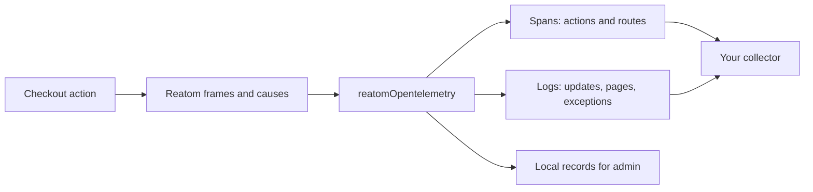

_Figure 1. Application activity shares a trace and cause graph._

### What Reatom already knows

[Reatom](#15-glossary) tracks which [action](#15-glossary) caused which update, because reactivity needs it. Each call runs in a _[frame](#15-glossary)_; frames know their causes; _variables_ travel with frames, also across `await` when the code uses [`wrap`](#15-glossary).

The tracer reads frames and one variable per instance ([`traceVar`](#15-glossary)). The root package does not patch `fetch`, `history` or `setTimeout`. Explicit optional network and console connectors install their own page-wide wrappers; [Part 12](#12-browser-diagnostics-and-backend-integrations) describes their scope.

The same pipeline supports an OTLP backend, page/session analytics and an in-page debugger. It uses Reatom context; it is not a general OpenTelemetry SDK provider for unrelated instrumentation.

Route boundaries and linked continuation traces keep individual traces bounded ([Part 4](#4-from-frames-to-otlp)). Choose filters and sampling for your traffic, and keep high-cardinality ids out of index labels ([Part 14](#14-launch-checklist)).

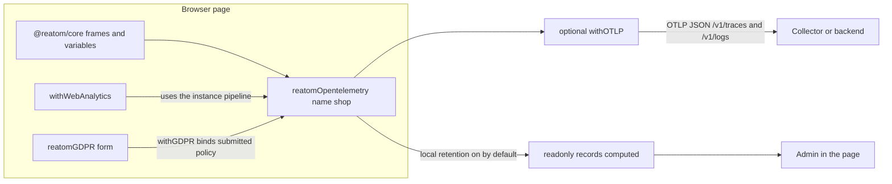

_Figure 2. One instance feeds the collector, analytics and admin with the same records._

### Choose collection explicitly

Core tracing, analytics, consent forms and browser diagnostics have separate entry points. Importing the root does not pull in the browser collectors or `web-vitals`. Each extension factory must be applied through native `.extend`; calling the factory alone is inert. Applied features follow their parent instance's disposal. You can use OTLP, a self-hosted Faro receiver, or your own transport.

There is no hosted service in this package. See [Part 13](#13-limits-and-sharp-edges) for current boundaries, and the [README](../../../../../packages/opentelemetry/README.md#bundle-cost) for dated bundle measurements and their method.

## 2. Reatom in five minutes, for everyone else

### Atoms, computeds, actions

An _[atom](#15-glossary)_ is a named piece of state (`atom([], 'cart.lines')`); read it by calling it, write with `.set`.

A _[computed](#15-glossary)_ derives from atoms and recomputes lazily.

An _action_ is a named function call that may write atoms; Reatom records each call.

Names are written once, at the definition. They become span and record names, so renaming a traced action is a public-API change for analysts and support.

We will reuse this cart throughout the article.

```ts title="cart.ts"
import { action, atom } from '@reatom/core'

import type { Product } from './routes'

export type CartLine = { productId: string; price: number; quantity: number }

export const cartLines = atom<CartLine[]>([], 'cart.lines')

export const addToCart = action((product: Product) => {
  cartLines.set((lines) => [
    ...lines,
    { productId: product.id, price: product.price, quantity: 1 },
  ])
}, 'cart.add')
```

### Frames, causes and wrap

Every call runs in a frame. A frame remembers the frame that caused it, which is how `cart.add` knows it caused the `cart.lines` update.

JavaScript loses the current frame at `await` and in callbacks handed to the platform. `wrap(promise)` and `wrap(callback)` carry the frame across. This was required for Reatom debugging long before OpenTelemetry.

The tracer keeps its context in a frame variable, so whatever `wrap` preserves, the trace preserves. No `withContext` calls after `await`.

```ts title="wrap.ts"
import { action, wrap } from '@reatom/core'

const notifySaved = action(() => 'saved', 'drafts.notifySaved')

export const saveDraftBroken = action(() => {
  setTimeout(() => notifySaved(), 300)
}, 'drafts.saveBroken')

export const saveDraft = action(() => {
  setTimeout(
    wrap(() => notifySaved()),
    300,
  )
}, 'drafts.save')
```

In `saveDraftBroken`, the timer callback runs outside any frame, so `drafts.notifySaved` starts its own trace. In `saveDraft`, `wrap` keeps it a child of `drafts.save`.

### The integration boundary

Automation covers most code, not all. Code without `wrap` between two Reatom actions — a third-party library callback, a bare `setTimeout`, a plain promise chain — breaks the end-to-end trace.

In dev, `warnContextLoss` warns once per target when a call starts a fallback trace from outside any frame while another trace is active in the same task: the usual sign of a missing `wrap`. It does not catch every case, for example a callback in a later task.

Name application models and preserve context with `wrap` at async boundaries. Automatic collection does not repair context lost in unrelated callbacks.

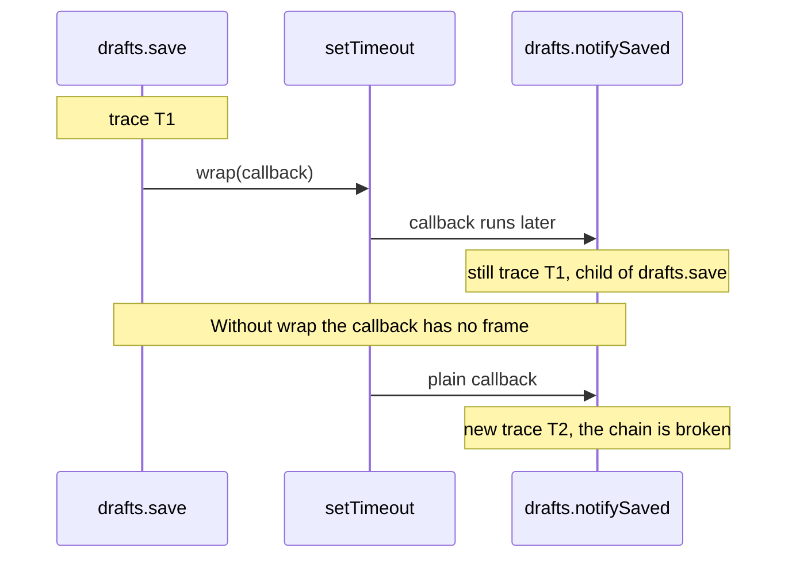

_Figure 3. With wrap the timer callback stays in the trace; without it a new trace starts._

## 3. One instance per name

### setup.ts

There is no default instance. You create one in `setup.ts` and import that file before any atom or action is defined, because targets created earlier are not instrumented retroactively.

```ts title="setup.ts"
import { withOTLP } from '@reatom/opentelemetry/otlp'
import { reatomOpentelemetry } from '@reatom/opentelemetry'
import { withGDPR } from '@reatom/opentelemetry/gdpr'

export const otel = reatomOpentelemetry({
  name: 'shop',
  serviceName: 'shop-web',
  serviceVersion: '1.4.0',
  environment: 'production',
  filter: (target) => !target.name.startsWith('analytics.'),
}).extend(
  withGDPR({ name: 'consent', categories: { analytics: false } }),
  withOTLP({
    endpoint: 'https://shop.example/otel',
  }),
)
```

Import order is the whole trick: setup first.

```ts title="main.ts"
import './setup'
import './analytics'

import { wrap } from '@reatom/core'
import { addToCart } from './cart'
import { checkout } from './checkout'
import { goodsRoute } from './routes'

goodsRoute.go({ id: '42' })

document.querySelector('#add')?.addEventListener(
  'click',
  wrap(() => {
    const product = goodsRoute.loader.data()
    if (product) addToCart(product)
  }),
)

document.querySelector('#checkout')?.addEventListener(
  'click',
  wrap(() => {
    checkout().catch(() => {})
  }),
)
```

`name` identifies the instance in a page-wide registry shared by all copies of the package. It namespaces the trace variable (`otel.shop.trace`), the default analytics storage key and the dev warnings. A second live instance with the same name replaces the first and warns once in dev, naming both creation sites; re-creating after `dispose()` is silent.

`serviceName` becomes `service.name`; `serviceVersion` and `environment` become `service.version` and `deployment.environment.name`. A random `service.instance.id` is generated per instance. In Chromium, low-entropy client hints add `browser.*`; `user_agent.original` is never sent.

### Local records and optional OTLP

The root is local-only by default: `reatomOpentelemetry({ name, serviceName })` needs no endpoint or exporter. Its readonly `records` computed exposes canonical safe records with plain attribute maps, millisecond times, string kinds/statuses and owned automatic value snapshots. `keepRecords` defaults true; `recordLimit` bounds retention (1000 by default), and `maxActive` bounds unfinished local operations (1000). `clearRecords()` releases retained records.

Apply `withOTLP({ endpoint: 'https://collector.example/otel' })` from `/otlp` to add delivery. It owns encoding, queues, retry, protocol handling and unload behavior. It appends `/v1/traces` and `/v1/logs`; empty/relative URLs throw. `endpoint: null` requires a nonempty custom transport list, such as Faro; it is not local mode or a fake exporter. Attach before the operations you want exported; previously captured local history is not replayed into a new exporter.

`otel.stats()` reports local active/captured/retained/dropped counts, drop reasons and invalidParent. With the extension, `otel.otlp.stats()` separately reports queued/in-flight/exported/drop/timeout/beacon state. A locally retained record does not prove wire admission or remote receipt. Export failures stay out of application errors and have development warnings plus delivery counters.

`localValues` (false by default) keeps original JavaScript params/payload/state/errors beside retained records. They are raw live references: not copied, masked, truncated or exported. Instance capture/redaction/consent do not control this side channel. True honors target `captureValues: false`; `'all'` retains those too. It needs local retention and does not bypass target eligibility. Enable deliberately for debugging and account for retained objects.

### The global extension and filter

Creating the instance registers a global extension: every action defined afterwards becomes a span. Atom and computed updates become log records through a second global extension.

`filter(target)` selects which automatic targets are recorded. `skipGlobalExtension: true` turns off both automatic action spans and automatic atom/computed update logs. Explicit `withOTel()` still records either way.

The constructor input `extend(target, withOTel)` adds per-target options automatically (distinct from native `otel.extend(...)`), for example `kind: 'client'` for everything named `api.*`.

Per-target [`withOTel`](#15-glossary) applies `name`, `kind`, `importance`, route `boundary`, `attributes`, `captureValues`, `serialize` and `enabled`. `enabled: false` turns tracing off for that target. `attributes` are written onto the span or update log; a function of `{ params, payload, state, prevState, error }` runs at completion. A thrown callback leaves `reatom.attributes_error`. `span: true` suppresses reactive update logs; it does not supply component profiling. `captureValues: false` records the span without params, payload, atom or computed bodies, or `LOG` payloads, including strings and numbers. A per-target `serialize(value, key)` replaces the instance transform for that target and can enable capture when instance capture is off; diagnostics denial still wins.

Names starting with `analytics.` or `otel.` are excluded from automatic observation, so a shared instance does not show the analytics layer's own atoms as app activity. `filter` is for the rest, such as a `vendor.` namespace. Explicit `withOTel()` on one of those names still records.

### The SDK is a settings atom

`otel()` reads capture settings; `otel.set(current => ({ ...current, captureValues: false }))` updates them. It is a genuine atom with native `.extend`, hooks and subscriptions. Native `.name` is `otel.shop`; readonly `.instanceName` is the raw registry/storage name. Root configuration contains no endpoint/export settings.

Service/resource metadata, local recordLimit/maxActive, scope version, constructor serialize and model-extension installation are fixed at construction. Resource and recordLimit are readonly members. Filtering of future targets, value capture, retention, sampling, root policy and category/signal gates are live. The optional `.otlp` config atom holds live endpoint/headers/transports; its batching, capacity, retry, timeout, useBeacon and platform injections are fixed when applied. See the [reference](../../../../../packages/opentelemetry/API.md#delivery-and-transports).

`records`, `stats`, `disposed` are readonly computeds; log/clearRecords/flush/dispose are native actions. One SDK owns local capture and isolated-root/default aggregate record views. An optional exporter owns shared queues across the SDK's Reatom roots; views do not create independent delivery runtimes. `flush()` forwards to that exporter or resolves without export if none is attached.

Disposal is terminal and tears down capture/features and attached export. HMR disposes the old SDK and constructs a fresh one ([E13](#e13-hmr-without-duplicate-instances)).

## 4. From frames to OTLP

### Actions are spans, updates are logs

OpenTelemetry exports a span only when it ends, and a span per frame would be far too much. So the default mapping is: an action call is a span (an async action's span ends when its promise settles); an atom or computed update inside it is a log record `reatom.atom.update` / `reatom.computed.update` that carries the action span's context and the new state in the body.

When a computed recomputes because atoms changed under _different_ traces, the recompute becomes a short span on the triggering cause with one link per other trace (`reatom.link.reason = computed.dependency`).

Reatom activity records carry `reatom.frame.id` and `reatom.cause.ids`, so the Reatom cause graph can be followed from canonical records or exported OTLP. That is what admin does ([Part 11](#11-reading-the-data)).

Exceptions are log records `exception` with span context; this integration uses logs rather than span events for them.

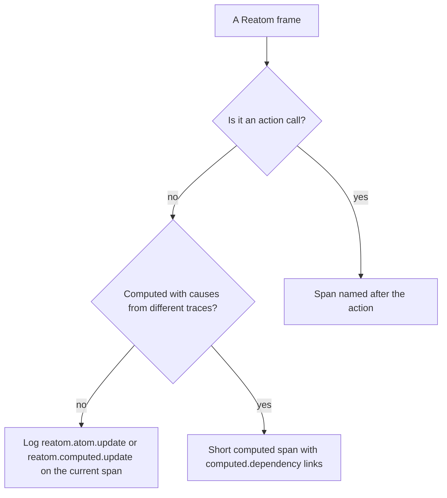

_Figure 4. Frames map to spans, update logs and, for cross-trace diamonds, short linked spans._

### Watersheds: where a trace starts

A trace is a user scenario with a beginning that depends on the user. It never "ends"; it stops receiving records. Without cuts, Reatom's chain would stretch back to the app's start.

Routes cut. When the set of matched routes changes, a new trace starts with a short root span `route <name>` (`route goods`) that lasts until the route loaders settle. Actions on that page — `cart.add`, `checkout.submit` — become children of that trace even after the root span closed (`route: 'child'`, the default).

The click that navigates belongs to the page it was clicked on: `goods#.go` sits in the previous page's trace. A form submit that navigates does not carry its trace into the new page.

Same route, new params (`/goods/1` → `/goods/2`) does not cut. Modal routes opt out with `withOTel({ boundary: false })` ([E16](#e16-a-modal-route-that-should-not-cut-the-trace)).

A top-level action with no trace and no page starts its own trace. A computed uses an existing or app-session context. A manual start is `traceVar.set(otel.createTrace(...))` ([Part 5](#5-across-the-network)).

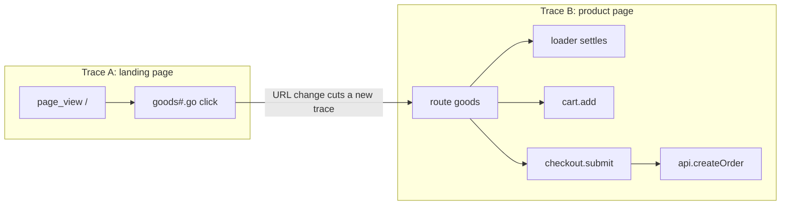

_Figure 5. Two pages, two traces; the navigation click belongs to the first._

### The app.session fallback

Records with no trace — a `LOG` call outside any action, a computed recomputed by a subscription — attach to one short span per instance per page load, `app.session`. They do not wait for a future trace; signal, consent, sampling and queue limits still apply.

Do not confuse the tracer span `app.session` with the analytics event `session.start` ([Part 8](#8-visitors-and-sessions)).

### Names, values and redaction

The span or record name is the atom or action name. Factory instances keep low cardinality: `goods#1.go` becomes `goods#.go` with `reatom.instance = "1"`; the raw name stays in `reatom.name`. Private names starting with `_` or containing `._` are normally skipped, with route-related instrumentation exceptions.

Automatic value snapshots are bounded to depth 5, 100 entries, 2048 characters per string and 8192 captured bytes. Local records retain typed safe values and automatic-value metadata; atom state stays in the update body. The optional exporter formats params/payload into OTLP text and separately checks its 16 KiB encoded-record limit. The serializer truncates long strings, limits depth and bytes, marks cycles and never calls getters.

Object keys matching `pass(word)?|secret|token|auth|cookie|session|crypto|card|cvv|iban|ssn` become `"[redacted]"` at any depth. The same words are also matched against the atom or action name, and against real parameter names when the function source still has them, so a password stored under the log key `body` or an action argument stored as `0` is redacted too. Name checks split on dots and camel case and do not treat `author` as `auth` (`issueAuthor` stays). The key regex still does, so an object key `author` is redacted. Email-like and phone-like text in a captured string becomes `[email]` and `[phone]`. A bare digit run inside an id is left alone. Analytics still scrubs its own error text ([Part 9](#9-errors-without-duplicates)).

`checkSensitiveNames(otel)` warns in dev about targets whose _names_ look sensitive while capture is on ([E18](#e18-sensitive-values-what-redaction-does-and-does-not-do)). It returns a cleanup function for teardown; it is a warning helper, not a redaction layer. A collector redaction processor can add another boundary.

Business values reach the backend through captured params/payloads and `withOTel({ attributes })` on the same span. Explicit domain and manual log attributes are caller-owned and are not automatically sensitive-key masked. A static map is copied at completion. A function receives `{ params, payload, state, prevState, error }` and its return value is merged onto the span or update log; if it throws, the record remains with `reatom.attributes_error` identifying the exception type.

### Outcomes that are not errors

Abort and Suspense are not errors: status unset, `reatom.outcome = abort` or `suspense`, `reatom.importance = low`. Filter them out of default views rather than dropping them.

When the page hides with an async action still open, its span is closed with `reatom.outcome = pending` and sent in the unload batch, inside a 60 KiB per-page budget shared by all instances ([E17](#e17-the-visitor-leaves-mid-checkout)).

`withAsync` helper actions (`checkout.submit.onReject`, `goods#.loader.onFulfill`) currently appear as their own short spans.

## 5. Across the network

### Outgoing: explicit traceparent headers

[`otel.traceparent()`](#15-glossary) returns the W3C `traceparent` string for the current span, or `undefined` outside a trace. In this manual recipe, you put it in your own headers and the root tracer does not patch `fetch`. The optional network connector can inject allowlisted headers when explicitly enabled.

Mark the networked action `withOTel({ kind: 'client' })` so backends draw it as an outgoing call. The header carries that span's id, so the server span becomes its child.

```ts title="checkout.ts"
import { action, withAsync, wrap } from '@reatom/core'

import { cartLines, type CartLine } from './cart'
import { otel } from './setup'

type Order = { orderId: string; total: number }

export const createOrder = action(async (lines: CartLine[]) => {
  const traceparent = otel.traceparent()
  const response = await wrap(
    fetch('/api/orders', {
      method: 'POST',
      headers: {
        'content-type': 'application/json',
        ...(traceparent ? { traceparent } : {}),
      },
      body: JSON.stringify({ lines }),
    }),
  )
  if (!response.ok) throw new Error(`Order failed: HTTP ${response.status}`)
  return (await wrap(response.json())) as Order
}, 'api.createOrder').extend(otel.withOTel({ kind: 'client' }))

export const checkout = action(async () => {
  const order = await wrap(createOrder(cartLines()))
  cartLines.set([])
  return order
}, 'checkout.submit').extend(withAsync())
```

CORS has two separate settings: the collector must accept the browser's origin, and your API must allow the `traceparent` request header (a cross-origin custom header triggers a preflight).

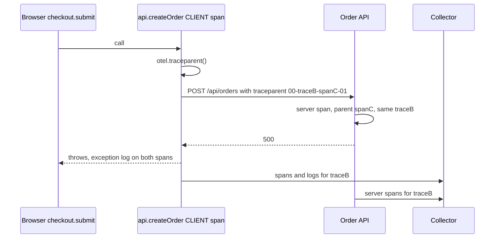

_Figure 6. The traceparent header continues the browser trace on the server._

### Incoming: parseTraceparent and traceVar

`otel.parseTraceparent(header)` accepts what header APIs return (`string | null | undefined`) and answers a context or `undefined`. Guard, then `otel.traceVar.set(remote)` inside an action; everything after it in that subtree continues the remote trace.

A malformed header increments `stats().invalidParent` and warns once in dev; a missing one is silent.

Recipes: WebSocket messages ([E11](#e11-a-websocket-push-and-a-sampled-backend)), SSR `<meta name="traceparent">` ([E8](#e8-isolation-tests-devtools-only-and-ssr)). Baggage is neither emitted nor parsed.

### Starting a trace by hand

Use `otel.traceVar.set(otel.createTrace({ name: 'send message' }))` inside the action — no wrapper, no root marker. A trace starts where there is none. [E10](#e10-starting-a-trace-by-hand-chatsendmessage) shows it.

### Sampling that respects the parent

Default head sampling keeps everything (`ratio: 1`). A lower ratio is `ParentBased(TraceIdRatioBased(ratio))`: a sampled incoming parent keeps its children; an unsampled one does not.

Sampled means `flags & 0x01`. When you propagate a header, its flag is `-01` or `-00`; the root/manual path does not send one automatically. The optional network connector propagates it only when configured.

`errors: 'always'` (default) keeps a small buffer per unsampled trace and exports it when an exception happens there.

Unsampled traces can still reach `records()` when local retention is enabled. The recommended production setup keeps error and slow traces whole and samples the rest at the collector with tail sampling; tail sampling only sees the whole trace when the browser and the backend share `traceparent`.

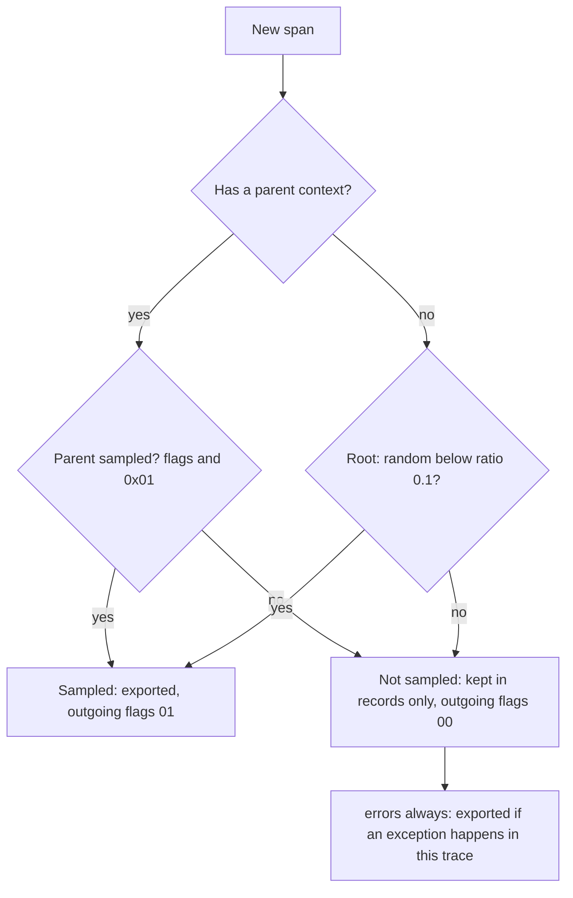

_Figure 7. ParentBased sampling with a 10% root ratio._

## 6. Analytics as a by-product

### What withWebAnalytics records today

Why a separate layer at all: not every app is on Reatom, and even in a Reatom app the tracer does not see a third-party script's error or the page lifecycle.

Apply `withWebAnalytics(options?)` through native `.extend` to add `otel.analytics`. It writes to the parent's canonical capture stream and uses optional export when attached. There is no instance-creating analytics overload or separate analytics exporter/teardown.

`otel.analytics` is a requested-enable boolean atom with readonly `visitor`, `session`, `page`, `attribution`, `focus` children and a `pageView` action. For example, `otel.analytics.session()` reads the captured analytics session. `.setFalse()` disables collection; `.setTrue()` requests it again. Requested true does not grant permission. Without an explicit source, analytics reads the effective analytics category, normally supplied by first-applied `withGDPR`.

Records it emits today:

| Record                 | Kind | Where                          | Key attributes                                                                                                             |
| ---------------------- | ---- | ------------------------------ | -------------------------------------------------------------------------------------------------------------------------- |
| `app.page_view`        | log  | page or route trace            | `url.path`, `url.full`, last-touch `app.utm.*` / `app.click_id.*`, `session.id`, `app.visitor.id`, `app.analytics.consent` |
| `session.start`        | log  | session rotation               | `session.previous_id`, `app.attribution.first.*`, `app.attribution.last.*`                                                 |
| `app.page.engagement`  | log  | hide or navigation             | `app.engagement.visible_ms`, `app.engagement.active_ms`                                                                    |
| `exception`            | log  | window error after consent     | type by default; message and stack only with `captureErrorDetails`                                                         |
| `exception.suppressed` | log  | hide / navigation / `pagehide` | `app.exception.count` for overflow                                                                                         |

All are canonical captured logs and become OTLP log records when exported with `session.id`, `app.visitor.id` (after consent) and `app.analytics.consent`.

What `app.page_view` carries: `url.path`, `url.full` without query or fragment (`captureQuery: true` records the full URL; query strings often carry personal data), last-touch `app.utm.*` / `app.click_id.*`. Title, referrer, viewport and display size are not automatically enriched. Web Vitals are collected separately with `withWebVitals`; there is no analytics `webVitals` option. General canonical spans/logs also capture consented `session.id` and query-free `page.url`/`page.path` (with legacy `url.full`/`url.path` fallback), without automatically adding visitor or login ids. Metadata is captured with each record, not read from the page at flush; pending identity is stripped on revocation.

### Page views and navigation sources

A page view is a watershed like a route. If the tracer's route root already opened a trace for this navigation, the page view joins it — one `traceId` for `route goods` and `app.page_view /goods/42`. Otherwise it starts a trace with a short root span `page_view <path>` (emitted today; the name is not yet frozen in the schema; the path is in the span name, so do not index span names as labels).

Navigation source, chosen when the feature starts: `'urlAtom'` when Reatom routes exist at that moment, else `'navigation-api'` when `window.navigation` exists, else `'popstate'`. Pass it explicitly when you know.

Analytics never reconfigures the app's router. Reading `urlAtom` turns on its link interception, so the default never picks `'urlAtom'` without Reatom routes, and an explicit `'urlAtom'` without routes warns in dev with the two settings to change. A React Router app navigates exactly as without analytics ([E4](#e4-a-react-router-app-and-foreign-pushstate)).

`autoPageViews: false` skips the initial automatic view; it does not remove navigation listeners. `pageView()` exists for the `'popstate'` fallback, where nothing else can see a foreign router's `pushState`. It reports navigation; it is not a tracking API.

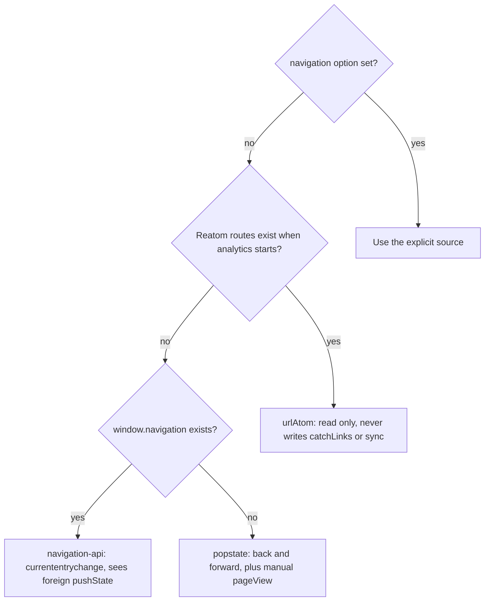

_Figure 8. How the navigation source is chosen._

### Business events are actions

There is no `trackEvent` and no `record(name)`. A purchase is an action named once, `action(..., 'app.purchase').extend(otel.withOTel())`, called where the purchase happens. It is a span on the page trace, visible to `take`, `getCalls`, tests and admin like any action.

A string-named tracking call repeats the name at every call site, where a typo silently creates a new event. A named action cannot be misspelled at the call site.

Stable names are a contract with analysts. Rename `app.purchase` like a public API.

The instance also has `otel.log(eventName, attributes)` for explicit manual facts. It obeys `signals.logs`; the caller owns category consent and privacy of these attributes. Named actions are useful when the event is also an application operation whose causes matter.

### Sampling and rate limits

Analytics is recorded at ratio 1 by default, because analytics counts things; `errorSampling` thins analytics exceptions only.

Every analytics event name is capped at 60 per page per minute and every error signature at 10, configurable through `rateLimit`. `byName` overrides a name's cap, and `0` disables that client cap. Drops are counted in `stats().droppedByReason.rateLimit`.

See the [analytics API reference](../../../../../packages/opentelemetry/API.md#web-analytics) for all options and defaults, including navigation, persistence, session timeouts, error sampling, attribution and rate limits.

## 7. Consent for analytics and diagnostics

### What the collection gates control

Analytics starts denied unless an effective analytics grant exists. Until then it neither reads/writes analytics identity in storage nor emits analytics records. Current-page engagement can accumulate in RAM and be emitted after a grant; earlier unconsented pages are discarded. Diagnostics are separate and remain available for local development/Admin when GDPR is omitted.

Apply `withGDPR` **first**, before collectors or the first capture, to establish offered-category denials before consent-form construction. Apply the extension before constructing/capturing application models. Late GDPR attachment rejects; it cannot retroactively protect captured records. A requested-on feature boolean does not override a category denial or signal switch.

Automatic value masking does not guarantee arbitrary URLs, common/domain attributes or manual text are safe. Attribute readers and manual facts require the application's privacy/category policy.

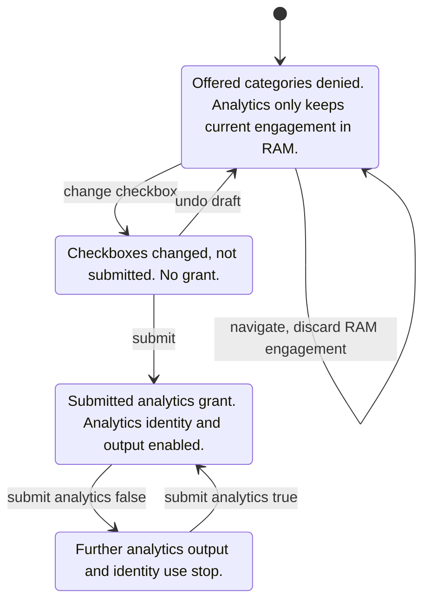

_Figure 9. Submitted category choices and requested feature enablement are distinct._

### Draft versus snapshot

No-argument `withGDPR()` creates exactly the default `reatomGDPR()` form and exposes it as `otel.gdpr`. Its categories are diagnostics, analytics and marketing, all false. Use the form fields as drafts and call `submit()` when the visitor saves. Only submitted/restored `snapshot` categories are permission.

```ts title="consent-defaults.ts"
import { withOTLP } from '@reatom/opentelemetry/otlp'
import { action, wrap } from '@reatom/core'
import { reatomOpentelemetry } from '@reatom/opentelemetry'
import { withGDPR } from '@reatom/opentelemetry/gdpr'
import { withWebAnalytics } from '@reatom/opentelemetry/web-analytics'

export const otel = reatomOpentelemetry({
  name: 'shop',
  serviceName: 'shop-web',
}).extend(
  withGDPR(),
  withOTLP({
    endpoint: 'https://shop.example/otel',
  }),
  withWebAnalytics(),
)

export const saveChoice = action(async () => {
  // In an application the form fields are edited by the visitor.
  otel.gdpr.fields.analytics.change(true)
  await wrap(otel.gdpr.submit())
}, 'consentBanner.save')
```

Before submit, both offered diagnostics and analytics are denied. This example grants analytics only; diagnostics remains false. A supplied `categories` object defines the exact schema: `withGDPR({ categories: { analytics: false } })` offers only analytics, leaving diagnostic capture unaffected. [E5](#e5-a-consent-banner-with-reatomgdpr) uses that analytics-only form.

For an existing app-owned form, use `withGDPR(sharedForm)`. The form may be shared across SDKs; disposing one SDK unbinds its policy without disposing the shared form. Standalone `reatomGDPR` takes `name`, `categories` and `persist`; it has no SDK `otel`/`instances` option. See [the complete form contract](../../../../../packages/opentelemetry/API.md#consent-form).

`withWebAnalytics()` reads effective `otel().consent.analytics` by default. An explicit `consent` option selects a separate boolean/atom/reader/category/form source. Do not redundantly pass `consent: true` with GDPR: that chooses a separate analytics source. Plain readers are reevaluated on activity; unlike atoms/forms, they may not trigger a grant immediately.

### What submit does

Submit persists the snapshot under `reatom.gdpr.<name>` (`persist: false` disables persistence; a string selects a key) and updates SDK categories. It leaves `signals` unchanged. Granted analytics starts identity/session/page records and can emit RAM engagement from the current page. Previously visited unconsented pages are discarded. Revocation stops future analytics output/identity use and strips pending session metadata; it does not automatically delete stored identifiers.

Known-user logout is separate: a `withAttributes` source returning null changes future captures, without relabeling or deleting queued history.

### Diagnostics signals

Offered `diagnostics: false` holds diagnostic spans/logs, browser diagnostics and automatic value capture. An analytics-only form does not offer diagnostics and does not deny it. Omitting GDPR leaves development diagnostics on. A submitted diagnostics grant never grants analytics.

App-owned `otel().signals.traces/logs` independently block those signals. Initialize them in capture settings or update through `otel.set(...)` and form submit does not rewrite them. Public `otel.log` and `logMeasurement` obey the logs signal, while their caller owns category checks and explicit-attribute privacy. Use the bound form to change categories; it is the effective source rather than draft checkboxes or an unrelated settings write.

## 8. Visitors and sessions

### Storage keys and lifetimes

After consent, the visitor id is a random UUID in `localStorage` under `<storageKey>.visitor`; the session under `<storageKey>.session`. `storageKey` defaults to the instance `name`, which is what isolates a widget from its host ([E3](#e3-an-embedded-widget-next-to-its-host)).

The visitor id is replaced when it is 400 days past creation; activity updates `lastSeen` without extending expiry. No cookie-based identity or fingerprinting is implemented.

### When a session rotates

30 minutes without activity (`sessionTimeout`), checked when analytics synchronizes session state. By default sessions are shared across tabs through localStorage and `storage` events.

An inbound campaign change: a new `utm_source`, `utm_medium`, `utm_campaign` or click id (`gclid`, `yclid`, `fbclid`, `msclkid`) on the document's landing page, from another origin. A same-origin referrer or an in-app link like `/?utm_source=header` does not rotate. `utm_term` or `utm_content` alone never rotate.

Optionally at local midnight (`rotateAtMidnight: true`; off by default).

Each rotation emits `session.start` with `session.previous_id`, `app.attribution.first.*` and `app.attribution.last.*`.

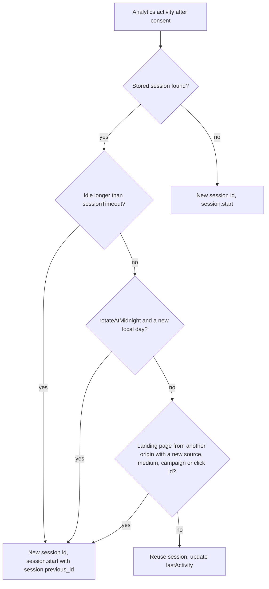

_Figure 10. When a session id rotates._

### Kiosks, tabs and memory-only visitors

`persistVisitor: false` keeps only the visitor id in memory; session storage continues. `perTab: true` keeps the session in `sessionStorage`. Storage failures degrade gracefully to memory. [E6](#e6-sessions-campaigns-and-a-kiosk).

### Login linking

Analytics' random visitor/session identifiers remain distinct from authenticated users. Bind an existing application computed with `withAttributes(source)` from `/attributes` to add user/tenant/domain data without creating another auth store. The reader returns a complete readonly attribute map or null.

Admission captures immutable bounded snapshots, including absence, so a new login cannot backfill a formerly anonymous async operation. Async logs and native HTTP inside it keep the initiating identity through `wrap`. An app can scope a complete override with `attributesVar.run(...)`. Source errors or budget failures omit the whole map and add `reatom.attributes_error`. Null after logout affects future captures, not queued history or consent. See the [complete attributes example](../../../../../packages/opentelemetry/API.md#common-attributes).

Faro maps captured `user.id`, `user.name`, `user.email`, `user.full_name`, `user.hash` and valid string-array roles to `meta.user`, grouping envelopes by that identity. There is no resource-user fallback or anonymous visitor/session-to-user conversion. The app owns login/logout and category policy.

## 9. Errors without duplicates

### Two sources

The tracer catches errors where they happen, inside actions and atoms, earlier than `window.onerror`, and attaches the Reatom cause chain the native stack lacks. A failed request's `exception` sits next to its action span; explicitly modeled params can carry the input when automatic capture is enabled. The network connector itself never captures request bodies.

The tracer captures values by default, so its `exception` carries message and stack trace. The same Error crossing two spans gives two `exception` records, one per span.

Analytics listens to `window` `error` and `unhandledrejection` — a subscription, not a patch — for errors the tracer cannot see. By default it sends the exception **type** only. `captureErrorDetails: true` adds the message and stack with emails and phones scrubbed, and only after consent.

`captureErrorDetails` governs analytics' window handlers only; it does not change what the tracer captures.

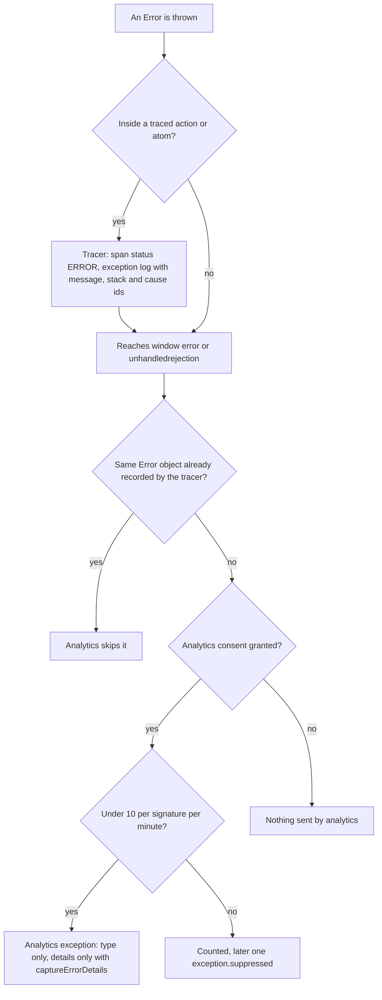

_Figure 11. An error is recorded once by whichever layer saw it first._

### Dedup and rate limits

When an Error object was already recorded by the tracer, the window handler skips it. A rejected traced action that also becomes an unhandled rejection is reported once.

Identical errors (type + message + first stack frame) are limited to 10 per page per minute; the overflow becomes one `exception.suppressed` with `app.exception.count` on hide, navigation or `pagehide`.

## 10. Scenarios

Each scenario names a team, shows the code, lists the records you should expect and one mistake people make. Related file blocks build on the setup shown in their scenario; blocks labeled as fragments require that surrounding application context. The package README provides standalone setup examples.

### E1. A shop: one trace from page view to failed checkout

**Team.** A five-person team running a Reatom storefront with Reatom routing.

**Scene.** A visitor lands on `/`, opens `/goods/42`, adds the product to the cart and checks out. The order API answers 500.

#### Code

```ts title="setup.ts"
import { withOTLP } from '@reatom/opentelemetry/otlp'
import { reatomOpentelemetry } from '@reatom/opentelemetry'
import { withGDPR } from '@reatom/opentelemetry/gdpr'

export const otel = reatomOpentelemetry({
  name: 'shop',
  serviceName: 'shop-web',
  serviceVersion: '1.4.0',
  environment: 'production',
  filter: (target) => !target.name.startsWith('analytics.'),
}).extend(
  withGDPR({ name: 'consent', categories: { analytics: false } }),
  withOTLP({
    endpoint: 'https://shop.example/otel',
  }),
)
```

```ts title="routes.ts"
import { reatomRoute, wrap } from '@reatom/core'

export type Product = { id: string; title: string; price: number }

export const goodsRoute = reatomRoute(
  {
    path: 'goods/:id',
    async loader({ id }) {
      const response = await wrap(fetch(`/api/goods/${id}`))
      return (await wrap(response.json())) as Product
    },
  },
  'goods',
)
```

```ts title="cart.ts"
import { action, atom } from '@reatom/core'

import type { Product } from './routes'

export type CartLine = { productId: string; price: number; quantity: number }

export const cartLines = atom<CartLine[]>([], 'cart.lines')

export const addToCart = action((product: Product) => {
  cartLines.set((lines) => [
    ...lines,
    { productId: product.id, price: product.price, quantity: 1 },
  ])
}, 'cart.add')
```

```ts title="checkout.ts"
import { action, withAsync, wrap } from '@reatom/core'

import { cartLines, type CartLine } from './cart'
import { otel } from './setup'

type Order = { orderId: string; total: number }

export const createOrder = action(async (lines: CartLine[]) => {
  const traceparent = otel.traceparent()
  const response = await wrap(
    fetch('/api/orders', {
      method: 'POST',
      headers: {
        'content-type': 'application/json',
        ...(traceparent ? { traceparent } : {}),
      },
      body: JSON.stringify({ lines }),
    }),
  )
  if (!response.ok) throw new Error(`Order failed: HTTP ${response.status}`)
  return (await wrap(response.json())) as Order
}, 'api.createOrder').extend(otel.withOTel({ kind: 'client' }))

export const checkout = action(async () => {
  const order = await wrap(createOrder(cartLines()))
  cartLines.set([])
  return order
}, 'checkout.submit').extend(withAsync())
```

```ts title="analytics.ts"
import { withWebAnalytics } from '@reatom/opentelemetry/web-analytics'

import { otel } from './setup'
import './routes'

export const consent = otel.gdpr
export const analytics = otel.extend(
  withWebAnalytics({ navigation: 'urlAtom' }),
).analytics
```

```ts title="main.ts"
import './setup'
import './analytics'

import { wrap } from '@reatom/core'
import { addToCart } from './cart'
import { checkout } from './checkout'
import { goodsRoute } from './routes'

goodsRoute.go({ id: '42' })

document.querySelector('#add')?.addEventListener(
  'click',
  wrap(() => {
    const product = goodsRoute.loader.data()
    if (product) addToCart(product)
  }),
)

document.querySelector('#checkout')?.addEventListener(
  'click',
  wrap(() => {
    checkout().catch(() => {})
  }),
)
```

#### What appears

Two traces. The first belongs to the landing page; the second starts at `route goods` and holds everything the visitor did on the product page, including the failed order. The illustrative exported OTLP records below shorten ids; analytics consent is assumed submitted. Local canonical records retain typed automatic values instead of OTLP wire text.

| Record                     | Kind              | Where                                         | Key attributes                                                                                                       |
| -------------------------- | ----------------- | --------------------------------------------- | -------------------------------------------------------------------------------------------------------------------- |
| `app.session`              | span              | own trace                                     | `reatom.kind = session`                                                                                              |
| `page_view /`              | span              | trace A (root)                                | landing page, no route matched                                                                                       |
| `app.page_view`            | log               | trace A                                       | `url.path = /`, `session.id`, `app.visitor.id`, `app.analytics.consent = analytics`                                  |
| `goods#.go`                | span              | trace A                                       | `reatom.name = goods#1.go`, `reatom.instance = 1`, `reatom.params = [{"id":"42"}]`                                   |
| `route goods`              | span              | trace B (root)                                | `reatom.kind = route`, ends when the loader settles                                                                  |
| `goods#.loader.onFulfill`  | span              | trace B                                       | helper span                                                                                                          |
| `app.page.engagement`      | log               | trace B                                       | engagement of the previous page; may use the current page trace                                                      |
| `app.page_view`            | log               | trace B                                       | `url.path = /goods/42`                                                                                               |
| `cart.add`                 | span              | trace B, child of `route goods`               | `reatom.params` with the product                                                                                     |
| `reatom.atom.update`       | log               | on `cart.add`                                 | `reatom.name = cart.lines`, new lines in the body, `reatom.cause.ids`                                                |
| `checkout.submit`          | span              | trace B                                       | `reatom.outcome = error`, status ERROR                                                                               |
| `api.createOrder`          | span, kind CLIENT | trace B, child of `checkout.submit`           | `reatom.params` = the cart lines, `reatom.outcome = error`                                                           |
| `exception` ×2             | log               | on `api.createOrder` and on `checkout.submit` | `exception.type = Error`, `exception.message = Order failed: HTTP 500`, `exception.stacktrace`                       |
| `checkout.submit.onReject` | span              | trace B                                       | helper span                                                                                                          |
| outgoing header            | —                 | request to `/api/orders`                      | `traceparent = 00-<trace B>-<api.createOrder span id>-01`; a server instrumented with any OTel SDK continues trace B |

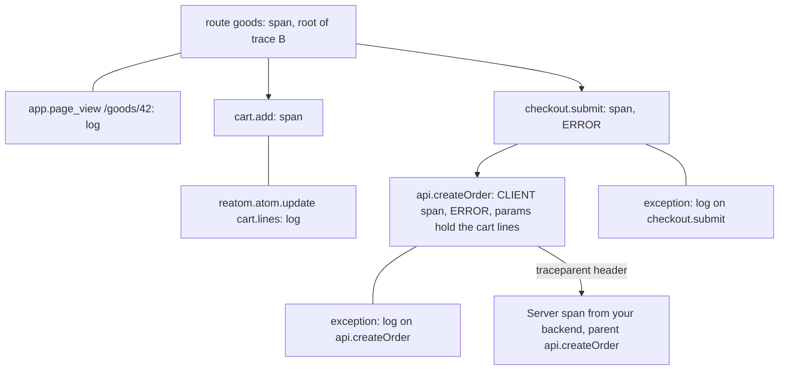

_Figure 12. The shop trace tree from page view to failed checkout._

If the visitor closes the tab while `api.createOrder` is still waiting, with an attached exporter, the span is sent with `reatom.outcome = pending` instead ([E17](#e17-the-visitor-leaves-mid-checkout)).

#### Common mistake

Connecting analytics in a module that runs before the routes exist. The navigation source is decided when analytics starts: with no Reatom routes yet, the default becomes `'navigation-api'`, and an explicit `'urlAtom'` prints a dev warning. Import routes before applying `withWebAnalytics`, as `analytics.ts` does, and import `setup.ts` before both.

Naming an app action `analytics.something` hides it from automatic tracing. That prefix belongs to the analytics layer; call `withOTel()` if that action should still be a span.

### E2. Analytics without Reatom models

**Team.** A marketing site built with plain TypeScript and a hand-written cookie banner; no state manager.

**Scene.** They want page views, sessions and one business event, `app.purchase`, in their own collector.

#### Code

```ts title="e02-analytics-only.ts"
import { withOTLP } from '@reatom/opentelemetry/otlp'
import { action, atom } from '@reatom/core'
import { reatomOpentelemetry } from '@reatom/opentelemetry'
import { withWebAnalytics } from '@reatom/opentelemetry/web-analytics'

type Order = { id: string; total: number; currency: string }

export const analyticsConsent = atom(false, 'cookieBanner.analytics')

export const otel = reatomOpentelemetry({
  name: 'site',
  serviceName: 'site-web',
  skipGlobalExtension: true,
}).extend(
  withOTLP({
    endpoint: 'https://site.example/otel',
  }),
  withWebAnalytics({
    consent: analyticsConsent,
  }),
)

export const analytics = otel.analytics

export const purchase = action((order: Order) => order, 'app.purchase').extend(
  otel.withOTel(),
)

document.querySelector('#accept-analytics')?.addEventListener('click', () => {
  analyticsConsent.set(true)
})

purchase({ id: 'o-1', total: 59.9, currency: 'EUR' })
```

#### What appears

Before the click: nothing from analytics. After `analyticsConsent.set(true)`: `session.start`, `app.page_view` for the current page (with `app.analytics.consent = granted`) and the RAM engagement of this page. A later `purchase(...)` call is a span `app.purchase` with the same `traceId` as the page view , and the order in `reatom.params` / `reatom.payload` as JSON. The purchase in the last line runs before consent in this file; its diagnostic span is captured and, with the attached exporter, exported, because analytics permission gates analytics records, not tracer spans ([Part 7](#7-consent-for-analytics-and-diagnostics)).

`@reatom/core` is still a dependency (atoms, actions); "no Reatom models" means no app state in Reatom.

#### Common mistake

Putting the order only in `withOTel({ attributes })` and then renaming the action. Attributes such as `app.order.value` are written on the span, and analysts still query the stable action name. Keep `app.purchase` stable.

### E3. An embedded widget next to its host

**Team.** A reviews-widget vendor whose bundle runs inside customers' React, Vue or Reatom shops, each customer with its own collector.

**Scene.** Host and widget each need their own traces, visitors and sessions on the same page.

In real life the two halves live in different bundles; they are in one file here so it compiles as one unit. `consent: true` stands for 'the host already collected consent'; a shipped widget should accept the host's consent atom instead of hard-coding it.

#### Code

```ts title="e03-widget.ts"
import { withOTLP } from '@reatom/opentelemetry/otlp'
import { action } from '@reatom/core'
import { reatomOpentelemetry } from '@reatom/opentelemetry'
import { withWebAnalytics } from '@reatom/opentelemetry/web-analytics'

export const hostOtel = reatomOpentelemetry({
  name: 'host',
  serviceName: 'host-web',
}).extend(
  withOTLP({
    endpoint: 'https://otel.host.example',
  }),
  withWebAnalytics({ consent: true }),
)
export const hostAnalytics = hostOtel.analytics

export const widgetOtel = reatomOpentelemetry({
  name: 'widget',
  serviceName: 'reviews-widget',
  filter: (target) => target.name.startsWith('reviews.'),
}).extend(
  withOTLP({
    endpoint: 'https://otel.reviews-vendor.example',
  }),
  withWebAnalytics({ consent: true, errors: false }),
)
export const widgetAnalytics = widgetOtel.analytics

export const submitReview = action((stars: number) => stars, 'reviews.submit')

hostAnalytics.visitor()
widgetAnalytics.visitor()
```

#### What appears

Storage keys `host.visitor`, `host.session`, `widget.visitor`, `widget.session`; two different visitor ids. Each collector receives its own `app.session`, page views and spans; each instance owns its runtime, stats and trace variable. An instance's optional exporter queues are shared across its Reatom roots; isolated record views do not create independent queues. The unload budget (60 KiB) is per page and shared by both.

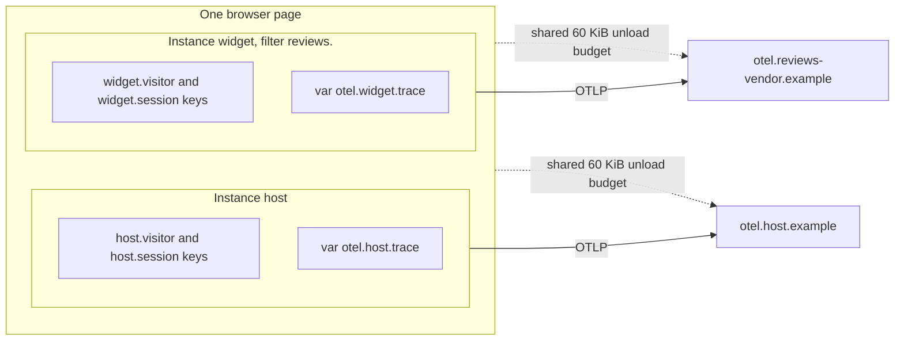

_Figure 13. Host and widget isolation on one page._

#### Common mistake

Both picking `name: 'app'`: the second replaces the first and warns in dev. Use a vendor-unique name. Forgetting that the host's global extension also traces the widget's `reviews.*` actions into the host stream; the host can exclude them with its own `filter`. Leaving `errors` on in the widget: window error listeners are page-wide, so the widget would report the host's error types to the vendor's collector.

### E4. A React Router app and foreign pushState

**Team.** A SaaS dashboard on React Router; no Reatom routing; they want analytics only.

**Scene.** Navigation happens through React Router's `history.pushState`. Analytics must see it without intercepting links.

#### Code

```ts title="e04-foreign-router.ts"
import { withOTLP } from '@reatom/opentelemetry/otlp'
import { atom } from '@reatom/core'
import { reatomOpentelemetry } from '@reatom/opentelemetry'
import { withWebAnalytics } from '@reatom/opentelemetry/web-analytics'

type HistoryAction = 'POP' | 'PUSH' | 'REPLACE'

const hasNavigationApi = 'navigation' in window

export const analyticsConsent = atom(false, 'site.consent.analytics')

export const otel = reatomOpentelemetry({
  name: 'site',
  serviceName: 'site-web',
  skipGlobalExtension: true,
}).extend(
  withOTLP({
    endpoint: 'https://site.example/otel',
  }),
  withWebAnalytics({
    consent: analyticsConsent,
    navigation: hasNavigationApi ? 'navigation-api' : 'popstate',
  }),
)

export const analytics = otel.analytics

export const reportRouterNavigation = (historyAction: HistoryAction) => {
  if (hasNavigationApi || historyAction === 'POP') return
  analytics.pageView()
}
```

The next block is illustrative and not type-checked.

```tsx title="RouterAnalytics.tsx"
import { useEffect } from 'react'
import { useLocation, useNavigationType } from 'react-router'

import { reportRouterNavigation } from './analytics'

export const RouterAnalytics = () => {
  const location = useLocation()
  const navigationType = useNavigationType()
  useEffect(() => reportRouterNavigation(navigationType), [location.key])
  return null
}
```

#### What appears

With the Navigation API, every React Router `pushState` produces one `app.page_view` through `currententrychange`; `reportRouterNavigation` does nothing. Without it, back/forward come from the `popstate` listener and push/replace from `pageView()`. Link clicks are not intercepted and `urlAtom` is never touched.

See [Figure 8](#page-views-and-navigation-sources) for how the navigation source is chosen.

#### Common mistake

Calling `pageView()` on every location change in `'popstate'` mode: back and forward are then counted twice, once by the listener and once by the effect. The `POP` guard prevents it. Second mistake: choosing `navigation: 'urlAtom'` here; reading `urlAtom` turns on link interception in an app that does not own it (dev warning names `urlAtom.catchLinks.set(false)` and `urlAtom.sync.set(() => () => {})`).

### E5. A consent banner with reatomGDPR

**Team.** The shop from E1, before launch in the EU and Russia.

**Scene.** A banner with an Analytics checkbox and a Save button. Analytics must stay denied before Save, while diagnostics remain available.

#### Code

```ts title="consent.ts"
import { withOTLP } from '@reatom/opentelemetry/otlp'
import { action, wrap } from '@reatom/core'
import { reatomOpentelemetry } from '@reatom/opentelemetry'
import { withGDPR } from '@reatom/opentelemetry/gdpr'
import { withWebAnalytics } from '@reatom/opentelemetry/web-analytics'

export const otel = reatomOpentelemetry({
  name: 'shop',
  serviceName: 'shop-web',
}).extend(
  withGDPR({ name: 'consent', categories: { analytics: false } }),
  withOTLP({
    endpoint: 'https://shop.example/otel',
  }),
  withWebAnalytics(),
)

export const consent = otel.gdpr
export const analytics = otel.analytics

export const toggleAnalytics = action((checked: boolean) => {
  consent.fields.analytics.change(checked)
}, 'consentBanner.toggleAnalytics')

export const saveChoice = action(async () => {
  await wrap(consent.submit())
}, 'consentBanner.save')

consent.snapshot()
```

See [Figure 9](#what-the-collection-gates-control) for the consent states.

#### What appears

| Moment                  | Analytics records                                                                                                                                                                    | Identity storage                                                                      | Tracer                                               |
| ----------------------- | ------------------------------------------------------------------------------------------------------------------------------------------------------------------------------------ | ------------------------------------------------------------------------------------- | ---------------------------------------------------- |
| Page load               | none                                                                                                                                                                                 | none; RAM session id only                                                             | spans as usual                                       |
| `toggleAnalytics(true)` | none                                                                                                                                                                                 | none                                                                                  | span `consentBanner.toggleAnalytics`                 |
| `saveChoice()`          | `session.start`, `app.page_view` with new `session.id`, `app.visitor.id`, `app.utm.*` from the landing URL, `app.analytics.consent = analytics`; `app.page.engagement` for this page | `shop.visitor`, `shop.session`, plus the consent snapshot under `reatom.gdpr.consent` | `consent.submit` and form internals                  |
| Submit analytics false  | none                                                                                                                                                                                 | consent snapshot only                                                                 | diagnostics unaffected by this analytics-only schema |

#### Common mistake

Wiring an explicit analytics source to a live checkbox: the field flips before Save and bypasses submitted-choice semantics. Apply `withGDPR` first and let `withWebAnalytics()` use the effective submitted category. Second mistake: assuming an analytics-only schema denies diagnostics. Include a diagnostics category when you need that gate, and apply GDPR first ([Part 7](#diagnostics-signals)).

### E6. Sessions, campaigns and a kiosk

**Team.** A museum kiosk app and the same museum's ticket site.

**Scene.** The kiosk must not remember visitors between people; the site wants honest campaign attribution from a newsletter.

#### Code

```ts title="e06-identity.ts"
import { withOTLP } from '@reatom/opentelemetry/otlp'
import { reatomOpentelemetry } from '@reatom/opentelemetry'
import { withWebAnalytics } from '@reatom/opentelemetry/web-analytics'

export const otel = reatomOpentelemetry({
  name: 'kiosk',
  serviceName: 'kiosk-web',
  skipGlobalExtension: true,
}).extend(
  withOTLP({
    endpoint: 'https://kiosk.example/otel',
  }),
  withWebAnalytics({
    consent: true,
    persistVisitor: false,
    sessionTimeout: 10 * 60 * 1000,
    perTab: true,
  }),
)

export const analytics = otel.analytics

analytics.session.subscribe((session) => {
  if (session.previousId) console.info('rotated from', session.previousId)
})
```

See [Figure 10](#when-a-session-rotates) for when a session id rotates.

#### What appears

With no prior stored identity, no `kiosk.visitor` key is created; the visitor id lives in memory. The session sits in `sessionStorage` and rotates after 10 idle minutes; each rotation emits `session.start` with `session.previous_id`. On the ticket site (defaults): a visitor arriving from the newsletter with `?utm_source=news&utm_campaign=may` gets `session.start` with `app.attribution.first.source = news` and page views with `app.utm.source = news`; clicking an in-app banner link `/?utm_source=header` updates nothing and does not rotate.

#### Common mistake

Putting `utm_*` on internal links to "track banners": it does not rotate sessions or create an external campaign. Use a named action (`app.bannerClick`) for internal promotion.

### E7. A TypeError: who records it

**Team.** The shop again; support complains about duplicated error counts in their old stack.

**Scene.** A coupon field throws inside a traced action; a third-party chat widget throws its own `TypeError` on the same page.

#### Code

```ts title="e07-errors.ts"
import { withOTLP } from '@reatom/opentelemetry/otlp'
import { action } from '@reatom/core'
import { reatomOpentelemetry } from '@reatom/opentelemetry'
import { withWebAnalytics } from '@reatom/opentelemetry/web-analytics'

export const otel = reatomOpentelemetry({
  name: 'shop',
  serviceName: 'shop-web',
}).extend(
  withOTLP({
    endpoint: 'https://shop.example/otel',
  }),
  withWebAnalytics({ consent: true }),
)

export const analytics = otel.analytics

export const applyCoupon = action((code: string) => {
  if (!/^[A-Z0-9]{6}$/.test(code)) throw new TypeError(`Bad coupon ${code}`)
  return code
}, 'checkout.applyCoupon')

const couponInput = document.querySelector<HTMLInputElement>('#coupon')
couponInput?.addEventListener('change', () => applyCoupon(couponInput.value))
```

Automatic observation already skips `analytics.` and `otel.` names. Use `filter` for other namespaces, such as `vendor.`.

See [Figure 11](#two-sources) for how the two error sources cooperate.

#### What appears

The coupon error: span `checkout.applyCoupon` with status ERROR and one tracer `exception` (type, message `Bad coupon <the typed value>`, stack, cause ids). It then reaches `window.onerror`, and analytics skips it because the tracer already recorded that Error object. The chat widget's error: one analytics `exception` with `exception.type = TypeError` only, on the current page trace. With `captureErrorDetails: true` it would also carry the message and stack, with emails and phones scrubbed, and still only after consent. A loop throwing the same error 100 times gives 10 records and one `exception.suppressed` with `app.exception.count`.

#### Common mistake

Turning on `captureErrorDetails` to "see more" and assuming it controls the tracer too. The tracer already sends messages and stacks for errors in traced code; mind what your error messages contain (the coupon code above ends up in `exception.message`).

### E8. Isolation: tests, devtools-only and SSR

**Team.** The shop's platform team: unit tests, a local debug mode and server rendering.

**Scene.** Tests must not see each other's records; the dev build must send nothing; SSR must continue the browser trace.

#### Code

```ts title="e08-isolation.ts"
import { action, atom, context } from '@reatom/core'
import { reatomOpentelemetry } from '@reatom/opentelemetry'

export const otel = reatomOpentelemetry({
  name: 'test',
  serviceName: 'shop-test',
})

const cartSize = atom(0, 'cart.size')
const addItem = action(() => cartSize.set((size) => size + 1), 'cart.addItem')

export const recordsOfOneCase = () =>
  context.start(() => {
    addItem()
    return otel.records()
  })

const firstCase = recordsOfOneCase()
const secondCase = recordsOfOneCase()
console.info(firstCase.length, secondCase.length)
```

```ts title="e08b-ssr.ts"
import { withOTLP } from '@reatom/opentelemetry/otlp'
import { action, context } from '@reatom/core'
import { reatomOpentelemetry } from '@reatom/opentelemetry'

export const serverOtel = reatomOpentelemetry({
  name: 'shop-ssr',
  serviceName: 'shop-ssr',
  skipGlobalExtension: true,
}).extend(
  withOTLP({
    endpoint: 'http://collector.internal:4318',
  }),
)

const renderProductPage = action(
  (path: string) => ({ path, traceparent: serverOtel.traceparent() ?? '' }),
  'ssr.renderProduct',
).extend(serverOtel.withOTel({ kind: 'server' }))

export const handleRequest = (request: Request) =>
  context.start(() => {
    const render = action(() => {
      const incoming = serverOtel.parseTraceparent(
        request.headers.get('traceparent'),
      )
      if (incoming) serverOtel.traceVar.set(incoming)
      return renderProductPage(new URL(request.url).pathname)
    }, 'ssr.request')
    return render()
  })
```

```ts title="e08c-hydrate.ts"
import { withOTLP } from '@reatom/opentelemetry/otlp'
import { action } from '@reatom/core'
import { reatomOpentelemetry } from '@reatom/opentelemetry'

export const otel = reatomOpentelemetry({
  name: 'shop',
  serviceName: 'shop-web',
}).extend(
  withOTLP({
    endpoint: 'https://shop.example/otel',
  }),
)

export const continueServerTrace = action(() => {
  const meta = document.querySelector('meta[name="traceparent"]')
  const remote = otel.parseTraceparent(meta?.getAttribute('content'))
  if (remote) otel.traceVar.set(remote)
}, 'app.continueServerTrace')
```

The server puts `traceparent` from `renderProductPage` into `<meta name="traceparent" content="…">`. Call client initialization within the same frame subtree after setting the parsed parent; calling a setter action once does not create a global OpenTelemetry provider for unrelated later callbacks.

#### What appears

`firstCase` and `secondCase` each hold only their own `cart.addItem` span and `cart.size` update; no network calls. On the server, each request is its own `context.start()` root; with an incoming header the explicit `ssr.renderProduct` span (kind SERVER) joins the caller's trace. `ssr.request` is not explicitly instrumented in this skip-global setup. On the client, the action sets the parsed parent for subsequent work in that frame subtree; it does not reparent a span that already started.

#### Common mistake

Sharing one module-level array of records between tests instead of reading `otel.records()` inside each `context.start()`. Second: expecting `withWebAnalytics` to do anything on the server; without `window` it is a no-op with one dev warning. Third: server resources still report `telemetry.sdk.language = webjs`; there is no Node-specific automatic resource detection here.

### E9. Debugging a failed checkout in admin

**Team.** A developer on the shop team reproducing a support ticket locally.

**Scene.** Same flow as E1, local-only dev build without `withOTLP`, admin open in the page.

#### Code

Use E1 without its `withOTLP` extension in `setup.ts`; the records stay in `otel.records()`.

#### What appears

Without `withOTLP`, the instance's `records` computed holds canonical safe records. Reatom admin consumes them directly and show them in its Railway chrome: Activity, State, Timeline, Graph, Filters, and an Inspector. Overview shows state or payload, then params, expanded in one column for model records. Event logs show grouped attributes instead. The other tabs are the cause chain, last-write history, and the record JSON. A failed checkout feed shows `route goods`, `cart.add`, `cart.lines`, `checkout.submit` and `api.createOrder` marked as errors, and `exception` with `Error: Order failed: HTTP 500`. Selecting `api.createOrder` shows `reatom.params` under the payload — the cart lines sent in the request body. The screenshot lives in [Part 11](#in-the-page-admin-on-records).

How to open admin on an instance's records is not a published API yet.

#### Common mistake

Reproducing with a different tool than production uses. The point of one log is that the same record names and cause ids appear locally and in the collector; compare them.

### E10. Starting a trace by hand: chat.sendMessage

**Team.** A support-chat product.

**Scene.** Sending a message involves an optimistic update, an upload and an API call; they want exactly one trace per message, server spans included.

#### Code

```ts title="e10-send-message.ts"
import { withOTLP } from '@reatom/opentelemetry/otlp'
import { action, wrap } from '@reatom/core'
import { reatomOpentelemetry } from '@reatom/opentelemetry'

export const otel = reatomOpentelemetry({
  name: 'chat',
  serviceName: 'chat-web',
}).extend(
  withOTLP({
    endpoint: 'https://chat.example/otel',
  }),
)

export const sendMessage = action(async (text: string) => {
  otel.traceVar.set(otel.createTrace({ name: 'send message' }))
  const traceparent = otel.traceparent()
  const response = await wrap(
    fetch('/api/messages', {
      method: 'POST',
      headers: traceparent ? { traceparent } : {},
      body: JSON.stringify({ text }),
    }),
  )
  return (await wrap(response.json())) as { id: string }
}, 'chat.sendMessage')
```

#### What appears

A short root span `send message`; actions called after the `traceVar.set` — including after `await wrap(...)` — share its `traceId`; the request carries it; the server continues it.

#### Common mistake

Calling `createTrace()` outside an action, or after the work it should cover. The new trace applies to the rest of the current frame subtree only.

### E11. A WebSocket push and a sampled backend

**Team.** A help-desk app whose backend samples 10% of traces and pushes ticket updates over WebSocket with the originating `traceparent`.

**Scene.** The agent's reaction to a push should continue the backend's trace and follow its sampling decision.

#### Code

```ts title="e11-incoming.ts"
import { withOTLP } from '@reatom/opentelemetry/otlp'
import { action } from '@reatom/core'
import { reatomOpentelemetry } from '@reatom/opentelemetry'

export const otel = reatomOpentelemetry({
  name: 'desk',
  serviceName: 'desk-web',
  sampling: { ratio: 0.1 },
}).extend(
  withOTLP({
    endpoint: 'https://desk.example/otel',
  }),
)

type TicketEvent = { traceparent: string | null; ticketId: string }

const showTicket = action((ticketId: string) => ticketId, 'tickets.show')

export const onSocketMessage = action((event: TicketEvent) => {
  const remote = otel.parseTraceparent(event.traceparent)
  if (remote) otel.traceVar.set(remote)
  return showTicket(event.ticketId)
}, 'tickets.onSocketMessage')

const socket = new WebSocket('wss://desk.example/events')
socket.addEventListener('message', (message) => {
  onSocketMessage(JSON.parse(String(message.data)) as TicketEvent)
})
```

See [Figure 7](#sampling-that-respects-the-parent) for ParentBased sampling.

#### What appears

With a sampled parent (`…-01` or `…-03`), `tickets.onSocketMessage` and `tickets.show` are exported under the backend's `traceId`. With an unsampled parent (`…-00`) they are not exported, but stay in local `records()`; if an exception happens there, `errors: 'always'` exports that tree. Messages without a header start a browser-rooted trace, sampled at 10%. A garbage header increments `stats().invalidParent`.

#### Common mistake

Comparing the flags string to `"01"`. Sampled is `flags & 0x01`; `03` is sampled too. Second: forgetting the guard; `traceVar.set(undefined)` is a type error, which is the point.

### E12. A Reatom island inside a React or Vue app

**Team.** A CRM written in Vue; the new search panel is the first feature built on Reatom.

**Scene.** They want the island traced, page views for the whole app, and nothing else of the host instrumented.

#### Code

```ts title="e12-island.ts"
import { withOTLP } from '@reatom/opentelemetry/otlp'
import { action, atom, withAsync, wrap } from '@reatom/core'
import { reatomOpentelemetry } from '@reatom/opentelemetry'
import { withWebAnalytics } from '@reatom/opentelemetry/web-analytics'

export const otel = reatomOpentelemetry({
  name: 'crm',
  serviceName: 'crm-web',
  filter: (target) => target.name.startsWith('search.'),
}).extend(
  withOTLP({
    endpoint: 'https://crm.example/otel',
  }),
  withWebAnalytics({ consent: true, navigation: 'navigation-api' }),
)
export const analytics = otel.analytics

export const searchQuery = atom('', 'search.query')
export const runSearch = action(async () => {
  const response = await wrap(
    fetch(`/api/search?q=${encodeURIComponent(searchQuery())}`),
  )
  return (await wrap(response.json())) as string[]
}, 'search.run').extend(withAsync())
```

#### What appears

`search.run` spans with `search.query` updates as logs, on the page trace opened by the host router's navigation; page views from the Navigation API; the Vue app's own code is untouched and its `fetch` is not patched, so host requests are invisible to the tracer (by design).

#### Common mistake

Calling `runSearch` from a debounced handler built with a plain `setTimeout` in the Vue component: the call then starts its own trace. Wrap the callback (`wrap`) or keep debouncing inside Reatom.

### E13. HMR without duplicate instances

**Team.** Anyone on Vite.

**Scene.** Editing `setup.ts` reruns it; dispose the old SDK and create a fresh one so feature lifetimes stay explicit.

#### Code

```ts title="e13-hmr.ts"
import { reatomOpentelemetry } from '@reatom/opentelemetry'

type HotModule = { dispose: (callback: () => void) => void }

export const otel = reatomOpentelemetry({
  name: 'shop',
  serviceName: 'shop-web',
  environment: 'development',
})

const hot = (import.meta as ImportMeta & { hot?: HotModule }).hot
hot?.dispose(() => otel.dispose())
```

In a Vite project with `vite/client` types, the last two lines are `import.meta.hot?.dispose(() => otel.dispose())`; the local type keeps this file free of Vite types.

#### What appears

After each edit, one live instance; no warning. Without the dispose line, the second creation replaces the first and prints one dev warning naming both creation sites.

#### Common mistake

Creating the instance inside a component or a function that runs per render.

### E14. Offline field app

**Team.** A field-inspection PWA used in basements and on trains.

**Scene.** The app is offline for long stretches; they want to know whether telemetry was lost.

#### Code

```ts title="e14-offline.ts"
import { withOTLP } from '@reatom/opentelemetry/otlp'
import { reatomOpentelemetry } from '@reatom/opentelemetry'

export const otel = reatomOpentelemetry({
  name: 'field-app',
  serviceName: 'field-web',
}).extend(
  withOTLP({
    endpoint: 'https://field.example/otel',
    maxQueueSize: 2000,
  }),
)

export const reportTelemetryHealth = () => {
  const stats = otel.otlp.stats()
  return {
    queued: stats.queued,
    exported: stats.exported,
    dropped: stats.dropped,
    droppedByReason: stats.droppedByReason,
  }
}
```

#### What appears

While `navigator.onLine` is false, export pauses and records queue up to `maxQueueSize`; on the `online` event it resumes. Delivery overflow/failures show in `otel.otlp.stats().dropped` / `.droppedByReason`; root stats remain capture-only.

#### Common mistake

Expecting the queue to survive a reload or a tab close while offline: there is no offline persistence, and the unload flush does not send while offline. Durable offline persistence is not provided.

### E15. Leftovers: a computed and LOG outside any action

**Team.** Any Reatom app with subscriptions in UI code.

**Scene.** A cart total is recomputed by a subscription, not by an action, and a developer logs it.

#### Code

```ts title="e15-leftovers.ts"
import { atom, computed, log } from '@reatom/core'
import { reatomOpentelemetry } from '@reatom/opentelemetry'

export const otel = reatomOpentelemetry({
  name: 'shop',
  serviceName: 'shop-web',
})

const prices = atom([10, 20], 'cart.prices')
export const cartTotal = computed(
  () => prices().reduce((sum, price) => sum + price, 0),
  'cart.total',
)

cartTotal.subscribe((total) => log.label('cart total', total))
```

#### What appears

One `app.session` span for the instance; the `cart.total` update (`reatom.computed.update`) and the `reatom.log` record (`reatom.log.label = cart total`, arguments in the body) attach to it. A computed never creates a trace id; these records still follow signal, consent, sampling and queue policies.

#### Common mistake

Filtering `app.session` out of dashboards and then wondering where `LOG` output went. Second: using `LOG` as levels; there are no levels, severity is INFO for records and ERROR for exceptions.

### E16. A modal route that should not cut the trace

**Team.** The shop adds a "quick view" modal route under the product page.

**Scene.** Opening the modal must stay in the product page's trace.

#### Code

```ts title="e16-modal.ts"
import { withOTLP } from '@reatom/opentelemetry/otlp'
import { reatomRoute } from '@reatom/core'
import { reatomOpentelemetry } from '@reatom/opentelemetry'

export const otel = reatomOpentelemetry({
  name: 'shop',
  serviceName: 'shop-web',
}).extend(
  withOTLP({
    endpoint: 'https://shop.example/otel',
  }),
)

export const goodsRoute = reatomRoute({ path: 'goods/:id' }, 'goods')

export const quickViewRoute = goodsRoute
  .reatomRoute({ path: 'quick-view' }, 'goods.quickView')
  .extend(otel.withOTel({ boundary: false }))
```

#### What appears

Opening `/goods/42/quick-view` adds a short `route goods.quickView` span inside the existing `route goods` trace; no new `traceId`. Without `boundary: false`, it would start a new trace.

#### Common mistake

Marking every nested route `boundary: false`; then a whole section of the app becomes one endless trace, the failure mode the SRE review warns about.

### E17. The visitor leaves mid-checkout

**Team.** The shop.

**Scene.** `api.createOrder` is waiting on a slow payment provider; the visitor closes the tab.

#### Code

None new; this is E1 `checkout.ts`.

#### What appears

With the E1 OTLP extension attached, on `pagehide` the open `api.createOrder` and `checkout.submit` spans are closed with `reatom.outcome = pending` and sent with `fetch` `keepalive` inside the 60 KiB per-page unload budget (newest records first). `useBeacon: true` is an opt-in fallback that cannot carry headers.

#### Common mistake

Treating `pending` as an error in alerts. It means "the user left while waiting", which is a product signal, not a crash.

### E18. Sensitive values: what redaction does and does not do

**Team.** A banking front end.

**Scene.** Login and card forms are Reatom actions; capture is on by default.

#### Code

```ts title="e18-redaction.ts"
import { withOTLP } from '@reatom/opentelemetry/otlp'
import { action } from '@reatom/core'
import { checkSensitiveNames, reatomOpentelemetry } from '@reatom/opentelemetry'

export const otel = reatomOpentelemetry({
  name: 'bank',
  serviceName: 'bank-web',
}).extend(
  withOTLP({
    endpoint: 'https://bank.example/otel',
  }),
)

checkSensitiveNames(otel)

type Login = { email: string; password: string }
type CardInput = { holder: string; cardNumber: string }

export const login = action(
  (credentials: Login) => credentials.email,
  'auth.login',
)

export const saveCard = action(
  (input: CardInput) => input.cardNumber.slice(-4),
  'billing.saveCard',
)
```

#### What appears

`auth.login` carries an object argument, so the password key is `"[redacted]"` and the email text is `"[email]"`. Its payload is the email string, and the action name matches `auth`, so that primitive payload is `"[redacted]"`. `billing.saveCard` redacts `cardNumber` by key. The last four digits are a primitive payload and the action name matches `card`, so they are `"[redacted]"` too. In dev, `checkSensitiveNames` warns once for `auth.login` and once for `billing.saveCard`.

#### Common mistake

Believing only object keys are masked. A string atom named `login.password`, or `setPassword('hunter2')` even when the parameter is not named `password`, is redacted from the name. `captureValues: false` omits those bodies and `LOG` payloads entirely. A per-target `serialize` still runs before the mask. Keep the collector redaction processor as the second layer.

## 11. Reading the data

### In the page: admin on records()

With default local retention, the instance's readonly `records` computed holds canonical safe records. Reatom admin consumes them directly without an OTLP encode/decode round trip; OTLP file/replay import remains available. The UI shows them in its "Railway" chrome: Activity (a log feed of actions, atoms and exceptions with an error badge), State, Timeline, Graph (the cause graph from `reatom.cause.ids`), Filters, and an Inspector. Overview shows state or payload, then params, expanded in one column for model records. Event logs show grouped attributes instead. The other tabs are the cause chain, last-write history, and the record JSON.

Analytics opens its **Sessions** view for local and replay investigations. Search captures, filter sessions with errors, sort by start/captured duration/page views/errors, and open a chronological journey of spans, logs, exceptions and measurements. Both lists show up to 100 rows per page. Select a record for the inspector or open the captured session in Timeline. Explicit `session.id` identifies a session; records without it appear as **Diagnostic capture**, grouped conservatively by source and resource. A trace joins a session only when ownership is unambiguous within that boundary. Captured duration covers recorded timestamps, not an inferred full session lifetime; remote data is partial (latest 500 records per signal).

**Overview** shows consented visitors, sessions, page views, engagement, bounce, errors, session-start trends, and page/source breakdowns. Open a row's sessions or its **Paths** timeline to inspect the median page sequence aligned at a step. These aggregates require analytics records; diagnostic capture does not infer visitor identity or consent. See the [admin analytics reference](../../../../../packages/admin/README.md#analytics-view) for grouping and count definitions.

`connectAdmin(otel, { host })` turns on `localValues` while connected, and enables keepRecords if the app turned retention off. `dispose()` restores both. Pass `localValues: false` to keep admin on the masked records, or `'all'` to include targets with `withOTel({ captureValues: false })`. Ingest attaches the live values to each admin record. The Activity preview, Overview, History, the State tree and search read them. The record JSON tab, the records download and MCP still use safe captured attributes. JSON export writes bigint as decimal strings and bytes as numeric arrays without changing typed capture. Only the newest 5,000 records keep live values; older ones fall back to the masked attributes and `connection.localValuesTrimmed` turns `true`. `connection.localValues` is a writable atom for a settings switch. `examples/chat/src/devtools.ts` registers it as the "Live values" switch in the Local work section of the Settings tab.

This UI integration fragment assumes your `otel` and host element are defined:

```ts title="admin-ui-fragment.ts"
import {
  ADMIN_FRAME,
  connectAdmin,
  mountAdminView,
  registerLocalWorkOption,
} from '@reatom/admin'
import { reatomBoolean } from '@reatom/core'

const connection = connectAdmin(otel, { host, localValues: true })
const liveValues = ADMIN_FRAME.run(() =>
  reatomBoolean(true, '_Admin.app.liveValues'),
)
const stopSync = ADMIN_FRAME.run(() =>
  liveValues.subscribe((enabled) => connection.localValues.set(enabled)),
)
const unregister = registerLocalWorkOption({
  id: 'otel.localValues',
  label: 'Live values',
  checked: liveValues,
})
const unmount = ADMIN_FRAME.run(() =>
  mountAdminView(host, connection.admin, connection, { floating: true }),
)
```

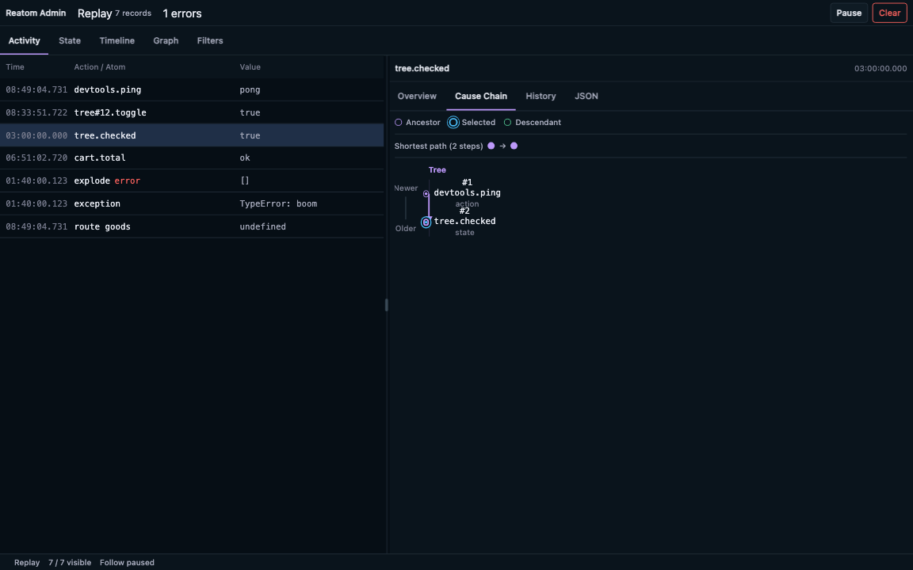

Walk through a failed checkout (from E1): the feed shows `route goods`, `cart.add`, `cart.lines`, `checkout.submit` and `api.createOrder` marked as errors, and `exception` with `Error: Order failed: HTTP 500`. Selecting `api.createOrder` and opening Params shows `reatom.params` — the cart lines sent in the request body, which is what support asks for first. The graph tab follows `reatom.cause.ids` from the exception back through `api.createOrder` and `checkout.submit` to the route.

:::caution
`connectAdmin` is not published yet; the screenshot comes from admin's own Storybook fixtures. The API and the view may change.
:::

### In an OTLP backend

Any OTLP/HTTP backend receives two signals: spans on `/v1/traces`, log records on `/v1/logs`.

Keys to filter by:

| Record                                | Kind            | Where                                              | Key attributes                         |
| ------------------------------------- | --------------- | -------------------------------------------------- | -------------------------------------- |
| span `name` / `reatom.name`           | span            | actions, routes                                    | factory names normalized (`goods#.go`) |
| log `eventName` / `event.name`        | log             | `reatom.atom.update`, `app.page_view`, `exception` | duplicated as `event.name`             |
| `traceId`                             | both            | one scenario                                       | join spans and logs of a page          |
| `session.id`, `page.url`, `page.path` | general records | captured after analytics grant                     | diagnostic/session joins               |
| `app.visitor.id`                      | analytics logs  | after consent                                      | visitor joins                          |
| `exception.type`                      | log             | errors                                             | type only from analytics by default    |
| `reatom.outcome`                      | span            | `error`, `abort`, `pending`                        | not every failure is an error          |

Spans per trace can help distinguish a multi-step operation from an isolated loader. Use cause ids when following the state changes behind it.

On navigation, older-page engagement may be emitted inside the current page trace. Use session, page/time attributes to interpret it rather than assuming its `traceId` identifies the previous page.

Ids (`session.id`, `app.visitor.id`, `user.id`, `url.full`) are fine as attributes and deadly as index labels in Loki or Prometheus.

The package e2e suite (`test:e2e:clickhouse`) checks spans, logs and `reatom.cause.ids` through the contrib `clickhouse` exporter. The [collector guide](../../../../../packages/opentelemetry/e2e/collector/README.md) includes setup and queries. Use a backend that supports both signals; a trace-only receiver will not store logs.

## 12. Browser diagnostics and backend integrations

### Attach only the collectors you use

The root package does not import browser collectors. Factories are inert until native `.extend` applies them; applied collectors start eagerly without subscribers. Apply GDPR first, then analytics/common attributes, then measurements whose document identity should use those sources:

```ts title="browser-diagnostics.ts"
import { withOTLP } from '@reatom/opentelemetry/otlp'
import { reatomOpentelemetry } from '@reatom/opentelemetry'
import { withGDPR } from '@reatom/opentelemetry/gdpr'
import { withBrowserNetworkMonkeypatch } from '@reatom/opentelemetry/browser-network'
import { withBrowserConsoleMonkeypatch } from '@reatom/opentelemetry/browser-console'
import { withBrowserPerformance } from '@reatom/opentelemetry/browser-performance'
import { withWebAnalytics } from '@reatom/opentelemetry/web-analytics'
import { withWebVitals } from '@reatom/opentelemetry/web-vitals'

const otel = reatomOpentelemetry({
  name: 'browser-diagnostics',
  serviceName: 'shop-web',
}).extend(
  withGDPR({ categories: { analytics: false } }),
  withOTLP({
    endpoint: 'https://shop.example/otel',
  }),
  withWebAnalytics(),
  withBrowserNetworkMonkeypatch({
    propagateTraceparent: ['https://api.shop.example'],
  }),
  withBrowserConsoleMonkeypatch(),
  withWebVitals(),
  withBrowserPerformance(),
)

otel.browserConsole.setFalse()
otel.browserConsole.setTrue()
import.meta.hot?.dispose(() => otel.dispose())
```

Analytics requires the form's submitted grant. This schema offers only analytics, so diagnostics remain on. Use default `withGDPR()` to initially deny all three default categories. Document measurements retain extension-application-time identity, including absent identity, across toggles. Later login/consent changes do not relabel those measurements.

| Extension                                 | Added switch and data                                                                                                                                                                          |
| ----------------------------------------- | ---------------------------------------------------------------------------------------------------------------------------------------------------------------------------------------------- |
| `withBrowserNetworkMonkeypatch(options?)` | `.browserNetwork`: fetch/XHR CLIENT spans, sanitized URL, method/status/duration. Propagation defaults off; exact origins or full-URL predicate. `ignoreUrl` excludes capture and propagation. |
| `withBrowserConsoleMonkeypatch(options?)` | `.browserConsole`: `reatom.console` logs with bounded/redacted arguments and Error details. Levels default warn/error; debug/info/log are opt-in.                                              |
| `withWebVitals()`                         | `.webVitals`: official `web-vitals` 6.2.3 CLS/FCP/INP/LCP/TTFB document metrics. Availability depends on browser and application timing.                                                       |
| `withBrowserPerformance(options?)`        | `.browserPerformance`: native buffered navigation/resource measurements; both enabled by default. `ignoreUrl` excludes entries. Cross-origin fields may be restricted or zero.                 |

Feature switches are requested-enable boolean atoms (`.setTrue`, `.setFalse`, `.toggle`, `.reset`), independent of permission and signals. Toggling applies synchronously. Duplicate installation, even when disabled, throws before effects. Parent disposal is terminal and tears down features; construct a new SDK after HMR. A failing extension rolls back its own setup, while earlier successfully applied extensions remain. Missing browser APIs make capture a no-op.

Network/console observation is page-wide. Host and widget instances each receive their own records, without partitioning native requests. Only the first eligible propagation context is injected. HTTP spans snapshot identity at request start, resources at observer delivery, and navigation/Web Vitals when their extension is first applied. Fetch duration ends when the response is available; XHR ends at completion, neither after body consumption. Exported URLs omit credentials/query/hash; predicates see full resolved URL clones before sanitization and fail closed if they throw.

Built-in OTLP/Faro destinations are excluded. Custom transport requests after an await need network `ignoreUrl`; performance needs it regardless because delivery is asynchronous. Use the same origin/path predicate on both, as in the [custom collector example](../../../../../packages/opentelemetry/API.md#excluding-custom-collectors). Unrelated requests remain captured. Console has no URL filter; avoid captured console levels after awaits in custom transports.

### Understand measurement records

Vitals emit `measurement` logs with `measurement.type = web-vitals`, lowercase values such as `{ lcp: 1200, delta: 1200 }`, unit `ms` (`1` for CLS), and `web_vital.name`, `id`, `rating`, `navigation_type`, `delta`. One collector registers five upstream callbacks per document, with weak subscribers and five cached primitive measurements. Disposal stops reports for the instance; upstream observers may live until document end.

Performance emits `browser-navigation` / `browser-resource` measurement types. Values include duration, DNS/connect/request/response times, transfer/encoded/decoded sizes, plus completed navigation milestones. Missing/unfinished milestones are omitted; each callback processes at most 100 entries. Disposal disconnects the native observers. See the [schema reference](../../../../../packages/opentelemetry/API.md#navigation-and-resources) for exact names and units.

### Send to your backend

Native OTLP appends `/v1/traces` and `/v1/logs`. Extra `Transport` destinations work with that endpoint or without `withOTLP`. A transport receives the batch payload/body, signal, item count, abort, deadline and keepalive flag, and returns accepted/rejected counts.

Use `withOTLP({ endpoint: null, transports: [faroTransport({ endpoint: receiverUrl })] })` to send to a Faro receiver. The optional `/faro` entry supplies `faroTransport({ endpoint, headers?, fetch? })` for an exact absolute Faro collection URL and `logMeasurement` for finite numeric log-derived measurements. It maps captured events, console logs, exceptions, traces and measurements, grouping envelopes by captured app/user/session/page metadata. Vitals retain lowercase values and Faro `id`/`rating`/`navigation_type` aliases; performance uses this package's custom schema. Existing dashboards may need panels for that schema. Exception stack text is context, without automatic structured frames or symbolication.

The [package README](../../../../../packages/opentelemetry/README.md#self-hosted-faro-receiver) has a self-hosted Alloy → Loki/Tempo recipe based on the receiver documentation; it has not been validated against a running receiver here. Managed Grafana Cloud Frontend Observability has not been verified. The bridge requires HTTP 202, rejects an invalid session response, and leaves rotation to the application. It does not implement managed session lifecycle parity.

Native OTLP defaults to three retries (four total attempts); standalone/custom/Faro transports own their retries, and Faro makes one attempt per envelope. The first destination controls queue accounting; additional destinations are best effort without independent retry queues. Offline holds are in memory and resume on `online`; reload loses unsent data. Unload keepalive/beacon is best effort under shared byte limits. Accepted beacon bytes do not prove receipt.

## 13. Limits and sharp edges

`withAsync` helper actions can appear as short spans. Older-page engagement can use the current page trace. A remote `traceparent` can remain attached to later roots within the same `context.start`; another root does not inherit it. Unsampled records may stay local when retention is enabled; an exception can promote the bounded held context for export. Local live values are independent of diagnostics consent and masking.

Trace continuations begin after 1000 spans or 60 seconds by default, linked to the previous trace. `Infinity` disables either limit. The accepted `roots: ['mount']` flag does not implement mount/render capture. General browser collectors do not repair missing `wrap` context, isolate a widget's native requests, or guarantee complete browser measurements after late attachment.

The package currently has no replay, source-map upload/symbolication service, error-grouping UI, arbitrary DOM named actions, frustration/rage-click/scroll/form analytics, CSP or long-task collector, experiment/e-commerce schema, automatic title/referrer/viewport enrichment, automatic login/logout identity linking, native OTLP metrics, durable offline storage, managed Faro session parity, cross-tab/worker trace propagation, or automatic mount/render profiling. Cross-tab session storage synchronization is separate from trace propagation. These are current boundaries, not release promises.

The [API reference](../../../../../packages/opentelemetry/API.md) lists the complete public surface, including capture, serialization, resources, per-target settings, transport contracts, consent, local values and helper types. [Reatom admin](../../../../../packages/admin/README.md) documents the local records workflow and its current APIs.

## 14. Launch checklist

1. Import `setup.ts` before any model.
2. Add withOTLP only when export is required, with an absolute endpoint (OTLP/HTTP port 4318 on a bare collector) or nonempty custom transports.
3. No secrets in the bundle; a bearer token in client code is public.
4. `serviceName`, `serviceVersion`, `environment` set.
5. Collector accepts your origin (CORS); your API allows the `traceparent` header.
6. Filter vendor namespaces on shared instances. `analytics.` and `otel.` are already excluded from automatic observation.
7. Apply `withGDPR` first when category control is required. Default categories initially deny diagnostics/analytics/marketing until submit; an exact analytics-only schema leaves diagnostics available. Feature enablement and signal switches remain separate.
8. Collector redaction processor as the second layer behind client redaction.
9. Tail sampling at the collector: keep error and slow traces, sample the rest.
10. Nothing high-cardinality in index labels.
11. Watch capture `stats().dropped`, optional `.otlp.stats()` delivery counters, and receiver metrics.
12. Sourcemaps and consent text are separate SRE and legal tasks.

## 15. Glossary

**`app.analytics.consent`** — Attribute on analytics records naming the consent source: `granted` (boolean or atom) or `analytics` (category or `reatomGDPR` form).

**`app.page.engagement`** — Analytics log with visible and active milliseconds of a page, emitted on hide and on navigation.

**`app.page_view`** — Analytics log for one page view; carries `url.path`, `url.full`, last-touch campaign and identity attributes.

**`app.session` (tracer span)** — One short span per instance per page load; the fallback context for records outside any trace. Not an analytics session.

**`app.visitor.id`** — Random visitor id written to storage only after analytics consent; replaced after 400 days.

**Action** — A named Reatom function call; becomes a span.

**Atom** — A named piece of Reatom state; its updates become `reatom.atom.update` logs.

**Cause ids** — `reatom.frame.id` and `reatom.cause.ids` on Reatom activity records; enough to follow the Reatom cause graph in OTLP.

**`withWebAnalytics`** — Native optional extension adding a requested-enable analytics atom with readonly session/page/visitor/attribution/focus children and a page-view action.

**Computed** — Derived Reatom state; uses an existing trace or app-session context.

**`createTrace`** — Instance method returning a fresh trace context with a short root span; used with `traceVar.set` for a manual trace start.

**Frame** — The record of one Reatom call and its causes; what the tracer reads instead of its own context model.

**Instance `name`** — Constructor registry key, exposed as `.instanceName`; native `.name` is `otel.<name>`. It supplies the default analytics storage key.

**`localValues`** — Instance option that keeps live references to params, payload, state and errors next to local records; `localValuesOf(record)` reads them. Never exported.

**`navigation` source** — How analytics sees URL changes: `urlAtom`, `navigation-api` or `popstate` with manual `pageView()`.

**ParentBased sampling** — Children follow the sampled flag of their parent; only roots use the ratio.

**`records()`** — Readonly computed view of canonical safe captures, retained by default independently of optional export.

**`reatomGDPR`** — Standalone app-owned consent form; fields are drafts and snapshot holds submitted choices. `withGDPR` binds it, or creates a default form when omitted.

**`reatomGDPR.snapshot`** — The submitted consent `{ submitted: true, categories }` or `null`; what analytics reads.

**`session.start` (analytics log)** — Emitted when an analytics session id is created or rotated; carries `session.previous_id` and attribution.

**`traceparent()`** — Instance method returning the W3C header for the current span, or `undefined` outside a trace.

**`traceVar`** — The instance's frame variable holding the current trace context; `get()` reads it, `set()` starts or continues a trace for the rest of the frame subtree.

**Watershed** — A point that starts a new trace instead of extending the current one: a route change, a page view, a manual `createTrace`.

**`withOTel`** — Instance extension that marks a target for tracing and sets per-target options such as `kind` or `boundary`.

**`wrap`** — Reatom helper that keeps the current frame across `await` and callbacks; the contract tracing depends on.

## 16. Credits

Dmitry Sinev (astartsky) — author of the tracer (`@reatom/opentelemetry`).

Vladislav — application examples and early integration feedback.

Community reviewers — feedback on trace boundaries, sampling and CORS guidance.

artalar — design and maintenance of Reatom.
