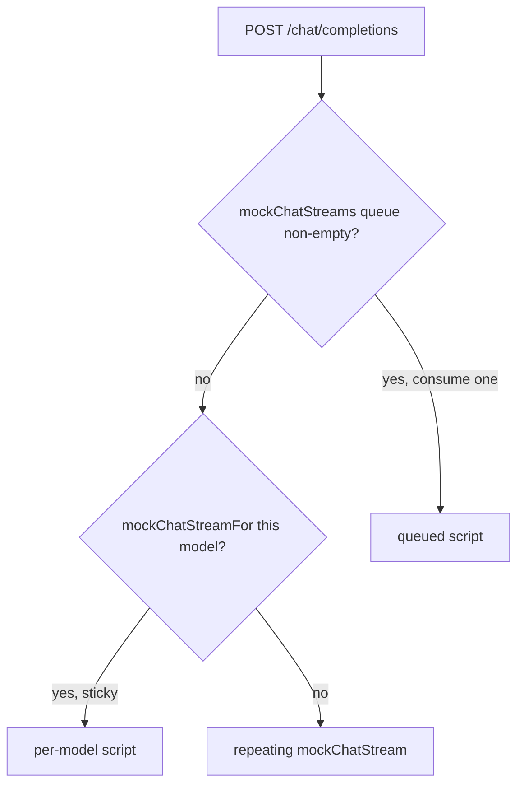

# Test harness

Delays in the OpenRouter mock are wall-clock `setTimeout` calls. Fake timers are not supported: `vi.useFakeTimers` will not advance `mockRouteDelay`, chunk `delayMs`, `{ comment: true, delayMs }`, or `firstTokenDelayMs`.

Keep those delays at or below 50ms. `slowStreamScript` is the explicit slow fixture (a 20k-character reply).

## Which chat script a POST uses

`mockChatStreamFor` stays in place across requests. A non-empty `mockChatStreams` queue is used first, including when a sticky script exists for that model.

## External fetches

`externalRequests()` records every non-OpenRouter `fetch`. Those requests reject with `TypeError: blocked by test mock`, except:

- same-origin URLs, which pass through so Vite can load the app
- URLs matched by `allowExternalPassthrough`
