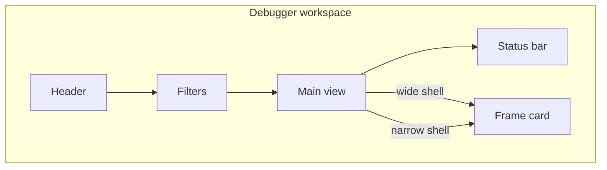

# Admin design

The admin is a causal timeline debugger for a canonical captured-record stream, with OTLP/replay import as an additional input. A person capturing or replaying that stream should see system status in words, filter the rows they care about, inspect one record without losing their place, and undo a destructive clear.



The frame card sits beside the main view when the shell is at least 680px wide and in a bottom drawer when it is narrower. That switch uses the shell width (`container: admin-shell`), not the viewport.

Local words: a record is one captured span or log row (or an imported OTLP/replay row); the frame card is the inspector for the selected record; a chip is an on/off filter control.

## Required rules

These are required. Product journeys named in the admin refactor plan are how each rule is proved in the product. Kit stories under `src/stories/design-system` prove rule 4 for shared components, with Storybook accessibility violations treated as test errors.

1. Visibility of system status. Status is words, including how many records are waiting while paused, an in-progress row, and an "N new" count when live follow is off.
2. Match with the real world. Use Reatom words (action, atom, computed, LOG, abort), human-readable durations, and names as they appear in code.
3. User control and freedom. Clear can be undone, Escape closes the top admin layer, filters can be reset, and Back and Forward walk selection history. Selection survives mode and view changes.
4. Consistency and standards. Product UI is composed from this kit. Tables use grid semantics, view switches use tabs, and Escape behaves the same on every admin layer. Design-system component stories set Storybook `a11y.test` to `error`. The package preview default stays `todo` for product stories.
5. Error prevention. Filter-language errors show before apply. Clear is undoable. Escape inside the admin does not activate the host's shortcuts.
6. Recognition rather than recall. Chips show counts, the frame card shows causes, and shortcuts appear on the controls and in help.
7. Flexibility and efficiency. Keyboard use, saved filters, and an errors chip are available.
8. Aesthetic and minimalist design. One primary surface. Advanced filters start collapsed. Counters are not duplicated.
9. Help users recognize and recover from errors. An error row shows the message, the frame card leads with the error, and a denied remote source tells the person what to do.
10. Help and documentation. Help lists shortcuts and the filter language. An empty live session lists the setup checks.

## Setup choices

Saved for this connection:

- Migration mode is contracts only. Contracts, indexes, and this file describe the kit. The migration does not change the runtime of Button, DataGrid, EmptyState, Field, Icon, InspectorTabs, RailGraph, SplitPane, StatusBar, Tabs, or Toolbar.
- The migration area is `src/view/design-system`. Tokens in [`src/view/design-system/tokens.ts`](src/view/design-system/tokens.ts) and shared CSS in [`src/view/design-system/mixins.ts`](src/view/design-system/mixins.ts) are the token source, not UI contracts.
- Verification runs. Structural contract checks, index checks, typecheck when types move, and the design-system stories for new or restyled kit pieces all run.
- Craft after that migration adds only the entities the kit did not already cover: Drawer, Toast, Popover, Disclosure, Kbd, Inspector, the debugger-workspace layout, and the inspect-record, filter-records, and undoable-destructive-action patterns.
- `GanttChart` stays product UI in `src/view/otlp`. A row adapter supplies `renderRow` and an optional `toolbar`. Records and paths are the two consumers. It may compose kit components. It is not a kit entity.
- Inspector in [`src/view/inspector`](src/view/inspector/Inspector.tsx) is the contracted value tree. Other views outside `src/view/design-system` stay unmanaged. Later cleanup removes the legacy admin modules. This setup does not document those other views.

## Design-system sources

- Components: [index](design-system/COMPONENTS.md)
- Layouts: [index](design-system/LAYOUTS.md)
- Patterns: [index](design-system/PATTERNS.md)
- Tokens: [`src/view/design-system/tokens.ts`](src/view/design-system/tokens.ts). `tokens` and `railTokens` are colors and type roles. `space`, `radius`, `size`, and `type` are spacing, radius, control size, and type roles. `adminThemeVars` is the stylesheet preamble that defines the custom properties. The default sheet is the original dark violet. A picked accent calculates a light or dark palette from that hue, and the shell paints those variables. `soft` mixes a token with transparency. Do not introduce raw colors outside this file.
- RailGraph visual source: the layout and states in its [contract](design-system/components/rail-graph.md). The older [`railway-reference.jpg`](src/view/design-system/railway-reference.jpg) is history, not the target.
- Motion: `--admin-motion-hover`, `--admin-motion-select`, and `--admin-motion-overlay`. Any transition uses the `reducedMotion` mixin so `prefers-reduced-motion: reduce` removes it.

UI indexes route to contracts. Token files have no eligibility status.

## Contracts and public use

Component contracts live in `design-system/components/`, the layout in `design-system/layouts/`, and patterns in `design-system/patterns/`. Frontmatter paths are relative to `packages/admin`.

Product views in this package import the barrel [`src/view/design-system/index.ts`](src/view/design-system/index.ts). Inspector is imported from [`src/view/inspector`](src/view/inspector/index.ts). The kit is not a separate package entry. Overlay components render as descendants of the shell that mounts them, including when that shell is a shadow root. They do not portal to `document.body`.

Craft may change design-only CSS, markup, and public design settings of kit components. Filter logic, the Gantt, selection, and the live connection stay in `src/otlp` and `src/gantt`.

## Verification

From the repository root:

```sh
node skills/design-system/scripts/check-contract.mjs --kind <component|layout|pattern> --update-sources-hash <contract.md>
node skills/design-system/scripts/generate-indexes.mjs packages/admin
node skills/design-system/scripts/generate-indexes.mjs --check packages/admin
pnpm --filter @reatom/admin typecheck
pnpm --filter @reatom/admin exec vitest run --project=storybook src/stories/design-system/<story>.stories.tsx
```

Design-system component stories set `parameters.a11y.test` to `error`. Do not set that default in `.storybook/preview.ts`. Storybook interaction style is [`.storybook/README.md`](.storybook/README.md).

## Gaps and decisions

Open gaps: [journal](design-system/gaps.md). Closed entries move in full to `design-system/gaps-archive.md` with their disposition, closure date, and basis.

## Product boundaries

The Gantt UI composes this kit and keeps its own record, time-axis, and selection behavior.

- View switches for Timeline, State, Graph, and Analytics use Tabs. Timeline unit buttons are Causal, Waterfall, Log, and Paths. Causal is the default; Waterfall and Log retain their existing tree and flat-record behavior, and Paths retains its Analytics tree. InspectorTabs is only the four sections of one record: Overview, Cause Chain, History, and JSON.
- Overview shows errors first, then current state for atoms/computeds, or payload and actual arguments for actions, in one column without headings. Computed middleware's previous-state input is internal and does not appear as Param. A successful local action returning its single argument shows that value once; only exact identity/value equality proves duplication, and replay keeps both captured fields. Missing fields mount no tree; captured undefined, errors and unfinished results stay distinct. Trees start expanded, including nested collections. Attributes, causes, effects, and resource are not on that view. Event logs (analytics page/session events and manual `otel.log`: a log without a `reatom.*` event name, `reatom.kind` / `reatom.name` / `reatom.frame.id`, or `reatom.cause.ids`) show the error if there is one, then grouped attributes under headings (Exception, Page, Metrics, Attribution, Identity, Other). Cause Chain keeps the cause graph and Open in Graph.
- The wide frame card uses the debugger-workspace side pane, which is a SplitPane. Below 680px of shell width the same card is a Drawer. Its header has a Close record details button that preserves selection and returns focus to the selected row. Do not use a viewport media query for that switch.
- Live mount classification updates only the kind decoration; unrelated captured records preserve the selected Inspector and browser text selection. Shell shortcuts respect Ctrl/Cmd chords, bare modifier keys and selections inside the Admin shadow tree.
- Name search and value search use SearchField. On/off filters use Button `variant="ghost"` with `pressed`. Advanced filter options open a Drawer, closed by default, with persistent Apply and Reset controls. Reset uses Button without `pressed`.
- Filter counters always reserve a 5ch tabular slot, including zero, so capture growth cannot resize chips or rewrap the toolbar. Counts through 9,999 display exactly; larger counts use compact notation, with the exact value in the Button's native title and accessible description.
- A destructive clear uses Button `variant="danger"`, then Toast with an undo action. The toast does not restore records itself.
- Structured hints, including drop reasons, use Popover. A single short phrase may use Button `title`. Shortcut chords outside SearchField use Kbd.
- Inspector shows one value as an expandable tree. The cause chain uses RailGraph. A uniform row table uses DataGrid. The waterfall stays in the product Gantt.
- `main` passed to DebuggerWorkspace stays in one parent so scroll position survives the card opening or the shell crossing 680px. `inspector` is called again when the card is shown and when the shell crosses 680px. Keep both states in atoms.
- Escape inside a Drawer or Popover closes that layer. Escape in the wide shell closes the frame card unless focus is in a text field. The product returns focus to the selected row from `onInspectorClose` when the drawer did not already restore it.

## Causal timeline

The Causal timeline owns a sequence of stable event handles separate from raw
capture order. Capture, export, MCP and Analytics still consume the original
record stream. Ordinary logs, unframed records and unrelated events remain rows;
there is no synthetic graph root. A pending span is an explicit placeholder and
its completed span keeps the same handle, selection and history. A matching
span/log frame is an alias only when source, trace, frame, Reatom kind and model
name agree; separate log occurrences remain separate. A late canonical span
absorbs its proven log alias into the pending span handle.

The three sections are Graph, Logs and Time. All start visible. Each virtual row
is one CSS grid row across all three sections. One body scroller and one
virtualizer own the vertical window. The rendered row block uses `position:
sticky`, with both `top` and `bottom` bound to `virtual.stickyInset()`, between
the before/after spacers. This keeps the mounted block covering the viewport
during native scroll movement before the next virtual window renders; increasing
overscan is not a substitute. The header sits outside vertical flow and
tracks the body's horizontal position. Opening the inspector or crossing the
680px workspace breakpoint preserves that scroller. Column visibility and width
change its tracks, not its row handles. Widths are remembered for this model
instance only: Graph is 60–2000px and Logs/Time are 160–2000px. Named separators
support pointer capture and Left/Right in 16px steps. At least one section remains
visible; the last active toggle explains why it is disabled. Narrow shells use
horizontal overflow and the section toggles.

Rails are product-local SVG geometry in
`src/view/otlp/CausalTimeline.tsx`. This is a bounded product fallback: the kit
RailGraph presents a small selected cause chain and caps lanes by hiding nodes;
the timeline preserves every event row and summarizes dense relationships instead.
The graph groups exact relationships with a common source or target into shared
buses before allocating tracks. Each projected relationship belongs to exactly
one group. Source pairs, direct/hidden provenance and cycles remain separate.
Up to four fixed-spaced tracks are drawn, with fewer at narrow width thresholds;
no geometric scaling makes lines or endpoints smaller. Whole groups that do not
fit remain available through endpoint counts and a visible summary. Both-end-
offscreen groups participate in those summaries. Widths within one threshold
reuse the same bus snapshot; selection never changes group membership or tracks.
Routes meeting on the same event row use separate tracks; only disjoint row
intervals reuse a track, so incoming and outgoing buses do not merge at a tap.

Every event has one round mark 12px from the right of Graph, beside its kind icon
and name. Branches extend left to their actual bus, with a tap at that trunk and
cutouts where they pass unrelated trunks. Passing buses reach row boundaries.
Accent trunks stop at the centers of the selected relationship's endpoints.
Accent branches paint after neutral branches, and an explicit trace uses its
own crossover halo, keeping unrelated intersections visually separate.
Named continuation controls navigate to offscreen anchors above or below the
viewport. The continuation strip keeps a fixed 36px height while Graph is shown
and the persisted Display setting Graph continuations is enabled (the default),
so a navigation action does not change the viewport height when its anchor appears.
`CausalContinuations.tsx` reconciles stable linked-list controls at integer row
boundaries instead of recreating the strip on every scroll offset. Surviving
controls retain focus and horizontal scroll position. New destinations fade in
using the overlay motion token; reduced motion skips the animation. Navigation
resolves the current anchor and rank at click time.
Hiding continuations removes the strip's height and releases its viewport/bus
subscriptions; Graph itself stays available.
Long model names truncate at the start, retaining their meaningful suffix, with
the full name in the accessible row label and native title. KindMark respects the
existing icon/color preferences.

The last visible section fills spare horizontal space; remembered section widths
remain minimums. Graph, Records and Time keep explicit grid-column positions
through all seven nonempty combinations. With Records visible and Time hidden,
rows expand from 26px to 36px; Graph-only and views with Time retain compact rows.
The same reactive uniform height drives virtualization, rails and scroll-anchor
math. Toggling density preserves the first visible event and within-row offset
(clamped when shrinking), while Follow stays pinned to the end.
Column handles are centered on their actual boundaries and start a drag from
the displayed width. Double-click or Home restores four-track Graph width,
fits filtered record names within available space (up to 800px, retaining at
least 160px for Time), or fits Time into the remaining viewport. Fitting scans
names only on that explicit request, never during scrolling or capture updates.
The trailing section's minimum reflects its fill requirement. A resize blocked
at that minimum does not alter its saved width. Splitter bounds remain valid on
ultrawide screens, and modified Home/arrow chords stay with the browser.

Selecting a record highlights its full directed ancestor and descendant chains.
Separate cycle-safe upstream/downstream walks keep siblings, co-causes and
ancestor-to-descendant bypasses neutral. Exact participating edges determine
highlighted bus intervals and member branches; a related anchor alone does not
highlight its whole bus. Hidden bridges retain canonical path provenance and
scope boundaries. Row highlighting also works with Graph hidden. Every other
row and relationship summary stays in place. Compact
cause/effect count ports open the existing frame card's Cause Chain section.
These ports are product-local diagram controls: the shared Button is 28px high,
while this product's compact rows are 26px; no shared Button size or contract is
overridden. Other actions and search compose Button, Tabs and SearchField. The
SVG is decorative; accessible descriptions disclose causes, summarized crossings,
hidden steps, unresolved relationships, cycles and timestamp discrepancies.

Cause Chain includes exact scoped recorded cause/effect counts and a searchable
virtualized relationship list, independent of track admission. Ordinary filters
can hide a neighbor from the timeline without erasing it from these recorded
counts; the list says when an endpoint is hidden. Source/scope exclusions and
unresolved references stay separate. Small neighborhoods also use RailGraph when
actual frame IDs are numeric and unique; never invent displayed frame IDs to fit
that component. Trace emphasizes one projected relationship without changing the
selected record; Go to event explicitly selects and reveals an already-visible
endpoint by scrolling, without resetting filters. Hiding Graph disables Trace
and releases bus routing subscriptions while this list remains usable. Pub/sub
registration totals are not inferred from recorded update events. Operation focus
and event-row folding remain separate follow-up designs.

Acyclic rows place causes before effects. Measured times break ready-node ties,
then arrival ordinal and stable identity. Cyclic components remain inspectable
in deterministic diagnostic order. A dependency link resolves its explicit
trace/span/frame namespace only when unambiguous; missing, ambiguous and
self-referential relationships show boundary details. Filtering projects nearest
visible predecessors through ordinary hidden steps as dashed rails with an exact
unique hidden-event count. A direct relationship takes precedence over a hidden
alternate path. Projection stops at excluded scope or source boundaries.
Highlight mode preserves membership and topology. Hidden selection remains in
the inspector; Reveal is an explicit filter reset. Arrow navigation from a
hidden selection starts at the first visible row when moving forward and the
last when moving backward.

Time bars retain real start/end timestamps, including zero-duration markers and
clipping. Causes-before-effects row order does not change the x position of a
clock-skewed event; its row description explains that discrepancy. Fit, zoom and
pan operate on the measured axis. Open visible spans use the live clock; replay
keeps its captured time range and starts no live clock task. A mixed causal-step
axis is a separate future design, not part of this timeline.

Follow-off tail arrivals preserve the viewport anchor including its overscan.
The new count tracks new actual timeline events, excluding placeholder
completion. Following again moves to the current end. A native downward scroll
returning within 1px of the bottom also resumes Follow. Model navigation,
horizontal scrolls, delayed acknowledgements and upward shrink clamping do not
resume it. Clear resets graph/session
indexes. Undo restores its owned snapshot before newer arrivals, deduplicating
identical raw objects; generated live IDs remain unique across clear/undo.
Replacement/replay starts a new capture epoch. Version gaps reconcile from the
authoritative list while retaining handles for unchanged raw records within an
epoch. Factory-owned model effects are disposed with the app; a connection keeps
its existing disposal ownership.

Certified monotone, unambiguous DAG tails bypass full SCC/order rebuilding and
`ordered.array()`. Raw ordering, counts and time bounds retain their incremental
capture paths. Shared-bus presentation currently rebuilds its projected grouping
in O(E log E), including on a certified capture append; it does not first allocate
per-edge lanes. Its fixed-budget layout/index construction is O(R × budget + E).
Prior lane-layout APIs remain lazy compatibility/benchmark consumers. Snapshot
publication still copies O(V+E) Maps/arrays. Filter edits, late endpoints,
ambiguity, cycles and skew can require full graph traversal and ordering.
Hidden-path projection can itself produce dense output; bundling does not remove
that known cost. Per-row bus queries use an interval index and return at most the
admitted tracks; branches are indexed by event. Overflow queries use prefix
counts without materializing all omitted passing routes. Only virtual windows
mount timeline and relationship DOM. Calculator filters, scoped legacy counts and
other compatibility queries retain their existing full-index costs. Measured
rebuild limits are recorded in `logs/shared-buses-implementation.md`; no constant-
time append or frame-rate guarantee is claimed.

Product journeys in `src/stories/otlp/causal.stories.ts` exercise multi-cause
ordering with measured skew, all nonempty section combinations, retained row and
scroller identity, keyboard sizing, hidden bridges and selection, pending
promotion, and narrow-shell final-row scrolling. Pure graph/model tests cover
scope/ambiguity/cycles, large hidden gaps, offscreen interval queries, immutable
lane snapshots, append certification, paused anchors, alias identity and
clear/undo. Shared kit contracts remain unchanged.
