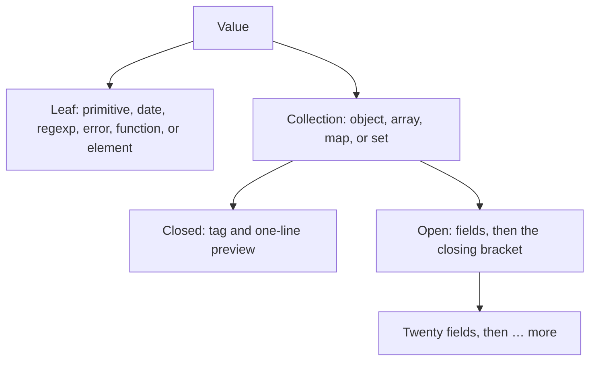

# Inspector

## When to use

- The person reads one value and expands or collapses its objects, arrays, maps, and sets. The caller already holds that value in an atom. This component does not fetch, copy, or edit it.

## When not to use

- Rows that share columns. Use [DataGrid](./data-grid.md).
- A cause chain. Use [RailGraph](./rail-graph.md).
- One collapsed product section, such as advanced filters. Use [Disclosure](./disclosure.md).
- Switching Overview, Cause Chain, History, and JSON for one record. Use [InspectorTabs](./inspector-tabs.md). Those panels may contain this tree.
- Editing the value, or copying it as JSON. The caller owns those actions beside the tree.

## Public API

Import `Inspector` from `src/view/inspector`.

```tsx
<Inspector value={payload} defaultExpanded />
```

- `value` is an atom of the unknown value. Pass an atom so a later write updates this tree. Wrap a one-off snapshot in an atom before passing it.
- `defaultExpanded` optional. Omit it, or pass false, to start the root closed. Pass true to start the root open. Nested collections stay closed either way.
- `name` optional. When set, the tree is prefixed with that name and ` = `.
- `hooks` optional. Omit it for the default walk of objects, arrays, maps, and sets.

`hooks.expandable` returns false to show that object as a single tag instead of a collection. `hooks.entries` replaces the walk for one value; return `undefined` to keep the default, and return an empty list for an empty object. `hooks.fieldLabel` names a walked field. `hooks.fieldActions` supplies buttons for a walked field that did not set `actions`. `hooks.initiallyExpanded` opens the root or a nested collection when it returns true for that value.

A field button's accessible name is its `label`. An empty `actions` list means that field has no buttons. Omit `actions` to ask `fieldActions`.

When a slot has no value and should show a sentence such as "No payload", the caller writes that sentence and does not mount this tree. `undefined` inside a mounted tree is the leaf `undefined`.

Colors and type come from [tokens.ts](../../src/view/design-system/tokens.ts).

## Behaviour and states

A value is either a leaf or a collection:



The caret button toggles a collection. A closed collection shows its tag and a one-line preview. A closed object shows the first three keys, then `…` when more keys remain. Arrays, maps, and sets preview at most 20 entries. Nested values in that preview stay tags. An open collection lists fields. After 20 fields, "… more" reveals the next 20. Objects use braces. Arrays use brackets and show their length. Maps show `key => value`. Sets list their values. A hole in an array reads `empty`, or `empty × N` when several holes are adjacent.

Leaves show their text, including null, undefined, numbers, booleans, dates, regexps, errors, functions, and elements. A string longer than 100 characters shows a shortened quote and "Show truncated". That button reveals the full string. A getter that throws shows `[forbidden]`.

The component does not copy, download, or format a second editor.

## Accessibility

Each collection toggle is a button with `aria-expanded`. Its name is the opening tag, such as `Object {` or `Array(3) [`. "Show truncated" and "… more" are buttons. A field action uses its label as the accessible name. The caller does not add another tree for the same value, and does not put the empty-slot sentence inside this component.
