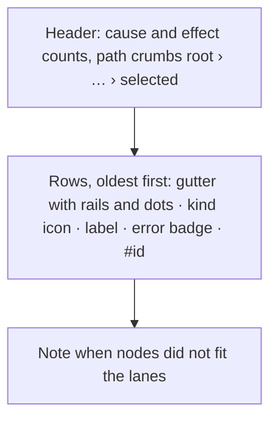

# Rail graph

## When to use

- The person is looking at how records caused each other, and each node has an id, a label, a kind, a timestamp, parent ids, and whether it failed. One node is selected. The caller updates that selection and may re-root the chain on a double-click.

## When not to use

- A table of records that share columns. Use [DataGrid](./data-grid.md).
- One value. Use [Inspector](./inspector.md).
- The waterfall of durations. That stays the product Gantt.

## Public API

Import `RailGraph` from `src/view/design-system`. Relation colors come from `railTokens` and `tokens` in [tokens.ts](../../src/view/design-system/tokens.ts).

```tsx
<RailGraph
  nodes={nodes}
  selectedId={selectedId}
  onSelect={selectNode}
  onReroot={reroot}
/>
```

- `nodes` is the cause chain. Each node has `id`, `label`, `kind`, `timestamp`, `parentIds`, and `hasError`. The caller maps those from the record. The component keeps only nodes connected to `selectedId` and lays them into lanes.
- `selectedId` is the selected node id. The chain splits the other nodes into causes, effects, and related nodes around it.
- `pathIds` optional. When it is a parent chain that ends at the selection, it is the emphasized path. Otherwise the component uses the shortest path from a root.
- `onSelect` receives the node id from a click on a row or a path crumb.
- `onReroot` receives the node id from a double-click or Shift+Enter on a row.

`layoutRailGraph(nodes, selectedId, pathIds?)` returns the same layout as plain data for tests and other renderers.

## Layout



- One row per node, ordered so parents always sit above children. Ties use timestamp, then id. Labels never share space with rails.
- The path from the root to the selection is a straight trunk in lane 0. A node continues its parent lane when it is the latest child; earlier siblings peel off into a shared lane. A second parent joins the child right above it.
- Lanes are reused once a branch ends. At most `MAX_RAIL_LANES` lanes are drawn. Nodes that do not fit are hidden and counted in a note under the list.

## Behaviour and states

- Color carries the relation, not the lane. Causes use `railTokens[0]`, the selection uses `tokens.info` with a ring, effects use `railTokens[2]`, and related nodes are hollow `tokens.text3` dots. An error node has an error dot and an `error` badge.
- Path edges are drawn at full strength. Other edges are softer.
- Hovering or focusing a row traces it: its direct edges and neighbour rows light up and the rest of the rails dim.
- The selected row has `aria-current`, a tinted background, and scrolls into view.
- A chain of one node says that it is a root event with no recorded cause.
- At narrow widths the `#id` column hides. The label truncates and its full name stays in the row title.

## Accessibility

Rows are buttons in an ordered list named "Cause chain, oldest first". Each button is named with its label and id and has `data-node-name` with the label. Arrow Up, Arrow Down, Home, and End move focus between rows. Enter selects. Shift+Enter re-roots. The path is a `nav` named "Shortest path from root" with one button per step. Rails, dots, and legend markers are hidden from assistive tech. The caller provides node labels that match the record names.
