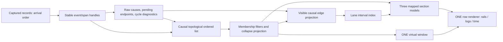

# Linked list derivations and causal rails

**Status**: `complete` · updated 2026-10-23

## Implementation tracker

This file is the persistent source of truth for implementation and verification. Root coordinates and updates this tracker; both implementation agents run `gpt-6.1-sol` at `xhigh` and share this checkout.

| Deliverable | Owner | Status | Completion evidence required |
| --- | --- | --- | --- |
| Reliable positional list operations and chainable derivations | `/root/sol_core_jsx` | Complete | 184 core tests pass; one existing expected failure; core typecheck/build pass |
| Mounted rows retain live fragment bindings and focus during movement | `/root/sol_core_jsx`, after core | Complete | 128 JSX browser tests pass; two existing skips; JSX build passes |
| One causal event row with all recorded causes and stable identity | `/root/sol_admin` | Complete | 356 admin tests pass across 50 files, including fan-in, hidden bridges, boundaries, skew/cycles, late promotion and arrival-order compatibility |
| Graph, logs and time remain aligned through filtering and scrolling | `/root/sol_admin` | Complete | Five causal journeys pass; 26 selected regression journeys pass; root visually reviewed diamond/passing rails and fixed scoped Escape handling |
| Documented contracts and measured incremental behavior | Both agents; root reviews | Complete with documented performance/tooling limits | Canonical references, admin DESIGN, reproducible benchmark harness and 104 measurements are saved; existing baseline failures are listed below |

- [x] Product decisions P1–P3 are resolved below.
- [x] Implementation ownership is split between two Sol agents at `xhigh`.
- [x] Initial core verification: 81 tests passed plus one expected failure across linked-list, derivations, view and virtual suites; build typecheck passed. Rerun after agent revisions.
- [x] Initial admin compatibility verification: 20 ingest/mount tests passed. Rerun after agent revisions.
- [x] Complete and review core contracts and incremental operation coverage.
- [x] Complete and verify JSX movement/rebuild behavior in a browser.
- [x] Complete and verify admin causal model and UI.
- [x] Complete integrated checks, performance measurements and documentation.

### Final verification and limits

| Check | Result |
| --- | --- |
| Core regression suites | 184 pass; one existing expected failure; core build/typecheck pass |
| JSX browser suites | 128 pass; two existing skips; JSX build passes |
| Admin unit suites | 356 pass in 50 files |
| Affected product browser regressions | 26 pass in six files; five confirmed legacy cases excluded as detailed below |
| Scoped keyboard/causal follow-up | Nine journeys pass across DebuggerWorkspace and causal stories; native Escape was also verified manually |
| Admin build | Passes after the final keyboard correction |
| Formatting | Targeted formatting and diff whitespace checks pass; generated screenshots/attachments were restored or removed |
| Performance | 104 measurements with five warm-ups and 20 samples each, plus structural counters, saved in `packages/admin/bench/results.jsonl`; analysis in `packages/admin/bench/README.md` |

Existing tooling/baseline exceptions are explicit, rather than described as clean checks:

- Full admin typecheck still reports existing assertion, gallery and Storybook errors. No diagnostics remain in the new causal production/test/story files or the changed timeline integration. Standalone benchmark typecheck reaches an existing unused `@ts-expect-error` in the user's `core/src/extensions/withCache.ts`.
- ESLint cannot start with the current TypeScript 7/typescript-eslint combination; the task does not modify that toolchain.
- An isolated HEAD admin comparison, using the current core/JSX, reproduces `Mode switch keeps selection`, `Filter calculator narrows rows`, both paused screenshot mismatches, and the unhandled `Service Unavailable` rejection in `GitHub stars failure`. These five cases are excluded from the clean regression run. Their unrelated expectations/baselines were not rewritten. Legacy tree fixtures now select their mode explicitly, and assertions about restored/filterable records no longer assume those records are mounted in the virtual window.
- Certified append avoids full graph sorting/projection traversal and source-array conversion, but immutable snapshot publication still copies O(V+E) maps/arrays. At 100k records, rare content revisions and late causal reorderings can take over a second; measured costs are documented. No constant-time append, incremental-content, or browser-frame-rate guarantee is claimed.
- Mixed causal-step/compressed-time display remains the author-approved follow-up outside this scope. Headless allocation measurements do not replace a full browser heap profile.

The implementation and core design plans are saved under the requested `logs` directories. The repository ignores those directories; explicitly force-add those two files if they should accompany a future commit.

## Outcome and scope

Build the approved **Causal rails** timeline: a Git-style causal gutter, selectable record text, and duration bars, aligned on the same event rows. Each section is independently visible and resizable. There is exactly one authoritative row sequence, one vertical scroll position, and one virtual window. A computed update with two causes is one event with two incoming edges; never duplicate it to make a tree.

The concept reference is `/Users/artalar/.codex/generated_images/01a16545-1efe-7771-925c-366030e1436d/exec-ec0f5c24-d0f0-4162-bb69-231ec4fdb2ed.png`. It establishes the composition and causal-rail direction, not exact pixels, measured timing, or additional telemetry facts.

Keep the incremental pipeline: captured-record linked list → raw causal graph and ordered projection → filters → list-level reductions/indexes → per-section mapped models → one window. Core collection work, admin model work, and product UI work must be independently reviewable. The tracker above records implementation progress; the specification below defines the required behavior.

Repository paths below are relative to `/Users/artalar/code/reatom`. Read the current working tree before implementation: it contains substantial unrelated work. Do not revert, overwrite, or format unrelated changes. Canonical skill documentation lives under `skills/`; do not edit or synchronize its symlink copies. Follow `packages/admin/AGENTS.md`, `packages/admin/DESIGN.md`, and `packages/admin/.storybook/README.md` for their respective work.

## Evidence from the current code, audited 2026-10-22

| Area | Verified behavior | Consequence |
| --- | --- | --- |
| `packages/core/src/primitives/reatomLinkedList.ts` | Root nodes carry factory-owned intrusive link symbols. A batch mutates links in place and publishes a version plus only that commit's changes. Existing `move` is `{ kind: 'move', node, after }`. | Preserve that shape; a second incompatible `move` union member is not safe. Old list states are not immutable order snapshots. |
| Same file | Mapping uses `peek(cb, origin)`. Removed origins are deleted from its WeakMap; clear replaces the map; missed versions rebuild every mapped value and invoke clear/create hooks. | Reusing the WeakMap only during rebuild does not preserve state across hide/show. Cache and hook semantics need an explicit contract. |
| `packages/core/src/primitives/reatomView.ts` | Cursor reuse accepts unchanged state or one append-only `create`/`createMany` version. Other changes walk from head/tail. | Positional changes are correct only with updated replay/fallback handling; they are not automatically O(delta). |
| `packages/core/src/primitives/reatomVirtual.ts` | Uniform row geometry is cheap; measured/nonuniform geometry builds O(n) prefix sums. Current scroll state retains a numeric offset. | Keep fixed 26px rows initially. Insertions above a paused viewport need stable-row anchoring beyond merely keeping scrollTop. |
| `packages/jsx/src/index.ts`, `walkLinkedList` | Moves/swaps assume single elements; live fragments have start/end comments. Missed versions clear/reappend the DOM. | Fragment run replay and rebuild must move complete live ranges, preserve retained bindings, and distinguish movement from removal. |
| `packages/admin/src/otlp/ingest.ts` | `records` is an array atom; IDs contain an ingest sequence. Times are converted from nanoseconds to integer milliseconds. Existing spans can be mutated by exception joining; local values are also trimmed in place. | Equal times do not identify a transaction; payload changes need notification even when list membership does not change. Deduplication cannot rely on current IDs alone. |
| `packages/admin/src/otlp/chrome.ts` | Matching, filter mode, analytics scope, quick toggles, and synthetic in-progress parents are separate stages. `ganttRecords` scans `visible.some` for every placeholder. | Preserve all filter meanings and eliminate nested scans with indexes. Placeholder rows are not raw OTLP records. |
| `packages/admin/src/gantt/records.ts` | Span parentage uses source + trace + span; logs attach to their owning span. Cause IDs and dependency links are not read. | Current waterfall is a containment tree, not the causal graph. |
| `packages/admin/src/gantt/reatomGantt.ts` | It converts sources to arrays, orders/flattens them, and owns a virtualizer. Waterfall and Log differ in row order. Analytics Paths is another real tree consumer. | Passing a filtered linked list alone does not make this pipeline incremental. Preserve the tree API for Paths; add a sequence path for Records. |
| `packages/admin/src/otlp/bind.ts` | Frame resolution and cross-trace `computed.dependency` links already exist. The selected graph prefers a span to a log for the same trace/frame, requires numeric frame IDs, and lacks source scoping in its frame key. | Reuse the semantics after strengthening identity/resolution; do not reuse its assumptions as a universal event identity. |
| `packages/admin/src/view/design-system/rail-layout.ts` and RailGraph contract | Selected connected subgraph, topological row order, selected trunk, maximum five lanes with hidden overflow nodes. | Keep RailGraph's inspector behavior. A complete timeline needs a separate layout; its rows must never disappear because lanes are full. |
| `packages/opentelemetry/src/withOTel.ts`, `packages/opentelemetry/src/causes.ts` | Unchanged atom/computed results are skipped with `Object.is`; causes are callers/changed dependencies. Cross-trace computed updates can be zero-duration spans under the latest changed traced cause, with links to other traces; other updates are logs. | Describe recorded state changes, not all evaluations/reads or the static dependency graph. Missing events are possible and must not be invented. |
| Telemetry and `AdminRecord` | No synchronous transaction/batch identity is supplied to admin. Transport batches and groups of equal timestamps are not synchronous execution batches. | A true mixed causal-step/time axis requires an explicit data contract. |

These are source-reading findings, not claims that new behavior has been tested.

## Product decisions resolved by the author

| Decision | Approved behavior | Implementation consequence |
| --- | --- | --- |
| P1 — Time axis | **Real time first.** The mixed causal-step/compressed-wait axis is a follow-up outside this implementation. | Keep actual timestamps and duration bars. Do not add batch telemetry or inferred execution groups in this scope. |
| P2 — Hidden causes | **Bridge hidden intermediates with dashed rails and hidden-step counts, respecting source/scope boundaries.** | Traverse all causal paths to nearest visible predecessors; do not bridge excluded boundaries. Distinguish bridges from direct recorded edges. |
| P3 — Row order | **Causes before effects.** Preserve actual timestamps on the bars. | The admin owns a causal topological ordered projection before visibility filtering. Timestamp order is only the tie-breaker among ready events. Late causes can reorder rows; preserve the viewport anchor and unaffected lanes where feasible. |

These choices supersede the original plan's chronological-row assumption and mixed-axis implementation scope. A valid causal graph must put each known cause above its effect even when clocks disagree. Cyclic input cannot satisfy that ordering; it receives the explicit diagnostic behavior below.

Recommended UI defaults, subject to the product contracts: preserve a hidden selection and inspector with “Hidden by filters” feedback; keep at least one section visible; restore a section's prior width when shown; do not compact lanes automatically while live data arrives. These are implementer defaults, not previously observed current behavior.

## Pipeline ownership and phase dependencies

The captured-record list retains capture/arrival order for compatibility. An **admin-owned ordered projection** is the sole owner of causal row order; it uses stable timeline handles and `insertMany`/`moveMany` to publish changes. This avoids changing State, History, Analytics or MCP ordering as a side effect of the timeline. Filtering takes place after complete-graph ordering, so hidden intermediates still constrain the order of their visible causes and effects.



Implement Phases 0–4 first. In admin, Phase 5 establishes capture compatibility and stable handles; Phase 6's raw-edge extraction and topological projection then precede its visibility/interval indexes. Only after that projection exists, wire the Phase 5 filters to it and finish Phase 7 rendering. Tests for each layer can land separately. The phase headings organize responsibilities; they do not permit filtering away evidence before causal ordering.

## Non-negotiable invariants

1. Every visible event has exactly one row identity shared by all three sections. Multiple causes add edges, not rows.
2. All sections consume the same final row sequence and window. There are no independent sort/filter/virtualizer instances for the cells.
3. Span containment, recorded causation, and arbitrary OTLP links remain distinguishable. An owning span is not silently labeled a changed dependency.
4. Raw records, synthetic placeholders, canonical causal events, and rendered row models have different responsibilities and explicit identities.
5. Filters change membership or emphasis according to their mode. They do not mutate raw records, select a different event, or manufacture direct causal facts.
6. Structural change logs preserve ordering and version continuity for connected consumers; lazy consumers may miss versions and must recover correctly.
7. Index derivations do not write per-row atoms during computed evaluation. Row computeds read shared indexes lazily; connection lifetimes own subscriptions.
8. No consumer mutates another consumer's change payload or uses already-mutated node links to reconstruct an old order.
9. No arbitrary lane limit hides event rows. Overflow is a presentation state with an explicit affordance.
10. Every complexity claim names its input size, required index, and fallback. A new wrapper identity does not make mutable data immutable or context-safe.

## Phase 0 — Freeze contracts and run bounded design probes

Write `packages/core/logs/linked-list-derivations.md` using the `reatom-api-design` format. Record constraints, actual call sites, mental traces, Zen rubric findings, rejected directions, and the selected semantics. Audit all consumers of `LLChanges`, public link symbols, `.reatomMap` hooks, `.array`, `reatomView`, and `reatomVirtual`, including examples. Compare: retaining arrays with admin-local indexes; chainable list derivations; and extending existing sequence/window primitives. Keep domain-specific causal layout in admin.

Before coding broad migrations, settle these engineering gates with small focused tests/probes and update the log:

- **E1 — Intrusive links and contexts:** current symbols are allocated per model factory, not per context. Per-context reducer state does not prevent the same node object from being relinked in two contexts. Verify ordinary independent context allocations, reused initial node arrays, inherited state, and source/derived symbol access. Either implement compatible context-local link ownership or explicitly reject conflicting ownership before mutation and document the restriction. Do not claim shared-node context isolation without proving it. This choice may affect public symbol access; inspect callers before changing it.
- **E2 — Failure atomicity:** validate complete runs before writing any links. Probe throws midway through nested `list.batch`, a failing node factory, and derived callbacks. Establish and test link restoration on failure (including head/tail/size, labels, membership and versions) or a safe, explicit unsupported transaction boundary. An exception must not leave published state with corrupted pointers. Reatom `withRollback` restores atom values; that alone cannot restore intrusive links.
- **E3 — Mapping identity versus lifecycle:** distinguish stable model identity from DOM lifetime. A removed DOM element is cleaned up by JSX; reinserting that object does not automatically revive its handlers. Decide how retained live fragment ranges and element nodes reconnect, or keep DOM allocation confined to the virtual window and only promise model identity across full unmount. Required: surviving/moved mounted rows keep DOM and handlers; hide/show keeps row model state. Do not promise full hide/show DOM reuse until a remount test proves it.
- **E4 — Record content updates:** prototype the admin-local stable row handle described in Phase 5. Choose a narrow changed-row/revision mechanism for filters and edge indexes, alongside the structural list. Do not add a generic core mutation protocol merely to carry OTLP payload changes. Verify exception attachment, completed spans, local-value pruning and cause-link enrichment.

Resolve these gates before publishing new core API signatures. The resolved product choices above apply throughout; the independent core probes do not need more product decisions.

### Proposed public surface

Names below are the proposed implementation baseline, not existing APIs. Preserve existing root mutation and mapping options.

```ts
// A readonly sequence source must accept both a root atom and a derived computed.
interface LinkedListSource<Node extends LLNode>
  extends Computed<LinkedList<Node>>, LinkedListSymbols {
  __reatomLinkedList: true
  array: Computed<Node[]>
  // Existing reatomMap callback/options retained, with chainable result.
  reatomMap: MapDerivation<Node>
  reatomFilter: FilterDerivation<Node>
  reatomReduce: ReduceDerivation<Node>
  has(node: Node): boolean
  compare(a: Node, b: Node): -1 | 0 | 1
}

// Root-only mutators; derived sources expose no .set or structural actions.
insertMany(nodes: readonly Node[], after: Node | null): Node[]
moveMany(nodes: readonly Node[], after: Node | null): void

// Add discriminants without changing the existing single-node move payload.
type AddedChanges<Node> =
  | { kind: 'insert'; nodes: Node[]; after: Node | null }
  | { kind: 'moveMany'; nodes: Node[]; after: Node | null }

type Predicate<Node> = (node: Node) => boolean
reatomFilter(
  predicate: Predicate<Node> | Computed<Predicate<Node>>,
  name?: string,
): LinkedListSource<Node>

reatomReduce<State>(options: {
  init(): State
  apply(previous: Readonly<State>, change: Readonly<Change<Node>>,
    source: Readonly<LinkedList<Node>>): State
  rebuild(previous: Readonly<State> | undefined,
    source: Readonly<LinkedList<Node>>): State
}, name?: string): Computed<{ readonly state: State; readonly version: number }>
```

`MapDerivation`, `FilterDerivation`, `ReduceDerivation` and `Change` above are explanatory aliases; implementation must export only the minimum necessary public types and add type tests. Do not cast a readonly derived computed to the current writable `LinkedListLikeAtom` merely to satisfy existing signatures. Widen readonly consumers to a shared source type and retain root mutation interfaces.

## Phase 1 — Positional runs, commit semantics, and replay

Files: `packages/core/src/primitives/reatomLinkedList.ts`, its tests, `packages/core/src/primitives/linkedListBatching.ts`, `packages/jsx/src/index.ts`, `packages/jsx/src/linked-list.test.tsx`.

### Operation contract

- `insertMany` accepts actual object/function nodes, not factory argument tuples. It inserts absent nodes in the supplied order immediately after `after`; null means the head. `createMany` retains its existing factory-argument contract and append event. Return the inserted node objects. A removed node may be reinserted when ownership permits.
- A non-null anchor must currently belong to this list. Reject duplicate run entries, nodes already present on insert, foreign/unowned nodes on move, and an anchor inside the moved run before changing anything. Foreign anchors must never silently become head/tail operations.
- `moveMany` takes one contiguous current run in source order. Reject noncontiguous or reversed inputs; callers split arbitrary selections into runs. The anchor is interpreted after detaching the run. Empty runs and moves already at their destination are no-ops. A no-op must not emit a structural change; if root batching currently bumps an empty version, preserve/document that separately until compatibility is evaluated.
- Keep existing `{ kind: 'move', node, after }`, `create`, `createMany`, `remove`, `removeMany`, `swap`, and `clear` shapes. Do not rename old events. Internal replay may normalize them to run operations, but public change logs preserve compatibility.
- Record a copied run array so callers cannot later change its membership. Treat change objects as readonly for consumers. A run requires O(k) validation and link assignment for k nodes; only boundary reconnection is O(1). Do not call the full operation “one relink” or O(1).
- `removeMany` may contain nonadjacent nodes; retain its semantics. A filter's newly hidden set emits `removeMany`, not `{kind:'remove', nodes}`.
- Replay operations in commit order with the consumer's own prior structure. Append means after that consumer's tail at that operation, not after the final source tail. Anchors must be translated through the consumer's identity map.
- A missing version or reset epoch triggers one rebuild; never attempt to replay the latest `changes` as though it contained intervening commits. Do not store historical source `head`/`tail` pointers as an immutable old snapshot.

### JSX range replay

Define internal range primitives for a normal element or a live fragment: first boundary, last boundary, extract complete range, insert range before a DOM anchor, remove range. For live fragments include both comment markers and every current node between them; the DocumentFragment object itself is usually empty after mount. Native unmarked DocumentFragments remain unsupported.

Use range operations for existing move/swap as well as new run kinds. Flush pending append runs before a positional operation. Capture safe boundary references before extraction, including adjacent swaps, head/tail moves, empty/nested/dynamically changing fragments, and mixed element/fragment runs. A run can use one native fragment insertion but must still visit all DOM nodes being moved. Never consume or modify the shared `changes` array.

On rebuild, reconcile retained identity/ranges rather than `innerHTML = ''` followed by appending emptied fragments. Move retained ranges; remove only absent ranges. Confirm the mount observer does not dispose synchronously moved rows and that true removal disposes bindings once. Focus and text selection in retained input rows must survive a move. The E3 result governs whether a fully removed row can be reused after remount.

**Exit checks:** old list/mapping consumers retain their event shapes; mixed-operation reference-model tests preserve bidirectional pointers and size; two sibling JSX subscribers see the same payload; fragment bindings still react after moves and missed-version reconciliation.

## Phase 2 — Readonly chainable derivations and reduction

Extract mapping into a source-based helper; attach derivation methods to root, mapped and filtered sources. Keep `.array` as a lazy compatibility view, not the hot pipeline. Derived state has its own emitted `version` plus a private consumed `sourceVersion`/epoch. They cannot be the same counter: predicate-only changes and source changes that affect no visible nodes are normal cases.

- Read and validate the upstream source, and propagate the batching guard through every derivation. A stale already-cached read may follow existing behavior, but any recomputation that would inspect an in-progress intrusive structure must throw. Test root → filter → map → view/virtual and root → reduce inside a batch.
- On sourceVersion unchanged, do not replay old changes. On sourceVersion + 1, replay this commit. On a missed/reset version, reconcile from current source. A filter may advance its private consumed version without emitting a visible membership change. Global-predicate changes advance the filter's own version when its output changes.
- No output change: preserve the previous result/wrapper when appropriate. A derived reset cannot masquerade as an empty incremental update; publish a replayable diff or an explicit resync indication understood by all consumers. Prefer a diff for connected filters.
- Mapping caches source-object → mapped-model identity weakly within the current context. Temporary membership removal does not delete the allocation cache; active membership is tracked separately. Reuse known mappings after missed versions and hide/show. A new object with the same ID is not automatically the same generic list node.
- Clear/source replacement ends an identity epoch unless the owner deliberately restores the same handles for undo. Release strong active membership and index references. A WeakMap cache must not become a parallel strong history store.
- Existing hooks need documented compatibility: define `onCreate`/`onRemove` as membership transitions (including re-entry with a cached mapped model), `onMove`/`onSwap` for actual changes, and `onClear` only for a real clear/reset. Never report a retained row as destroyed merely because a consumer missed a commit. Audit published hook users before adopting this change and document any behavioral migration. Hooks are not DOM mount/unmount callbacks.

### Reducer purity and context

`init()` is a factory invoked per evaluation context, not a shared `init: new Map()` object. Reducer callbacks read inputs and return state; they do not call `.set`, mutate source links, invoke row callbacks, or allocate external subscriptions. `apply` must not mutate previously published semantic state. Use persistent structures or copy-on-write paths for large indexes; cloning an entire Map for each edge would make the incremental path O(E).

The proposed `{ state, version }` wrapper is only a notification boundary. It does not make in-place mutation safe. Any private memoization must be context-scoped and observationally transparent; prior semantic snapshots must not change underneath readers. Define the semantic distinction from the linked list's intentionally intrusive representation.

`apply` receives the final source state of the commit, not a historical state after each change. Use explicit change payloads plus reducer-owned previous membership to interpret each change. Do not walk mutable source neighbours to infer a deleted node's old location. `rebuild` receives the previous state for identity reuse if useful, but reconstructs correctness from the current source after a gap. Initial reduction uses `init` followed by a current-source rebuild even when source changes are empty.

Reducer callbacks' incidental atom reads are untracked; external reactive configuration belongs in an explicitly tracked surrounding computed or prepared input, with a documented rebuild on configuration change. Keep the first API small; no registration/disposal protocol for index consumers.

**Exit checks:** map → filter → map and filter → reduce work; two contexts own separate accumulators; unchanged source versions do not double-apply; skipped versions, reset, empty commit and predicate-only commits converge; retained mapping allocations and hooks behave as documented; a failed reducer leaves its last good result intact and can recover.

## Phase 3 — Filter membership and explicit reactive inputs

A filter reuses the original node object but owns separate links and membership. Root and sibling filter links must remain intact. `has(node)` reads current membership in O(1), including empty and singleton cases; the presence of link properties alone does not prove membership after removal/clear. Follow the source-context ownership decision from E1.

An arbitrary predicate cannot magically distinguish a global atom read from a per-node atom read. Use the explicit prepared-predicate form for reactive global inputs:

```ts
const predicate = computed(() => {
  const query = filterQuery()
  const scope = currentScope()
  return (row: TimelineRow) => matches(row.record(), query, scope)
}, 'timeline.predicate')
const visible = rows.reatomFilter(predicate, 'timeline.visible')
```

Evaluate the returned predicate under `peek`; the factory tracks query/scope, while evaluating every row does not subscribe to every row atom. A plain callback is the static form and is also peeked. This is a deliberate clarification of the original “globals tracked, node fields peeked” promise. Document that changing a row atom alone does not automatically re-test its membership; Phase 5's content-update adapter supplies that invalidation. Do not ship silently stale filtering.

On source structural commits, test only inserted/changed candidates where the predicate permits it; remove vanished members and reconcile moved runs. Finding a visible insertion predecessor by walking hidden nodes costs the hidden gap length, potentially O(n). Reuse the last predecessor across a contiguous run; if profiling requires an order/membership predecessor index, add it with measured justification rather than claim O(delta) for backtracking.

On prepared predicate changes, make one source-order pass. Keep passing nodes in place, emit a `removeMany` of newly hidden nodes, and insert contiguous newly visible runs after their final surviving predecessor. A predicate edit alone emits no moves of retained nodes. “Minimal diff” means no unnecessary removal/recreation of retained members; it does not claim an optimal general edit script for arbitrary reorder.

Process simultaneous source and predicate changes against one final source snapshot; avoid evaluating removed nodes or inserting a newly visible node twice. A skipped source version requires a membership reconciliation and may cost O(n). A connected output can publish the resulting diff incrementally even though its input was rebuilt. A lazy downstream consumer may still miss versions; do not promise it never will.

`show`/`hide`/`exclude`, `highlight`, trace candidate scope, analytics scope, abort/suspense and mount toggles retain their current semantics. Highlight affects per-row appearance and counts, not row membership. Calculator predicates involving other records require indexed global dependencies and an explicit invalidation set; do not reduce them to independent per-node text predicates.

**Exit checks:** all/none/alternating membership, singleton, hidden gaps, move/swap across hidden members, simultaneous query and ingest, nested filters, quick toggles, rejected calculator input, and content-update invalidation. Map state survives hide/show and skipped commits; DOM checks obey the E3 contract.

## Phase 4 — Order maintenance, indexes and virtual windows

Each ordered sequence owns its comparison order. `compare(a,b)` returns -1/0/1 for present members; missing/foreign members throw a named error. Identity equality returns 0 only for a present member. Filter and map order agrees with their source projection.

Gap-based labels are an implementation choice, not exposed persistent IDs. Start with finite numeric labels and detect exhausted gaps before precision collapses. Relabel a bounded neighbourhood where possible, with a documented O(n) fallback; insertion/movement is not unconditionally O(1). Stress repeated insertion at one position, endpoints, huge run sizes and safe-integer limits. Track relabel work in benchmarks.

Order-index rules:

- Store row handles/endpoints, not copied numeric labels, in indexes that must survive relabeling. A pure relabel preserves relative order and must not invalidate comparisons or cached max-end augmentation.
- A move changes relative order. Remove/reinsert affected ordered entries or rebuild before queries; a balanced tree using a comparator with mutated keys is otherwise corrupted. Keep an order revision for invalidating dependent slices and rank lookups.
- `compare` alone gives neither O(log n) insertion search by timestamp nor O(log n) rank lookup. Add an admin-owned ordered time/rank index if those costs are required; identify its maintenance work explicitly. Do not binary-search a linked list by walking from its head repeatedly.

The timeline orders causally, as specified in Phase 6. Among simultaneously ready events use available start time, stable ingestion ordinal, then scoped key as a total tie-breaker. Do not derive causation or batch identity from timestamp equality. Preserve actual available timestamps on bars. Replaying the same ordered capture preserves these keys; a differently ordered import of otherwise indistinguishable logs may legitimately receive different ordinals. Timestamp-to-row navigation must query a time index and resolve the chosen handle to its causal row rank: causal rows are not sorted by time, so `rowIndexAt` cannot binary-search their timestamps. Document the sequence path's time-navigation semantics independently of the existing waterfall/root behavior.

Virtualization has one owner and receives the final linked-list sequence directly. Keep fixed row height and overscan initially. Extend `reatomView`'s cursor treatment for the new event kinds and prove fallback correctness; optimize positional cursor rank updates only with sufficient change/rank data. Otherwise document O(min(offset, n-offset) + window) fallback.

When follow is off, anchor by the first visible stable row plus its within-row offset before a model commit. After inserts/removals/moves/filtering, restore that row's position, choosing the nearest surviving neighbour if it disappeared. This is an explicit model/virtualizer integration; current numeric offsets do not guarantee it. Follow on remains pinned to the end; a late insertion above the end must not spuriously toggle follow. Do not adjust both browser scroll anchoring and model anchoring.

**Exit checks:** label relabel does not change interval-query results; movement does invalidate/rebuild appropriate indexes; viewport anchored through late inserts and completion timestamp corrections; append below a non-following viewport leaves mounted rows unchanged; window clamps correctly after clear/filter/resize.

## Phase 5 — Admin identity, ingestion and compatible data surfaces

Files include `packages/admin/src/otlp/ingest.ts`, `packages/admin/src/otlp/chrome.ts`, `packages/admin/src/otlp/filter.ts`, `packages/admin/src/otlp/bind.ts`, `packages/admin/src/otlp/inProgress.ts`, `packages/admin/src/gantt/records.ts`, `packages/admin/src/gantt/selection.ts`, analytics and MCP consumers.

### Separate raw data, stable row handles and rendered models

Introduce a root linked list for captured records in their existing capture/arrival order and an admin-owned projected timeline sequence that can contain synthetic span handles. Phase 6 owns that projection's causal topological order; the raw store is not sorted by start time or causality. Preserve the public `store.records()` array shape and capture/arrival order as a lazy compatibility computed over captured records while migrating consumers. State, Graph, Analytics, export and MCP must not unexpectedly receive linked-list states or synthetic placeholders. Audit writable uses of `records.set` and route them through store actions.

Proposed admin-local handle:

```ts
interface TimelineRow {
  key: string                 // stable, scoped identity in this capture
  record: Atom<AdminRecord>   // current immutable record snapshot
  synthetic: Atom<boolean>   // completion changes content, not handle identity
}
```

Keep UI atoms (expansion/selection-local state) on mapped models, not exported OTLP objects. The handle is a proposal to be validated by E4; reuse an equivalent existing mechanism if the audit finds one. One handle owns one event; three mapped section models refer to that same handle.

Identity domains:

- Capture/session epoch prevents new data after clear or replacement from accidentally reusing IDs of a previous stream. Undo explicitly restores its captured epoch/handles where appropriate.
- Span identity is capture + source + trace + span. Scope all internal indexes accordingly. Retain the older convenience lookup APIs only with documented multi-match behavior; they are not unique identity maps.
- A framed Reatom change needs a stable scoped frame/event key; do not parse arbitrary IDs into floating-point numbers. Determine frame namespace from telemetry evidence. Match local cause IDs within their capture/source context; cross-trace link trace/span/frame fields select the linked namespace explicitly.
- Ordinary logs without frame IDs remain distinct records, including repeated logs with equal timestamps/names/body. Dedup only with a trustworthy transport/event key or a proven repeated-import item identity; never dedup by display text/time alone.
- Multiple OTLP representations of a *proven same Reatom change* resolve to one causal event, with a canonical record (completed span preferred where appropriate) and raw aliases retained for export/inspection. Do not collapse an exception or other independent log merely because it shares an owning span or frame. One computed event must not be materialized once per cause.
- Synthetic in-progress rows use stable scoped span identity and remain absent from raw exports/MCP. Label them as provisional and do not assign invented causal frames.

### Atomic ingest and updates

Normalize and validate incoming data first; compute identities and raw index changes before committing. Append captured records in the existing capture/arrival order and batch list mutations once per ingest chunk. Update raw causal evidence, then let the Phase 6 topological projection compute timeline insertions/moves. Its certified append path avoids a full graph rebuild for eligible batches; late/middle data follows the documented reconciliation path. Do not sort the captured store by time to position timeline rows.

Maintain span/frame/record indexes and visible-log counts by scoped span key. Replace `visible.some` placeholder matching with those counts/sets. Preserve `onClear`, local-values masking, value limit, exception enrichment, remote/replay replacement, and pause behavior.

Completion updates the existing provisional handle's `record` and `synthetic` state; it does not destroy the selected/expanded row model and insert an unrelated one. The true span start can differ from the earliest log that created the placeholder. Reconcile causal order and ready-set tie-breaking, updating its order key and issuing a move if required; do not promise “same position.” Preserve selection history aliases and re-anchor the viewport. A complete span arriving before its logs must never create a second placeholder later.

Structural list updates and payload updates are separate. E4 must define a compact admin-local commit delta for changed handles or reuse an existing revision mechanism. At minimum record which rows changed searchable values, error/outcome, start/end, frame/causes/links and local-value availability. Apply row atom writes and delta publication in the ingest action, not in an index computed. Filters/indexes must consume this delta or intentionally rebuild on a content revision, including missed-revision fallback. The first correct content-revision fallback may scan O(n); benchmark and replace it before claiming incremental content processing. Do not hide this cost in `reatomReduce`.

Pause is currently an ingest gate (`if (paused()) return`), not a store queue. Preserve source-specific buffering/counters in their owner; do not promise replaying dropped calls on resume. Preserve distinct live/replay/remote clear behavior and the public array-based consumers during migration.

**Exit checks:** old raw-record outputs remain equivalent; scoped collisions do not cross-connect; same-span completion keeps one handle and valid selection/history; exceptions and value trimming refresh affected UI/filter outcomes; late records reconcile causal order and viewport anchoring correctly; no synthetic rows leak to exports or MCP.

## Phase 6 — Raw causation, visibility projection and lane interval index

Build two layers: a raw causal graph from all available captured evidence, then a visible projection for the final row sequence. Reducing only the filtered list cannot resolve hidden intermediates or late causes that are not rows. Changes to raw causal content and visible membership both invalidate the projection.

### Edge extraction and uncertainty

- A cause ID and a `computed.dependency` link are recorded causal evidence. Deduplicate the same source-target relation reached through both channels; retain evidence/provenance for the inspector.
- A dependency link with `frameId` resolves the scoped event if unique. Without frameId, use its trace/span target if that uniquely identifies a recorded span/event; do not discard the link merely because it lacks a frame. If multiple candidate events belong to that span, show an unresolved span-level boundary, not an arbitrary event.
- OTLP links do not contain a sourceId field. Resolve across sources only when trace/span/frame evidence selects a unique candidate in the capture. Ambiguous matches remain unresolved; never default to the first match or blindly copy the effect's source.
- Preserve parentSpanId and log ownership for the existing containment tree and fallback context. `route.page` and unknown link reasons are not silently converted into changed-dependency edges.
- A nonframed ordinary log/span still gets a row. Its graph cell can show no recorded causal event, a distinct contextual connection if designed, or an unresolved boundary. “No recorded cause” is different from “root” and from “dependency unchanged.”
- Missing endpoints are retained in a pending-edge index and resolved when data arrives. Keep distinct states for filtered-out known events, outside-scope events, unavailable/evicted data, and ambiguous identities.
- Self-links do not allocate intervals; expose malformed evidence in details. Traverse with visited sets. Cycles must not make rows disappear or loop forever. Mark cyclic evidence and use the cycle policy below; never silently delete raw evidence to manufacture a DAG. Clock-skewed but acyclic causes still appear above effects; only their actual bar positions may run backwards in time.

For the approved bridging policy: traverse backwards through hidden causal nodes, stopping separately at the first visible node on every path and at scope/source boundaries. Return all nearest visible predecessors, not one tree parent. Deduplicate endpoint pairs, retain direct-versus-bridged status and hidden path metadata. For each bridged pair, count distinct hidden event handles on the represented paths (exclude visible endpoints and synthetic placeholders) and label it “N hidden steps”; shared intermediates count once. If multiple paths exist, expose that fact and the unique-step definition in details. No direct-edge count is added. If traversal is truncated for a declared resource limit, show “at least N hidden steps” plus an incomplete-path state instead of a false exact count. Memoize per visibility/raw-graph revision and invalidate affected reachability, with a full rebuild fallback. Output can be O(V²) in highly connected graphs; “incremental filter” does not bound the projected edge count.

### Causal topological order: one explicit owner

The admin ordered projection consumes the complete known event graph before ordinary visibility filters. It emits one stable row handle per actual event/provisional span. Noncausal records participate as independent ready nodes; do not fabricate causal edges from their owning span to force a prettier tree. Scope/source identity prevents false cross-source relations. Filtering the completed order preserves cause-before-effect relations through hidden paths.

Reference algorithm: normalize/deduplicate edges; find strongly connected components; topologically order the resulting condensation graph using a ready priority queue. Ready priority is the earliest member's actual start time, then its stable ingestion ordinal, then scoped key. For acyclic singleton components this is ordinary Kahn ordering by timestamp + ordinal + key. Inside a cyclic component use that same stable tuple to retain every row, mark each cyclic internal edge, and disclose that cause-before-effect cannot be satisfied there. Reject those internal edges only as ordering constraints, never erase their recorded evidence. Self-links are diagnostics and never affect indegree. The full reference cost is O(V + E + V log V), including SCC detection and ready-queue work.

Pending endpoints do not invent rows or indegree. When the endpoint arrives, resolve the edge and reconcile the graph/order before publishing the next visible sequence. A newly discovered cause can move before an existing effect and force other rows to move. Use a copied identity sequence or order index for the previous order; mutable links cannot stand in for that snapshot. Diff the old and reference order into retained contiguous runs, insertion/removal and `moveMany`; preserve handles and mapped state. Do not claim a globally minimal move script.

Start with the full reference rebuild as the correctness oracle and implement a certified common append path: all new events have tie-break keys after existing events, all resolved incoming dependencies are already ordered or belong to the new batch, and no new/enriched edge targets an existing event or changes a prior SCC. Order that batch and append it. A failed certificate, late timestamp, new cause for an existing event, changed identity, cycle change or deletion uses reconciliation. A narrower incremental repair can follow measurement, but must produce the same deterministic order as the reference. Record the O(V+E+V log V) fallback honestly; linked-list diff publication alone does not make graph ordering incremental.

Commit ordering, edge indexes and row changes together, then let the single virtualizer restore its stable-row anchor. Relabeling preserves relative order; real moves invalidate interval/rank indexes and require safe removal/reinsertion or rebuild. Old edge lanes survive only where their new intervals remain compatible. Stable lane IDs cannot be guaranteed across every newly revealed causal relation.

Legacy Waterfall remains the containment-tree mode, and Analytics Paths retains its tree semantics. The new **Causal rails** Records mode uses this causal sequence for all three sections. If containment collapse controls are exposed in Causal rails, they only hide containment descendants in a second filter stage and must be labeled accordingly; they never reorder rows depth-first. Do not remove/rename Waterfall or change Paths as an incidental shortcut.

### Lane model and query contract

Keep the new algorithm separate from `layoutRailGraph` unless a small shared geometry primitive can be extracted without changing the contracted selected graph. Reuse tokens and visual vocabulary, not its selected-only filtering/topological sort/five-lane limit.

Model **node lanes** and **edge interval lanes** separately. One row has one node mark; an edge may branch horizontally from the source's node lane into its own vertical interval lane and merge at the target. Multiple incoming edges terminate at the same mark. This makes late edges possible without relocating old event rows or duplicating their marks.

Use stable scoped edge IDs. An interval spans the positions of its endpoints in the current row order, with separate half-row port geometry at endpoints. Specify overlap precisely: vertical interiors conflict; shared-endpoint ports may join only when their geometry allows it. Diagnostic edges inside a cyclic component may point upwards; use their min/max interval for collision checks and retain their visible direction. Ordinary acyclic causal edges point down the row order even when measured times disagree.

Maintain:

1. A node/edge identity index and pending endpoints.
2. An interval search structure per lane, keyed by endpoint row handles/order.
3. A global interval stabbing/range index for “which edges cross this row/window.”
4. Per-row endpoint adjacency for branch/merge ports.
5. Context-scoped memoized row slices with a semantic geometry signature.

A balanced interval tree with max-end augmentation is one suitable baseline. Add/remove/query is O(log E + hits) where applicable; scanning candidate lanes to find the first free one adds O(L log E) in the worst case. Do not call lane allocation O(log E) without a lane-search index that actually provides that bound. Persistent/copy-on-write paths are needed if the reducer publishes immutable semantic snapshots.

The rendering query may be a pure `sliceAt(row)` returning `{ node, incoming, outgoing, passing, boundaries }`, backed by the index. Each edge part includes stable edge/lane IDs, direction, direct/bridged/unresolved state and clipping/end-port geometry. Cache and reuse a slice object only when all visible semantics, order and adjacency match. Reading a shared index revision may rerun computeds for the mounted window; unchanged slices suppress DOM changes. Do not claim every lookup computation is skipped.

A visible-window sweep is preferable if per-row stabbing would repeat too much work: query crossing intervals at the window start, then sweep endpoint changes through the window. Cost is O(log E + crossing edges + visible endpoints + output). All-window-crossing edges must be present even when both endpoint rows are offscreen. `sliceAt` can be a view of that result while preserving its simple consumer interface.

### Stability guarantees, stated honestly

- On append-only arrival, preserve existing node lane IDs and existing edge lane assignments. A new edge chooses a free lane across its entire interval; if none exists, allocate another lane. This may change previously rendered *slices* as the new edge passes through them.
- No fixed lane cap, minimal width, and forever-unchanged lanes can all be guaranteed for arbitrary late data. Keep rows visible and expose overflow/pan/expand presentation instead of concealing the conflict.
- Late source/target resolution introduces a new interval. Corrected endpoints, row moves, collapse/filter projection changes and replay/reset can create conflicts in an old lane. Attempt local repair of affected edges, otherwise deterministically rebuild that projection. Preserve unaffected assignments where valid, but do not promise “existing edges never move” for every edit.
- Pure label relabeling must leave geometry/order unchanged. Actual reordering triggers reindexing. Store interval max endpoints as row identities or update augmentation during relabel; stale copied numeric keys are invalid.
- Removing a row removes/reprojects its edges. Clear/replacement releases graph indexes; undo can restore assignments from an owner snapshot if retained, otherwise rebuild deterministically. Optional manual compact is a separate product action; no automatic live compaction.

**Exit checks:** a two-cause diamond has one computed row and two incoming edges; unrelated events remain rows; late causes add visible crossings without duplicating events; long edges render through the viewport with offscreen ends; cycles and missing endpoints remain inspectable; lane overflow never drops rows. Identical ordered input/revision histories produce deterministic geometry. A fresh rebuild is deterministic under its documented edge-allocation order, but need not reproduce lane numbers retained by a different live history; compare causal edges and collision invariants rather than requiring history-independent lane numbering.

## Phase 7 — Glue the three sections into the existing shell

Files: `packages/admin/src/view/otlp/App.tsx` (active shell and direct Gantt mount), `packages/admin/src/view/otlp/GanttChart.tsx`, `packages/admin/src/view/otlp/SecondaryViews.tsx` (current Graph composition), `packages/admin/src/view/otlp/FrameCard.tsx` (current inspector), affected row adapters, `packages/admin/src/gantt/reatomGantt.ts`, and shell state/selection. Older standalone `packages/admin/src/view/otlp/TimelineScreen.tsx` is not the primary integration entrypoint; audit legacy references before touching it. Use design-system discovery for UI selection and respect the RailGraph contract's boundary. If reusable rail presentation becomes a kit capability, do its bounded craft/contracts/checks before product use; GanttChart remains product UI.

### Composition and rendering ownership

- Introduce the Records sequence path that accepts the authoritative final list. Do not make the sequence path sort/flatten an array inside `reatomGantt`. Keep time range/bar math reusable and keep the existing tree path for Analytics Paths.
- One scroller owns vertical and horizontal position, one virtualizer owns spacers/window, and each rendered row is one CSS grid row containing graph/log/time cells. The axis/header uses the same column definitions. Hiding a cell does not change row identity, height, order, selection or scroll window.
- Keep per-section `.reatomMap` results as lightweight row models/computeds. Join them by shared source identity at the render boundary, never by separately indexed arrays. Do not allocate all DOM rows or canvases for the full session. Only `virtual.reatomMap(renderRow)` creates mounted row DOM.
- CSS custom properties control column tracks and widths. Dragging updates shared widths without rebuilding row models, filters or lane indexes. Width-dependent SVG/canvas projection may repaint; “no rerender” means no structural recreation, not zero painting.
- Prefer per-row SVG initially for inspectable geometry and clipping; use canvas only after profiling identifies a need. Rails are decorative to accessibility; textual cause/effect/boundary details are available through the row/inspector.
- Clip rails at virtual boundaries without drawing false terminal dots. Crossing lines touch the top/bottom row boundaries; arrows/continuation affordances identify offscreen endpoints when useful. Hover/selection can highlight a relation whose other endpoint is unmounted.
- Share selected record/handle state and history with the inspector and Graph view. Row clicks in any section select once. Keyboard movement walks the shared visible rows. Hiding the text section must not remove accessible row names or keyboard targets.

### Column states and sizing

Each section has visible and remembered-width atoms in the timeline model. Use all three visible initially; do not add persisted storage implicitly. Clamp widths to contract/token-based minima; define graph overflow separately from event visibility. Keep at least one section visible: disable the last remaining section toggle with a clear explanation. These are the implementation defaults described above; an all-hidden empty workspace is outside this scope.

Provide named keyboard-operable separators with current/min/max values and arrow-key resize. Pointer capture owns a drag and releases on cancel/unmount. When a section hides during its drag or while it contains focus, cancel the drag and move focus to its toggle/row target. On show, restore the previous clamped width. All seven nonempty visibility combinations preserve row alignment.

Narrow layout depends on shell container width, including embedded/shadow-root use. Preserve the existing 680px inspector side-pane/drawer switch and the stable main parent that protects scroll position. Do not force three minimum-width columns into an unreadably narrow surface: allow deliberate horizontal overflow and section toggles, with the chosen overflow affordance covered by a story. Width changes and inspector opening must not recreate the scroller.

### Approved real-time axis

Retain measured start/end times, zero-duration markers, clipping, pan/zoom/fit and duration labels. Rows follow causality while bars retain their actual x positions: a cause may appear above an effect whose clock timestamp is earlier. Describe that clock discrepancy in details; do not distort duration or topological row order to hide it. Equal-time events occupy separate rows and may share an x coordinate. Open spans use the existing live clock; stop unnecessary clock subscriptions in frozen replay or when no pending spans are visible.

Mixed causal steps and compressed waits are outside this implementation. A future design must supply real execution batch identity, a time/display mapping and inverse, ticks, gap markers, zoom/hit-testing and old-schema fallback. Transport batches and timestamp buckets are insufficient. This follow-up is not a completion dependency or a pending feature to implement opportunistically here.

## Required state matrix

| State/transition | Required behavior and acceptance evidence |
| --- | --- |
| Empty live capture | Existing setup guidance and source status remain; no fake graph root or time range. |
| No filter matches | Show reset-filter action and truthful counts. A hidden selected record stays inspectable with visibility feedback. |
| Highlight mode | Row count/order and graph topology unchanged; only emphasis changes. |
| Selected row hidden or collapsed | Preserve selection/history. Reveal acts explicitly; ordinary filtering does not automatically expand/reset user filters. Arrow navigation starts from a deterministic visible neighbour/edge as documented. |
| Ordinary log, span, unframed event | Row retained; causal availability/context is described accurately. |
| Equal timestamps | Stable deterministic row order; no invented batch grouping. |
| Out-of-order delivery / skew | Reconcile causes-before-effects order, preserve stable viewport anchor, and retain actual skewed bar timestamps; only cyclic diagnostic edges may violate row direction. |
| Missing cause arrives later | Resolve pending edge; update every affected visible crossing slice. No duplicate event or false direct edge. |
| Source/scope-hidden cause | Draw the approved boundary state; bridge ordinary hidden steps with dashed/count-marked rails, never excluded scope/source boundaries. |
| Cycle / self-link / ambiguous identity | Keep rows; finite traversal; disclose malformed or unresolved relationship. |
| >5 lanes / narrow gutter | No hidden records. Overflow affordance and counts are truthful. |
| Both endpoints offscreen | Passing rail segments visible across the entire mounted window. |
| Placeholder → completed span | Same timeline handle, selection, history and mapped model; update time/duration and order when needed. |
| Late exception / local values trimmed | Affected preview, error/filter status and inspector refresh; export remains masked. |
| Pause/resume | Preserve actual source buffering behavior; status/counts do not promise dropped events are queued. |
| Follow off + incoming data | Preserve anchored row; “N new” uses actual new events, not repaints/placeholder completion. Following again moves to current end. |
| Clear + undo + newer arrivals | Raw records, indexes, epoch/identities, selected-history aliases and row order restored without duplicates; define merge policy using current undo owner. |
| Replay / replace / remote load | Reset appropriate session indexes and live clock state; preserve source/error/clear contracts. No stale edges from prior capture. |
| Denied/disconnected remote source | Existing actionable status remains; last available rows stay usable according to current source behavior. |
| Toggle any section / resize | Same rows/scroll/selection; mounted cells stay aligned; keyboard and pointer controls work. |
| Inspector opens / shell crosses 680px | Stable main scroller and row focus; side-pane/drawer follows current shell contract. |
| Filter or derived index throws | Last valid data/filter state stays usable where supported; error is visible/recoverable; no half-mutated list. |
| Unmount/remount / second context | No subscriptions, resize listeners, live clock tasks or foreign-context links leak. |

## Implementation test matrix and review gates

Do not write tautological tests that duplicate helper code. Use simple array/graph oracles and observable behavior; test existing public entrypoints.

| Layer | Focused cases | Location / evidence |
| --- | --- | --- |
| Core operations | Head/middle/tail, empty/singleton, invalid anchors, duplicate/noncontiguous runs, no-op moves, remove/clear, nested failure rollback, mixed commits | `packages/core/src/primitives/reatomLinkedList.test.ts`; randomized operation sequences compared with an array oracle plus pointer invariants |
| Types | Readonly derived sources chain; root mutators remain callable only on root; overload inference; callback/result types; invalid node/anchor/predicate errors | Adjacent core type tests using `@ts-expect-error` |
| Derivations | Own/source version separation, predicate-only update, no visible diff, skipped versions, resets, cache reuse, hook counts, two contexts | Core linked-list/derivation tests |
| Filter | All/none/alternating, huge hidden gap, show/hide/show, move through hidden nodes, query + ingest in one commit, content invalidation | Array-filter oracle and existing admin filter fixtures |
| Reducer | Initial nonempty state, apply order, gap rebuild, no duplicate replay, no mutation of old semantic snapshot, exception recovery | Core reducer tests with immutable reference reduction |
| Order/indexes | Relabel exhaustion, repeated hot-spot insert, real moves, endpoint deletion, compare nonmember | Order tests plus interval-query brute-force oracle |
| JSX | Fragment/element mixed runs, adjacent swap, nested/empty/dynamic fragments, skipped versions, two subscribers, retained input focus/handlers, true unmount cleanup | `packages/jsx/src/linked-list.test.tsx` and browser lifecycle tests |
| View/virtual | Append tail, late insert above viewport, delete anchor, filter to zero, new run events, hidden/show, fixed vs measured size, follow toggle | `packages/core/src/primitives/reatomView.test.ts`, `packages/core/src/primitives/reatomVirtual.test.ts` and browser tests |
| Ingestion | Raw compatibility, source collisions, ordinary duplicate-looking logs, proven duplicate event, completion before/after logs, late exception, local-value trimming, pause/replace/undo | Admin ingest/chrome/in-progress/selection tests |
| Causation | `diamond-links.json`, three causes, cross-trace/source ambiguity, known span link without frame, missing cause, filtered diamond, scope boundary, cycle/self-link | Pure raw/projection/index tests with provenance assertions |
| Lane/render data | Cross-window edges, >5 lanes, late overlapping edge, local repair, no-op relabel, deterministic rebuild, backward edges | Pure geometry tests + serialized expected slices |
| Product journeys | One computed/two incoming edges, filter preserves selection, 7 column combinations, resize keyboard/pointer, live anchor, clear undo, pause, replay, source error, narrow shell/drawer | Storybook journeys with actual interactions; follow `kahraman-storybook-testing` and `.storybook/README.md` when implementing |
| Regressions | Paths tree expansion/selection, inspector Cause Chain, Graph view, State/Analytics/MCP/exports | Existing affected tests and stories |

Run targeted core/JSX/admin suites after each phase, then affected package typechecks and regression suites. Use current package scripts (core has additional lane tests and browser configuration; admin uses `--project=@reatom/admin` and Storybook). Inspect scripts when implementation begins rather than freezing possibly stale commands here. New/restyled managed kit entities also require contract/index checks and their design-system stories with `a11y.test = error`; product preview defaults stay unchanged.

## Performance verification with explicit budgets

Record baseline and new results on the same engine/hardware, with warm-up, at least 20 measured iterations, median and p95, record/edge/window counts and mutation size. Report heap/allocation trends and callback/DOM-operation counts alongside elapsed time. Keep the benchmark harness out of production code.

Workloads:

- 1k, 10k and 100k records; append chunks of 1/100/1000 at the tail.
- 100k records with a 40-row viewport, follow on and off; repeated scrolls, middle inserts and a late cause spanning the entire capture.
- Filter all → half → none → all, an alternating predicate, a narrow match behind a huge hidden gap, and content-only changes to 1/100 rows.
- Repeated insertions at one order gap to force relabeling; bulk moves and skipped-version rebuilds.
- Sparse causal graph, 100k-edge graph, fan-in/fan-out stress, many active crossing lanes, hidden-path projection with many visible ancestor pairs, certified topological append and full late-edge/SCC reconciliation.
- Placeholder completion and late errors while scrolled away; full clear/undo/replay; mounted lifecycle/subscription counts after repeated toggles/unmount.

Pass criteria are observable structural budgets first: no full source-array conversion on the common timeline append path; no per-record mounted DOM/subscription work outside the window; retained rows are not recreated for resize/highlight; unchanged mounted slices do not trigger DOM mutation; lane queries scale with index lookup plus returned geometry, not all edges per row; no quadratic `visible.some` placeholder scan. Document unavoidable O(n) filter edits/rebuilds, O(hidden gap) predecessor scans, relabel fallbacks and projected edge output costs. Choose numeric latency targets after recording the baseline, then record them in the design log before optimization. Do not invent “60fps” or O(delta) guarantees without measurement.

## Documentation and completion

Update canonical `skills/reatom/REFERENCE.md` for operations, chaining, version/cache/ownership rules, filtering reactivity, reducers, comparison and batch restrictions. Update `skills/reatom-jsx/REFERENCE.md` for supported fragment movement and the verified identity/lifecycle boundary. Add JSDoc to new public members and update affected exported types. Do not edit README/summary symlinks separately.

Update `packages/admin/DESIGN.md` and relevant contracts only for final approved product behavior: causal rails, shared rows/window, section controls, filter projection, selected-hidden state, row ordering and time-axis policy. Keep the selected RailGraph contract distinct if its behavior is unchanged. The API design log records rejected alternatives, probe results, measured costs and any deviations found by real migration.

Completion requires: the three resolved author choices implemented (real-time bars, boundary-respecting dashed bridges with counts, causal row order); E1–E4 resolved with evidence; all affected tests/typechecks and required product stories passing; performance results recorded; no legacy consumer silently broken; no pending mixed-axis work described as shipped. Core phases can land separately, but the three-section timeline is complete only when the shared row/selection/scroll and causal-edge acceptance checks pass together.
