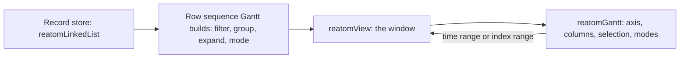

# PR 1249 — `reatomView` and `reatomInfinityList`

Collected 2026-10-15 from GitHub, read-only. Head `0771a1ba72cc4a0f3aad5bae2200275417dc775b` on `cursor/infinite-list-view-model-0b05`. Nothing here is implemented on the current `v1001` tree. This note does not choose a replacement API.

Sources: `gh pr view 1249`, the pulls files API, review comments, issue comments, the Bugbot review, GraphQL review threads, and the three file bodies at that SHA (`reatomInfinityList.ts`, `reatomInfinityList.test.ts`, and the patches for the other four files). Local reads are the `v1001` working tree. The PR tests were not run.

## Owner constraint

`reatomGantt` is built on `reatomView`. The view primitive is the window (the lens). The Gantt model composes that window: rows of spans over a time range or an index range. Records stay in one `reatomLinkedList`. Gantt does not keep a second store of the visible rows.

`packages/opentelemetry/spec/04-admin-rewrite.md` still says `reatomGantt` is a headless model over `reatomLinkedList`. The layering this constraint requires is list, then view, then Gantt. `reatomInfinityList` in this PR is only an early consumer of the view. It is not the Gantt model.



## 1. PR metadata

|                                            |                                                                                                                        |
| ------------------------------------------ | ---------------------------------------------------------------------------------------------------------------------- |
| URL                                        | https://github.com/reatom/reatom/pull/1249                                                                             |
| Title                                      | Infinite list view model                                                                                               |
| Number                                     | 1249                                                                                                                   |
| State                                      | OPEN. `mergedAt` and `closedAt` are null. `mergeable` was `CONFLICTING` when read. Not a draft. No labels.             |
| Author                                     | `artalar` (Arutyunyan Artem) opened the PR. Every commit is `Cursor Agent` / `cursoragent` / `cursoragent@cursor.com`. |
| Base                                       | `v1000` @ `51844a431338ccd82d1602d8c95234c3fa9788ac`                                                                   |
| Head                                       | `cursor/infinite-list-view-model-0b05` @ `0771a1ba72cc4a0f3aad5bae2200275417dc775b`                                    |
| Opened                                     | 2026-02-13T23:37:01Z                                                                                                   |
| Last `updatedAt`                           | 2026-03-12T12:32:24Z                                                                                                   |
| Diff                                       | +953 / −19 across 6 files                                                                                              |
| Background agent                           | `bc-5ba3b8a9-9c63-4288-9d25-b9b0e50a1ad4` (linked from the PR body)                                                    |
| Current tree this note was written against | branch `v1001` in `/Users/artalar/code/reatom`                                                                         |

### Commits

1. `2b4cc01d0be3e6f464eb501e71725bc0df24b1da` — 2026-02-13T15:15:40Z — `feat(reatomLinkedList): add reatomView for windowed access to linked list`. Adds the method, the two view types, and the view tests. The commit message says 17 tests; the patch contains 18 `test()` calls.
2. `d5e650505a5d0a3d02ad98cdde0b3cca630ccd94` — 2026-02-13T23:49:14Z — `feat(primitives): add reatomInfinityList for infinite scroll state model`. New module, 17 tests, and the `index.ts` export. Does not change `reatomView`.
3. `0771a1ba72cc4a0f3aad5bae2200275417dc775b` — 2026-02-13T23:49:21Z — `fix(tests): make connectLogger tests robust against atom ID counter shifts`. Renames hardcoded `[#n]` ids in two existing logger tests. Does not change the view.

### Checks on the head SHA

Preview workflow run `22006808804` concluded `failure`:

- `lint / prettier` — failure
- `test / test` — failure
- `publish-preview` — skipped

Log text was not copied into this note.

### Conversation

One issue comment, from `cursor[bot]`, 2026-02-13T23:37:03Z: https://github.com/reatom/reatom/pull/1249#issuecomment-3900102316. It offers to work on the branch if someone writes `@cursor`. No human replies. No review replies under the inline threads.

### Files

| File                                                      | Status   | +/−                                         |
| --------------------------------------------------------- | -------- | ------------------------------------------- |
| `packages/core/src/primitives/reatomLinkedList.ts`        | modified | +85 / −0                                    |
| `packages/core/src/primitives/reatomLinkedList.test.ts`   | modified | +295 / −1                                   |
| `packages/core/src/primitives/reatomInfinityList.ts`      | added    | +151                                        |
| `packages/core/src/primitives/reatomInfinityList.test.ts` | added    | +395                                        |
| `packages/core/src/primitives/index.ts`                   | modified | +1 (`export * from './reatomInfinityList'`) |
| `packages/core/src/methods/connectLogger.test.ts`         | modified | +26 / −18                                   |

## 2. Stated goal and the API as shipped

PR body, first paragraph:

> Add `reatomView` primitive to `reatomLinkedList` to enable efficient windowed views for infinite lists.
>
> This primitive provides a reactive "lens" that selects a range of elements from the linked list based on `offset` and `limit` parameters. This is crucial for implementing infinite scroll patterns, as it allows rendering only a small visible window of a potentially large data source, improving performance by preventing unnecessary re-renders when items outside the viewport change.

The Cursor summary under that paragraph was generated for commit `2b4cc01` only. It describes `reatomView` and the view tests. It does not mention `reatomInfinityList`, which landed in the next commit. The summary rates the change medium risk because of traversal, memoization, and notification behavior under list mutations.

### `list.reatomView(lens, name?)`

```ts
list.reatomView(
  () => ({ offset, limit }),
  name?,
)
```

The lens is a zero-arg function. It is called inside a `computed`, so atoms read inside it become dependencies. The commit message says the view updates when the list changes (`create`, `remove`, `swap`, `move`, `clear`) and when tracked `offset` / `limit` atoms change.

Return value: a `LinkedListViewAtom`, which is a `Computed` of:

| Field       | Meaning in this PR                                                                                                       |
| ----------- | ------------------------------------------------------------------------------------------------------------------------ |
| `items`     | Nodes in the window, in list order. Also exposed as `view.items`, a separate computed.                                   |
| `totalSize` | `linkedList().size` at compute time.                                                                                     |
| `offset`    | Requested offset clamped to `[0, size]`.                                                                                 |
| `limit`     | Requested limit clamped with `Math.max(0, rawLimit)`. Not clamped to the remaining length, and not forced to an integer. |

`view.items` is documented by the commit message as notifying only when the window's nodes change, so a `totalSize`-only update stays quiet for `items` subscribers.

### `reatomInfinityList(list, options?)`

Second commit. A model that owns viewport atoms and calls `list.reatomView`.

```ts
reatomInfinityList(linkedList, { limit?, name?, fetcher? })
```

Without `fetcher`, the return is `InfinityListAtom`:

| Member        | Role                                                                                                          |
| ------------- | ------------------------------------------------------------------------------------------------------------- |
| `offset`      | `Atom<number>`, starts at `0`                                                                                 |
| `limit`       | `Atom<number>`, starts at `options.limit ?? 20`                                                               |
| `view`        | The `LinkedListViewAtom` from `list.reatomView(() => ({ offset: offset(), limit: limit() }), name + '.view')` |
| `items`       | `view.items`                                                                                                  |
| `topCount`    | `computed(() => view().offset)`                                                                               |
| `bottomCount` | `totalSize - offset - items.length`                                                                           |
| `totalSize`   | `computed(() => view().totalSize)`                                                                            |
| `hasMore`     | `Atom<boolean>`, starts `true` even when no fetcher is passed                                                 |
| `isEnd`       | `!hasMore() && offset + items.length >= totalSize`                                                            |

With `fetcher`, the return is `InfinityListFetcherAtom`, which adds:

| Member      | Role                                                                                                                                                                                                                                                                 |
| ----------- | -------------------------------------------------------------------------------------------------------------------------------------------------------------------------------------------------------------------------------------------------------------------- |
| `loadMore`  | `action` extended with `withAsync()`. Reads `list().size` and `limit()`, awaits `fetcher(size, limit)`, then `list.createMany(fetchedParams)`. Sets `hasMore` to `false` when `fetchedParams.length < limit`. Returns immediately when `hasMore` is already `false`. |
| `isLoading` | `computed(() => !loadMore.ready())`                                                                                                                                                                                                                                  |

`fetcher` is `(offset: number, limit: number) => Promise<Array<Params>>`, and `Params` is the tuple `list.create` expects. The number passed as `offset` is the loaded size, not the viewport `offset` atom.

Default atom name is `named('infinityList')`. Child names are `${name}.offset`, `.limit`, `.view`, `.topCount`, `.bottomCount`, `.totalSize`, `.hasMore`, `.isEnd`, `.loadMore`, `.isLoading`.

## 3. Public types and signatures

Added on `LinkedListAtom` next to `reatomMap`:

```ts
reatomView: (lens: () => { offset: number; limit: number }, name?: string) =>
  LinkedListViewAtom<LLNode<Node>>
```

New exported types from `reatomLinkedList.ts`:

```ts
export interface LinkedListViewState<Node extends LLNode> {
  items: Array<Node>
  totalSize: number
  offset: number
  limit: number
}

export interface LinkedListViewAtom<Node extends LLNode> extends Computed<
  LinkedListViewState<Node>
> {
  items: Computed<Array<Node>>
}
```

The view atom is not a linked list. The factory does not set `__reatomLinkedList`.

From `reatomInfinityList.ts`, both overloads and the interfaces:

```ts
export interface InfinityListAtom<Node extends LLNode> {
  offset: Atom<number>
  limit: Atom<number>
  view: LinkedListViewAtom<Node>
  items: Computed<Array<Node>>
  topCount: Computed<number>
  bottomCount: Computed<number>
  totalSize: Computed<number>
  hasMore: Atom<boolean>
  isEnd: Computed<boolean>
}

export interface InfinityListFetcherAtom<
  Node extends LLNode,
> extends InfinityListAtom<Node> {
  loadMore: Action<[], Promise<void>> & AsyncExt<[], void>
  isLoading: Computed<boolean>
}

export function reatomInfinityList<
  Params extends any[],
  Node extends Rec,
  Key extends keyof Node,
>(
  list: LinkedListAtom<Params, Node, Key>,
  options?: { limit?: number; name?: string },
): InfinityListAtom<LLNode<Node>>

export function reatomInfinityList<
  Params extends any[],
  Node extends Rec,
  Key extends keyof Node,
>(
  list: LinkedListAtom<Params, Node, Key>,
  options: {
    limit?: number
    name?: string
    fetcher: (offset: number, limit: number) => Promise<Array<Params>>
  },
): InfinityListFetcherAtom<LLNode<Node>>
```

`packages/core/src/primitives/index.ts` star-exports the new module, so those three names are public. `LinkedListViewState` and `LinkedListViewAtom` ride the existing `reatomLinkedList` star export.

## 4. Implementation notes

`reatomView` is a closure inside `reatomLinkedList`, same place as `reatomMap`. Full body as shipped:

```ts
const reatomView = (
  lens: () => { offset: number; limit: number },
  viewName: string = named(`${_name}.reatomView`),
): LinkedListViewAtom<LLNode<Node>> => {
  const viewComputed = computed(
    (
      prev?: LinkedListViewState<LLNode<Node>>,
    ): LinkedListViewState<LLNode<Node>> => {
      const ll = linkedList()
      const { offset: rawOffset, limit: rawLimit } = lens()

      const clampedOffset = Math.max(0, Math.min(rawOffset, ll.size))
      const clampedLimit = Math.max(0, rawLimit)

      let current = ll.head
      let skipped = 0
      while (current !== null && skipped < clampedOffset) {
        current = current[LL_NEXT]
        skipped++
      }

      const items: Array<LLNode<Node>> = []
      while (current !== null && items.length < clampedLimit) {
        items.push(current)
        current = current[LL_NEXT]
      }

      if (prev !== undefined) {
        const itemsUnchanged =
          prev.items.length === items.length &&
          items.every((item, idx) => item === prev.items[idx])

        if (itemsUnchanged) {
          const stateUnchanged =
            prev.totalSize === ll.size &&
            prev.offset === clampedOffset &&
            prev.limit === clampedLimit

          if (stateUnchanged) return prev

          return {
            items: prev.items,
            totalSize: ll.size,
            offset: clampedOffset,
            limit: clampedLimit,
          }
        }
      }

      return {
        items,
        totalSize: ll.size,
        offset: clampedOffset,
        limit: clampedLimit,
      }
    },
    viewName,
  )

  const viewItems = computed(() => viewComputed().items, `${viewName}.items`)

  return Object.assign(viewComputed, { items: viewItems })
}
```

### Traversal

Every recompute starts at `ll.head` and follows `LL_NEXT`. Cost is O(offset + limit) link hops, including when the window's nodes did not change. There is no index, cursor, or skip list. Skipping still happens; it just does not allocate those nodes into `items`.

The walk uses the `LL_NEXT` binding in the `reatomLinkedList` closure. On current `v1001` that binding is a per-list `Symbol` created inside the factory (`reatomLinkedList.ts` around the `const LL_NEXT = Symbol(...)` locals). `toArray` does not use that closure binding: it destructures `LL_NEXT` off the list value and walks `head[list.LL_NEXT]`. A later extraction of `reatomView` out of the factory has to take the list's symbol the same way. The PR never tests two lists with distinct symbols, and that per-list symbol work is newer than this branch.

### Memoization

Node identity, index by index (`item === prev.items[idx]`).

- Same nodes in the same order, and same `totalSize` / clamped offset / clamped limit: return the previous state object.
- Same nodes, but size or clamped window numbers changed: new state object, previous `items` array.
- Any node added, removed, or reordered inside the window: new array.

`view.items` returns that array. Subscribers of `view.items` stay quiet when the array reference is reused. Subscribers of `view` itself see a new state object when `totalSize` changes even if `items` is reused.

The two-read test (section 5) only shows the computed cache when nothing invalidates. The append-outside-the-window test is the one that forces a recompute and checks array reuse. No test forces a recompute where size and window are also unchanged, so the `return prev` branch is unread by the suite.

The view does not read fields inside a node. A payload change that does not bump the list atom does not recompute the window. Row identity across slides is the node object itself.

`toArray` on current `v1001` already reuses its array when `prev[i] === head` for every index and the length matches. The view repeats that idea for a slice. `array()` still materializes the whole list; the view exists so a window does not.

### Clamping

- Offset: `Math.max(0, Math.min(rawOffset, ll.size))`. Negative becomes `0`. Past-the-end becomes `size`, and the item loop then yields `[]`. The stored `offset` is the clamped value.
- Limit: `Math.max(0, rawLimit)`. Zero and negative become an empty window (`negative` is what the expression does; only zero is tested). A limit larger than the tail is stored as requested; the loop simply stops at the tail. `view().limit` is that request, not `items.length`.
- Non-integers are left as-is. The loops use `<`, so any positive fraction rounds the skip and the take upward. Example from the source, not from a test: offset `1.5` and limit `2.5` skips two nodes (`skipped` becomes `2`, and `2 < 1.5` is false) and then pushes three nodes (`0`, `1`, and `2` are all `< 2.5`). `NaN` survives `Math.max(0, NaN)`. Comparisons with `NaN` are false, so the window is empty and the stored offset is `NaN`. Untested.
- `Infinity` as a limit takes the rest of the list. Untested.

### Batching

The view reads `linkedList()` and never looks at the batch `STATE` flag. `reatomMap` in the same factory throws `Can't compute the map of the linked list inside the batching.` when `STATE` is set. `find` walks `STATE ?? committed`.

Current `v1001` documents `batch` as: inside the callback, `find` sees the in-progress list; mutators relink nodes in place, so `list()`, `array`, and `map` mix old and new state until the callback returns, and `reatomMap` throws (`LinkedListAtom.batch` JSDoc). The PR does not change `batch`. Bugbot's reading (section 6) matches that shape: a view read during `list.batch()` walks the committed atom while links are already mutated, and unlike `reatomMap` it does not refuse the read. Neither later commit adds a guard or a test. This note did not execute a batch to confirm how long a cached window sticks.

### `reatomInfinityList` body

The module is 151 lines. Behavior beyond the table in section 2:

- `topCount`, `bottomCount`, and `totalSize` are one-line computeds over `view()`. `items` is the same computed as `view.items`, not a wrapper.
- `loadMore` has no in-flight lock and no abort. Two overlapping calls both read `list().size` and both `createMany`. That is unread by the tests; it is what the action body does.
- A page whose length equals `limit` leaves `hasMore` true, including when that page emptied the server. Only `length < limit` clears the flag. The suite's servers are sized 50, 5, 25, and 73 against limits 10, 10, 10, and 20, so every "end" is a short page. An exact multiple is untested.
- `loadMore` does not move `offset`. After an append, the same viewport offset and limit show a longer tail (`bottomCount` grows). The 73-item test asserts that.
- On a fetcher throw, `withAsync` stores the error, `createMany` does not run, `hasMore` stays at its previous value, and `isLoading` becomes false because `ready()` is true again. The test covers the empty-list case.
- Uniform row height is not in the model. One test multiplies `topCount` and `bottomCount` by a local `50`.

## 5. Test inventory

All of these are `test()` bodies added by the PR. Assertions below are what the source expects. The Preview `test / test` job failed on this SHA; this inventory is the intended contract, not a green run.

### `reatomLinkedList.test.ts` — 18 view tests

The commit message says 17. The patch adds these 18.

1. **`reatomView should return items for a basic view window`** — five nodes `1..5`, lens `{offset: 0, limit: 3}`. `items` are `1,2,3`. `totalSize` 5, `offset` 0, `limit` 3.
2. **`reatomView should react to changes in lens atoms`** — `offset` and `limit` atoms, list `1..5`. Start `1,2`. `offset = 2` yields `3,4`. `limit = 3` yields `3,4,5`. `offset = 4` yields `5`.
3. **`reatomView should update when list items are added`** — window `{0, 3}` on an empty list is `[]` / `totalSize` 0. After `createMany([1],[2])`: items `1,2`, size 2. After `create(3)`: `1,2,3`, size 3. After `create(4)`: items stay `1,2,3`, size 4.
4. **`reatomView should update when list items are removed`** — window `{1, 2}` on `1..5` is `2,3`. Remove the head. Items become `3,4`, size 4.
5. **`reatomView should memoize items array when content is unchanged`** — window `{0, 2}` on `1,2,3`. `create(4)` keeps the same `items` array reference and sets `totalSize` to 4.
6. **`reatomView items computed should not notify when items are unchanged`** — subscribe `view.items` (1 call, `[1,2]`). `create(4)` does not add a call.
7. **`reatomView should handle offset beyond list size`** — three nodes, lens `{10, 5}`. Items `[]`, `totalSize` 3, stored `offset` 3.
8. **`reatomView should handle empty list`** — lens `{0, 5}`. Items `[]`, size 0, offset 0, limit 5.
9. **`reatomView should handle list clear`** — window shows `1,2,3`, then `clear()` yields `[]` and size 0.
10. **`reatomView should reflect swap within view window`** — `swap` of the first and third nodes. Window `{0, 3}` changes from `1,2,3` to `3,2,1`.
11. **`reatomView should reflect move within view window`** — `move(first, third)` which places the first node after the third. Window becomes `2,3,1`.
12. **`reatomView should clamp negative offset to 0`** — lens `{offset: -5, limit: 2}` on three nodes. Items `1,2`, stored offset `0`.
13. **`reatomView should handle zero limit`** — items `[]`, size 3, stored limit `0`.
14. **`reatomView should return full state memoization when nothing changes`** — two `view()` reads with no write in between are `===`.
15. **`reatomView should work with removeMany`** — nodes `1..5`, window `{1, 3}` is `2,3,4`. `removeMany` of `2` and `4` leaves `1,3,5`. Window becomes `3,5`, size 3.
16. **`reatomView should work with a sliding window pattern`** — 10 nodes, `pageSize` 3, `offset: page * pageSize`. Page 0 is `1,2,3` (size 10). Page 1 is `4,5,6`. Page 2 is `7,8,9`. Page 3 is `10`. Page 4 is `[]` with stored offset `10` (requested 12 clamped to size).
17. **`reatomView items computed should notify only when items change`** — subscribe once with `[1,2]`. Append `6` outside the window: still 1 call. Remove the head: 2 calls, last payload `[2,3]`.
18. **`reatomView should handle limit larger than list`** — two nodes, limit `100`. Items `1,2`, size 2, stored limit `100`.

Not covered by any view test: `batch`, fractional or `NaN` lens values, negative limit, `swap` / `move` entirely outside the window, node payload updates, two lists, overscan.

### `reatomInfinityList.test.ts` — 17 tests

1. **`basic viewport state without fetcher`** — 10 nodes, `limit: 4`. Items `1..4`, `totalSize` 10, `topCount` 0, `bottomCount` 6, `hasMore` true, `isEnd` false.
2. **`viewport shifts on offset change`** — same list. `offset = 3` → items `4,5,6,7`, top 3, bottom 3. `offset = 7` → items `8,9,10`, top 7, bottom 0.
3. **`viewport reacts to limit change`** — start limit 3, items `1,2,3`, bottom 7. `limit.set(5)` → `1..5`, bottom 5.
4. **`counts update when list is modified externally`** — 5 nodes, limit 3, offset 1: top 1, bottom 1, size 5. `create(6)`: size 6, top stays 1, bottom 2.
5. **`isEnd when hasMore is false and viewport at list end`** — 5 nodes, limit 3. `hasMore.set(false)` while offset is 0: `isEnd` false. `offset = 2`: items `3,4,5`, `isEnd` true. Back to offset 0: `isEnd` false.
6. **`empty list state`** — items `[]`, size 0, top 0, bottom 0, `hasMore` true, `isEnd` false.
7. **`loadMore fetches and appends items`** — 50 server items, page 10. Before the call, items `[]` and `isLoading` false. After `loadMore()` is invoked and before it resolves, `isLoading` true. After resolve: `isLoading` false, size 10, 10 items, ids `0` and `9` at the ends, `hasMore` true.
8. **`loadMore sets hasMore to false on partial page`** — 5 server items, limit 10. One load: size 5, `hasMore` false.
9. **`loadMore skips when hasMore is false`** — fetcher spy, `hasMore.set(false)`, `loadMore` does not call the spy.
10. **`multiple loadMore calls accumulate data`** — 25 items, limit 10. After each load: size 10 / `hasMore` true, size 20 / true, size 25 / false.
11. **`padding counts for virtual scroll`** — 100 nodes, viewport 20, local height constant 50. Offset 0: top padding 0, bottom padding `80 * 50`. Offset 40: both paddings `40 * 50`. Offset 80: top `80 * 50`, bottom 0.
12. **`near-real infinite scroll model with async fetching`** — 73 items, page 20, fetcher awaits `sleep(5)`. Subscribes to `items` and to `isLoading` (the test never asserts those subscription counts). Start: items `[]`, size 0, `hasMore` true, `isLoading` false. Page 1: loading true then false, size 20, 20 items, top 0, bottom 0. `offset = 10`: top 10, 10 items, bottom 0. Page 2: size 40, 20 items, top 10, bottom 10. `offset = 30`, page 3: size 60, top 30, bottom 10. Page 4: size 73, `hasMore` false. `offset = 53`: 20 items, ids 53 then 72, top 53, bottom 0, `isEnd` true. `offset = 0`: id 0, top 0, bottom 53, `isEnd` false.
13. **`fetcher error is captured via AsyncExt`** — fetcher throws `Network failure`. After `loadMore().catch(() => {})`: `loadMore.error()` is an `Error` with that message, `isLoading` false, size 0, `hasMore` true.
14. **`items computed only notifies on actual item changes`** — 5 nodes, limit 3, subscribe `items` (1 call). `create(6)` does not notify. `offset.set(1)` notifies (2 calls) with `[2,3,4]`.
15. **`list clear resets infinite list state`** — offset 2 on 5 nodes, limit 3: top 2, 3 items. `clear()`: size 0, items `[]`, top 0, bottom 0. The test does not assert `offset` or `hasMore` after clear.
16. **`default limit is 20`** — `reatomInfinityList(list)` with no options, `limit()` is 20.
17. **`view atom is accessible for advanced use`** — 3 nodes, limit 2. `inf.view()` items `1,2`, `totalSize` 3, offset 0, limit 2.

Not covered: concurrent `loadMore`, abort, a final page whose length equals `limit`, `hasMore` on a fully local list that the user forgot to clear, variable row heights, scroll anchoring, a fetcher offset that is not `list().size`.

### `connectLogger.test.ts` — incidental

`normalizeAtomIds` rewrites `[#n]` so the first id seen becomes `[#1]`, the next new id `[#2]`, and repeats keep their mapped number. Two existing tests compare the normalized stack:

- **`calc deps graph`** — both snapshots go through the helper. The post-`sleep` expected graph changes from absolute ids `#5`–`#9` to `#1`–`#5`: effect → counter → `counter.inc`, plus `doubled` and `isEven` both depending on counter.
- **`BFS log simplification`** — ids `#16`–`#20` become `#1`–`#5`. The graph is effect → d → (b → a, c → b). The comment still says `a` must not be repeated under the second `b`.

The new view tests create named atoms and moved the global counter, which is why these assertions broke. Current `v1001` `connectLogger.test.ts` has no `normalizeAtomIds`.

## 6. Reviews and whether the PR fixed them

One review: `cursor[bot]`, state `COMMENTED`, 2026-02-13T23:39:23Z, on commit `2b4cc01` only. https://github.com/reatom/reatom/pull/1249#pullrequestreview-3800141442

The review body says Bugbot found 2 issues, that autofix is off, and that the repo is on the Bugbot Free tier. There is no human review.

Both inline threads are unresolved and not outdated. GraphQL on 2026-10-15: `isResolved: false`, `isOutdated: false`, one comment each, no replies. Head `0771a1ba` still points at the same lines (761 and 775 in `reatomLinkedList.ts`). Commits 2 and 3 do not edit `reatomView`.

### Stale batched state — not fixed

Medium. Bugbot id `ref1_e56d5cc4-cf20-4e95-99cd-b75e2de8959f`. https://github.com/reatom/reatom/pull/1249#discussion_r2806518438

Lines it cites: `packages/core/src/primitives/reatomLinkedList.ts` L755–L761 (`const ll = linkedList()` and the lens read).

> `reatomView` computes from `linkedList()` even while `list.batch()` is mutating shared `STATE` in place. Unlike `reatomMap`, it has no batching guard, so a read during the same batch can cache and return a stale window until the batch finishes, producing incorrect intermediate behavior.

The shipped function still has that read and no `STATE` check. No batch test was added. Spec 04's ingest path batches record writes per animation frame, so this is the Gantt store's write pattern, not an edge case.

### Fractional offset and limit — not fixed

Low. Bugbot id `ref2_9118abe7-fe0d-4370-8ba1-75cac9970cf1`. https://github.com/reatom/reatom/pull/1249#discussion_r2806518441

Lines it cites: L762–L775 (the clamp and both `while` loops).

> `reatomView` accepts numeric `offset` and `limit` but never normalizes them to integers. The loop conditions use `<` against fractional values, which effectively rounds up and returns too many/shifted `items`, causing incorrect window boundaries when `lens()` yields non-integer values.

The shipped clamp is still `Math.max` / `Math.min` with no `Math.floor` or `Math.trunc`. No fractional test was added. Section 4 has the concrete `1.5` / `2.5` walk.

Both comments also embed Bugbot "Fix in Cursor" / "Fix in Web" links. Nobody followed them on this branch.

## 7. What looks sound, and what is a poor fit

### Worth keeping as the shape of a window

- The product is a `computed` of a small state object, plus `view.items`. Call sites already know how to subscribe to a computed. That matches "produce a primitive, not a protocol" better than `reatomInfinityList` does.
- The lens is re-read inside that computed, so the window tracks whatever atoms the caller actually touches. The sliding-page test is the call site: `offset: page() * pageSize`.
- Memoizing by node `===` means a row component can keep its node while the window slides, and `view.items` does not wake up when an append lands outside the window. Tests 5, 6, and 17, and infinity test 14, lock that in.
- Structural edits inside the window show up: create, remove, removeMany, swap, move, clear.
- Clamping an index into `[0, size]`, with an empty window at `offset === size`, is a clear rule. Tests 7, 8, 12, and the page-4 case lock the ends. Zero limit and "limit stored as requested even when the tail is shorter" are also explicit (tests 13 and 18).
- `reatomInfinityList` demonstrates the composition the owner asked for, in miniature: one linked list, one `reatomView`, and a model that only reads the view. Gantt should follow that arrow. It should not follow the rest of that model.

### API-design problems

Scored against the six Reatom API rules. Evidence is the PR source and the tests above, read 2026-10-15, not a migrated call site. There is no production caller. The only consumers are these tests.

**Primitives outperform frameworks.** `reatomView` is a slice. `reatomInfinityList` is an infinite-scroll screen model: viewport atoms, padding counts, a `hasMore` flag, and a page fetcher that appends with `createMany`. Padding is `topCount * itemHeight` in a test, with the height left outside the library. The fetcher's paging policy (short page means the end) is one product's policy. Gantt's axis, zoom, columns, and selection would become more fields on the same bag if this were the extension point.

**Composition beats configuration.** The infinity options object is `{ limit?, name?, fetcher? }`, and the return has nine fields, eleven with a fetcher. `items`, `topCount`, and `totalSize` are aliases of `view.items`, `view().offset`, and `view().totalSize`. They do not add a behavior the view lacks. `reatomMap` on the same atom is a method because it builds another linked list. The view is not a linked list; hanging `reatomView` beside `reatomMap` is local consistency, and it also hides a different kind of atom behind a factory-shaped method name.

**Explicit specifics, implicit generics.** The thing that changes per call site is the window. The signature hides it in `() => ({ offset, limit })`. A lens that closes over plain numbers, or that forgets to call the atoms, never retriggers. Nothing warns. The generic part the library still leaves at the call site is "read your atoms inside this callback." Passing the offset and limit atoms (or a computed of the range) would make the specific numbers visible and the tracking structural.

**Compatibility worth complexity.** A time-axis window does not drop in. Callers translate a range into `offset` and `limit`, and they learn that `limit` on the state is the request while `items.length` is the fulfilled size, and that `offset` on the fetcher is `list().size` rather than the viewport atom of the same name. `loadMore`'s parameter list and the viewport atom share the word `offset` for two cursors.

**Easy to use, hard to misuse.** Several misses are silent:

- Fractional and `NaN` windows (Bugbot, unfixed). No throw, no test.
- A read during `batch` does not throw, while `reatomMap` does (Bugbot, unfixed).
- `hasMore` starts `true` with no fetcher. On a finished local list, `isEnd` stays false until someone remembers `hasMore.set(false)`. Test 1 expects that default.
- A last page whose length equals `limit` never clears `hasMore`. The flag only falls when a page is short.
- Negative limit collapses to an empty window through `Math.max(0, rawLimit)`, with no error. Untested.
- Overlapping `loadMore` calls are not rejected. Untested.

**Hardest solved, rest resolved.** The hard part for a 100k-record admin list is reaching a window without walking from the head, and computing that window from a consistent list snapshot while ingest is inside `batch`. The PR walks from the head on every notification and reads the torn snapshot. `reatomInfinityList` then solves padding arithmetic, which is the easy part. Spec `01-core-prerequisites.md` C6 still lists virtualization in `reatomLinkedList` as later work, with the note that admin gets it for free when it lands. This prototype is not that landing: O(offset + limit) from `head` on every recompute, including recomputes that reuse the items array.

Other prototype limits, same evidence:

- The name `reatomInfinityList` misspells "infinite" and names a UI pattern.
- `isEnd` treats "viewport covers the loaded tail" as the end of the data only when `hasMore` is also false. Scrolling to the loaded tail while more pages exist correctly stays `isEnd === false` (the 73-item test at offset 10 before page 2). The flag is easy to read as "user is at the bottom of the scroll."
- Commented stubs `reatomFilter` and `reatomReduce` are still comments. The PR does not compose a filtered sequence into the view.

## 8. What Gantt needs from the view

Owner constraint again, as composition: `reatomView` is the only window. `reatomGantt` reads it and writes the lens. The visible rows are `view.items` (or a computed that maps those nodes). They are not a second linked list inside the Gantt module.

`reatomGantt` is not implemented. Spec 04 and AD-1 describe the product it has to sit under. AD-1 (2026-10-07 chrome decision) puts that product in the Timeline tab. Activity, State, Timeline, Graph, and Filters stay separate tabs. The Gantt does not replace Activity and does not swallow the filter chrome.

From spec 04, the Gantt state that this prototype never models:

- Rows are a tree of spans. Logs are markers on a span row, or child rows in log mode. Expand and collapse are per row and per level.
- The time axis has a range, zoom, offset, and a cursor. It absorbs today's Timeline.
- Columns have visibility, order, and width.
- Selection is the selected row, keyboard focus, and multi-select.
- Grouping is by trace, session, route, or source.
- Modes are `waterfall` and `log`.

Filters feed the Gantt (`FILTERS --> GANTT` in the spec 04 diagram). The ~100k target (Д37) is a Storybook story, with ingest batched per animation frame and only expanded subtrees rendered. Virtualization itself is deferred. The store is still specified as `reatomLinkedList` plus indexes, so that a later window can apply. This PR is that later window, in an index-pagination shape.

### How the composition has to work

1. **Store.** `AdminRecord` nodes live in one `reatomLinkedList`. Indexes by trace, span, frame, name, and atom name stay beside the list, as spec 04 already says. The view does not own them.
2. **Row sequence.** Filter, grouping, expand/collapse, and waterfall-versus-log decide which records are rows and in what order. That sequence is what `reatomView` windows. Collapsing a row changes the sequence, which changes the lens inputs, which changes `view.items`. Gantt keeps the expand set and the mode. It does not copy the visible slice into its own list.
3. **Lens.** Gantt writes the window. Vertically that is an index range over the row sequence (scroll position and how many rows fit). Horizontally it is a time range (zoom, pan, cursor) that clips or hits bars on those rows. The prototype only accepts `{ offset, limit }` counts of nodes. A time range has to become an index range before it can use this lens, or the lens has to grow a time bound. Either way the view remains the window type Gantt subscribes to. Doing the time-to-index search by walking `LL_NEXT` from `head` on every pan is the cost section 4 already has, and it is the wrong cost at the 100k gate.
4. **Identity.** Selection, focus, and multi-select need a row that stays the same object when the user pans. The prototype's node-`===` memo is that mechanism for as long as the node stays in the list. A flatten step that `create`s new nodes on every filter change throws the identity away. `reatomMap` already keeps a `WeakMap` from source node to derived node; a filtered row list has to preserve identity the same way if selection is going to survive a filter edit. The view does not do that itself.
5. **Geometry.** `topCount` and `bottomCount` are hidden-row counts for a uniform-height scroller. A span is placed by `start` and `end` on the time axis. Row height in a Gantt is also not uniform once a row expands into a frame card. Those counts do not position a bar, and the infinity-list padding test is not a Gantt layout.
6. **Batch snapshot.** Ingest applies a frame of records inside `list.batch()`. The view Gantt reads has to see the list the way `find` does (`STATE` while a batch is open) or refuse the read the way `reatomMap` does. The shipped view does neither. That is the unfixed medium Bugbot finding, and it sits on the ingest path.
7. **Quiet items.** `view.items` staying still when the window's nodes are the same is what the Timeline list wants while `totalSize` ticks from ingest below the fold. That split is the part of the prototype that matches a Gantt render loop. It does not replace indexes, and it does not skip the O(offset) walk.

`reatomInfinityList` stays a rejected consumer for this job: one line of reason is that it models page fetching and uniform-height padding, and the Timeline already has a time axis to absorb. The useful line in it is `view = list.reatomView(...)`.

Open question 6 in `packages/opentelemetry/spec/README.md` still asks whether `reatomGantt` lives in `@reatom/core` next to `reatomLinkedList` or in admin first, and proposes admin first. This note does not answer that. The constraint only fixes the dependency: wherever the Gantt module lives, its window is `reatomView`.

## 9. Pointers

### PR head `0771a1ba`

| What                                                             | Where                                                                                                                                                                                                                                                                                             |
| ---------------------------------------------------------------- | ------------------------------------------------------------------------------------------------------------------------------------------------------------------------------------------------------------------------------------------------------------------------------------------------- |
| `reatomView` method, `LinkedListViewState`, `LinkedListViewAtom` | `packages/core/src/primitives/reatomLinkedList.ts` on the head branch. Types sit with `LinkedListDerivedAtom`. The method is the closure after `reatomMap`, and the returned object lists `reatomView` next to `reatomMap`. Bugbot lines 755–775 are the lens read, the clamp, and the two loops. |
| 18 view tests                                                    | `packages/core/src/primitives/reatomLinkedList.test.ts` on the head branch, appended after the `reatomMap` / `removeMany` test                                                                                                                                                                    |
| Infinity model                                                   | `packages/core/src/primitives/reatomInfinityList.ts` (added)                                                                                                                                                                                                                                      |
| 17 infinity tests                                                | `packages/core/src/primitives/reatomInfinityList.test.ts` (added)                                                                                                                                                                                                                                 |
| Public export                                                    | `packages/core/src/primitives/index.ts` — one added line, `export * from './reatomInfinityList'`                                                                                                                                                                                                  |
| Logger id rewrite                                                | `packages/core/src/methods/connectLogger.test.ts`                                                                                                                                                                                                                                                 |

### Current `v1001` tree

| What                                                                               | Where                                                                                                                                                                                                                                                                                                                                                                              |
| ---------------------------------------------------------------------------------- | ---------------------------------------------------------------------------------------------------------------------------------------------------------------------------------------------------------------------------------------------------------------------------------------------------------------------------------------------------------------------------------- |
| `reatomLinkedList`, `batch`, `reatomMap`, `toArray`                                | `packages/core/src/primitives/reatomLinkedList.ts`. `LinkedListAtom` is the interface that starts with `batch`. `batch` JSDoc describes the torn read. Per-list `LL_NEXT` symbols are the `Symbol(...)` locals inside the factory. `toArray` walks `list.LL_NEXT` and reuses the previous array by node identity. `reatomMap` throws while `STATE` is set. `find` prefers `STATE`. |
| No `reatomView`, `LinkedListViewState`, `LinkedListViewAtom`, `reatomInfinityList` | Confirmed by search under `packages/` on 2026-10-15. `packages/core/src/primitives/` has no view or infinity file. `index.ts` does not export one.                                                                                                                                                                                                                                 |
| No `reatomGantt` implementation                                                    | Same search. The name exists in the spec only.                                                                                                                                                                                                                                                                                                                                     |
| Gantt product description                                                          | `packages/opentelemetry/spec/04-admin-rewrite.md`, section `reatomGantt` (rows, axis, columns, selection, grouping, modes) and the data-flow diagram (`STORE --> GANTT`, `FILTERS --> GANTT`). Performance paragraph: no virtualization now, ~100k gate, ingest batched per animation frame.                                                                                       |
| Where the Gantt UI lands                                                           | `packages/opentelemetry/spec/notes/AD-1-admin-analysis.md`. Timeline tab is filled later by headless `reatomGantt` (AD-3). Chrome stays tabbed.                                                                                                                                                                                                                                    |
| Virtualization deferred                                                            | `packages/opentelemetry/spec/01-core-prerequisites.md` section C6, and the deferred list in `packages/opentelemetry/spec/README.md`. Open question 6 in that README is where the Gantt module lives.                                                                                                                                                                               |
| Timeline screen on the admin rewrite                                               | `packages/admin/src/view/otlp/TimelineScreen.tsx` is the current Timeline surface. This note did not audit its code. AD-1 says the Gantt fills that tab later.                                                                                                                                                                                                                     |
