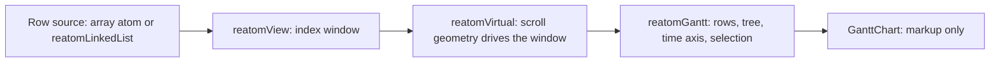

# `reatomVirtual` design log

Started 2026-10-15 from a review of `reatomView` and the admin `reatomGantt` against [On Rendering Diffs](https://pierre.computer/writing/on-rendering-diffs). Implemented: `reatomVirtual` in core, `reatomGantt` and the admin `GanttChart` migrated to it, and an append-only cursor in `reatomView`.

## Problem

Virtualization was split between two places that both did the wrong half:

- `reatomGantt` owned `firstRow`, `rowsPerScreen`, and a row-count `padding`. These were scroll state expressed in rows.
- `GanttChart.tsx` owned the rest: a `ResizeObserver` for `rowsPerScreen`, a scroll listener for `firstRow`, an rAF loop that aligned `scrollTop` back to `firstRow`, a follow-live effect, pixel spacers, and a 40-line linked list that mirrored the window so `@reatom/jsx` would move row elements instead of recreating them.

None of that was Gantt-specific, and the next virtualized list (the chat example, an activity log) would copy it.

## Constraints

1. `reatomGantt` is built on `reatomView` (PR 1249 note): list, then view, then Gantt.
2. The middle layer holds the main complexity of virtualized rendering and will be published for other Reatom users.

## Layers

`reatomVirtual` returns the view itself, extended. Everything that reads a view (`virtual()`, `virtual.items`) keeps working, and the scroll API is added on top.

## What the article contributed

| Article technique | Where it landed |
| --- | --- |
| Native scroll, inverse sticky to avoid blanking | `stickyInset`: the `top`/`bottom` of a sticky wrapper, `min(0, viewport - rendered)`. A browser test checks that the rendered block covers the viewport right after a 10 000 px jump, before the window updates. |
| Cheap first-pass estimates | `itemSize` as a number (O(1) arithmetic, no array) or a per-item function |
| Measured deltas | `measure(item, size)`, keyed by item identity so the size survives filtering and reordering. Measuring an item at its estimate keeps the O(1) path. |
| Position-to-line checkpoints with binary search | Prefix sums in a `Float64Array`, binary search for the window bounds. `reatomView` keeps its linked-list cursor across append-only updates, so a mid-list window does not re-walk half the list on every ingest. |
| Model-owned scroll anchoring, `overflow-anchor: none` | `measure` of an item that starts above the viewport moves `scrollOffset` by the delta. `bindScroller` sets `overflow-anchor: none`. |
| Element pooling to avoid churn | `reatomMap(render)` keeps a rendered node per item while it stays in the window; `@reatom/jsx` moves those nodes. A shell pool across different items is a follow-up. |
| Shared options instead of per-item copies | Already the pattern: rows read `gantt.bar(row)` and `gantt.depth(row)` from shared atoms. |

Not applicable here: string detaching, worker highlighting, horizontal virtualization.

## Decisions and rejected options

- **Pixel units, not rows.** The DOM reports pixels, and variable sizes need them. The Gantt default `itemSize: 1` keeps row units for headless tests.
- **`scrollOffset` is a read-only computed, `scrollTo` writes.** Rejected: an atom with `withComputed` clamping, because `withComputed` does not run on every `set` (checked in a throwaway test: `set(Infinity)` stored `Infinity`). Rejected: a computed with a custom `set`, because computeds already have `set`. `scrollTo` mirrors `element.scrollTo`.
- **Clamped like `scrollTop`.** A shrink keeps the clamped offset, and turning `stickToEnd` off keeps the pinned position. The previous computed state remembers the effective offset until a new `scrollTo` request.
- **`stickToEnd` accepts an external atom.** Admin passes `followLive`, which other screens also toggle. A `scrollToIndex` before the end and a user scroll up through `bindScroller` set it to `false`, which replaces the follow and unfollow effects in `GanttChart`.
- **`overscan` counts items.** Same mental model as other virtualizers. A size-based overscan for very uneven items is a possible follow-up.
- **`bindScroller`, not `bind`.** Atoms are functions, so `bind` collides with `Function.prototype.bind`, and `extend` refuses it.
- **Writes to `scrollTop` wait for the next frame,** so spacers rendered in the same update already have their height; otherwise the browser clamps the write and the next scroll event would turn off `stickToEnd`. Writes are skipped when the model only echoes the last reported DOM offset, so momentum scrolling is never pulled back.
- **Gantt API.** `firstRow`, `rowsPerScreen`, `padding`, and `view` are replaced by `gantt.virtual`. `scrollToTime` now clamps to the last full screen instead of leaving one row at the top.

## Verification

- Core unit tests `reatomVirtual.test.ts` (22), type tests `reatomVirtual.test-d.ts`, `reatomView.test.ts` with a mid-list append test.
- Core browser tests `reatomVirtual.test.browser.ts` (Chromium via Playwright): viewport and scroll binding, programmatic scroll position, `stickToEnd` following appends and turning off on a user scroll, and the inverse sticky invariant.
- Admin unit tests (214) and the XO Gantt and OTLP Storybook stories. "Scroll keeps rows mounted" now scrolls past the overscan before expecting the first row to unmount.

## Follow-ups

- A `measureElement(item)` ref helper with one shared `ResizeObserver`, so variable-size lists need no observer code.
- Identity-based anchoring when rows are inserted above the viewport (today only `measure` anchors).
- A horizontal axis for `bindScroller`.
- Typing bug outside this change: `LinkedListDerivedAtom['array']` resolves to `never[]` for derived lists.
