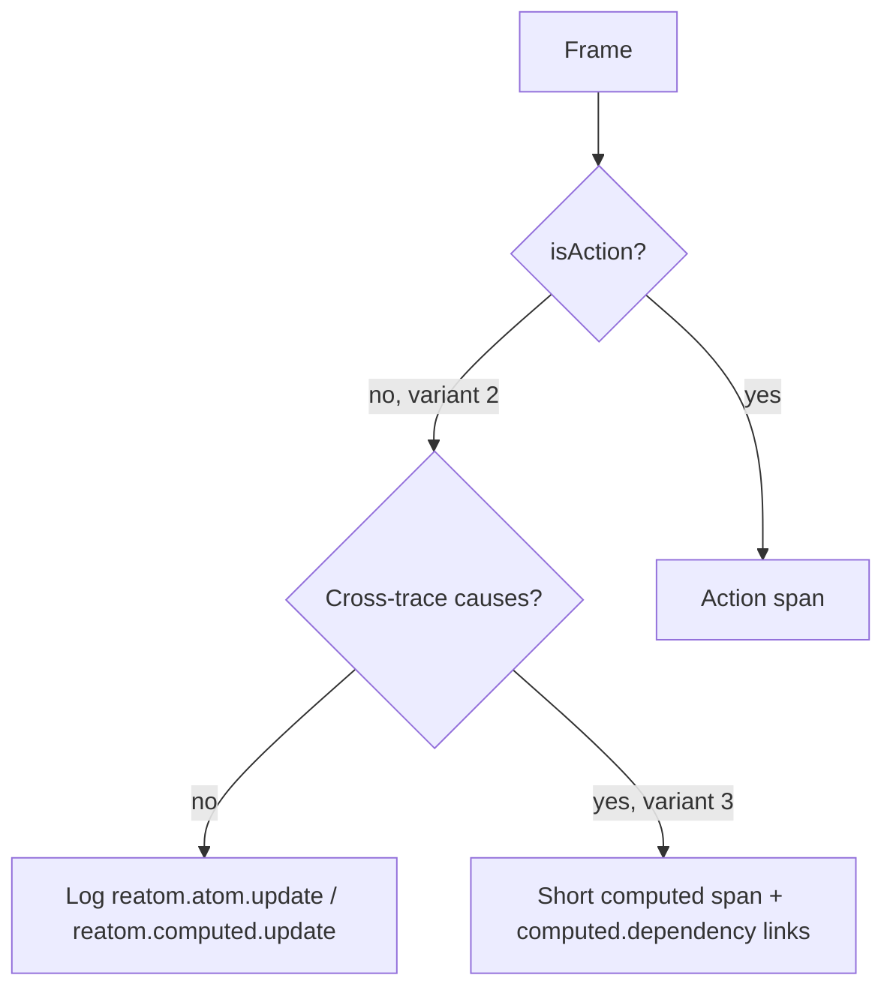

# 05 — Telemetry schema v1 (frozen)

**Frozen 2026-10-07.** Schema version **1**. After this freeze, changes are additive. A breaking change bumps the version and ships a note in admin's ingest. The resource attribute `reatom.schema.version` is **reserved / not yet emitted** — ingest must not require it until the factory writes it.

This file is the **shipped** v2 contract plus closed research (R1, R2 pick C, R3, R4, R5, C4, R7). It is not a pre-implementation proposal.

Naming follows OpenTelemetry semantic conventions wherever a convention exists **and** the semantics match. Own names live in `reatom.*` (runtime facts) and `app.*` (analytics facts). OTLP/JSON: hex `traceId` / `spanId`, string-encoded 64-bit integers.

## Frozen vs planned

| Status                   | What                                                                                                                                                                                                                                                                                                                                                             |
| ------------------------ | ---------------------------------------------------------------------------------------------------------------------------------------------------------------------------------------------------------------------------------------------------------------------------------------------------------------------------------------------------------------- |
| **Frozen tracer fields** | Shipped resource keys, mapping 2+3 / `detail: 'events'` / `route: 'child'`, span/log shapes on the wire, `reatom.kind` union (names reserved), link reasons, capture-on params/payload, T30 skip, sampling flags, leftover attach to `app.session`. Tracer grep: `reatom.name`, `exception.type`                                                                 |
| **Planned, not frozen**  | Analytics catalog (`app.page_view`, `session.start`, `url.path` on those records, `app.display.*`). `reatom.async.settle`. Resource `reatom.schema.version` / `reatom.instance.name`. Route-span `url.path` / `reatom.route.pattern`. Span name `page_view <path>`. `detail: 'summary'` attrs, `code.file.*`, `reatom.origin`. `telemetry.sdk.language = nodejs` |

Do not treat planned rows as ingest fixtures. Do not invent `reatom.state.prev`. Do not emit `reatom.async.pending`.

Wire examples: [`success-span.json`](examples/success-span.json), [`route-watershed.json`](examples/route-watershed.json), [`modal-same-trace.json`](examples/modal-same-trace.json), [`exception.json`](examples/exception.json), [`log-outside-trace.json`](examples/log-outside-trace.json), [`atom-update.json`](examples/atom-update.json), [`diamond-links.json`](examples/diamond-links.json).

## Mapping defaults (R1)

Shipped default is **variants 2 + 3**, `detail: 'events'`, `route: 'child'`.



| Id                     | When                                           | Spans                                                                                                   | Updates                                                                            |
| ---------------------- | ---------------------------------------------- | ------------------------------------------------------------------------------------------------------- | ---------------------------------------------------------------------------------- |
| **2** (default)        | `detail: 'events'`                             | Action call (async ends on promise settle). `span: true` on an atom/computed is the per-target override | Atom / computed updates are log records on the **current action span context**     |
| **3** (default add-on) | computed with causes from **different traces** | Short span; parent = primary (triggering) cause; one link per other trace                               | Single-cause stays a log ([`diamond-links.json`](examples/diamond-links.json))     |
| 1                      | `detail: 'spans'` (local debug)                | Every action, atom write, computed recompute                                                            | Diamonds cannot be expressed                                                       |
| 4                      | `detail: 'summary'` (**planned**)              | Action spans only                                                                                       | Planned attrs `reatom.updates.count` / `reatom.updates.names`; **not on the wire** |

Cause ids are in every variant. `route: 'link'` is orthogonal: it only decides whether a **top-level action** (no calling frame) stays on the page `traceId` or mints a new one with `reatom.link.reason = route.page`.

A computed never mints a `traceId` (R4). Leftover computed updates and `LOG` attach to `app.session`. `span: true` on an untraced computed is a **child of `app.session`**, not a new root.

## Resource

Ingest keys = **shipped** only. Reserved names are not required until emitted.

| Attribute                                              | Ingest                         | Notes                                                                                                                              |
| ------------------------------------------------------ | ------------------------------ | ---------------------------------------------------------------------------------------------------------------------------------- |
| `service.name`                                         | required                       | From options                                                                                                                       |
| `service.version`                                      | no                             |                                                                                                                                    |
| `deployment.environment.name`                          | no                             | From `environment`                                                                                                                 |
| `service.instance.id`                                  | required                       | Random per page load or process. Scopes `reatom.frame.id`                                                                          |
| `telemetry.sdk.name`                                   | required                       | `@reatom/opentelemetry` (never `opentelemetry`)                                                                                    |
| `telemetry.sdk.language`                               | required                       | Frozen shipped value: **`webjs`**. `nodejs` is **planned** (factory hardcodes `webjs`)                                             |
| `telemetry.sdk.version`                                | required                       | Package version                                                                                                                    |
| `reatom.schema.version`                                | **reserved / not yet emitted** | Contract value `1` when it ships. **Not** a required ingest key                                                                    |
| `reatom.instance.name`                                 | **reserved / not yet emitted** | Instance `name` option. **Not** a required ingest key                                                                              |
| `browser.language`                                     | optional-if-UA-CH              | Emitted only inside the UA-CH branch. Safari/Firefox (`navigator.userAgentData` absent) get **no** `browser.*`, including language |
| `browser.brands`, `browser.platform`, `browser.mobile` | optional-if-UA-CH              | Low-entropy UA-CH only; omit if missing. No `user_agent.original`, no high-entropy hints, no `navigator.platform` fallback         |

Values that change during the page (login, tenant, viewport, URL) are record attributes, never resource.

## Spans

| Field  | Value                                                                                                                                                                                                |
| ------ | ---------------------------------------------------------------------------------------------------------------------------------------------------------------------------------------------------- |
| name   | Frozen: normalized Reatom name (`checkout.purchase`, `tree#.toggle`), `route <leaf>`, `mount <component>`, `app.session`. **Planned:** `page_view <path>` (analytics; no such tracer span in `src/`) |
| kind   | OTel `INTERNAL` (1) by default. `withOTel({ kind })` overrides (`client` / `server` / `producer` / `consumer`)                                                                                       |
| status | `ERROR` with message on failure. Unset otherwise, including abort and Suspense                                                                                                                       |
| flags  | W3C bit 0: sampled = `flags & 0x01`. Outgoing `traceparent` flags `01` / `00` (R5). `03` incoming still counts as sampled                                                                            |
| links  | Cross-trace causes (variant 3) and `route: 'link'` page pointers                                                                                                                                     |

Do not confuse the tracer span `app.session` (one leftover root per instance per page load) with the planned analytics event `session.start`.

### `reatom.kind` (frozen union)

`action` · `atom` · `computed` · `effect` · `route` · `loader` · `render` · `mount` · `session` · `page_view`

Infer `action` / `atom` / `computed` from `reactive` / `writable`. C3 stamps `effect` / `route` / `loader` / `render` / `mount`. `session` is tracer-created. `page_view` is **reserved** in the union; the span name `page_view <path>` is **planned** (analytics). `async.helper` is tracer-internal and **never** a public `reatom.kind`. There is no `route.pathless`, `log`, `async`, `retry`, `form`, or `field` kind.

Shipped on the wire today: `action`, `atom`, `computed` (variant-3 diamond spans), `route`, `session`. The rest of the union is reserved so later stamps do not bump the version.

| Attribute                                      | On                                               | Meaning                                                                                                                                                                                                                                                                                                                |
| ---------------------------------------------- | ------------------------------------------------ | ---------------------------------------------------------------------------------------------------------------------------------------------------------------------------------------------------------------------------------------------------------------------------------------------------------------------- |
| `reatom.kind`                                  | all                                              | Closed union above                                                                                                                                                                                                                                                                                                     |
| `reatom.name`                                  | all                                              | Raw name, including the instance id. **Grep-able (frozen tracer).** Dropped only when it equals the span `name` and exceeds 1920 UTF-8 bytes                                                                                                                                                                           |
| `reatom.instance`                              | factory instances                                | The `#id` part (`tree#12.toggle` → name `tree#.toggle`, instance `"12"`)                                                                                                                                                                                                                                               |
| `reatom.frame.id`                              | all                                              | Per-instance counter, a string, scoped by `service.instance.id`                                                                                                                                                                                                                                                        |
| `reatom.cause.ids`                             | all                                              | Array of frame ids: `pubs[0]` first, then changed dependencies                                                                                                                                                                                                                                                         |
| `reatom.params`                                | actions, **capture on by default**               | JSON string from the serializer                                                                                                                                                                                                                                                                                        |
| `reatom.payload`                               | actions, **capture on by default**               | JSON string; for async, the resolved value                                                                                                                                                                                                                                                                             |
| `reatom.outcome`                               | all                                              | `ok`, `error`, `abort`, `suspense`, `pending` (unload of an open span)                                                                                                                                                                                                                                                 |
| `reatom.importance`                            | optional                                         | `low` for abort and Suspense                                                                                                                                                                                                                                                                                           |
| `reatom.attributes_error`                      | spans and update logs                            | Exception type when the `attributes` function throws. **Not frozen.**                                                                                                                                                                                                                                                  |
| `reatom.attempt`                               | retries                                          | 1-based                                                                                                                                                                                                                                                                                                                |
| `reatom.updates.count`, `reatom.updates.names` | **planned**                                      | `detail: 'summary'` / variant 4. **Not yet emitted**                                                                                                                                                                                                                                                                   |
| `reatom.route.pattern`, `url.path`             | **planned** on route spans                       | F-03 dumps have only `reatom.name` / `kind` / `outcome`. Do not grep F-03 for `url.path`. Analytics `app.page_view` may still plan `url.path`                                                                                                                                                                          |
| `reatom.origin`                                | **planned**                                      | `admin` via `attributesVar`. **Not yet emitted**                                                                                                                                                                                                                                                                       |
| `reatom.parent.reason`                         | **not frozen**                                   | Why this parent was chosen: `call` (calling frame), `dependency` (changed traced dependency), `read` (reader on the stack), `route` (route page trace), `explicit` (per-root manual or remote trace), `session` (app-session fallback), `root` (no parent, a new trace), `budget` (continuation after the span budget) |
| `code.file.path`, `code.line.number`           | **planned**                                      | Dev `captureCodeLocation`. **Not yet emitted**                                                                                                                                                                                                                                                                         |
| user attributes                                | `withOTel({ attributes })`, `options.attributes` | e.g. `user.id`, `app.order.value`. **Not stripped.** Domain taxonomy stays here                                                                                                                                                                                                                                        |

T30: names with a `_` prefix or a `._` segment are skipped, **except** `route` / `render` / `mount`.

Abort and Suspense are not errors: status unset, `reatom.outcome` `abort` | `suspense`, `reatom.importance = 'low'`. Pending at `pagehide`: open action spans close with `reatom.outcome = 'pending'`.

### Links

| Link attribute       | Meaning                                                                                                                                                                                                                                                                    |
| -------------------- | -------------------------------------------------------------------------------------------------------------------------------------------------------------------------------------------------------------------------------------------------------------------------- |
| `reatom.link.reason` | Frozen: `computed.dependency` (cause from another trace), `route.page` (top-level action under `route: 'link'` pointing at the page route span). **Not frozen:** `trace.budget` (this span roots a continuation of an over-budget trace). Optional later: `route.previous` |
| `reatom.frame.id`    | Frame id of the linked cause (variant 3)                                                                                                                                                                                                                                   |

## Log records

Log records always carry the span context of the current span when there is one, else the `app.session` span. They **always dual-write** the OTLP `eventName` field **and** the `event.name` attribute (R2 pick C: keep both for backends that flatten attributes).

| `eventName`              | Status                  | Body                              | Key attributes                                                                                                                |
| ------------------------ | ----------------------- | --------------------------------- | ----------------------------------------------------------------------------------------------------------------------------- |
| `reatom.atom.update`     | **frozen**              | new state (serialized `AnyValue`) | `event.name`, `reatom.name`, `reatom.kind`, `reatom.instance`, `reatom.frame.id`, `reatom.cause.ids`                          |
| `reatom.computed.update` | **frozen**              | new state                         | as above                                                                                                                      |
| `reatom.log`             | **frozen**              | the arguments array               | `reatom.log.label`, `reatom.log.state` (the name for `LOG.state`)                                                             |
| `exception`              | **frozen**              | —                                 | `exception.type` (**grep-able**), `exception.message`, `exception.stacktrace`, `reatom.cause.ids` (tracer)                    |
| `reatom.async.settle`    | **planned, not frozen** | payload or error summary          | `reatom.name` of the **async target**, `reatom.outcome` `ok` / `error` / `abort`. Helpers are not spans. **Not yet emitted.** |

Previous state is not sent. Admin derives it from the previous update of the same atom in the same instance. There is no `reatom.state.prev`.

Severity: INFO (9) for everything, ERROR (17) for `exception`. No levels API (Т30). `LOG.state` records only on change.

### Exceptions are logs only (R2 pick C)

`exception` is an OTLP **log record** with span context. Span status is still `ERROR` with the message. There is **no default span-event duplicate**. `exception.escaped` is not emitted. [`exception.json`](examples/exception.json): `span.events` has no `exception`; the log has `eventName` + `event.name` = `exception`.

## Route watershed (C4)

A **page** is a change in the set of **bounding** matched routes (`boundary !== false`, default on route atoms).

- Bounding-set change → `createTrace` named `route <leaf>`, short root span until bounding loaders settle. The **trace** does not end; later actions under `route: 'child'` keep that `traceId`. F-03 dumps carry `reatom.name` / `reatom.kind` / `reatom.outcome` only — **not** `url.path` or `reatom.route.pattern` ([`route-watershed.json`](examples/route-watershed.json)).
- `withOTel({ boundary: false })` → short child span `route <name>` on the current page trace, **no new `traceId`** ([`modal-same-trace.json`](examples/modal-same-trace.json)).
- `route: 'link'` → each later top-level action mints a trace and links to the page span with `reatom.link.reason = route.page`. Loader-invoked work stays on the route `traceId`.
- Same bounding set, new params (`/users/1` → `/users/2`) does not cut.
- `roots: []` emits no automatic route / mount / action / atom roots. `app.session` still exists.

No `reatom.kind = 'route.pathless'`. Pathless / modal is the `boundary: false` opt-out.

## Sampling (R5)

| Default                | Value                                                                                                                  |
| ---------------------- | ---------------------------------------------------------------------------------------------------------------------- |
| Sampler                | ParentBased (OTel SDK default)                                                                                         |
| Root                   | AlwaysOn (`ratio: 1`). Ratio `< 1` is `ParentBased(root = TraceIdRatioBased(ratio))` only — never a bare ratio sampler |
| `by`                   | `'trace'`. `'session'` is opt-in, still ParentBased                                                                    |
| `errors`               | `'always'` (ring-buffer unsampled traces; export on exception)                                                         |
| Sampled flag           | `flags & 0x01` (`01` and `03` are both sampled; equality on `"01"` is wrong)                                           |
| Outgoing `traceparent` | `…-01` if sampled, `…-00` if not. Do not omit the header on unsampled traces                                           |
| Baggage                | off                                                                                                                    |

Unsampled traces still reach the local sink / admin (`IsRecording`).

## Capture

Capture is **on by default**: `reatom.params` and `reatom.payload` on action spans; atom/computed state in the log **body**. Default redaction replaces keys matching `/pass(word)?|secret|token|auth|cookie|session|crypto|card|cvv|iban|ssn/i` with `"[redacted]"`. Getters are never invoked. `captureValues: false` disables. Local devtools may read the live values through `localValues` and `localValuesOf` when records are kept; that side channel is not part of the exported schema.

Custom attributes (`user.id`, `app.order.value`, anything from `withOTel({ attributes })` or `options.attributes`) are **not stripped**. Frozen tracer grep today: `reatom.name`, `exception.type`. `url.path` is planned on analytics/`app.page_view`, not on F-03 route spans.

## Analytics events (planned, not frozen)

R2 pick C names, for when `connectWebAnalytics` emits. **Not a v1 ingest contract.**

Common attributes when they ship: `session.id`, `app.visitor.id` (after consent), `url.path` (analytics records, **not** current route spans), `app.analytics.consent`.

| `eventName`               | When                                     | Attributes                                                                                                                                                                                                       |
| ------------------------- | ---------------------------------------- | ---------------------------------------------------------------------------------------------------------------------------------------------------------------------------------------------------------------- |
| `app.page_view`           | start, URL change, manual `pageView()`   | `url.full` (no query or fragment by default), `url.path`, `app.page.title`, `app.page.referrer`, `app.viewport.width/height`, **`app.display.width/height`** (not `app.screen.*`), `app.utm.*`, `app.click_id.*` |
| `session.start`           | first activity, timeout, campaign change | **not** `app.session.start`. `session.previous_id`, `app.attribution.first.*`, `app.attribution.last.*`                                                                                                          |
| `app.page.engagement`     | page change, hide                        | `app.engagement.visible_ms`, `app.engagement.active_ms`                                                                                                                                                          |
| `app.visibility.change`   | visibility flip                          | `app.visibility.state`                                                                                                                                                                                           |
| `app.network.change`      | online or offline                        | `network.online` (custom; not TCP `network.connection.state`)                                                                                                                                                    |
| `app.focus.change`        | focus or blur (tier 0 if budget allows)  | `app.focus.state`                                                                                                                                                                                                |
| `browser.web_vital`       | web-vitals module                        | official browser-events names                                                                                                                                                                                    |
| `feature_flag.evaluation` | experiments module                       | official feature-flag names                                                                                                                                                                                      |
| `exception`               | analytics handlers                       | `exception.type` always; `exception.message` / `.stacktrace` only after consent and `captureErrorDetails`                                                                                                        |
| `exception.suppressed`    | analytics dedup                          | `exception.type`, `app.exception.count`                                                                                                                                                                          |

Keep `app.visitor.id` (do not replace with `enduser.pseudo.id`). Residual `app.*` with no analog (engagement, UTM, consent, ecommerce-until-WA-9, tier-1 modules) stays `app.*`. Manual business facts are named tracer actions with `withOTel({ attributes })`, not an analytics `trackEvent` API (R21).

## Examples

Action span, capture on ([`success-span.json`](examples/success-span.json) shape):

```json
{
  "traceId": "ab6fd8d2b26376faa22989049b5f702d",
  "spanId": "5df931fe8a8f4c49",
  "name": "devtools.ping",
  "kind": 1,
  "flags": 1,
  "attributes": [
    { "key": "reatom.name", "value": { "stringValue": "devtools.ping" } },
    { "key": "reatom.kind", "value": { "stringValue": "action" } },
    { "key": "reatom.outcome", "value": { "stringValue": "ok" } },
    { "key": "reatom.params", "value": { "stringValue": "[]" } },
    { "key": "reatom.payload", "value": { "stringValue": "pong" } },
    { "key": "reatom.frame.id", "value": { "stringValue": "1" } }
  ]
}
```

Atom update on the action span, not a span and not a span event ([`atom-update.json`](examples/atom-update.json)):

```json
{
  "eventName": "reatom.atom.update",
  "traceId": "e6cd025f45c061f5d92a8098987d03e7",
  "spanId": "5d89d93da21eb997",
  "severityNumber": 9,
  "body": true,
  "attributes": [
    { "key": "event.name", "value": { "stringValue": "reatom.atom.update" } },
    { "key": "reatom.name", "value": { "stringValue": "tree.checked" } },
    { "key": "reatom.kind", "value": { "stringValue": "atom" } },
    { "key": "reatom.frame.id", "value": { "stringValue": "2" } },
    {
      "key": "reatom.cause.ids",
      "value": { "arrayValue": { "values": [{ "stringValue": "1" }] } }
    }
  ]
}
```

Variant-3 diamond: short `reatom.kind = computed` span on the primary cause, link `reatom.link.reason = computed.dependency` to the other trace ([`diamond-links.json`](examples/diamond-links.json)).

## Freeze checklist

- [x] R1 closed: variants 2 + 3, `detail: 'events'`, `route: 'child'`.
- [x] R2 pick C: keep `reatom.*`; `session.start` not `app.session.start`; `app.display.width/height` not `app.screen.*`; exceptions are logs only; dual `eventName` + `event.name`.
- [x] R3 closed: kind union above; no `reatom.async.pending`; helpers = planned `reatom.async.settle`.
- [x] R4 closed: leftover computed / `LOG` attach to `app.session`; never mint.
- [x] R5 closed: ParentBased; outgoing `01` / `00`; sampled = `flags & 0x01`.
- [x] C4 closed: `route <leaf>`; `boundary: false` child; link reasons `route.page` | `computed.dependency`.
- [x] Capture-on default; T30 `_` / `._` skipped except route/render/mount.
- [x] Frozen tracer grep: `reatom.name`, `exception.type` (dumps). `url.path` on route spans is planned. Custom `app.order.value` / `user.id` not stripped.
- [ ] Admin ingest (AD-2) parses the recorded fixtures without special cases.
- [ ] ClickHouse e2e can query spans by `reatom.name` and logs by `eventName`.
