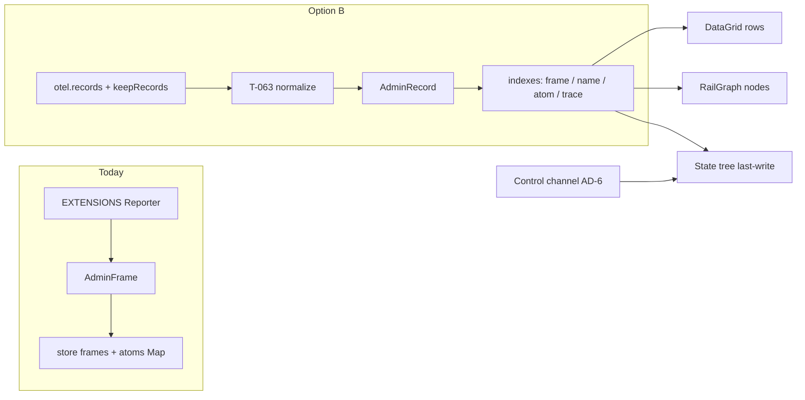
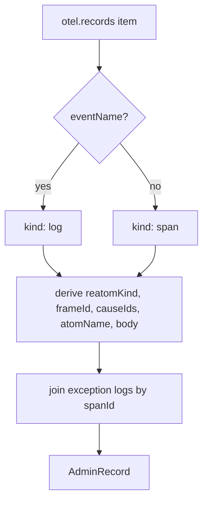

# AD-1 — `@reatom/admin` against OTel-first (option B)

- Task: [04 AD-1](../04-admin-rewrite.md#implementation-steps). Validates option B (Д10, Д13) against every current Reporter/admin capability.
- Date: 2026-10-07.
- Chrome: owner-applied Railway design is source of truth (owner decision 2026-10-07). Skip spec 04 designer debate. Spec 04 “only Gantt” lean **yields** to the tabbed chrome in `Layout.tsx` / `WorkspaceTabs.tsx`: Activity, State, Timeline, Graph, Filters. Timeline/Gantt is a view _inside_ that chrome, not a replacement.
- Schema: [05](../05-telemetry-schema.md) frozen tracer vs planned analytics. Ingest fixtures are shipped fields only.
- Flow: F-13 (Admin Gantt, MCP, remote source): Gantt/MCP over `otel.records`, not Reporter. Do not retarget existing Reporter Storybook until a T-063 adapter exists.
- Method: read Reporter (`types.ts`, `reporter/`, `store/`, `cause-graph/`, `filters/`, `timeline/`, `session/`), view model and screens, design-system primitives (not rewritten), tracer `causes.ts` / `buildSpan.ts` / `buildLogRecord.ts`, and evidence F-01 / F-03 / F-12. No UI, factory, or Reporter edits.

**Do not rewrite `packages/admin/src/view/design-system/`.** Keep tokens, Button, Toolbar, DataGrid, SplitPane, RailGraph, InspectorTabs, StatusBar, Field, EmptyState, mixins. Reference mock: `railway-reference.jpg`.

**Do not break Reporter stories in T-063.** New OTLP tests go in `packages/admin/src/otlp/`. Existing `stories/admin-shell`, `stories/gallery`, `stories/reatom-jsx-xo` stay on `createReporter` until the adapter is proven.

## Verdict

Option B holds. Every live capability maps to an `AdminRecord` derived from the tracer sink, a **control-channel** gap (AD-6), or a **tracer** gap that is already named in schema 05 (planned, not frozen). Nothing in today’s chrome requires a second Recorder schema.

The one semantic narrowing to accept: Reporter `pubIds` is every pub except `context`; tracer `reatom.cause.ids` is `pubs[0]` then **changed** deps only. Activity + Graph still work. Diamonds that span traces use variant-3 links (`reatom.link.reason = computed.dependency`), which Reporter cannot express.



## 1. Capability matrix

Legend: **record** = equivalent from OTLP spans/logs. **control** = not in records; later AD-6. **tracer** = records cannot do it until the factory emits a named planned field. **chrome** = local UI state, keep as-is. **process** = T-063 must not retarget.

| #   | Capability                                                        | Where it lives today                                                                  | OTel / AdminRecord equivalent                                                                                                                                                                         | Gap                                                                                                                                        |
| --- | ----------------------------------------------------------------- | ------------------------------------------------------------------------------------- | ----------------------------------------------------------------------------------------------------------------------------------------------------------------------------------------------------- | ------------------------------------------------------------------------------------------------------------------------------------------ |
| 1   | Activity feed (time / name / preview)                             | `LogScreen` → `DataGrid` over `visibleFrames`                                         | One row per `AdminRecord`. Time = span `start` or log `timeUnixNano`. Name = `reatom.name` else span/event name. Preview = log `body`, else `reatom.payload` / `reatom.params`, else `reatom.outcome` | **record**                                                                                                                                 |
| 2   | Follow-live + last-200 render cap                                 | `view.followLive`, `FEED_RENDER_LIMIT`                                                | Same chrome over the record list                                                                                                                                                                      | **chrome**                                                                                                                                 |
| 3   | Inspector Overview                                                | `FrameDetail` + `JsonInspector` (`params`/`payload` or `state`, `error`)              | Span: parse `reatom.params` / `reatom.payload` JSON strings. Log: parse `body`. Error: sibling `exception` log on the same `spanId`, or `reatom.outcome = error`                                      | **record**. Previous state is **derived** from the prior update of the same `atomName` in the same `sourceId` (05: no `reatom.state.prev`) |
| 4   | Inspector Cause Chain                                             | `RailGraph` from `causeGraph.graph()` / `pubIds`                                      | `parentIds` = parsed `causeIds` (+ variant-3 link frame ids). `hasError` from outcome / exception                                                                                                     | **record**. Narrower than all-pubs (see §2.3)                                                                                              |
| 5   | Inspector History                                                 | `HistoryPanel`: last 8 frames with same `atomId`                                      | Last 8 records with the same `atomName` + `sourceId`                                                                                                                                                  | **record**                                                                                                                                 |
| 6   | Inspector JSON + copy/download                                    | `getFrameExportPayload`                                                               | Export the normalized `AdminRecord` (attrs, body, links, resource)                                                                                                                                    | **record**                                                                                                                                 |
| 7   | Inspector tabs                                                    | `InspectorTabs` overview / causes / history / json                                    | Same tabs, same primitive                                                                                                                                                                             | **chrome**                                                                                                                                 |
| 8   | State tree                                                        | `view.model` `buildStateTree`: latest **reactive** frame per atom, split on `.` / `#` | Latest `reatom.atom.update` / `reatom.computed.update` (or variant-3 computed span) per `atomName`. Same path split. `#id` instances stay grouped under the factory                                   | **record** for atoms that updated since connect. **control** for the rest (§3)                                                             |
| 9   | State inspector + graph root                                      | `StateExplorer` selects `frameId`                                                     | Select the last-write `AdminRecord` for that atom                                                                                                                                                     | **record**                                                                                                                                 |
| 10  | Timeline buckets / zoom / pan / autofit                           | `timeline/`: `TimeBucket` from `timestamp`                                            | Same utils over `record.start`. Action vs state counts from `kind`. Errors from `outcome` / exception                                                                                                 | **record**. Headless `reatomGantt` (AD-3) later **fills this tab**; it does not replace Activity                                           |
| 11  | Timeline event list                                               | `frameGroups` by equal timestamp                                                      | Group by `start` (ms). Sync clicks share a ms; async spans do not                                                                                                                                     | **record**                                                                                                                                 |
| 12  | Cause graph: ancestors / descendants / full, depth, path, re-root | `cause-graph/index.ts` BFS on `pubIds`                                                | Same algorithms; input is `causeIds` plus a reverse index of records. Cross-trace edges from `links` where `reatom.link.reason = computed.dependency`                                                 | **record**. Keep traversal; do not rewrite `RailGraph`                                                                                     |
| 13  | Filter search (name / state / params / payload / all)             | `filters/search.ts`, persisted                                                        | Same `matchText` over derived fields on `AdminRecord`                                                                                                                                                 | **record**                                                                                                                                 |
| 14  | Filter tags + expression tree + modes show/hide/highlight/exclude | `tags`, `expression`, `engine`, `persistence`                                         | Keep the tree and storage keys. Evaluate against records. Built-in `error` / `action` / `reactive` remap to `reatom.kind` + outcome / exception                                                       | **record**. Calculator string + new targets (`attr.*`, duration, trace, route, source) are AD-4, not T-063                                 |
| 15  | Built-in `async` / `reject` / `fulfill`                           | Name suffix `.onReject` / `.onFulfill`                                                | Today those helpers still emit **action spans** (settle is **planned**). Keep suffix match until `reatom.async.settle` ships, then remap tags                                                         | **tracer** (planned `reatom.async.settle`, R3)                                                                                             |
| 16  | Cause predicates `>` / `<`                                        | Walk `pubIds` by atom name                                                            | Walk `causeIds` (and reverse) by `atomName`                                                                                                                                                           | **record** (same narrowing as #12)                                                                                                         |
| 17  | Session id filter                                                 | `AdminFrame.sessionId` (admin-generated)                                              | In-page: `service.instance.id` + chrome session. Replay file: source metadata                                                                                                                         | **record** after ingest stamps `sourceId` / `sessionId`                                                                                    |
| 18  | Session export / import                                           | `ExportedSession` `{ session, atoms, frames }` v1                                     | Spec 04 v2 = normalized records + source metadata; v1 importer later (AD-5). T-063 may accept v2 fixtures only                                                                                        | **record** (format bump is AD-5)                                                                                                           |
| 19  | Pause / resume capture                                            | `reporter.paused`                                                                     | Not a tracer API. Local ingest gate (stop copying `otel.records`) or a later control message. StatusBar “Paused” stays chrome                                                                         | **control** (local gate is enough for widget; protocol later)                                                                              |
| 20  | Clear workspace / Fresh                                           | `reporter.clear` + `store.clear` + `session.start`                                    | `otel.clearRecords()` for the in-page sink, plus drop the admin linked-list. Fresh = new chrome session id, then clear                                                                                | **record** (`clearRecords` already exists, F-11)                                                                                           |
| 21  | Return to live after replay                                       | `store.returnToLive`                                                                  | Drop file/remote overlay; resubscribe to `otel.records`                                                                                                                                               | **chrome** + **record**                                                                                                                    |
| 22  | Live vs replay badge                                              | `store.source`                                                                        | Same atom: `'live' \| 'replay'` (later `'remote'`)                                                                                                                                                    | **chrome**                                                                                                                                 |
| 23  | Status bar counts                                                 | `view.summary` frames / visible / errors / rules / follow                             | Count `AdminRecord`s. Optional: `otel.stats()` in the same StatusBar (spec 04)                                                                                                                        | **record**                                                                                                                                 |
| 24  | Workspace tabs + FilterBar + HeaderBar + SplitPane ratios         | `Layout`, `WorkspaceTabs`, persisted splits                                           | Unchanged chrome                                                                                                                                                                                      | **chrome**. Do not fold Filters into a Gantt accordion in T-063                                                                            |
| 25  | Docked Shadow DOM / PiP hosts                                     | `DevtoolsShell`                                                                       | Unchanged (AD-9)                                                                                                                                                                                      | **chrome**                                                                                                                                 |
| 26  | `ADMIN_FRAME` self-exclusion                                      | `createAdmin` / Reporter enqueue                                                      | Keep. Ingest and admin models stay inside `ADMIN_FRAME`. Tracer already skips `_` / `._` (T30)                                                                                                        | **chrome**                                                                                                                                 |
| 27  | Reporter `match(name)`                                            | `createAdmin({ match })`                                                              | `otel` `filter` + T30. `connectAdmin` may raise local `detail` / capture; it must not change production export                                                                                        | **record**                                                                                                                                 |
| 28  | Atom registry `AdminAtom { id, name, isReactive }`                | Reporter `WeakMap` + `atoms` Map                                                      | Derived: `atomName` + `reatomKind` (`atom` / `computed` = reactive). No synthetic `_Admin.atom#`                                                                                                      | **record**                                                                                                                                 |
| 29  | Full JS `state` / Error objects                                   | Reporter captures in-memory values                                                    | Export still serializes and redacts. `localValues` / `localValuesOf` give in-app devtools the live references; they are never exported                                                                | **record**. Live edit of real atoms is **control** (AD-6)                                                                                  |
| 30  | Init-skip (reactive first read)                                   | Reporter skips `params.length === 0` before first write                               | Tracer also records writes, not silent inits. Same “no first paint” for unread atoms                                                                                                                  | **record** = same as today. Full snapshot is **control**                                                                                   |
| 31  | Storybook: Counter Activity / Timeline                            | `stories/admin-shell/*`                                                               | Stay on Reporter                                                                                                                                                                                      | **process**                                                                                                                                |
| 32  | Storybook: Gallery lightbox + filter studio                       | `stories/gallery/*`                                                                   | Stay on Reporter                                                                                                                                                                                      | **process**                                                                                                                                |
| 33  | Storybook: XO winning debug + timeline                            | `stories/reatom-jsx-xo/*`                                                             | Stay on Reporter                                                                                                                                                                                      | **process**                                                                                                                                |
| 34  | Design-system visual stories                                      | `stories/design-system/*`                                                             | Unrelated to ingest                                                                                                                                                                                   | **process** / **chrome**                                                                                                                   |
| 35  | MCP tools over the same filters                                   | not shipped                                                                           | F-13 / AD-7 over `AdminRecord`, not Reporter                                                                                                                                                          | later (not T-063)                                                                                                                          |
| 36  | ClickHouse / Tempo / Jaeger source                                | not shipped                                                                           | AD-8 after T-063 ingest of the same shape                                                                                                                                                             | later                                                                                                                                      |
| 37  | Edit atom / call action / `reatom.origin = admin`                 | not shipped                                                                           | Control channel (AD-6). `reatom.origin` is **planned**, not frozen                                                                                                                                    | **control** + **tracer** (planned)                                                                                                         |
| 38  | Open in editor (`code.file.*`)                                    | not shipped                                                                           | Planned tracer attr                                                                                                                                                                                   | **tracer** (planned)                                                                                                                       |
| 39  | Non-Reatom OTLP producer                                          | not possible today                                                                    | Any span/log becomes an `AdminRecord`; Reatom-only fields stay empty                                                                                                                                  | **record** (option B win)                                                                                                                  |

### Reporter fields → record fields

| `AdminFrame`         | Record source                                                                                                                          |
| -------------------- | -------------------------------------------------------------------------------------------------------------------------------------- |
| `id: number`         | `reatom.frame.id` string, scoped by `service.instance.id`. RailGraph still wants `number` — parse the counter within one source (§2.2) |
| `timestamp`          | Span `startTimeUnixNano` / log `timeUnixNano` → ms                                                                                     |
| `sessionId`          | Chrome session for the widget; `service.instance.id` for the page process                                                              |
| `atomId`             | Drop. Key atoms by `atomName` (`reatom.name`)                                                                                          |
| `state`              | Log `body` (atom/computed). Action spans have no state body                                                                            |
| `error`              | `exception` log (`exception.type` / `.message` / `.stacktrace`) or span status ERROR                                                   |
| `params` / `payload` | Span attrs `reatom.params` / `reatom.payload` (JSON strings, capture-on)                                                               |
| `pubIds`             | `reatom.cause.ids` (+ link `reatom.frame.id` for other traces)                                                                         |

`otel.records` stores **bare** `OtlpSpan | OtlpLogRecord` (F-11). Resource is on the live instance / export envelope, not on each sink item. T-063 stamps `resource` from the connected instance for the in-page source.

## 2. `AdminRecord` (spec 04) and the existing widgets

### 2.1 Shape

Match spec 04. Do not invent widgets. Do not invent `reatom.state.prev`.

```ts
type AdminRecordKind = 'span' | 'log'

type AdminReatomKind =
  | 'action'
  | 'atom'
  | 'computed'
  | 'effect'
  | 'route'
  | 'loader'
  | 'render'
  | 'mount'
  | 'session'
  | 'page_view'

interface AdminRecordLink {
  traceId: string
  spanId: string
  reason?: 'computed.dependency' | 'route.page'
  frameId?: string
}

interface AdminRecord {
  id: string
  sourceId: string
  kind: AdminRecordKind
  traceId: string
  spanId: string
  parentSpanId?: string
  name: string
  start: number
  end?: number
  attributes: Record<string, unknown>
  body?: unknown
  resource: Record<string, unknown>
  links: AdminRecordLink[]
  reatomKind?: AdminReatomKind
  frameId?: string
  causeIds: string[]
  atomName?: string
  eventName?: string
  outcome?: 'ok' | 'error' | 'abort' | 'suspense' | 'pending'
  error?: { type?: string; message?: string; stack?: string }
}
```

| Field           | From the wire                                                                                                                                                                                                                                              |
| --------------- | ---------------------------------------------------------------------------------------------------------------------------------------------------------------------------------------------------------------------------------------------------------- |
| `id`            | Ingest key: `${sourceId}:${kind}:${spanId}:${frameId ?? start}:${eventName ?? ''}:${seq}`. T-064 appends log `eventName` and a per-store ingest sequence so two logs that share span+frame (exception + `reatom.log`) stay unique for DataGrid `getRowId`. |
| `sourceId`      | In-page: `service.instance.id` (required resource). Later: file / hub / ClickHouse handle                                                                                                                                                                  |
| `kind`          | Discriminate: log has `eventName`; span has `startTimeUnixNano` + `name`                                                                                                                                                                                   |
| `name`          | Span `name`, or log `reatom.name` / `eventName`                                                                                                                                                                                                            |
| `start` / `end` | Nano → ms. Logs have `start` only                                                                                                                                                                                                                          |
| `attributes`    | Flattened OTLP key/value (string / number / bool / nested array)                                                                                                                                                                                           |
| `body`          | Log body (`AnyValue`). Atom/computed **new state**                                                                                                                                                                                                         |
| `resource`      | Instance snapshot for T-063; envelope for OTLP/HTTP later                                                                                                                                                                                                  |
| `links`         | Span `links` + `reatom.link.reason` / `reatom.frame.id`                                                                                                                                                                                                    |
| `reatomKind`    | `reatom.kind` if present                                                                                                                                                                                                                                   |
| `frameId`       | `reatom.frame.id` (absent on some F-03 route / session shorts — do not require)                                                                                                                                                                            |
| `causeIds`      | `reatom.cause.ids` or `[]`                                                                                                                                                                                                                                 |
| `atomName`      | `reatom.name` when kind is atom/computed/action/effect                                                                                                                                                                                                     |
| `eventName`     | `reatom.atom.update` / `reatom.computed.update` / `reatom.log` / `exception`                                                                                                                                                                               |
| `outcome`       | `reatom.outcome`                                                                                                                                                                                                                                           |
| `error`         | Joined from a same-`spanId` `exception` log when ingesting a batch                                                                                                                                                                                         |

`service.name` + `service.instance.id` are required ingest keys (05). `reatom.schema.version` is reserved / not emitted — do not require it.



### 2.2 DataGrid rows (Activity)

`DataGrid` is generic. T-064 binds `rows: () => AdminRecord[]` with the **same three columns** Activity already uses. No new grid.

| Column        | Render from                                                                                                                                |
| ------------- | ------------------------------------------------------------------------------------------------------------------------------------------ |
| Time          | `formatTimestamp(record.start)`                                                                                                            |
| Action / Atom | `record.atomName ?? record.name`; badge if `reatomKind === 'action'` or `kind === 'span'`; error badge if `error` or `outcome === 'error'` |
| Value         | `body` preview, else parsed `reatom.payload` / `reatom.params`, else `eventName` / `outcome`                                               |

`getRowId` = `record.id`. Selection writes `selectedRecordId` and sets the cause-graph root to `frameId`.

### 2.3 RailGraph nodes (Graph + inspector Cause Chain)

`RailInputNode` is frozen: `{ id: number, label, kind, timestamp, parentIds, hasError }`. Do not widen it in T-063.

Within **one** `sourceId`, tracer `reatom.frame.id` is a decimal counter (`"1"`, `"2"`). Ingest keeps `frameSeq = Number(frameId)` and a `Map<frameSeq, AdminRecord>`.

```ts
function toRailNode(
  record: AdminRecord,
  byFrame: Map<string, AdminRecord>,
): RailInputNode {
  const id = Number(record.frameId)
  const parentIds = record.causeIds
    .map((causeId) => Number(causeId))
    .filter((n) => Number.isFinite(n))
  for (const link of record.links) {
    if (link.reason === 'computed.dependency' && link.frameId) {
      const linked = Number(link.frameId)
      if (Number.isFinite(linked)) parentIds.push(linked)
    }
  }
  return {
    id,
    label: record.atomName ?? record.name,
    kind: record.reatomKind === 'action' ? 'action' : 'state',
    timestamp: record.start,
    parentIds,
    hasError: record.error != null || record.outcome === 'error',
  }
}
```

Records **without** `frameId` (short `route <leaf>` in F-03, leftover `app.session`) are Activity/Timeline rows only. They are not RailGraph nodes until the tracer stamps a frame id (T-057 residual, not a T-063 special case).

`cause-graph` BFS stays. Swap `AdminFrame.pubIds` for `AdminRecord.causeIds`. Descendant index: records that list `root.frameId` in `causeIds`, plus reverse link edges.

**Accepted narrowing vs Reporter:** unchanged pubs disappear from the DAG. That matches Reatom “who actually caused this write” and is what F-12 dumps already show (`tree.checked` cause `["1"]`; `cart.total` causes `["3","5"]` plus a `computed.dependency` link).

## 3. Live state records cannot provide

Records are a **diff log**. StateScreen’s tree today is already “latest captured write,” not a heap dump:

- Reporter skips the first reactive read (`params.length === 0`) and never registers atoms that never wrote after connect.
- Tracer emits `reatom.*.update` on writes (and leftover computeds on `app.session`). Atoms that have not changed since `connectAdmin` produce **no** row and **no** last-write body.

So the tree of “current app state” is incomplete in **both** pipelines for untouched atoms. Option B names the fix: a **control channel** snapshot subscription (spec 04 protocol `snapshot.subscribe` / `snapshot`), AD-6, not a tracer record.

| Need                                                     | Records                              | Control (AD-6)                                                                                         |
| -------------------------------------------------------- | ------------------------------------ | ------------------------------------------------------------------------------------------------------ |
| Last written value of `tree.checked`                     | Yes — last `reatom.atom.update` body | Optional refresh                                                                                       |
| Atom created and set before connect, never written after | No                                   | Yes — snapshot by name prefix                                                                          |
| Atom that exists but has only been read                  | No                                   | Yes                                                                                                    |
| In-memory identity / class instance                      | No (serialized)                      | Yes, through the tracer serializer                                                                     |
| Set atom / call action                                   | No                                   | `atom.set` / `action.call` inside `attributesVar.run({ 'reatom.origin': 'admin' })` — **planned** attr |
| Prod / replay / file                                     | Last recorded body only              | Absent (read-only)                                                                                     |

T-063 must not fake a snapshot by walking `EXTENSIONS` or `root.inits`. That would reintroduce a Reporter-shaped side channel and break option B.

Replay and remote sources stay last-write-only. The State tab empty-state copy can say so once T-064 binds records.

## 4. What the tracer must already emit (Activity + Graph)

No new factory work in T-063. These are **frozen** and already on the wire when `detail: 'events'` (default, variants 2+3).

| Must be present                                                                                                                                                               | Why                                                              | Evidence                                                             |
| ----------------------------------------------------------------------------------------------------------------------------------------------------------------------------- | ---------------------------------------------------------------- | -------------------------------------------------------------------- |
| `detail: 'events'`                                                                                                                                                            | Atom/computed updates are logs, not missing and not a span flood | 05 mapping; F-12                                                     |
| Action spans with `reatom.name`, `reatom.kind=action`, `reatom.frame.id`, `reatom.cause.ids`, capture-on params/payload                                                       | Activity action rows + inspector                                 | [`success-span.json`](../examples/)                                  |
| `reatom.atom.update` logs: `eventName` + `event.name`, `body` = new state, `reatom.frame.id`, `reatom.cause.ids`, `traceId`/`spanId` of the current action (or `app.session`) | Activity state rows, State last-write, Graph edges               | [`atom-update.json`](../examples/)                                   |
| `reatom.computed.update` logs (single-trace)                                                                                                                                  | Same as atom updates                                             | 05; R4 leftover → `app.session`                                      |
| Variant-3 short computed **span** + `links[].reatom.link.reason = computed.dependency` + `reatom.frame.id` on the link                                                        | Diamond Graph across traces                                      | [`diamond-links.json`](../examples/)                                 |
| Unsampled traces still in `records` (`IsRecording`)                                                                                                                           | Local admin sees everything; export may drop                     | 05 sampling; factory `rememberRecord` on both sampled and ring paths |
| `endpoint: null` **or** `keepRecords: true` fills `records`; `clearRecords()` empties and drops references                                                                    | F-13 clear; F-11                                                 | `instance.v2.test.ts`                                                |
| T30 skip of `_` / `._` except route/render/mount                                                                                                                              | Admin must not expect private frames                             | 05                                                                   |

`connectAdmin` (later host work) may raise local `detail` / capture. It must not change what a production endpoint exports.

Not required for Activity + Graph (do not block T-063):

- `reatom.schema.version`, `reatom.instance.name`, route `url.path`, `reatom.origin`, `code.file.*`, `reatom.async.settle`, `reatom.updates.*` (all planned / reserved).
- `reatom.frame.id` on every short route/session span (F-03 `route goods` omits it).
- Analytics catalog (`app.page_view`, `session.start`, …).

## 5. T-063 ingest order

F-13: Gantt/MCP over `otel.records`, not Reporter. Decision: unpark T-063 then T-064. New tests under `packages/admin/src/otlp/`.

### First (T-063)

1. Normalize one in-page sink: `otel.records()` while `keepRecords` or `endpoint: null`.
2. `OtlpSpan | OtlpLogRecord` → `AdminRecord` using F-01 / F-12 / F-03 fixtures as golden cases (OTLP key/value arrays **and** flattened evidence dumps).
3. Stamp `resource` from the connected instance (`service.name`, `service.instance.id`, `telemetry.sdk.*`).
4. Indexes: `frameId`, `traceId`, `spanId`, `atomName`, `name`. Join `exception` logs to the action span in the same batch.
5. `clear` → `otel.clearRecords()` plus empty the admin list. Test that no record refs remain (spec 04 Д11).
6. Unit tests only. Do not bind `LogScreen` / Storybook. Do not import Reporter types into `otlp/` except a documented adapter seam if a story harness needs both (default: **no**).

### Later (not T-063)

| Work                                                                       | Owner |
| -------------------------------------------------------------------------- | ----- |
| Bind DataGrid / RailGraph / State tree / Timeline buckets to `AdminRecord` | T-064 |
| `reatomGantt` headless model inside the Timeline tab                       | AD-3  |
| Filter calculator + new targets                                            | AD-4  |
| File v2 export/import, WebSocket hub, OTLP/HTTP receiver                   | AD-5  |
| Control channel snapshot / set / call                                      | AD-6  |
| MCP tools + stdio bridge                                                   | AD-7  |
| ClickHouse (then Tempo / Jaeger)                                           | AD-8  |
| Extra hosts (PiP, standalone)                                              | AD-9  |

Reporter stays the production path for current stories until T-064 (or an explicit adapter task) swaps the harness. Spec 04 “Reporter becomes an adapter so stories keep passing” is that later seam — **not** a T-063 rewrite of `reporter/index.ts`.

## 6. Constraints (explicit)

1. **Do not rewrite the design-system.** No token or primitive replacement. No new widgets for ingest.
2. **Do not break Reporter stories in T-063.** `admin-shell`, `gallery`, `reatom-jsx-xo` stay green on `createReporter`.
3. **Do not fold the chrome into a single Gantt.** Activity, State, Timeline, Graph, Filters remain tabs. Gantt/time axis lands in Timeline.
4. **Do not retarget F-13 onto Reporter Storybook.**
5. **Do not emit or require planned schema fields** in T-063 fixtures.
6. **Do not walk the live atom heap** to fill State. That is AD-6.

## Assumptions

- Frozen chrome and schema 05 override older “design debate then views” / “only Gantt” lines in spec 04.
- One in-page source in T-063; `Number(reatom.frame.id)` is unique inside that `service.instance.id`.
- `otel.records` remains a flat mix of spans and logs without a per-item resource wrapper.
- Helper `.onFulfill` / `.onReject` still appear as action spans until `reatom.async.settle` is implemented; filter tags keep suffix match until then.
- Pause is a local ingest gate for the widget; a protocol `pause` is not required for T-063.

## Next

T-063: failing tests in `packages/admin/src/otlp/` for F-01 / F-12 / F-03 → `AdminRecord` + indexes + `clearRecords`. Then implement. T-064 binds the existing DataGrid / RailGraph / State / Timeline views without touching design-system files or Reporter stories.
