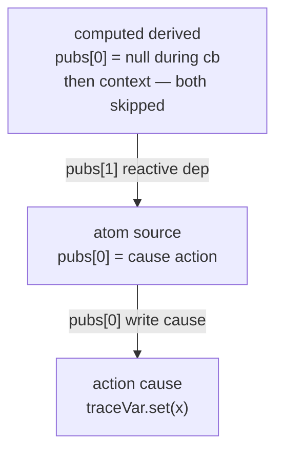
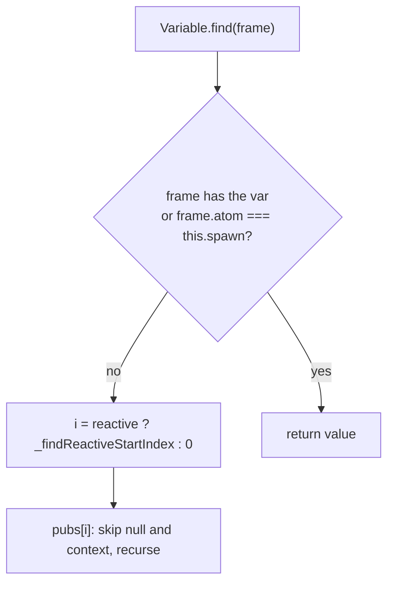

# C1 — Does the trace variable reach every frame it should?

Spike against core `variable` at `packages/core/src/methods/variable.ts`. Tests: `packages/core/src/methods/variable.test.ts` (`describe('C1 variable propagation')`). Core was not changed. `spanContext.ts` was not deleted.

**Verdict:** a value `traceVar.set(x)` inside an action is already visible in every required C1 frame. The adapter can store trace context on a core `variable`. Do not keep a parallel closure cell.

## Case table

Set `traceVar.set('c1-trace')` inside a named action, then read `traceVar.get()` in the target frame. `readVar` maps `undefined` to `'undefined'` and a thrown `Error` to `error.message`.

| Case | C1 requirement | Observed | Path `get()` walked (pubs index:atom → … → holder) |
| ---- | -------------- | -------- | -------------------------------------------------- |
| Nested action | must see `x` | **PASS** `'c1-trace'` | child action `pubs[0]` is the parent |
| `await wrap` continuation | must see `x` | **PASS** `'c1-trace'` | `wrap` restores the same action frame |
| `onEvent` handler | must see `x` | **PASS** `'c1-trace'` | `onEvent` does `wrap(action(cb))` on the registrar frame |
| `effect` body started from that action | must see `x` | **PASS** `'c1-trace'` | `1:effect._memo → 1:effect._subscribe → 0:start` (`withDynamicSubscription` makes `subscribe` an action called from `start`) |
| `effect` that also reads the atom written in the action | extra | **PASS** `'c1-trace'` | same as above, plus the written atom’s `pubs[0]` |
| `withAsync` `onFulfill` | must see `x` | **PASS** `'c1-trace'` | `bind(actionFrame)` then `abortVar.spawn(onFulfill)`; `traceVar` still walks past `abortVar.spawn` |
| `withAsync` `onReject` | must see `x` | **PASS** `'c1-trace'` | same as `onFulfill` |
| Route loader after `page.go()` from the action | must see `x` if cheap | **PASS** `'c1-trace'` | `1:route → 1:route._match → 1:urlAtom → 0:route.go → 0:start` |
| Computed recomputed because an atom changed inside the action | document | **PASS** `'c1-trace'` | `1:source → 0:cause` (see rule below) |
| Bare `setTimeout` | must NOT keep context | **PASS (negative)** `'missing async stack'` | no frame on `STACK`; `top()` throws |
| Callback without `wrap` between two actions | must NOT keep context | **PASS (negative)** `'undefined'` | follow action’s `pubs[0]` is not the writer |

### Untested (not required to land this spike)

| Case | Why skipped |
| ---- | ----------- |
| `urlAtom` write from `popstate` or a caught link click (C1.3 remainder) | needs a DOM / history fixture; `go()` from the action already writes `urlAtom` and the loader saw the var |
| Render computed in `reatomAbstractRender` / event handlers bound during render (C1.4) | needs an adapter mount fixture |

## Computed + `pubs[0]` + `_findReactiveStartIndex`

`Frame.pubs[0]` is the actualization flag and the imperative write cause. Later slots are reactive dependencies.

During a reactive callback, `pubs[0]` is still `null` (`computedMiddleware` sets `frame.pubs = [null]` before `next()`). After the callback, `frame.pubs[0] ??= frame.root.frame` (the `context` atom). `Variable.find` skips `null` and skips `pub.atom === context`, so a computed **never** reads the var off its own `pubs[0]`.

`Variable._findReactiveStartIndex` is `0`. For a reactive frame, `find` starts at `pubs[0]`. That matters on the **written atom**, not on the computed:

Observed for `c1.computed.derived` after `cause()` + `notify()`:

- `get()` → `'c1-trace'`
- during cb: `derived.pubs[0] === null`
- after compute: `derived.pubs[0].atom === context`
- `source.pubs[0].atom.name === 'c1.computed.cause'`
- walk: `['1:c1.computed.source', '0:c1.computed.cause', 'c1.computed.cause']`

`AbortVariable` sets `_findReactiveStartIndex = 1`, so abort does **not** follow a reactive atom’s write cause. Regular `variable` **does**. Traces should use `variable`, not `abortVar`.

`get()` walks `pubs`, not `STACK`. That is why `setTimeout` and an unwrapped callback lose the value: those frames are not in the pubs tree of the reader.

## Bench — 10k action calls, one combined variable vs two

Machine: darwin, `pnpm exec vitest run src/methods/variable.test.ts`. Depth `N` = `N` nested actions under the action that `set`s; `get` is at the leaf. `notify()` every 100 calls so action state does not accumulate (otherwise the 10k loop OOMs). Warmup 1k, not timed. Two consecutive samples:

| Depth | Combined `{trace, span}` set+get (ms) | Two vars, two gets (ms) |
| ----- | ------------------------------------- | ----------------------- |
| 1     | 10.4 / 10.8                           | 11.0 / 15.0             |
| 5     | 30.8 / 33.0                           | 31.1 / 29.3             |
| 20    | 115.3 / 117.1                         | 126.7 / 130.9           |

Nested action overhead dominates `Variable.get()` walking. Depth 5 is within noise. Depth 20 is consistently ~10% slower with two variables, not 2×. Т11 still holds: **one combined variable if trace and span are always read together**; two only if they are read in different places.

## Implications

- Core already carries the value through nested actions, `wrap`, `onEvent`, `effect`, `withAsync` settle hooks, a route loader after `go()`, and a computed invalidated by a write from that action.
- Do not keep `spanContext.ts` as a workaround. Switch the adapter to `variable` and then delete the closure cell.
- Do not “fix” `setTimeout` or unwrapped callbacks — those are the documented core boundary (Т12).
