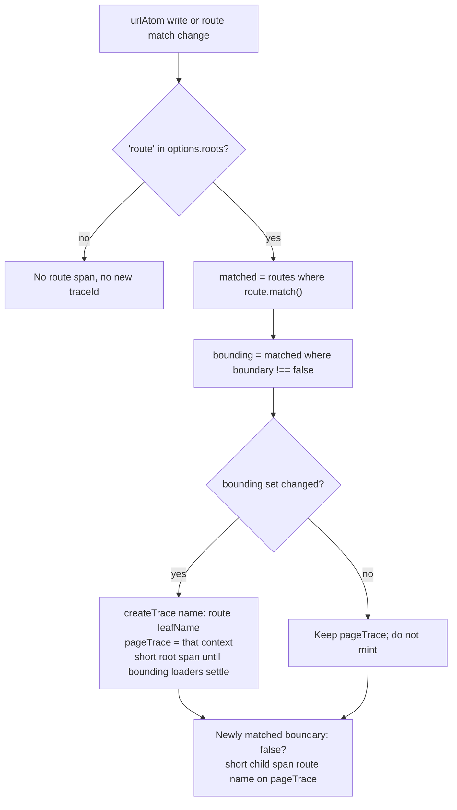
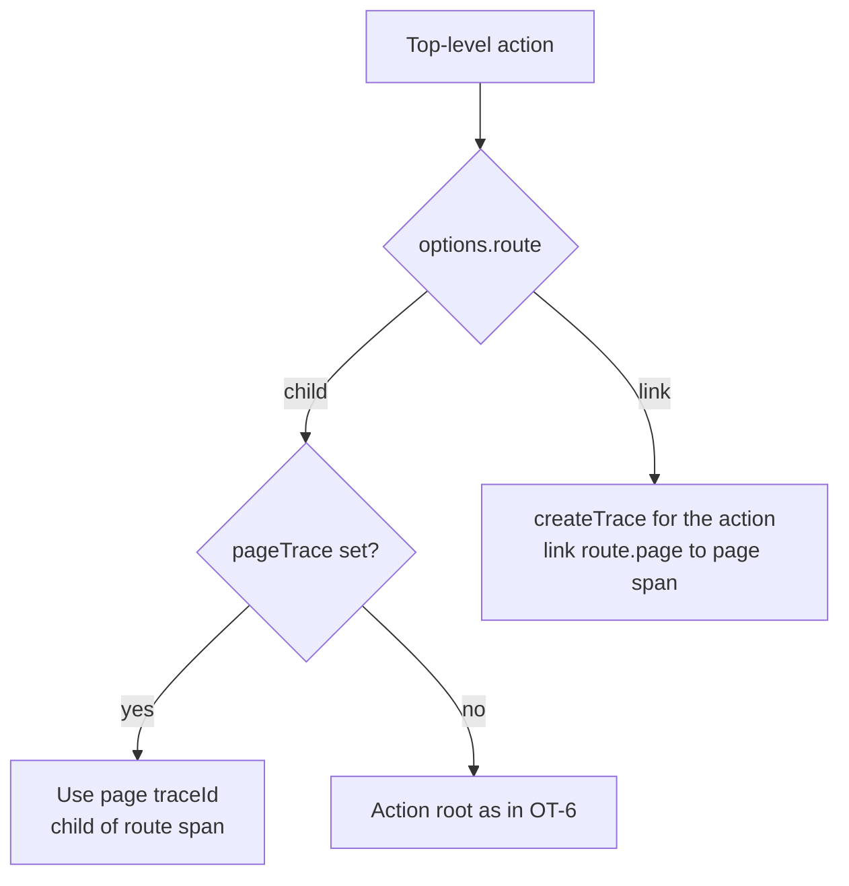

# C4 — Pathless / modal route boundary (Т1, Q12)

- Date: 2026-10-07
- Task: C4 in [01](../01-core-prerequisites.md). Unblocks [OT-7 / T-035](../02-opentelemetry-refactor.md#implementation-steps). Feeds F-03 (route watershed) and README open question 12.
- Owner lean: `withOTel({ boundary: false })` keeps the modal in the page trace (short `route <name>` span, same `traceId`).
- Fallback (ship this if the owner skips Q12): tracer extension only. No core routing change. No `reatom.kind` for pathless ([R3](R3-kinds.md)).
- Method: read REFERENCE Routing, [01 C4](../01-core-prerequisites.md#c4-trace-boundary-on-routes-and-pathless-routes-т1), [02 roots](../02-opentelemetry-refactor.md#trace-roots-where-a-trace-starts-т1т6-т28-т34), R3, R4, `urlAtom.routes` / `reatomRoute` as data. Core was not edited.

## Question

How does a modal / pathless route interact with the page `traceId`? Does routing itself need a setting that tells such routes apart, or is the tracer extension enough?

## Verdict

**The tracer extension is enough.** T-035 implements route roots in `@reatom/opentelemetry` and does not wait for C3, Q12, or a core flag.

A pathless route is still a route atom (`reatom.kind = 'route'`). It cuts a new page trace **unless** the app opts out with `route.extend(otel.withOTel({ boundary: false }))`. That opt-out emits a short `route <name>` span **inside** the current page trace and does not mint a `traceId`.

Do not add `reatom.kind = 'route.pathless'`. Do not add `traceBoundary` on `reatomRoute` options. Do not change `packages/core` unless the owner answers Q12 by asking for a core flag.

## Pathless in core today (read-only)

`hasNoExplicitPath` is `!('path' in options)` inside `createRouteFactory` (`packages/core/src/routing/route.ts`). It is a local. It is **not** copied onto `RouteExt` and is **not** a key on `urlAtom.routes`.

`urlAtom.routes` is a mutable `Rec<RouteAtom>` (plain object, not an atom), keyed by route name. Each value is a computed plus `go`, `loader`, `match`, `exact`, `pattern`, `layout`, `parent`, `path`, `routes`, `render`, `outlet`. `urlAtom.pattern` is `'/'`.

Four top-level factories can share `pattern === '/'`:

| Factory | `hasNoExplicitPath` | Typical use | Must cut a page trace? |
| --- | --- | --- | --- |
| `reatomRoute('')` | false | home page | **yes** when navigating to `/` |
| `reatomRoute({ layout: true })` | true | always-on shell | no — already matched; name the leaf |
| `reatomRoute({ search: z.object({ dialog: … }) })` | true | search-only modal | only with default `boundary` |
| `reatomRoute({ params(arg) { … } })` | true | in-memory modal gate | only with default `boundary` |

Core already treats the last three as pathless for **navigation** (`getUrl` keeps `url.pathname` when the child added no path; `matchPath` forces `exact: true` when `hasNoExplicitPath && segments.length === 0`). That is a URL/match rule, not a telemetry rule.

`go()` always runs `urlAtom.set`. An in-memory modal still writes `cachedParams` inside that updater. If `href` is unchanged, `urlAtom` state does not change, but the route computed still recomputes from `cachedParams`.

## Why `urlAtom.routes` cannot classify pathless

Proof that a tracer cannot tell pathless apart from a home page using only public registry data:

1. `reatomRoute('')` becomes `{ path: '' }`, so `hasNoExplicitPath` is false, but `subPath` is still `''`. Pattern is `${strippedParent}/` — `'/'` under `urlAtom`.
2. `reatomRoute({})`, search-only, and a params-gate modal also get `subPath === ''` and `pattern === '/'` under `urlAtom`.
3. Nested `parent.reatomRoute('')` and `parent.reatomRoute({ params() { … } })` both get `pattern === parent.pattern + '/'`. Segment lists are identical (`splitPath` drops empty parts).
4. `layout` is true only for shells. Search-only and modal gates default `layout: false`.
5. The params callback / search schema live in the factory closure. They are not on the atom.
6. Runtime `exact() === true` on a deeper pathname is a hint of pathless (`matchPath` forces exact), but at `'/'` home and pathless are indistinguishable. Too late and too noisy for a watershed.

C3 may later stamp a boolean `pathless: true` on the route object ([R3](R3-kinds.md)). That is **not a kind**, and it is **not required** for T-035. It would only unlock a later dev warning. Q12 stays open: do not add that boolean unless the owner asks.

**`urlAtom.routes` is still the read-only registry T-035 uses** to list route atoms and diff the matched set. It is not a pathless detector.

## Watershed

A **page** is a change in the set of **bounding** matched routes. A bounding route is a member of `urlAtom.routes` whose per-target options have `boundary !== false`. `boundary` defaults to `true` on route atoms (anything in that registry). Other atoms do not grow a default `boundary`.

Rules for T-035:

1. **Leaf name.** The short root span is `route <leafName>`. The leaf is the deepest newly-matched bounding route (longest parent chain / pattern). An always-matched pathless layout stays in the set and does not re-name every click.
2. **Cut overwrites the navigator.** `go()` from a submit action must not carry that action's `traceId` onto the new page (Т1). The route-root hook calls `traceVar.set(createTrace({ name: 'route <leaf>' }))` when the bounding set changes.
3. **The route span is short.** It opens at navigation start and ends when bounding loaders settle (`isSomeLoaderPending` false, or each new bounding `loader.ready()`). Т4: the **trace** does not end. Keep `pageTrace` on the instance so later actions still see that `traceId` after the root span has `endTime`.
4. **Same bounding set, new params.** `/users/1` → `/users/2` or `?q=` on the same page route does **not** cut (02: the matched *set* of route atoms). Loader rework stays on the existing page trace. R1 may revisit; do not wait.
5. **Form submit that navigates** is a bounding-set change. New `traceId`. The submit span stays on the old trace.
6. **Pathless / modal without the opt-out** is still a bounding route. Opening it **does** cut. That is the footgun the docs recipe exists for. Do not auto-spare pathless (home would be a false positive).
7. **`boundary: false`.** Newly matched (or unmatched) such a route never mints a `traceId`. Emit one short span `route <name>` with `reatom.kind = 'route'` as a **child of the current page route span** (same `traceId`, `parentSpanId` = page span). If there is no `pageTrace` yet, attach that short span to `app.session`.
8. **Discover routes without C3.** Scan `Object.values(urlAtom.routes)` on every run. Also duck-type new atoms from the instance `extend` hook (`'pattern' in target && 'loader' in target && 'go' in target`) so a modal created after setup and opened with an unchanged `href` is still observed. Read `route.match()` (or `route()`) for each, not only `urlAtom()` — in-memory gates recompute from `cachedParams` when `href` is unchanged.

## `roots: []` and `route: 'child' | 'link'`

These are instance options. They do not change what a pathless route *is*.

| Setting | Route root | Modal with `boundary: false` | Later top-level action |
| --- | --- | --- | --- |
| `roots` default, `route: 'child'` | New `traceId`, short `route <leaf>` | Short `route <name>` in that `traceId` | Same `traceId` (page context is "found") |
| `roots` default, `route: 'link'` | Same page `traceId` and short route span | Still in the **page** `traceId` (boundary wins) | New `traceId` each, link to the **page** span, `reatom.link.reason = route.page` |
| `roots: []` | None. No `route *` spans | None. `boundary` is ignored | None, unless `traceVar.set(otel.createTrace())` |

Details:

- **`roots: []`** turns the whole route-root machine off (02 test 21 / F-03). App-session still exists. Manual `traceVar.set(otel.createTrace())` still opens a trace. Do not emit automatic route, mount, action, or atom roots.
- **`route: 'child'`** (default, R1 fallback): an action or atom set without a calling-frame trace uses `pageTrace` when it exists. That is how post-loader clicks stay on the page `traceId`.
- **`route: 'link'`** applies to **top-level actions** (no calling frame), not to the modal span. Loader-invoked work (`fetchX` from `loader`) has a calling frame and stays on the route `traceId` even in `'link'` mode. The 02 sentence "with `route: 'link'` it gets its own trace with a link instead" is the **action** rule, not a second modal mode. Do not mint a modal `traceId` when `boundary: false`.
- **`boundary: true`** (default) plus `'link'`: a forgotten modal opt-out *does* cut a new route trace; later top-level actions link to **that** route span.

## F-03 acceptance (already encoded in `roots.route.test.ts`)

T-035 makes these four tests pass. Do not weaken them.

1. Navigate to a route with a loader, then call an action after `loader` settles. **One** short root span `route <name>`. Loader work and the later action share that `traceId`. The route span ends at or after the loader span and at or before the later action's start.
2. A params-gate modal with `withOTel({ boundary: false })` after the page loader settles emits `route <modal>` with the **same** `traceId` as `route <page>`. Both have `reatom.kind = 'route'`. The modal span is short (has `endTime`).
3. `roots: []` emits no `route <name>` and no automatic action span. `traceVar.set(otel.createTrace({ name: 'checkout' }))` then an action **does** share one `traceId`.
4. `route: 'link'` keeps one `route <page>` span. Each later top-level action has its own `traceId` and a link `{ traceId, spanId }` of the route span with `reatom.link.reason = 'route.page'`.

## Recommendation T-035 can ship without waiting

Implement OT-7 now:

1. `roots/route.ts` (or the instance hook that already watches `urlAtom`): bounding-set diff, `pageTrace` cell, short `route <name>` spans, `boundary: false` child spans.
2. Default `boundary: true` only for targets in `urlAtom.routes` / duck-typed route atoms. Flat-merge `withOTel({ boundary: false })` as already specified (skip `undefined`).
3. Classify those spans as `reatom.kind = 'route'` because the target is a route atom, not because C3 stamped it. If C3 later stamps `kind: 'route'`, copy it; do not block on C3.
4. Docs recipe (OT-15 can copy later): every modal / search-only / params-gate route gets `route.extend(otel.withOTel({ boundary: false }))`. Show the REFERENCE examples (`dialogRoute`, `confirmModal`).
5. Do not infer pathless. Do not warn on `reatomRoute('')`. Do not add a core option.
6. WA-2: a `boundary: false` match, or a match that does not change `urlAtom.pathname`, is **not** a `page_view`. Analytics already defers to an existing route root for the same navigation.

## Q12 (owner)

Asked: should routing itself tell pathless routes apart?

**Recommendation: no.** The watershed is a telemetry concern. Core already has the right navigation behavior. Exposing `hasNoExplicitPath` would let a later warning fire, and would still not decide "this modal should not cut" — a pathless layout, a search overlay, and a forgotten home `reatomRoute('')` are different products. The explicit extension is the API that is hard to misuse: a call site that wants the page `traceId` says so.

If the owner later asks for a core boolean, add `pathless` on the route object (R3), not a `reatom.kind`, and still keep `boundary: false` as the only cut opt-out.

## Sources

1. [01 C4](../01-core-prerequisites.md#c4-trace-boundary-on-routes-and-pathless-routes-т1) — prefer the extension; Q12 is owner approval for any routing change.
2. [02 roots and `withOTel`](../02-opentelemetry-refactor.md#trace-roots-where-a-trace-starts-т1т6-т28-т34) — page watershed, modal opt-out, `roots`, `route: 'child' | 'link'`.
3. [02 OT-7 / tests 1, 21, 22](../02-opentelemetry-refactor.md#implementation-steps) — F-03 acceptance.
4. [05](../05-telemetry-schema.md) — `route <name>`, `reatom.kind = route`, `reatom.link.reason = route.page`.
5. [R3](R3-kinds.md) — no `route.pathless` kind; C3 `pathless` boolean is optional and not a kind.
6. [R4](R4-computed-trace.md) — computeds do not mint traces; route roots are a tracer hook, not the route computed.
7. [README Q12](../README.md#open-questions-for-the-owner) — pathless setting vs C4 extension.
8. [R23](../06-research-backlog.md) fallback — short span inside the page trace; `'link'` for its own *action* traces.
9. REFERENCE Routing — search-only preserves pathname; modal gate is in-memory; `urlAtom.routes` is the registry.
10. `packages/core/src/routing/route.ts` — `hasNoExplicitPath`, `getUrl`, `matchPath`, `go` + `cachedParams`, `urlAtom.routes[name] = routeAtom`.
11. `packages/core/src/web/url.ts` — `routes: {}`, `pattern: '/'`.
12. `packages/core/src/routing/route.test.browser.ts` — `reatomRoute('')` vs `reatomRoute({})` vs search-only share `/` and differ only in `exact` on deeper paths.
13. `packages/opentelemetry/src/roots.route.test.ts` — F-03 tests T-035 must pass.
