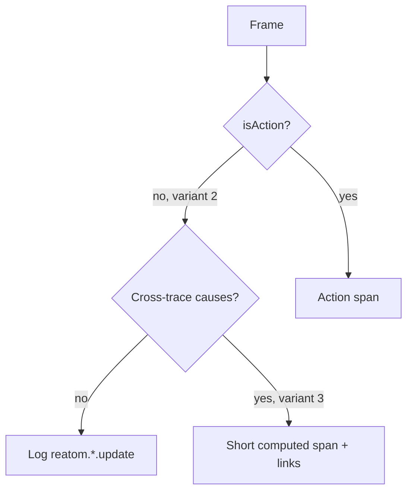

# R1 — Frame → OTLP mapping variants (Т7, Т10, Т22, Т27)

- Task: [06 R1](../06-research-backlog.md). Informs [OT-5 / OT-9](../02-opentelemetry-refactor.md#implementation-steps) and the P3 freeze of [05](../05-telemetry-schema.md).
- Date: 2026-10-07.
- Method: desk estimate from [02 mapping](../02-opentelemetry-refactor.md#mapping-frames-to-opentelemetry-т7-т10-т22-т27), [05](../05-telemetry-schema.md) example records, `buildSpan.ts` / `buildLogRecord.ts` OTLP/JSON shapes, `causes.test.ts` (F-12), and `roots.route.test.ts` (`route: 'link'`). No `examples/react-search` recording. No C3 `kind`. No admin UI.
- Fallback (06, and current code): **variants 2 + 3**, `detail: 'events'`, mount roots on, `route: 'child'`.
- **`owner_decision`:** confirm 2 + 3 and `route: 'child'` as the schema default, or pick otherwise, **before T-042 / P3**. T-033 / OT-5 may keep shipping 2 + 3 without waiting.

## Question

How do Reatom frames become OTLP so the cause chain survives (`reatom.frame.id` / `reatom.cause.ids`), a span-per-frame flood does not, and Jaeger / Tempo / SigNoz stay readable? The owner asked for variants (Т10) and heard “one trace gets one span”; this note names the variants, costs a typical click, and recommends a pick.

`route: 'child' | 'link'` is **orthogonal** to the four mapping variants: it only decides whether a **top-level action** (no calling frame) stays on the page `traceId` or mints a new one with a link to the route span ([C4](C4-route-boundary.md)).

## Variants (already in 02)

| Id    | `detail`             | Spans                                                                                                                                                                                                                          | Updates / diamonds                                                                                                                                                           | Status                                                                                                                           |
| ----- | -------------------- | ------------------------------------------------------------------------------------------------------------------------------------------------------------------------------------------------------------------------------ | ---------------------------------------------------------------------------------------------------------------------------------------------------------------------------- | -------------------------------------------------------------------------------------------------------------------------------- |
| **1** | `'spans'`            | Every action, atom write, computed recompute                                                                                                                                                                                   | Multi-cause updates **cannot** be expressed                                                                                                                                  | Local debug only                                                                                                                 |
| **2** | `'events'` (default) | Action call (async ends on promise settle). `span: true` on an atom/computed is the per-target override                                                                                                                        | Atom / computed updates are log records `reatom.atom.update` / `reatom.computed.update` with the **current action span context**, name, serialized **body**, frame/cause ids | **Shipped direction** (`causes.test.ts` F-12; `buildLogRecord.ts`)                                                               |
| **3** | add-on to 2          | Same as 2. A computed with causes from **different traces** becomes a **short span**; parent = primary (triggering) cause; one **link** per other trace (`reatom.link.reason = computed.dependency`). Single-cause stays a log | Diamonds keep several `traceId`s without a span per frame                                                                                                                    | **Default add-on** (OT-9). `buildSpan.ts` still lacks a `links` field; route links are already asserted in `roots.route.test.ts` |
| **4** | `'summary'`          | Action spans only                                                                                                                                                                                                              | No update records. Span attrs `reatom.updates.count` / `reatom.updates.names`                                                                                                | Production budget mode                                                                                                           |

**Cause ids are in every variant.** Each span and log gets `reatom.frame.id` (per-instance counter, scoped by `service.instance.id`) and `reatom.cause.ids` (`pubs[0]` first, then changed deps). That is the Reatom graph on the wire. Admin (later, R13) rebuilds it from OTLP alone; the mapping pick must not wait on that UI.

`withAsync` helpers are not a fifth variant: [R3](R3-kinds.md) already sends `reatom.async.settle` logs, not helper spans. [R4](R4-computed-trace.md) already forbids minting a `traceId` on an untraced computed. Untraced computeds attach to `app.session`. `effect` follows variant 2 (log) unless `span: true`.

Do **not** add `reatom.state.prev`. 05 already derives previous state from the prior update of the same atom. Do **not** put atom updates on **span events** to feed Jaeger: R2 forbids a default exception span-event duplicate; the Span Event API is deprecated. Jaeger users who need updates in the waterfall use `detail: 'spans'` locally.

## Typical click (cost model)

One user gesture with **no calling Reatom frame**: 1 click action + 2 nested actions + 8 atom writes + 6 computed updates (**3 action spans, 14 updates**). Capture on, small values (`[{"sku":"42"}]`, numeric/object bodies of a few fields). OTLP/JSON **record** sizes from the 05-shaped builders (no gzip; resource envelope ~0.5 KiB per signal batch):

| Record                                          | Bytes    |
| ----------------------------------------------- | -------- |
| Action span (`reatom.*` + small params/payload) | ~0.7 KiB |
| Same span + one route/computed **link**         | ~0.9 KiB |
| Atom/computed **span** (variant 1)              | ~0.6 KiB |
| `reatom.atom.update` **log**                    | ~0.5 KiB |
| Link object alone                               | ~0.2 KiB |

Ceiling, not typical: serializer budget is **8 KiB per captured value** (`serialize.ts`); `MAX_RECORD_BYTES` is 16 KiB. Fourteen fat updates can exceed the **60 KiB unload** budget on their own. `sampling.updates` and `detail: 'summary'` exist for that.

### Per typical click — mapping

| Mapping              | Spans                                                     | Logs   | OTLP/JSON (two signals, small values)    |
| -------------------- | --------------------------------------------------------- | ------ | ---------------------------------------- |
| 1 `'spans'`          | **17** (3 actions + 14 updates)                           | 0      | ~10 KiB traces                           |
| **2 + 3** `'events'` | **3** (+ 0–1 short diamond span; 0 on a same-trace click) | **14** | ~3 KiB traces + ~8 KiB logs ≈ **11 KiB** |
| 4 `'summary'`        | **3**                                                     | 0      | ~3 KiB traces                            |

Variant 1 does **not** win on bytes. It wins only on “everything is a span,” and it **drops diamonds**.

### `route: 'child'` vs `'link'` (same click, variants 2 + 3)

|                              | `'child'` (default)                                   | `'link'`                                                           |
| ---------------------------- | ----------------------------------------------------- | ------------------------------------------------------------------ |
| New `traceId`                | 0 (page leftover after the short `route <leaf>` span) | **1** (the top-level action)                                       |
| Extra span                   | 0                                                     | 0 (same 3 action spans)                                            |
| Extra link                   | 0                                                     | **1** on the top-level span, `reatom.link.reason = route.page`     |
| Bytes vs child               | baseline ~11 KiB                                      | **+~0.2 KiB**                                                      |
| Nested actions / loader work | same `traceId`                                        | stay **in the new scenario trace** (they have a calling frame; C4) |

Bytes per click barely move. What moves is **trace cardinality** and waterfall length.

15-step loan, one typical click per step, ~10 client spans nested per step (Viktor’s ~150 requests):

|                      | `'child'`                                        | `'link'`                              |
| -------------------- | ------------------------------------------------ | ------------------------------------- |
| Traces               | **1** page trace                                 | **15** scenario traces + 1 page trace |
| Action+request spans | ~45 + 150                                        | same counts, split                    |
| Update logs          | ~210                                             | ~210                                  |
| Payload              | same order (~0.25 MiB raw JSON over the session) | +~3 KiB of links                      |

Pay-on-desktop / check-on-phone is **not** decided by `route`. The phone is another page load. Linking those two traces is `traceparent` / `createTrace` (Т16, Т34), not `'child'`.

## What Jaeger / Tempo / SigNoz show well

Do **not** treat Jaeger as a log-record viewer. Jaeger is traces only.

| Backend             | Spans / waterfall    | Span events                                       | OTLP **log records**                                                                                       | Span **links**                                                                                                                                            |
| ------------------- | -------------------- | ------------------------------------------------- | ---------------------------------------------------------------------------------------------------------- | --------------------------------------------------------------------------------------------------------------------------------------------------------- |
| **Jaeger**          | Excellent tree/Gantt | Shown on the span (legacy “logs” in the trace UI) | **Not stored, not painted**                                                                                | Same-trace edges in Trace Graph (dashed); cross-trace is a jump at best. Some UIs still mis-read a link as `FOLLOWS_FROM` parentage (blank/cyclic traces) |
| **Tempo** (Grafana) | Excellent            | Shown on the span                                 | **Not in Tempo.** Trace-to-logs is a Loki (or other) hop on `traceId`; often the whole trace, not the span | **Best of the three for `'link'`:** span details → View Linked Span, including **another `traceId`**                                                      |
| **SigNoz**          | Good                 | Shown                                             | **Native:** Logs tab on the span when the record carries `traceId` + `spanId` (exactly variant 2)          | Present as references; not a diamond DAG                                                                                                                  |

Readability verdict:

- **Variant 2 + 3** is built for SigNoz and for Tempo+Loki (or ClickHouse e2e). Cause ids survive even when the UI cannot draw a DAG.
- **Jaeger sees actions, not atom updates**, unless `detail: 'spans'`. That is acceptable: updates are high-volume facts with their own retention (`sampling.updates`).
- **`'child'`** is what Jaeger/Tempo waterfalls do well for a short page: one trace, nested clicks.
- **`'link'`** is what Tempo’s linked-span jump does well for a 15-step form: each step is searchable, the page is one click away. Jaeger search also stops drowning in one endless page trace (principle 2).
- Diamonds via links will look weak in all three UIs (owner already suspected this, Т13). Variant 3 still writes the link **and** `reatom.cause.ids`. R13/admin is the DAG; do not block mapping on it.

**Т10, explicit:** a trace is not one span. Under the recommended mapping a typical click is **three action spans plus fourteen logs** on one `traceId` (`'child'`) or on a new `traceId` (`'link'`). One-span traces are the failure mode of minting on every computed (rejected in R4), not of action spans.

## Recommendation — `owner_decision`

**Ship variants 2 + 3. Keep `route: 'child'` as the instance default. Keep `'link'` as the opt-in for long scenarios. Do not change the code direction.**

1. Matches current tests: action span + `reatom.atom.update` log with the action `spanId` and cause ids; `route: 'link'` already emits `route.page` links.
2. Matches 02/06 fallback and `detail: 'events'`.
3. Answers volume: few spans (actions), many cheap logs (updates), diamonds only when two traces actually meet.
4. Answers backends: SigNoz/Tempo+logs get the full story; Jaeger gets the action waterfall; `detail: 'spans'` remains the Jaeger-local escape hatch.
5. `'child'` default keeps post-loader clicks on the page (C4 F-03, OT-7). Switch a 15-step loan app to `'link'` without a schema bump. Do not auto-link step-to-step until someone asks (02).
6. Mount roots stay **on** as the 06 fallback. That is a root, not a mapping variant. Measuring them does not require C3: duck-type / adapter mount is enough later (OT-10). The mapping freeze does not wait.

Reject as the **default**: variant 1 (diamonds die; Jaeger-shaped but not the OTel logs path v2 already chose); variant 4 as the only mode (loses cause-level updates; keep it as `'summary'`); flipping the default `route` to `'link'` (every click becomes its own trace in search, including noise handlers; Tempo links work, Jaeger parentage bugs bite more often).

### Implementer rules (no C3, no admin)

- Infer `action` / `atom` / `computed` from `reactive` / `writable` ([R3](R3-kinds.md)). Do not wait for `AtomMeta.kind`.
- Emit variant 2 from OT-5. Emit variant 3 links from OT-9 (`computed.dependency`). Emit `route.page` links from OT-7. Add `links` to `buildSpan` when those land.
- Recursion cap default 32 stays until a real recording says otherwise.
- SCHEMA-1 freeze copies 05 as written for this mapping: action spans, update logs, cause ids, link reasons `computed.dependency` | `route.page`.

## What this note does not decide

R2 names, R3 helper/`pending` emission, R4 leftover computeds, R5 sampling, C4 pathless detection, mount-on-by-default as a **product** promise after a real-app recording, how admin draws diamonds (R13).

## Sources

1. [02 mapping, roots, `detail` / `route`](../02-opentelemetry-refactor.md)
2. [05 spans, logs, link reasons, cart.add example](../05-telemetry-schema.md)
3. [06 R1](../06-research-backlog.md), [README Q9 / Q15](../README.md)
4. [C4 `child` vs `link`](C4-route-boundary.md), [R2 exceptions = logs](R2-semconv.md), [R3 kinds](R3-kinds.md), [R4 no computed `traceId`](R4-computed-trace.md)
5. `packages/opentelemetry/src/buildSpan.ts`, `buildLogRecord.ts`, `causes.test.ts`, `roots.route.test.ts` (`causes.ts` is not a file yet; F-12 is the cause-id contract)
6. Jaeger stores traces only — https://www.jaegertracing.io/docs/
7. Grafana Tempo trace-to-logs and span links — https://grafana.com/docs/grafana/latest/datasources/tempo/configure-tempo-data-source/configure-trace-to-logs/
8. SigNoz correlate traces and logs — https://signoz.io/docs/traces-management/guides/correlate-traces-and-logs/
9. Span Event API deprecation — https://opentelemetry.io/blog/2026/deprecating-span-events/
