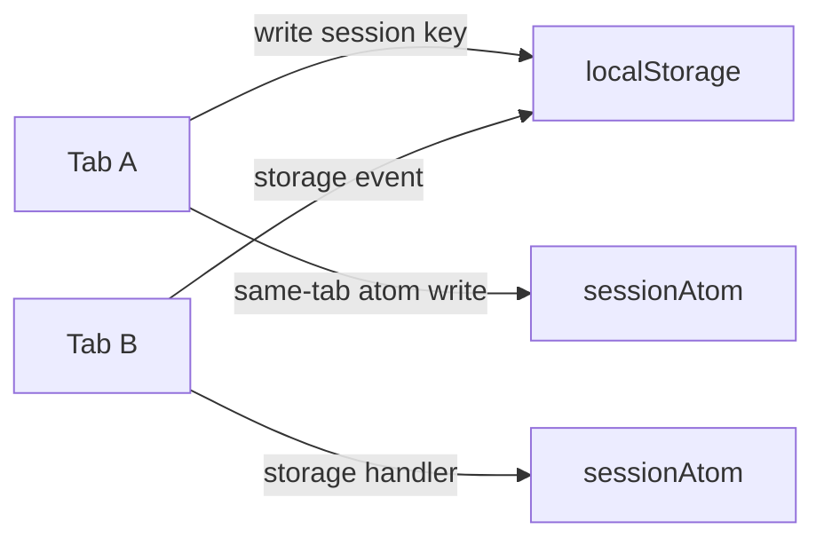
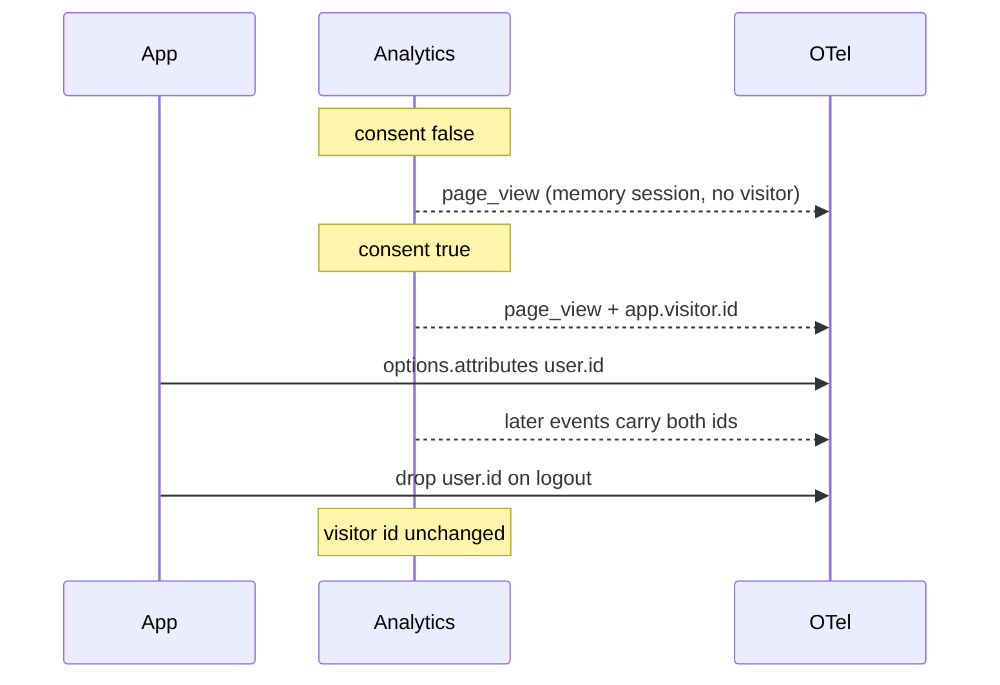

# R10 — Identity and sessions

**Task:** typical practices for storage, lifetimes, cross-tab sessions, campaign-change rotation, midnight rotation, and linking an anonymous visitor to `user.id` after login. No fingerprinting.

**Fallback (implementation starts here):** [03 § Identity and sessions](../03-connect-web-analytics.md#identity-and-sessions-а14а16). This note confirms those defaults and names the knobs and pitfalls. R11 owns consent law; this note only says when storage is written.

## Question

What should `connectWebAnalytics` persist, for how long, how tabs share it, when a session id rotates, and how a later login attaches `user.id` without inventing identity on the client or fingerprinting the device?

## Industry survey

| Product             | Visitor storage                               | Visitor life                           | Session timeout                        | Campaign rotates session?                                                    | Midnight rotates? | Login link                                                               |
| ------------------- | --------------------------------------------- | -------------------------------------- | -------------------------------------- | ---------------------------------------------------------------------------- | ----------------- | ------------------------------------------------------------------------ |
| Universal Analytics | first-party `_ga` cookie                      | 2 years (Chrome caps 400 d)            | 30 min                                 | yes                                                                          | yes (property TZ) | User-ID, client stays                                                    |
| GA4                 | first-party cookie / `user_pseudo_id`         | 2 years, Chrome-capped                 | 30 min, no max                         | **no** — new UTM attributes later events only                                | **no**            | app sends `user_id`; device id stays                                     |
| Yandex Metrica      | first-party cookie + `localStorage` on eTLD+1 | `_ym_uid` 1 year                       | 30 min (30–360)                        | first ad click-through is a new session; later tags in the same visit do not | no                | `ClientID` + `userParams` from the app                                   |
| Matomo              | first-party `_pk_id` / `_pk_ses`              | 13 months / 30 min                     | 30 min                                 | attribution cookie, not a hard rotate by default                             | no                | `setUserId` keeps visitor id                                             |
| PostHog             | local persistence + cookie                    | until cleared                          | 30 min idle **or 24 h max**; cross-tab | no; UTM is `$session_entry_*`                                                | no                | `identify(distinct_id)` merges anonymous into named; `reset()` on logout |
| Amplitude           | cookie / `localStorage` device UUID           | until cleared                          | 30 min                                 | no                                                                           | no                | `user_id` + `device_id`; Amplitude ID stitches server-side               |
| Mixpanel            | cookie / `localStorage` `distinct_id`         | until cleared                          | 30 min (product-side)                  | no                                                                           | no                | `identify` / `alias`                                                     |
| Plausible           | none on device                                | daily server hash of salt+domain+IP+UA | server-side visit                      | n/a                                                                          | daily salt        | none                                                                     |
| Umami               | none by default                               | server-side; optional `distinct-id`    | server-side                            | n/a                                                                          | n/a               | `umami.identify` / `data-distinct-id` from the app                       |

The 30-minute idle timeout is the industry default. Campaign-change and midnight rotation are Universal Analytics / Metrica-flavoured, not GA4. Persistent random ids in first-party storage are the product-analytics default; cookieless daily hashes are the privacy-analytics default and are fingerprinting.

OpenTelemetry already names `session.id`, `session.previous_id`, and `session.start`. Schema [05](../05-telemetry-schema.md) uses those plus `app.visitor.id` and `user.id`.

## Storage

### Options

| Option                                                                 | Pros                                                                                                                                                                              | Cons                                                                                                                                        |
| ---------------------------------------------------------------------- | --------------------------------------------------------------------------------------------------------------------------------------------------------------------------------- | ------------------------------------------------------------------------------------------------------------------------------------------- |
| **A. `localStorage` under `storageKey` (fallback)**                    | Same-origin, no cookie header cost, survives reload, `storage` events for other tabs, core `withLocalStorage` exists. Safari ITP is harsher on JS cookies than on `localStorage`. | Origin-scoped (not subdomain). Quota / private-mode eviction. ePrivacy treats it as “similar technology”: **no legal win versus a cookie**. |
| **B. First-party cookie, optional `Domain=eTLD+1`**                    | Shared across `www` / `shop` / `app`. Matches Matomo / Metrica / GA. `withCookie` / `withCookieStore` exist.                                                                      | Chrome `Max-Age` cap 400 days. Safari ITP often evicts JS-set cookies in ~7 days. Header cost. Still needs consent (R11).                   |
| **C. `sessionStorage`**                                                | Natural `perTab`.                                                                                                                                                                 | Dies with the tab; no returning-visitor or cross-tab session.                                                                               |
| **D. Memory only (`persistVisitor: false`, and the pre-consent path)** | No device write. Required before consent ([03](../03-connect-web-analytics.md#consent-а4-а17а19-о18), ICO / CNIL: do not read or write the terminal before consent).              | New visitor / session every load. Cannot link days.                                                                                         |
| **E. IndexedDB**                                                       | Overkill for two small records. Offline queue is already a user extension (Т43).                                                                                                  | Extra API, no `storage` event.                                                                                                              |
| **F. Device fingerprint or IP+UA hash (Plausible / Umami)**            | No client persist.                                                                                                                                                                | **Out of scope.** See Fingerprinting.                                                                                                       |

Cookies and `localStorage` are the same ePrivacy class: PECR / ICO cover any store or access on the device, CNIL forbids read/write before consent. Choosing `localStorage` is an engineering default (size, ITP, no cookie header), not a consent shortcut.

### Recommendation

Keep **A**. Cookie **B** is the documented opt-in for subdomain sharing (`Domain` on the registrable domain, `Secure`, `SameSite=Lax`, `Max-Age=400d`, `Path=/`). **C** is `perTab: true`. **D** is `persistVisitor: false` and the pre-consent path. Never **F**.

Two keys, both prefixed by `storageKey` (instance `name`):

- `visitor` — `{ id, createdAt, lastSeen, firstTouch, lastTouch }`
- `session` — `{ id, startedAt, lastActivity, previousId, campaign, pageViews, events, engagedMs }`

Do not persist `user.id`. That attribute is owned by `otel.options` and the app’s auth store.

Ids: `crypto.randomUUID()` when present, else 128 random bits as hex. Matches the OTel `session.id` example.

## Lifetimes

### Visitor

400 days is Chrome’s cookie ceiling and sits next to Matomo’s 13 months. GA’s “2 years” is silently capped.

| Option                                                                                                          | Pros                                                                                                      | Cons                                                   |
| --------------------------------------------------------------------------------------------------------------- | --------------------------------------------------------------------------------------------------------- | ------------------------------------------------------ |
| **A. Sliding 400 d: rewrite `lastSeen` on activity; rotate only if `createdAt` is older than 400 d (fallback)** | Returning yearly visitors keep the id (Chrome’s stated reason for 400 d). Predictable unique-user counts. | Long-lived identifier after consent.                   |
| **B. Hard expire 400 d from last write**                                                                        | Shorter if the user disappears.                                                                           | A yearly visitor looks new.                            |
| **C. 13 months (Matomo) / 1 year (Metrica `_ym_uid`)**                                                          | Familiar to EU analytics policies.                                                                        | Arbitrary versus the Chrome cap we already document.   |
| **D. No persist / daily (Plausible)**                                                                           | Minimal identity.                                                                                         | Needs a server hash (fingerprinting) or loses uniques. |

**Recommendation:** **A**. Refresh `lastSeen` (and the optional cookie `Max-Age`) on activity so a live visitor does not fall off at day 400 of a still-open relationship. Rotate `id` when `createdAt` exceeds 400 days; keep first-touch attribution on the old record only if the product later asks for it — v1 just mints a new visitor.

`persistVisitor: false` never writes the visitor key (test 11 in [03](../03-connect-web-analytics.md#tests)).

### Session

| Option                                     | Pros                                                   | Cons                                                                        |
| ------------------------------------------ | ------------------------------------------------------ | --------------------------------------------------------------------------- |
| **A. 30 min idle, no max (fallback, GA4)** | Industry default. Long support chats stay one session. | A forgotten tab can stay “the session” if something keeps writing activity. |
| **B. 30 min idle or 24 h max (PostHog)**   | Bounds replay-sized sessions.                          | Splits overnight work.                                                      |
| **C. Configurable idle only**              | Matches the option already named `sessionTimeout`.     | Callers must opt into a max themselves.                                     |

**Recommendation:** **A** + **C**. Default `sessionTimeout: 30 * 60 * 1000`. No default max. A later `maxSessionDuration` is fine as an opt-in; do not add it to tier 0.

Idle clock: any analytics record, plus engagement / visibility that already flushes. Cross-tab: write `lastActivity` to the shared session key so tab A keeps tab B alive (GA cookie behaviour). Two tabs racing a cold start: if an existing session’s `lastActivity` is inside the timeout, reuse it; otherwise mint and set `session.previous_id`.

Rotation always emits `app.session.start` with `session.previous_id` when known (OTel `session.start`).

## Cross-tab

| Option                                                     | Pros                                                                                                   | Cons                                                                                                                       |
| ---------------------------------------------------------- | ------------------------------------------------------------------------------------------------------ | -------------------------------------------------------------------------------------------------------------------------- |
| **A. Shared `localStorage` + `storage` events (fallback)** | Other tabs see writes; GA / Matomo / PostHog all share one session per browser profile. Zero new APIs. | `storage` does not fire in the writing tab (the atom already updated). Hidden iframes / partitioned contexts do not share. |
| **B. `BroadcastChannel`**                                  | Explicit messages, including same-tab if wanted.                                                       | Extra API, still same-origin, does not persist. Would sit on top of A, not replace it.                                     |
| **C. `perTab: true` via `sessionStorage`**                 | Widgets, kiosks, parallel research tabs.                                                               | Inflates session counts. Off by default.                                                                                   |
| **D. Cookies only**                                        | Shared by definition.                                                                                  | Default path is cookieless.                                                                                                |

**Recommendation:** **A** after consent. The writing tab updates `sessionAtom` itself; other tabs apply the parsed `storage` event when `event.key` matches. Ignore malformed JSON. Instance isolation is the key prefix (test 5). **C** is the option. Do not propagate Reatom trace context across tabs (Т15 never).

Pre-consent: in-memory session id per page load, no `storage` writes, no `storage` listeners that read identity keys.

## Campaign rotation

UA started a new session on a new campaign. GA4 does **not**: a mid-session UTM updates event attribution and leaves `ga_session_id` alone. Metrica starts a **new** session on the first advertising click-through, then ignores later tags in that visit. Spec 03 follows UA/Metrica, not GA4.

| Option                                                   | Pros                                                                                               | Cons                                                                                                                             |
| -------------------------------------------------------- | -------------------------------------------------------------------------------------------------- | -------------------------------------------------------------------------------------------------------------------------------- |
| **A. Rotate on campaign change (fallback)**              | Last-touch session matches the landing campaign. Comparable to UA and to Metrica’s first ad click. | Internal UTM links (`/?utm_source=header`) inflate sessions (the classic UA bug). GA4 reporters will see more sessions than GA4. |
| **B. GA4-style: never rotate on UTM**                    | Stable sessions; attribution is a property, not a watershed.                                       | Last-touch on `app.session.start` can disagree with a later `app.page_view`.                                                     |
| **C. Rotate only on inbound campaign (not same-origin)** | Keeps A’s value, drops the internal-UTM trap.                                                      | Needs a same-origin check on referrer / Navigation API.                                                                          |

**Recommendation:** keep **A** as the default (fallback). Implement it as **C**’s filter so the default is not foot-guns:

- Campaign keys that may rotate: `utm_source`, `utm_medium`, `utm_campaign`, and click ids `gclid`, `yclid`, `fbclid`, `msclkid` (the [03](../03-connect-web-analytics.md#attribution-а8) list).
- Do **not** rotate on `utm_term` / `utm_content` alone.
- Do **not** rotate when the navigation is same-origin (in-app UTM). Compare against the current session’s stored `campaign` snapshot, not against last-touch history.
- Direct / empty UTM does not rotate an existing session.

Last-touch on the visitor still updates when a new inbound campaign arrives (attribution § in 03). Session start carries first and last touch; every page view carries last touch.

`attributionParams` remains the override list.

## Midnight

| Option                                           | Pros                                                                                            | Cons                                                                                                                                                                                 |
| ------------------------------------------------ | ----------------------------------------------------------------------------------------------- | ------------------------------------------------------------------------------------------------------------------------------------------------------------------------------------ |
| **A. Off (GA4, PostHog, Amplitude, Metrica)**    | A 23:50–00:20 checkout is one session. Daily uniques stay a backend `date_trunc` on timestamps. | Day-bucketed session counts can span two dates.                                                                                                                                      |
| **B. Local midnight (`rotateAtMidnight: true`)** | UA-shaped daily session reports without a warehouse rule.                                       | Splits night-shift and live events. “Local” is the **browser** timezone, not a GA property timezone — document that. DST: `Date` local calendar is enough; do not hand-roll offsets. |
| **C. UTC midnight**                              | Stable across travelers.                                                                        | Wrong for “my Tuesday” reports.                                                                                                                                                      |

**Recommendation:** default **A** (`rotateAtMidnight: false`). **B** is the named option. When it fires, treat it as any other rotation: new id, `session.previous_id`, `app.session.start`. Check on activity and on the visibility flush, not on a 00:00 timer in a background tab (timers lie under throttling).

## Linking anonymous visitor to `user.id`

| Option                                                                   | Pros                                                                                                                                                                                                | Cons                                                                         |
| ------------------------------------------------------------------------ | --------------------------------------------------------------------------------------------------------------------------------------------------------------------------------------------------- | ---------------------------------------------------------------------------- |
| **A. App sets `user.id` on `otel.options`; visitor id stays (fallback)** | Analytics never invents a login. OTel semconv `user.id`. Backend `GROUP BY visitor, user` stitches history. Matches GA4 User-ID + device id, Matomo `setUserId`, Amplitude `user_id` + `device_id`. | No cross-device. Shared computer keeps the visitor until storage is cleared. |
| **B. Client `identify()` / alias table (PostHog, Mixpanel)**             | Merge is immediate in the vendor.                                                                                                                                                                   | Extra API (А9 killed manual analytics APIs). Alias graphs are a backend job. |
| **C. Replace visitor id with `user.id`**                                 | One column.                                                                                                                                                                                         | Breaks anonymous history; leaks the account id into the visitor key.         |
| **D. Cross-device stitch on the client**                                 | —                                                                                                                                                                                                   | Impossible without a server identity graph. Out of scope.                    |
| **E. Hash email into `user.hash` automatically**                         | OTel has `user.hash`.                                                                                                                                                                               | Spec: hashing is documented, per-site salt, **never automatic**.             |

**Recommendation:** **A**.

Rules:

1. Analytics does not read the auth cookie, JWT, or DOM.
2. After login the app writes `otel.options.set(opts => ({ ...opts, attributes: { ...opts.attributes, 'user.id': id } }))`. From then on every analytics record already carries common attributes, so `user.id` and `app.visitor.id` sit together.
3. The visitor id does not change. That is the join key for pre-login, post-consent events.
4. Pre-consent events stay unlinkable (03). No backfill.
5. Logout drops `user.id` from `options.attributes`. Visitor stays. A shared-computer recipe may also mint a new visitor (PostHog `reset()`); that is docs, not default.
6. No client alias event. If a backend wants PostHog-style merge, it queries `app.visitor.id` where `user.id` is set.
7. Do not put email in `user.id` (GA4 ToS; Umami says use an internal id). `user.email` is a separate, explicit attribute the app may set.

## Fingerprinting — out of scope

Issue #1272 listed cookies and fingerprinting as optional. [README open question 13](../README.md#open-questions-for-the-owner) already offers the cookie and leaves fingerprinting out. This note **confirms: no fingerprinting**, not even as a module.

Not shipped, not as a fallback, not as “cookieless uniques”:

- canvas / WebGL / AudioContext / font / hardware hashes
- IP + User-Agent (+ daily salt) hashes (Plausible, default Umami)
- `user_agent.original` (already off on the tracer)
- high-entropy Client Hints
- `user.hash` computed by analytics

A random id the browser **stores after consent** is identification, not fingerprinting. A hash of signals the user cannot see or clear is fingerprinting (WP29 Opinion 9/2014; ICO PECR “similar technologies”).

## Recommendation (unchanged fallback)

Keep [03](../03-connect-web-analytics.md#identity-and-sessions-а14а16) as written:

| Knob             | Default                                             |
| ---------------- | --------------------------------------------------- |
| Visitor store    | `localStorage` key from instance `name`             |
| Visitor life     | 400 days from `createdAt`, sliding `lastSeen`       |
| Cookie           | off; opt-in first-party + `Domain` for subdomains   |
| `persistVisitor` | `true` (false = memory)                             |
| Session idle     | 30 minutes, shared lastActivity                     |
| Session max      | none                                                |
| Campaign rotate  | yes, inbound source/medium/campaign/click-id only   |
| Midnight rotate  | `rotateAtMidnight: false`                           |
| Cross-tab        | shared; `perTab: true` uses `sessionStorage`        |
| Login            | app sets `user.id`; visitor stays; no client stitch |
| Fingerprint      | never                                               |
| Pre-consent      | memory session, no identity keys, no storage writes |

WA-3 implements this. Tests already in 03: timeout + `session.previous_id` + two tabs share (3), instance isolation (5), `persistVisitor: false` (11), consent false writes nothing (4). Add: inbound UTM rotates, same-origin UTM does not; midnight option; login then logout keeps visitor and drops `user.id`.

## Sources

1. [GA4: About Analytics sessions](https://support.google.com/analytics/answer/9191807) — 30 min idle, no max.
2. [GA4: Session](https://support.google.com/analytics/answer/12798876) — engaged session (10 s / key event / 2 pageviews).
3. [GA4: Campaigns and traffic sources](https://support.google.com/analytics/answer/11242841) — new campaign does **not** start a session.
4. [UA→GA4 conversion differences](https://support.google.com/analytics/answer/13672281) — UA midnight + campaign reset; GA4 dropped both.
5. [GA4: User-ID](https://support.google.com/analytics/answer/9213390) — app-generated id, no PII, device id remains.
6. [OTel session semconv](https://opentelemetry.io/docs/specs/semconv/general/session/) — `session.id`, `session.previous_id`, `session.start`.
7. [OTel session attributes](https://opentelemetry.io/docs/specs/semconv/registry/attributes/session/).
8. [OTel user attributes](https://opentelemetry.io/docs/specs/semconv/registry/attributes/user/) — `user.id`, `user.hash`.
9. [Chrome M104: 400-day cookie cap](https://developer.chrome.com/blog/cookie-max-age-expires).
10. [Matomo cookies](https://matomo.org/faq/general/faq_146/) — `_pk_id` 13 months, `_pk_ses` 30 min.
11. [Yandex Metrica glossary](https://yandex.com/support/metrica/en/general/glossary.md) — visit = 30 min idle; first ad click-through is a new session.
12. [Yandex Metrica sources](https://yandex.com/support/metrica/en/general/sources-tracking) — tags read from the **first** pageview of the session.
13. [Yandex Metrica cookies / localStorage](https://yandex.com/support/metrica/en/general/cookie-usage) — `_ym_uid` 1 year; ids also in `localStorage`.
14. [PostHog sessions](https://posthog.com/docs/data/sessions) — 30 min idle or 24 h; cross-tab; `$session_entry_` UTM.
15. [PostHog identify](https://posthog.com/docs/product-analytics/identify) — anonymous id, `identify` merge, `reset()` on logout.
16. [Amplitude unique users](https://amplitude.com/docs/data/sources/instrument-track-unique-users) — `device_id` + `user_id`; do not assign user id to anonymous.
17. [Amplitude sessions](https://amplitude.com/docs/data/sources/instrument-track-sessions) — 30 min default.
18. [Mixpanel sessions](https://docs.mixpanel.com/docs/features/sessions) — timeout-based, default 30 min.
19. [Plausible data policy](https://plausible.io/data-policy) — no cookies / no client persist; daily `hash(salt + domain + ip + ua)`.
20. [Umami tracker](https://umami.is/docs/tracker-configuration) — cookieless; `data-distinct-id` / `identify` from the app.
21. [ICO PECR cookies and similar technologies](https://ico.org.uk/for-organisations/direct-marketing-and-privacy-and-electronic-communications/guide-to-pecr/cookies-and-similar-technologies/) — store **or** access on the device, any method.
22. [ICO storage and access technologies (2026)](https://ico.org.uk/for-organisations/direct-marketing-and-privacy-and-electronic-communications/guidance-on-the-use-of-storage-and-access-technologies/).
23. [CNIL cookies guidelines](https://www.cnil.fr/en/cookies-and-other-tracking-devices-cnil-publishes-new-guidelines) — no read/write before consent.
24. [WP29 Opinion 9/2014 on device fingerprinting](https://ec.europa.eu/newsroom/article29/items/640216/en).
25. [Issue #1272 `connectWebAnalytics`](https://github.com/reatom/reatom/issues/1272) — optional cookies or fingerprinting; this spec takes the cookie and rejects the fingerprint.
26. [MDN `Window.storage` event](https://developer.mozilla.org/en-US/docs/Web/API/Window/storage_event) — other documents, same origin, not the writer.
