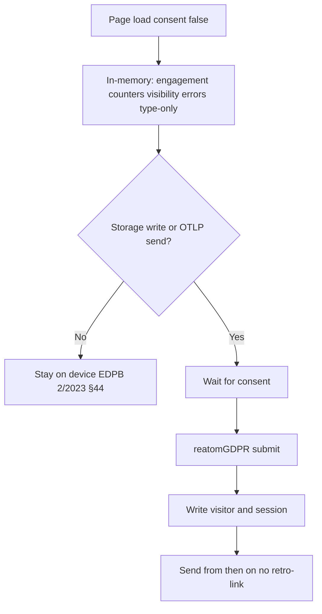

# R11 — Pre-consent legality and forbidden data

Task: [06 R11](../06-research-backlog.md). Informs [03 consent](../03-connect-web-analytics.md#consent-а4-а17а19-о18) and WA-4. Answers README open question 14 (collector redaction).

**This is not legal advice.** It maps regulator and court guidance onto the analytics defaults. Integrators remain controllers. National transpositions of ePrivacy Article 5(3) differ. Where this note is unsure, it keeps the [03](../03-connect-web-analytics.md#consent-а4-а17а19-о18) pre-consent shape (no persistent identifiers, no storage writes, in-memory engagement) and applies R11's second fallback: **where sending the aggregate would need consent, nothing leaves the page** (doc 11).

Related: FLOWS F-10 — a cookieless HTTP send is not an EU waiver.

## Two layers (EU) versus one statute (RU)

| Layer                                                                                                              | What it governs                                                                                                                                                                                                  | Trigger for this SDK                                                                                                                                                                                                                                                                                                                      |
| ------------------------------------------------------------------------------------------------------------------ | ---------------------------------------------------------------------------------------------------------------------------------------------------------------------------------------------------------------- | ----------------------------------------------------------------------------------------------------------------------------------------------------------------------------------------------------------------------------------------------------------------------------------------------------------------------------------------- |
| ePrivacy Directive Art. 5(3) (2002/58/EC as amended; FR Art. 82 Loi Informatique et Libertés; DE § 25 TTDSG/TDDDG) | Storing information on, or gaining access to information already stored in, **terminal equipment**. Applies to **information**, not only personal data (Planet49, C-673/17, para. 70).                           | JS that instructs the browser to persist or to send stored/generated device data. Technology-neutral: cookies, localStorage, pixels, fingerprinting, unique ids ([EDPB Guidelines 2/2023](https://www.edpb.europa.eu/system/files/2024-10/edpb_guidelines_202302_technical_scope_art_53_eprivacydirective_v2_en_0.pdf) v2.0, 7 Oct 2024). |
| GDPR                                                                                                               | Processing of **personal data**. Needs Art. 6 (and Art. 9 if special category). IP addresses can be personal data (Breyer, C-582/14). Recital 30: online identifiers such as IP, cookie ids.                     | Any OTLP export the collector can attribute to a person, including by IP, User-Agent, path, or a visitor id.                                                                                                                                                                                                                              |
| 152-ФЗ                                                                                                             | One personal-data statute. No ePrivacy twin. Art. 3: any information relating to an identified or identifiable natural person. Art. 6 legal bases. Art. 9 consent. Art. 18(5) localisation of RF citizens' data. | A persistent visitor id in `localStorage` is personal data. So is a collector log that keeps IP + URL + time if it can single the visitor out.                                                                                                                                                                                            |

ePrivacy Art. 5(3) exemptions (not analysed as a checklist by EDPB 2/2023 §4, §40, §56): transmission only, or **strictly necessary** for a service the user explicitly requested. WP29 Opinion 04/2012: first-party analytics cookies are **not** in that exemption; a future legislative carve-out was suggested and was never adopted at EU level.

## Cookieless send is not an EU waiver (F-10)

[03](../03-connect-web-analytics.md#consent-а4-а17а19-о18) proposed sending aggregate-safe events with no persistent identifiers and no storage writes. That is **not** consent-free under EU law merely because there is no cookie.

- EDPB 2/2023 §32–33: instructing the terminal (including **JavaScript** that sends async requests with targeted information) is **gaining access**. Storage and access need not happen together, nor by the same party.
- EDPB 2/2023 §38: RAM counts as storage; there is no minimum duration.
- EDPB 2/2023 §44: local use that **never leaves** the device is not access; the moment the information or a derivation is sent, Art. 5(3) applies.
- EDPB 2/2023 §3.2 (local processing) and §3.5 (unique identifiers, including **on-device hashes** of email/phone): sending is access.
- EDPB 2/2023 §3.3: IP-only tracking can still be Art. 5(3) unless the entity can show the IP does not originate from the terminal.
- LfDI Baden-Württemberg, [FAQ Cookies und Tracking](https://www.baden-wuerttemberg.datenschutz.de/faq-zu-cookies-und-tracking-2/) §3.1: passive server logs of IP and User-Agent that the browser sends **unsolicited** with the document request are not § 25 TTDSG access. **JavaScript readout of screen resolution** (or fonts, or a mutated User-Agent) **is** access. Spec 03's pre-consent payload includes viewport and screen size — that is the JS-readout case.
- DSK [OH Telemedien 2021](https://www.datenschutzkonferenz-online.de/media/oh/20221205%5Foh%5FTelemedien%5F2021%5FVersion%5F1%5F1%5FVorlage%5F104%5FDSK%5Ffinal.pdf): analytics/tracking is not "strictly necessary" for the Telemedien service.

A first-party OTLP POST of `url.path` + viewport + a RAM session id is still an instructed send. Dropping the cookie does not drop Art. 5(3). GDPR still applies to the IP the collector sees.

## Do not claim a CNIL exemption

CNIL (France) treats some **first-party audience-measurement tracers** as strictly necessary under Art. 82 LIL when tightly configured: exclusive publisher use; anonymous statistics; no cross-site id; no reuse or combination with other files; IP truncation; tracker lifetime ≤ 13 months; aggregated retention in the order of 25 months; information and **opt-out**; no user-id / ecommerce / heatmap / session replay as part of the exempted config. Sources: [délibération 2020-091](https://www.cnil.fr/sites/cnil/files/atoms/files/lignes_directrices_de_la_cnil_sur_les_cookies_et_autres_traceurs.pdf) §§50–51; [mesure d'audience](https://www.cnil.fr/fr/cookies-solutions-pour-les-outils-de-mesure-daudience); [sheet 16](https://cnil.fr/en/sheet-ndeg16-use-analytics-your-websites-and-applications) (explicitly: national variation — ask the local DPA).

That is a **French** reading. WP29 04/2012 did not create an EU analytics exemption. EDPB 2/2023 does not decide exemptions. Germany's DSK does not follow CNIL on this. AEPD (ES) later published a similar national line; that still is not an EU waiver.

This library **must not** document, name, or default-enable a "CNIL-exempt mode". Integrators who want that posture do it with their own counsel, their own collector, and their own opt-out — not as a Reatom claim. Spec 03's 400-day visitor id would fail CNIL's 13-month tracer cap in any case.

## What may happen before consent

Conservative default for a library shipped into mixed GDPR+ePrivacy and 152-ФЗ apps. This is the 03 pre-consent **shape** (no identifiers, no storage writes, in-memory engagement) plus the R11 send fallback.



### Allowed before consent

| Action                                                                                                                                     | Why                                                                         |
| ------------------------------------------------------------------------------------------------------------------------------------------ | --------------------------------------------------------------------------- |
| Count visible/active time and page-view intent **in RAM**, and flush only **after** consent on the first consented page view (doc 11 / 03) | Local processing that does not leave the device (EDPB 2/2023 §44).          |
| Remember consent yes/no **without a unique id**                                                                                            | LfDI BW FAQ 1.3: strictly necessary to store the choice, not an identifier. |
| Do nothing on the network for analytics event groups                                                                                       | Art. 5(3) not engaged by a send that does not occur.                        |
| Tracer diagnostics if the app gates them on a **separate** `diagnostics` category and its own basis                                        | Out of analytics R11. Analytics stays stricter (О19).                       |

### Not allowed before consent (library default)

| Action                                                                                       | Why                                                                                                                                                                                            |
| -------------------------------------------------------------------------------------------- | ---------------------------------------------------------------------------------------------------------------------------------------------------------------------------------------------- |
| OTLP / beacon / `fetch` of page view, engagement, web-vitals, visibility, network, exception | Instructed JS send = access (EDPB 2/2023 §33, §44, §3.2). Viewport/screen = TTDSG access (LfDI BW §3.1). Collector IP = GDPR personal data (Breyer). 152-ФЗ: IP+URL+time can be personal data. |
| `localStorage` / cookies / IndexedDB visitor or session or attribution                       | Art. 5(3) storage. 152-ФЗ Art. 3 personal data (persistent visitor id). DSK: analytics storage is not strictly necessary.                                                                      |
| RAM session id that is **sent**                                                              | EDPB 2/2023 §38 (RAM is storage) + §33 (send is access).                                                                                                                                       |
| UTM / click-id export, full referrer, `app.visitor.id`, `user.id`                            | Identifiers and often third-party click ids. Referrer origin may stay in RAM for the post-consent first view; it is not sent first.                                                            |
| `exception.message` / `exception.stacktrace`                                                 | 03 / О19: messages carry emails and ids. After consent and only with `captureErrorDetails`.                                                                                                    |
| Fingerprinting, cross-site ids, third-party pixels                                           | WP29 9/2014; EDPB 2/2023; DSK OH Telemedien.                                                                                                                                                   |

If an integrator's counsel later enables a send-before-consent configuration, that is **their** Art. 6 / Art. 5(3) analysis. The default stays off. Spec 03's line stands: if a jurisdiction needs consent for an event, that event waits; the rest may still go. For this library's default jurisdiction mix, **all analytics sends wait**.

## Always forbidden (А19, finalized)

Never collected, before or after consent, unless a **separate explicit** option is on and documented. Consent does not lift these.

| Class                                | Rule                                                                                                                                                   | Scrub                                                                                                                                  |
| ------------------------------------ | ------------------------------------------------------------------------------------------------------------------------------------------------------ | -------------------------------------------------------------------------------------------------------------------------------------- |
| Form field values                    | Never.                                                                                                                                                 | Do not read `input`/`textarea` values into records. `app.form.submit` (tier 1) may send the form **name** after consent, never values. |
| Email-like                           | Never in URL, title, referrer, error text, attributes.                                                                                                 | Replace with `[email]` — see patterns below.                                                                                           |
| Phone-like                           | Same.                                                                                                                                                  | Replace with `[phone]`.                                                                                                                |
| Precise geolocation                  | Never (`Geolocation` coords, lat/lng query params). City-level from a **server** geo-IP, after consent, is an integrator choice, not a client default. | Drop keys matching `/lat(itude)?                                                                                                       | lng    | lon(gitude)? | geo(\. | $)     | coordinates/i`. |
| Full query and fragment              | Off unless `captureQuery: true` (03). UTM and click ids are extracted only **after** consent.                                                          | Parse; keep path; drop `?` and `#`.                                                                                                    |
| Secrets and payment                  | Tracer key redaction applies; analytics never keeps them.                                                                                              | `/pass(word)?                                                                                                                          | secret | token        | auth   | cookie | session         | crypto | card | cvv | iban | ssn/i`→`[redacted]` ([02](../02-opentelemetry-refactor.md#values-and-serialization-т20-т22-о17-о19)). |
| Special-category inferences          | Health, religion, sexual orientation, etc. (GDPR Art. 9; 152-ФЗ Art. 10).                                                                              | Do not add attributes that encode them. Precise location is already banned as a proxy.                                                 |
| Cross-site / third-party identifiers | No shared cookie, no hashed email used as a join key across properties.                                                                                | EDPB 2/2023 §3.5.                                                                                                                      |
| Retro-link                           | Events that never left before consent are not patched with `app.visitor.id` later (03).                                                                | Implementation: no pre-consent queue to the collector.                                                                                 |

`captureQuery: true` and `captureErrorDetails: true` are post-consent only and still run the scrubs.

## Hashing

Spec 03: when the **app** explicitly sends an identifier, hash with SHA-256 and a per-site salt through `crypto.subtle`. Documented. **Never automatic.**

| Claim                         | Regulator position                                                                                                                                                                                                                                                                                                                                                                                                                                                                            |
| ----------------------------- | --------------------------------------------------------------------------------------------------------------------------------------------------------------------------------------------------------------------------------------------------------------------------------------------------------------------------------------------------------------------------------------------------------------------------------------------------------------------------------------------- |
| Hash = anonymous              | **No.** WP29 Opinion 05/2014 (WP216): hashes are reversible by replay when the input space is known; salted hashes still often feasible; keyed hashes remain reversible for the controller who holds the key. GDPR Recital 26 / Art. 4(5): pseudonymised data remain personal data. [AEPD–EDPS](https://collab.dpa.gr/wp-content/uploads/2023/07/aepd-edps_INTRODUCTION-TO-THE-HASH-FUNCTION-AS-A-PERSONAL-DATA-PSEUDONYMISATION-TECHNIQUE_en.pdf): hash is a **pseudonymisation** technique. |
| Hash removes ePrivacy consent | **No.** EDPB 2/2023 §3.5: hashing personal data on the device and sending the digest is still gaining access.                                                                                                                                                                                                                                                                                                                                                                                 |
| Hash removes 152-ФЗ duties    | **No.** Art. 3 p. 9 обезличивание: belonging to a person must be impossible without additional information. A stable `SHA-256(visitorId + salt)` still singles the visitor out. LfDI BW §3.2: replacing ids with hashes is not anonymisation; session-crossing individual paths are not anonymisation.                                                                                                                                                                                        |
| Hash instead of dropping      | Use it as a **safeguard** after consent (or on the collector as a second layer), not as a licence to collect.                                                                                                                                                                                                                                                                                                                                                                                 |

Do not hash emails or user ids by default. If the app opts in, salt is per site (not a public library-wide salt), stored off the public bundle when possible; a public salt only slows trivial reversal.

## Cookieless aggregate and consent

**Question:** does cookieless aggregate analytics need consent?

**Answer for this SDK's default:** **yes, the send needs consent** in the EU ePrivacy sense, and the processing needs a GDPR basis which for client-side JS analytics is typically consent. Under 152-ФЗ the persistent id and the collector IP are personal data; analytics/statistics identifiers are treated in Russian practice as needing Art. 9 consent, not the contract basis used for cart/login cookies.

Narrower postures that some DPAs discuss — **passive first-party server logs** with no JS readout, no third party, short retention, no join (LfDI BW §3.1; Breyer legitimate interest for **security** logs) — are **not** what `connectWebAnalytics` does. It is a JS SDK. Do not advertise them as this product.

## 152-ФЗ: visitor id in localStorage

Federal Law No. 152-FZ of 27 July 2006, Art. 3: personal data is any information relating to a directly or indirectly identified or identifiable natural person. A random durable visitor id in `localStorage` (03: 400 days, optionally a first-party cookie) singles the visitor out across visits. That is personal data even with no name attached.

Consequences for WA-4 / identity (R10):

- Do not write `app.visitor.id` (or session/attribution) to storage before consent.
- After consent, the id stays personal data: Art. 6 basis (Art. 9 consent for this purpose), Art. 18/18.1 notice and policy, Art. 22 notification to Роскомнадзор unless an exception applies, Art. 18(5) **localisation** (record/store/update/extract RF citizens' data using databases in the Russian Federation; Feb 2025 restatement). A collector only in the EU/US is a localisation problem for RF-citizen traffic.
- Cross-border transfer: Art. 12 rules, separate from localisation.
- Hashing the id does not take it out of 152-ФЗ.
- Technical cookies for login or cart may rest on Art. 6(1)(5) (contract). Analytics/marketing identifiers do not; Russian commentary aligned with Роскомнадзор practice treats them as consent (e.g. [Pravo.ru / Ozon DPO](https://pravo.ru/opinion/250647/)). Courts have treated IP, Hash-ID, User-Agent, cookie, URL and Referrer as personal data when they can identify (discussed in [vc.ru / case commentary](https://vc.ru/legal/148445-kak-ne-prevratit-cookies-v-shtraf)).

## Collector redaction — second layer (О19, README Q14)

**Yes. Docs should recommend a collector redaction processor as the second layer.** Client redaction stays mandatory and first. The collector does not legalise a pre-consent send.

OpenTelemetry: [Handling sensitive data](https://opentelemetry.io/docs/security/handling-sensitive-data/). Contrib: [`redactionprocessor`](https://github.com/open-telemetry/opentelemetry-collector-contrib/blob/main/processor/redactionprocessor/README.md) (fail-closed allowlist; the README names GDPR), [`attributesprocessor`](https://github.com/open-telemetry/opentelemetry-collector-contrib/blob/main/processor/attributesprocessor/README.md) (hash/delete), [`transformprocessor`](https://github.com/open-telemetry/opentelemetry-collector-contrib/blob/main/processor/transformprocessor/README.md) (OTTL `SHA256`, `replace_pattern` for IP truncation).

Recommended recipe (docs, not bundled):

1. Client scrubs and consent-gates (this note).
2. Collector `redaction` with `allowed_keys` = the [05](../05-telemetry-schema.md) analytics/tracer allowlist; `blocked_values` for email/phone/card; `blocked_key_patterns` for secret keys.
3. `transform`: drop last octet of `client.address` / `net.sock.peer.addr`; delete `url.query` if present; hash `user.id` only if the app asked for a hash and consent is recorded on the record (`app.analytics.consent`).
4. Do not index high-cardinality ids as labels ([02](../02-opentelemetry-refactor.md#values-and-serialization-т20-т22-о17-о19)).

## Pre-consent mode for WA-4 (output)

| `consent`                     | Storage                         | Network             | Identifiers                         | Engagement                                                             |
| ----------------------------- | ------------------------------- | ------------------- | ----------------------------------- | ---------------------------------------------------------------------- |
| false / no analytics category | Zero writes (WA-4 acceptance)   | Zero analytics OTLP | None (`app.analytics.consent=none`) | RAM only                                                               |
| true / analytics category     | Visitor + session + attribution | Send from then on   | `app.visitor.id`, `session.id`      | Flush RAM into the first consented page view; no retro-link of unsents |

Categories toggle event groups **synchronously** (А4). `diagnostics` is not a back door for analytics identifiers.

Tests to keep (03): consent false → no storage, no identifiers; after true, first page view has identifiers; `persistVisitor: false` never writes the visitor id; error details never before consent.

## Scrub patterns (client, always on)

Apply to URLs, titles, referrers, exception message/stack, attribute string values. Order: query/fragment drop → email → phone → secrets keys → geo keys.

```
email:  /[a-zA-Z0-9._%+\-]+@[a-zA-Z0-9.\-]+\.[a-zA-Z]{2,}/g
phone:  /(?<!\d)(?:\+|00)?(?:\d[\s().\-]?){10,15}\d/g
secret keys (object keys): /pass(word)?|secret|token|auth|cookie|session|crypto|card|cvv|iban|ssn/i
geo keys: /lat(itude)?|lng|lon(gitude)?|geo(\.|$)|coordinates/i
```

Replace matches in strings with `[email]`, `[phone]`, `[redacted]`. Do not keep a hash of the match. False positives on phone are acceptable; leaking a phone is not.

## Safe-setup guide outline (Run2, WA-10)

Not the guide itself. Headings for the docs-site GDPR / 152-ФЗ recipe:

1. Controller vs this library; not legal advice.
2. Two EU layers; 152-ФЗ as one statute; cookieless send is not a waiver; no CNIL claim.
3. Wire `reatomGDPR` (or a boolean atom) before `connectWebAnalytics`; categories map to event groups.
4. Planet49 / EDPB Guidelines 05/2020: prior, freely given, specific, informed, unambiguous; no pre-ticks; reject as easy as accept; withdraw as easy as give.
5. Default: nothing stored, nothing sent, until submit.
6. After consent: what is written (visitor 400 days — consider shortening; session 30 min), what is sent, retention on the backend.
7. First-party collector / proxy; no GA4 `api_secret` or Metrika token in the bundle (03); Schrems-style transfer risk if the backend is outside the EEA.
8. 152-ФЗ: consent text separate (Art. 9); policy; RKN notification; RF database for RF citizens (Art. 18(5)); visitor id is personal data.
9. Client scrubs + collector `redaction` processor.
10. Launch checklist line: consent and sourcemaps are SRE tasks ([02](../02-opentelemetry-refactor.md) OT-15).

## Sources

1. EDPB Guidelines 2/2023 v2.0 (7 Oct 2024) — https://www.edpb.europa.eu/system/files/2024-10/edpb_guidelines_202302_technical_scope_art_53_eprivacydirective_v2_en_0.pdf
2. WP29 Opinion 04/2012 Cookie Consent Exemption — https://ec.europa.eu/justice/article-29/documentation/opinion-recommendation/files/2012/wp194_en.pdf
3. WP29 Opinion 09/2014 Device fingerprinting
4. WP29 Opinion 05/2014 Anonymisation (WP216) — https://ec.europa.eu/justice/article-29/documentation/opinion-recommendation/files/2014/wp216_en.pdf
5. EDPB Guidelines 05/2020 on consent
6. CJEU C-673/17 Planet49 (1 Oct 2019)
7. CJEU C-582/14 Breyer (19 Oct 2016)
8. DSK OH Telemedien 2021 v1.1 — https://www.datenschutzkonferenz-online.de/media/oh/20221205_oh_Telemedien_2021_Version_1_1_Vorlage_104_DSK_final.pdf
9. LfDI BW FAQ Cookies und Tracking — https://www.baden-wuerttemberg.datenschutz.de/faq-zu-cookies-und-tracking-2/
10. CNIL délibération 2020-091; audience-measurement pages (cited as national only)
11. GDPR Recital 26, Recital 30, Art. 4(1), 4(5), 6, 7, 9
12. ePrivacy Directive 2002/58/EC Art. 5(3)
13. 152-ФЗ Art. 3, 6, 9, 10, 12, 18(5), 18.1, 22 — http://kremlin.ru/acts/bank/24154
14. AEPD–EDPS hash-as-pseudonymisation
15. OpenTelemetry Collector sensitive-data processors
