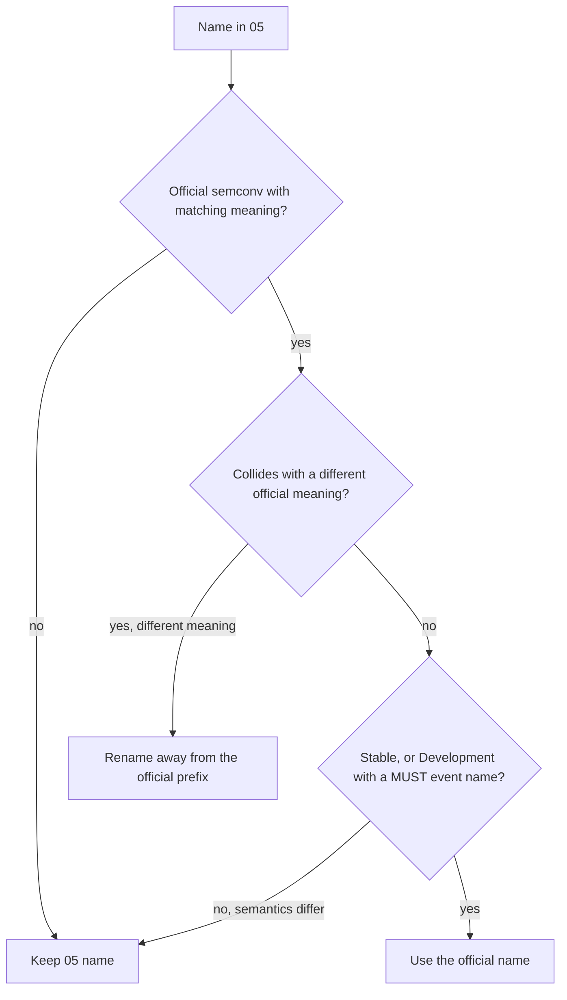

# R2 — Semantic conventions debate (О13)

- Date: 2026-10-07. Task T-006.
- Method: inventory every `reatom.*` and `app.*` name in [05](../05-telemetry-schema.md); compare against current OpenTelemetry semantic conventions, the `opentelemetry-browser` instrumentations, and the v2 FLOWS in [02](../02-opentelemetry-refactor.md). Two voices (FOR aliasing / AGAINST freeze-as-written), then a third summary.
- Fallback (ship this until the owner picks): [05](../05-telemetry-schema.md) as written, and the exception **span event on**.
- This note’s pick **overrides the span-event half of that fallback**: exceptions stay **log records only**. Semconv does not force a span-event duplicate for a new major.

## Question

For every name in 05, should Reatom freeze a private `reatom.*` / `app.*` dialect, or alias onto existing semantic conventions and `opentelemetry-browser` event names? Specifically:

1. Keep or rename each `reatom.*` and `app.*` key.
2. Is `exception` also written as a **span event**, or only as an OTLP log record?
3. `session.id` versus a custom visitor/session attribute.
4. `browser.*` resource attributes: keep, expand, or drop.
5. Which analytics events already have a semconv or `opentelemetry-browser` name to alias.

## Options

| Id    | Policy                                                                                                                          | Exception signal                        | Analytics event names                                                         |
| ----- | ------------------------------------------------------------------------------------------------------------------------------- | --------------------------------------- | ----------------------------------------------------------------------------- |
| **A** | Alias aggressively onto every Development-status name                                                                           | logs only                               | `session.start`, `browser.navigation`, `enduser.pseudo.id`, drop `event.name` |
| **B** | **Fallback.** Freeze 05 as written                                                                                              | log **plus span event**                 | keep `app.page_view`, `app.session.start`, `app.visitor.id`                   |
| **C** | **Chosen.** Follow 05’s own rule: official name when it exists **and** the semantics match; otherwise keep `reatom.*` / `app.*` | **logs only** (opt-in span event later) | keep most `app.*`; rename only collisions and MUST-named events               |

A is the FOR voice. B is the AGAINST voice and the backlog fallback. C is the synthesis: B’s catalog, A’s exception rule, plus two small renames that 05 would collide with if left alone.

## Inventory

Verdicts: **keep** = freeze as in 05; **alias** = emit the official name instead; **rename** = keep a custom name but not the colliding 05 spelling; **official** = 05 already uses the convention.

### Resource

| 05 name                       | Verdict  | Official analog              | Notes                                                                          |
| ----------------------------- | -------- | ---------------------------- | ------------------------------------------------------------------------------ |
| `service.name`                | official | Resource `service`           | Required                                                                       |
| `service.version`             | official | Resource `service`           |                                                                                |
| `deployment.environment.name` | official | Resource                     |                                                                                |
| `service.instance.id`         | official | Resource `service`           | Random per page; scopes `reatom.frame.id`                                      |
| `telemetry.sdk.name`          | official | `@reatom/opentelemetry`      | Must **not** be `opentelemetry` — that identifier is reserved for the OTel SDK |
| `telemetry.sdk.language`      | official | `webjs` (browser) / `nodejs` |                                                                                |
| `telemetry.sdk.version`       | official | package version              |                                                                                |
| `reatom.schema.version`       | keep     | none                         | Schema contract                                                                |
| `reatom.instance.name`        | keep     | none                         | Instance `name` option                                                         |
| `browser.language`            | official | Browser resource             | `navigator.language`; R7                                                       |
| `browser.brands`              | official | Browser resource             | UA-CH `brands`; omit if missing                                                |
| `browser.platform`            | official | Browser resource             | UA-CH `platform`; do **not** fall back to `navigator.platform`                 |
| `browser.mobile`              | official | Browser resource             | UA-CH `mobile`; omit if missing                                                |

Do **not** add `user_agent.original` or `browser.document.url.full` by default (fingerprint / URL-on-resource). R7 already decided that.

### `reatom.*` (runtime facts)

No OpenTelemetry document defines frame ids, cause arrays, abort/Suspense outcomes, or factory-instance cardinality. Naming rules say a system-specific attribute starts with `{system_name}.*.{property}`. `reatom` is that system name. **Keep every `reatom.*` key.**

| 05 name                                         | Verdict            | Near-miss that must **not** be used                                                                                         |
| ----------------------------------------------- | ------------------ | --------------------------------------------------------------------------------------------------------------------------- |
| `reatom.kind`                                   | keep               | OTel `SpanKind` is a different field                                                                                        |
| `reatom.name`                                   | keep               | span `name` is the normalized form; this is the raw name                                                                    |
| `reatom.instance`                               | keep               | not `service.instance.id`                                                                                                   |
| `reatom.frame.id`                               | keep               | none                                                                                                                        |
| `reatom.cause.ids`                              | keep               | none; admin rebuilds the DAG from this                                                                                      |
| `reatom.params` / `reatom.payload`              | keep               | not span events                                                                                                             |
| `reatom.outcome`                                | keep               | not `error.type` (that is failure class, not abort/suspense/pending)                                                        |
| `reatom.importance`                             | keep               | undocumented abort/Suspense marker                                                                                          |
| `reatom.attempt`                                | keep               | **not** `http.request.resend_count` (HTTP wire resend, 1-based resend ordinal). Reatom retries are action/computed attempts |
| `reatom.updates.count` / `.names`               | keep               | variant 4 summary                                                                                                           |
| `reatom.route.pattern`                          | keep               | **not** `http.route` (HTTP server route). SPA pattern sits next to `url.path`                                               |
| `reatom.origin`                                 | keep               | `admin` from `attributesVar`                                                                                                |
| `reatom.link.reason`                            | keep               | link attribute                                                                                                              |
| `reatom.log` / `.label` / `.state`              | keep               | `LOG` records                                                                                                               |
| `reatom.atom.update` / `reatom.computed.update` | keep               | log `eventName`                                                                                                             |
| `reatom.async.settle` / `reatom.async.pending`  | keep               | R3 decides emission, not the name                                                                                           |
| `reatom.state.prev`                             | keep if R1 adds it | none                                                                                                                        |

Span **names** `route <…>`, `mount <…>`, `page_view <path>`, `app.session` are Reatom watershed labels, not log event names. Keep them. Do not confuse the `app.session` **span** (one per instance per page load, Т28) with the analytics **event** `app.session.start`.

### Already-official signals in 05 (do not fork)

| 05 name                                                                            | Verdict             | Convention                                                                                                                        | Status                  |
| ---------------------------------------------------------------------------------- | ------------------- | --------------------------------------------------------------------------------------------------------------------------------- | ----------------------- |
| `exception` (log `eventName`)                                                      | official            | Exceptions in logs. Global handlers SHOULD use `exception`                                                                        | Stable (logs)           |
| `exception.type` / `.message` / `.stacktrace`                                      | official            | same                                                                                                                              | Stable                  |
| `browser.web_vital` + `.name` `.value` `.delta` `.id` `.rating` `.navigation_type` | official            | Browser events. Optional `.attribution.*` stays extra                                                                             | Development             |
| `feature_flag.evaluation`                                                          | official            | Feature-flag events                                                                                                               | Development             |
| `feature_flag.key` / `feature_flag.result.variant`                                 | official            | same                                                                                                                              |                         |
| `url.path` / `url.full`                                                            | official            | URL registry. 05 already drops query/fragment by default                                                                          | Stable (`url.path`)     |
| `code.file.path` / `code.line.number`                                              | official            | Code registry                                                                                                                     | Stable                  |
| `user.id`                                                                          | official            | User registry (app sets after login)                                                                                              |                         |
| `session.id` / `session.previous_id`                                               | official            | Session. Opt-In on arbitrary records; Required on `session.start`                                                                 | Development             |
| `event.name` attribute                                                             | **keep dual-write** | Deprecated: value MUST now be LogRecord `EventName`                                                                               | Deprecated as attribute |
| `network.online`                                                                   | keep (custom)       | **Not** in the network registry. `network.connection.state` is TCP states (`established`, `time_wait`, …), not `navigator.onLine` | —                       |

### `app.*` analytics facts

Official `app.*` in the registry is **client UI identity and crashes**: `app.screen.id` / `.name` / `.coordinate.*`, `app.widget.*`, `app.installation.id`, `app.crash`, `app.jank`. It is **not** web analytics. The OpenTelemetry Demo also uses `app.*` for cart/order — that is a demo dialect, not a convention.

| 05 name                                          | Verdict                                      | Official analog                                                                                                                                                                   | Why                                                                                                                                                 |
| ------------------------------------------------ | -------------------------------------------- | --------------------------------------------------------------------------------------------------------------------------------------------------------------------------------- | --------------------------------------------------------------------------------------------------------------------------------------------------- |
| `app.page_view`                                  | **keep**                                     | `browser.navigation` in opentelemetry-browser / js-contrib; **not** in official browser-events.md (only `browser.web_vital` is). PR that added `browser.page_view` was superseded | Analytics page view (title, referrer, UTM, watershed) ≠ hard/soft navigation with `hash_change` / `type`                                            |
| `app.page.title` / `app.page.referrer`           | keep                                         | no `page.title`. Do **not** use `http.request.header.referer` (header array, opt-in, HTTP spans)                                                                                  |                                                                                                                                                     |
| `app.viewport.width` / `.height`                 | keep                                         | none                                                                                                                                                                              |                                                                                                                                                     |
| `app.screen.width` / `.height`                   | **rename** → `app.display.width` / `.height` | Official `app.screen.*` is UI screen identity, not `window.screen` pixels                                                                                                         | Collision                                                                                                                                           |
| `app.utm.*` / `app.click_id.*`                   | keep                                         | none                                                                                                                                                                              |                                                                                                                                                     |
| `app.session.start`                              | **alias** → `session.start`                  | Session events: event name MUST be `session.start`; `session.id` required; `session.previous_id` when continuing                                                                  | 05 already emits those attributes. Campaign/timeout/midnight rotation **is** a new OTel session                                                     |
| `app.attribution.first.*` / `.last.*`            | keep                                         | extras on `session.start`                                                                                                                                                         |                                                                                                                                                     |
| `app.visitor.id`                                 | **keep**                                     | `enduser.pseudo.id` (pseudonymous, PII warning). `app.installation.id` is per-install and MUST persist across upgrades                                                            | Visitor rotates, is consent-gated, and survives login next to `user.id`. Not an install id. Optional extra alias after consent, never a replacement |
| `app.analytics.consent`                          | keep                                         | none                                                                                                                                                                              |                                                                                                                                                     |
| `app.page.engagement` / `app.engagement.*`       | keep                                         | none                                                                                                                                                                              |                                                                                                                                                     |
| `app.visibility.change` / `app.visibility.state` | keep                                         | none                                                                                                                                                                              |                                                                                                                                                     |
| `app.network.change`                             | keep                                         | none; keep `network.online`                                                                                                                                                       |                                                                                                                                                     |
| `app.focus.change` / `app.focus.state`           | keep                                         | none                                                                                                                                                                              |                                                                                                                                                     |
| `app.ecommerce.*`                                | keep until WA-9                              | **No** ecommerce semconv. Demo uses `app.order.*`                                                                                                                                 |                                                                                                                                                     |
| `app.scroll.depth`                               | keep                                         | none                                                                                                                                                                              |                                                                                                                                                     |
| `app.click.outbound`                             | keep                                         | not `app.widget.click` / `app.screen.click` (those need widget/screen ids and pixel coordinates)                                                                                  |                                                                                                                                                     |
| `app.form.submit`                                | keep                                         | none                                                                                                                                                                              |                                                                                                                                                     |
| `app.click.rage`                                 | keep                                         | not `app.screen.click`                                                                                                                                                            |                                                                                                                                                     |
| `app.long_task`                                  | keep                                         | not `app.jank` (jank is frame-threshold UI stall, not `PerformanceLongTaskTiming`)                                                                                                |                                                                                                                                                     |
| `app.breadcrumb`                                 | keep                                         | none                                                                                                                                                                              |                                                                                                                                                     |
| `app.exception.count`                            | keep                                         | on `exception.suppressed`                                                                                                                                                         |                                                                                                                                                     |
| `exception.suppressed`                           | keep                                         | custom summary event, not `exception`                                                                                                                                             |                                                                                                                                                     |
| `app.order.value` (example)                      | keep                                         | demo-style domain attr                                                                                                                                                            |                                                                                                                                                     |

`opentelemetry-browser` also emits `browser.navigation` (url.full, same_document, hash_change, type), web-vitals as logs, and unhandled errors. Reatom analytics is not that instrumentation. Sharing `browser.web_vital` and `exception` is enough. Do not ship a second `browser.navigation` event unless we later drop `app.page_view` after that convention lands in browser-events.md **and** matches URL-based page views (including `pageView()`).

Grafana Faro uses `faro.performance.navigation` — a vendor name. Do not alias to Faro.

## Exception: log record vs span event

05 already lists `exception` under **Log records**, not span events. 02 still leaves “also a span event for waterfall UIs” to R2, default on. README already records the v2 FLOWS decision: Span Event API deprecated; exceptions become OTLP log records with span context.

Current conventions:

- **Exceptions on spans**: Deprecated. Use exceptions in logs.
- **Exceptions in logs** (Stable): attributes on a LogRecord; MUST carry the corresponding span context when the instrumentation also records spans; global handlers SHOULD use event name `exception`; severity ERROR (17) for unhandled exceptions that do not shut the app down.
- `OTEL_SEMCONV_EXCEPTION_SIGNAL_OPT_IN` (`logs` / `logs/dup`) is for **existing** instrumentations that already emit span events. Default remains span-event-only so old majors do not break. They MAY drop the variable in the **next major** and emit logs only. Users can still route logs → span events at the **SDK** layer (event-to-span-event bridge).
- OTEP 4430 / 2026 blog: **new code uses the Logs API**. Deprecate `Span.AddEvent` / `Span.RecordException`. Compatibility is a consumer/SDK bridge, not a second write in new producers.

Reatom v2 is a new major with no field contract for span-event exceptions. Semconv does **not** force the duplicate. The unload budget (60 KiB) is shared. Admin already joins the log via span context and `reatom.cause.ids`.

**Recommendation:** emit `exception` as a log record only. Span status `ERROR` with message still on the span. Do **not** dual-write a span event by default. An undocumented opt-in (or a collector/SDK bridge) may rehydrate span events for backends that still only paint span events on the waterfall. Drop that opt-in when those UIs render linked logs (R13).

`exception.escaped` is deprecated even on the old span-event convention. Do not emit it.

## `session.id` versus custom

Keep `session.id` and `session.previous_id` as 05 wrote them. They are the official client-session attributes. Do **not** invent `app.session.id` (the OTel demo’s `app.session.id` is a demo key; the convention is `session.id`).

Rename the **event** `app.session.start` → `session.start`. The session document says instrumentation that tracks user-behavior sessions MUST emit `session.start` on every new session, with `session.id` required and `session.previous_id` when the new session continues a prior one, and the two ids MUST differ. Reatom’s 30-minute inactivity, campaign change, and optional midnight rotation **are** new sessions under that definition. Attribution extras stay as `app.attribution.*` on that event.

Keep the tracer span name `app.session` for the leftover root (Т28). That span is not the analytics event.

Do not emit `session.end` by default: 05 has no end event, and `session.start` with `session.previous_id` is already defined as equivalent to end-then-start.

## `browser.*` resource

Keep 05’s four low-entropy attributes. They match the Browser resource entity. R7: no `user_agent.original`, no high-entropy UA-CH, no `navigator.platform` fallback. Safari/Firefox: `browser.language` only.

Do not put URLs, viewport, or session ids on the resource.

## FOR — alias official names; no exception span event

Reatom v2 is not a compatibility shim for a frozen producer. It is a **new major instrumentation**. The fallback — keep 05 as written, and also write `exception` as a span event — is the conservative answer for an old library that already shipped the dead shape. It is the wrong answer here. 05 itself already states the rule: naming follows OpenTelemetry semantic conventions wherever a convention exists. Own names live in `reatom.*` (runtime facts) and `app.*` (analytics facts). R2 exists to enforce that sentence before the P3 freeze, not to bless a private dialect that looks almost official.

The cost of a near-miss name is forever. Admin, ClickHouse, Grafana, Tempo, and every MCP tool will query the strings we freeze. Dual-writing a deprecated form “until backends catch up” is how those backends never catch up: they keep consuming the museum copy. FLOWS in 02 already emit exceptions as log records with span context. The Span Event API is deprecated. The next major of an existing instrumentation is allowed to drop the duplicate. We _are_ that next major, and we have no prior contract to honor. Take the official names. Do not invent a second schema next to them.

Every `reatom.*` name stays. `reatom.kind`, `reatom.frame.id`, `reatom.cause.ids`, `reatom.outcome` (`abort` / `suspense`) describe Reatom’s frame graph. No semantic convention defines those facts. Inventing `code.*` or `app.*` aliases for them would smash runtime into namespaces that mean something else.

`app.*` is residual, not a brand. If a convention already names the fact, 05 forbids a Reatom synonym. 03 claimed OTel had only `browser.web_vital`, `exception`, and `feature_flag.evaluation` in this area. That claim is stale. Session, Browser resource, Enduser, App attributes, and opentelemetry-browser Navigation already occupy names 05 still spells as `app.*`.

`exception` is a log record only. Semantic conventions for exceptions on spans is Deprecated. Semantic conventions for exceptions in logs is the live document. The `OTEL_SEMCONV_EXCEPTION_SIGNAL_OPT_IN` hatch is for **existing** instrumentations. Turning `logs/dup` on by default would spend unload budget twice, teach admin two truths, and keep waterfalls addicted to a deprecated API. The same document says users can still route logs to span events at the SDK layer. That is where a stubborn backend belongs — not in our producer. **Forbidden for new code: a span event named `exception`.**

Session: keep `session.id` / `session.previous_id`. Rename `app.session.start` → `session.start`. Do not confuse that event with the tracer’s `app.session` leftover span.

`browser.*` resource: keep the official low-entropy set. Do not add `user_agent.original` by default.

Alias `app.page_view` to `browser.navigation`. The page-view event proposed for semantic conventions was superseded by a browser navigation event. opentelemetry-browser already emits `browser.navigation` on initial load and in-page navigations. Extra analytics facts (title, referrer, UTM) are additional attributes; they do not mint a second event.

`app.screen.width` / `.height` occupy the official `app.screen.*` prefix with a different meaning (geometry vs UI screen identity). Rename to `app.display.width` / `.height`.

`app.visitor.id` is `enduser.pseudo.id`, not `app.installation.id`. Installation id MUST persist across upgrades and be shared by every OTel SDK in the app. A rotating marketing visitor violates that. Identified login remains `user.id`.

Stop setting the deprecated `event.name` attribute. Set `LogRecord.eventName` only. OTLP has the field. A collector transform can copy it for a stubborn store.

**FOR punch-list — MUST-CHANGE:** `app.session.start` → `session.start`; `app.page_view` → `browser.navigation`; `app.screen.width/height` → `app.display.width/height`; `app.visitor.id` → `enduser.pseudo.id`; drop `event.name` dual-write; forbid exception span events.

## AGAINST — freeze 05 as written, keep the exception span-event duplicate

R2 is not a license to redecorate the contract. 06 already wrote the fallback: **05 as written, and the exception span event on**. 05 is the only interface admin, analytics, backends, and agents may rely on. ClickHouse e2e queries spans by `reatom.name` and logs by `eventName`. MCP tools must always include `reatom.*` and `app.*`. Aggressive renaming before P3 freeze is not alignment. It is churn against fixtures, SQL, agent tools, and every `withOTel({ attributes })` recipe that already uses `app.*`.

Keep every `reatom.*` name. No convention owns frame ids, cause arrays, or abort-versus-Suspense. Admin rebuilds the cause graph from those fields. 02 already treats names as a public API (О22). That rule applies twice as hard to the schema those targets land in.

Keep `app.*` analytics names. 03 is explicit: for this area, OTel currently gives `browser.web_vital`, `exception`, and `feature_flag.evaluation`. Everything else is `app.*`. Official `app.*` is screens and widgets, not web analytics. `browser.navigation` and `session.start` sit at **Development** status. Aliasing onto Development names is worse than owning `app.*`: the upstream names can still move, our freeze cannot, and after P3 a breaking change bumps `reatom.schema.version`. The OpenTelemetry Demo itself uses `app.*` for cart and order. That is the working pattern when a domain fact has no stable semconv.

Keep `exception` as a log record **and** a span event until waterfall UIs catch up. 02 already argued this, and R2’s fallback already accepted it. Span Events are deprecated — that deprecation is the destination, not the current UI. Jaeger, Tempo, SigNoz still show span events inline and treat logs as a second pane. An SRE who opens a failed `checkout.submit` span and sees no exception in the waterfall has been failed. Bytes for a duplicate on an error span are cheap. When those backends catch up, drop the span event in a minor release. Turning it off at freeze because the API is deprecated is ideology.

Keep `session.id`; do not rename `app.session.start` to OTel `session.start`. Reatom analytics sessions are a different object: thirty minutes of inactivity, a new session on UTM change, optional midnight rotation, shared across tabs. `session.previous_id` points at the prior analytics session, not at a page-load lifecycle. Aliasing them teaches backends the wrong grain. Keep `session.id` as the attribute. Keep `app.session.start` as the analytics event.

Keep the `browser.*` resource as 05 wrote it. Expanding it before R7 finishes is the opposite of a freeze.

Do not alias `app.page_view` to `browser.navigation`. Different events. `app.page_view` is an analytics page view and a watershed. `browser.navigation` is a navigation signal including `hash_change`. A `pageView()` from a foreign router is not a Browser Navigation API event. Collapsing those layers destroys the distinction 03 drew: analytics records URLs; the tracer records routes.

`app.screen.width` is geometry, not `app.screen.name`. Document the collision. If anything is renamed later, rename **only the colliding keys**. One homonym is not a namespace emergency.

Do not replace `app.visitor.id` with `enduser.pseudo.id`. The latter carries an explicit PII warning. Ours is consent-gated, 400-day, held in memory before consent, kept after login so anonymous and identified history join. Different lifetime, different warning, different audience.

Keep dual `eventName` + `event.name`. 05 already solved ingest compatibility. Some pipelines flatten attributes and drop the log field. Dual-write here is cheap.

**AGAINST punch-list — MUST-KEEP:** all `reatom.*`; `app.*` catalog including `app.page_view` and `app.session.start`; `session.id`; `browser.*` resource as listed; exception log **plus** span event; dual `eventName` + `event.name`. **OPTIONAL-LATER:** document or rename `app.screen.width/height`; revisit `browser.navigation` / `session.start` when they leave Development and match our semantics; drop the span event once waterfalls show linked logs.

## Recommendation

**Ship C.** Implementation may start on B (05 as written, span event on) and must land C before the P3 freeze.

1. **Keep every `reatom.*` name.** System namespace. No aliases.
2. **Keep official names 05 already uses:** `session.id`, `session.previous_id`, `browser.*` resource (four low-entropy attrs only), `exception.*` on a log record, `browser.web_vital`, `feature_flag.evaluation`, `url.path` / `url.full`, `code.file.path` / `code.line.number`, `user.id`, `service.*`, `telemetry.sdk.*` (`name` = `@reatom/opentelemetry`, `language` = `webjs` in the browser).
3. **Exception is a log record, not a span event.** Semconv does not force the duplicate for new majors. v2 FLOWS already say logs. Span status `ERROR` stays. Opt-in / SDK bridge for stubborn waterfalls; not a default dual-write. This is the one place C **rejects** the R2 fallback.
4. **Rename `app.session.start` → `session.start`.** MUST event name in the session convention; 05 already carries the required attributes. Keep the `app.session` **span** name for the leftover root.
5. **Keep `app.page_view`.** Official browser-events.md has no navigation/page-view event yet; opentelemetry-browser’s `browser.navigation` is a different grain (hash changes, navigation type, often a history patch). Revisit after that convention is in browser-events.md **and** matches URL-based views plus `pageView()`.
6. **Rename `app.screen.width` / `app.screen.height` → `app.display.width` / `app.display.height`.** Avoid the official `app.screen.*` identity prefix. Keep `app.viewport.*`.
7. **Keep `app.visitor.id`.** Do not emit `app.installation.id` for a rotating visitor. Do not replace with `enduser.pseudo.id`. After consent, the app may **also** set `enduser.pseudo.id` to the same value if it wants the official key; the analytics catalog still queries `app.visitor.id`.
8. **Keep residual `app.*`** with no analog (engagement, visibility, focus, UTM, click ids, consent, ecommerce-until-WA-9, tier-1 modules). Do not alias rage/outbound clicks to `app.screen.click` / `app.widget.click`. Do not alias `app.long_task` to `app.jank`. Keep custom `network.online`.
9. **Keep dual `eventName` + `event.name` until freeze.** The attribute is deprecated; 05 dual-writes for backends that only read attributes. Dropping it is a collector recipe, not a producer surprise. After freeze, a minor may drop the attribute if ingest fixtures prove ClickHouse/admin read `eventName`.
10. **Do not add** `user_agent.original`, `exception.escaped`, `session.end` (unless a later module needs an explicit end), or Faro `faro.*` names.

### What changes in 05 (before P3)

| Change                                                                      | Why                                                             |
| --------------------------------------------------------------------------- | --------------------------------------------------------------- |
| Log `eventName` `app.session.start` → `session.start`                       | Session MUST name                                               |
| Attributes `app.screen.width` / `.height` → `app.display.width` / `.height` | Collision with `app.screen.*`                                   |
| Exception span event **off** by default                                     | Logs convention + 2026 deprecation; not required for new majors |
| Note in 05: `app.session` span ≠ `session.start` event                      | Vocabulary clash                                                |

Everything else in 05 stays. Admin ingest and ClickHouse e2e update those two event/attribute names and stop expecting a span event named `exception`.

### What this note does not decide

- R3 kinds, R1 mapping, R7 extra resource attrs, R9 engagement definitions, R10 storage lifetimes, R11 legal gates on `session.id` / visitor.
- Whether a later analytics module emits `session.end` or `app.crash` (process crash, not `window.onerror`).
- WA-9 ecommerce field list.

## Sources

1. Semantic conventions for exceptions in logs — https://opentelemetry.io/docs/specs/semconv/exceptions/exceptions-logs/
2. Semantic conventions for exceptions on spans (Deprecated) — https://opentelemetry.io/docs/specs/semconv/exceptions/exceptions-spans/
3. Deprecating Span Events API — https://opentelemetry.io/blog/2026/deprecating-span-events/
4. OTEP 4430 Span Event API deprecation plan — https://github.com/open-telemetry/opentelemetry-specification/blob/main/oteps/4430-span-event-api-deprecation-plan.md
5. Semantic conventions for session (`session.id`, `session.start`, `session.end`) — https://opentelemetry.io/docs/specs/semconv/general/session/
6. Session attributes registry — https://opentelemetry.io/docs/specs/semconv/registry/attributes/session/
7. Browser resource (`browser.brands` / `.language` / `.mobile` / `.platform`) — https://opentelemetry.io/docs/specs/semconv/resource/browser/
8. Browser attributes registry — https://opentelemetry.io/docs/specs/semconv/registry/attributes/browser/
9. Semantic conventions for browser events (`browser.web_vital`) — https://opentelemetry.io/docs/specs/semconv/browser/browser-events/
10. Feature-flag events (`feature_flag.evaluation`) — https://opentelemetry.io/docs/specs/semconv/feature-flags/feature-flags-events/
11. Naming (custom namespaces, `{system_name}.*.{property}`, do not squat official prefixes) — https://opentelemetry.io/docs/specs/semconv/general/naming/
12. Semantic conventions for events (EventName, no dynamic event names) — https://opentelemetry.io/docs/specs/semconv/general/events/
13. Event attributes (`event.name` deprecated → LogRecord EventName) — https://opentelemetry.io/docs/specs/semconv/registry/attributes/event/
14. App attributes registry (`app.screen.*`, `app.installation.id`, `app.crash.id`) — https://opentelemetry.io/docs/specs/semconv/registry/attributes/app/
15. App events (`app.screen.click`, `app.widget.click`, `app.crash`, `app.jank`) — https://opentelemetry.io/docs/specs/semconv/app/app-events/
16. Enduser attributes (`enduser.pseudo.id`, `enduser.id`) — https://opentelemetry.io/docs/specs/semconv/registry/attributes/enduser/
17. User attributes (`user.id`) — https://opentelemetry.io/docs/specs/semconv/registry/attributes/user/
18. URL attributes (`url.path`, `url.full`) — https://opentelemetry.io/docs/specs/semconv/registry/attributes/url/
19. Code attributes (`code.file.path`, `code.line.number`) — https://opentelemetry.io/docs/specs/semconv/registry/attributes/code/
20. Network attributes (no `network.online`; `network.connection.state` is TCP) — https://opentelemetry.io/docs/specs/semconv/registry/attributes/network/
21. Resource / telemetry SDK (`telemetry.sdk.name` must not be `opentelemetry` for a custom SDK; `webjs`) — https://opentelemetry.io/docs/specs/semconv/resource/
22. HTTP spans (`http.request.resend_count`, `http.route`, `http.request.header.<key>`) — https://opentelemetry.io/docs/specs/semconv/http/http-spans/
23. opentelemetry-browser instrumentation README (`browser.navigation`, web-vitals, errors) — https://github.com/open-telemetry/opentelemetry-browser/blob/main/packages/instrumentation/README.md
24. `@opentelemetry/instrumentation-browser-navigation` (`eventName = browser.navigation`) — https://www.npmjs.com/package/@opentelemetry/instrumentation-browser-navigation
25. PR #1910 Add browser page view event (superseded by #2806) — https://github.com/open-telemetry/semantic-conventions/pull/1910
26. OpenTelemetry Demo manual span attributes (`app.order.*`, `app.session.id` as demo keys) — https://opentelemetry.io/docs/demo/telemetry-features/manual-span-attributes/
27. How to name your span attributes (domain-first) — https://opentelemetry.io/blog/2025/how-to-name-your-span-attributes/
28. Deprecate `event.name` attribute in favor of EventName — https://github.com/open-telemetry/semantic-conventions/pull/1646
