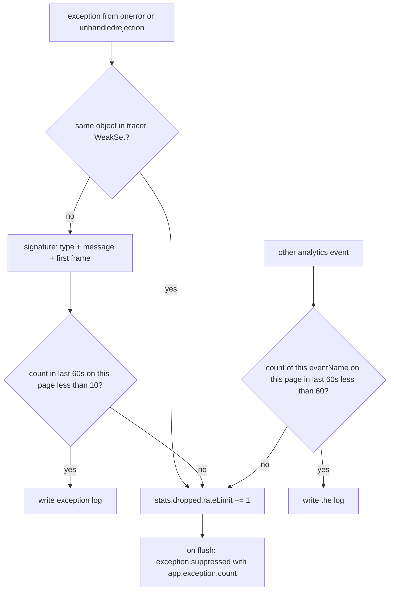

# R22 — Error dedup and analytics sampling (А27, А30)

- Task: T-021 / R22. Date: 2026-10-07.
- Question: what are the industry client defaults for error dedup windows, and for rate limits on **all** events, not only errors? Confirm or replace the fallback in [06](../06-research-backlog.md) and the sketch already in [03](../03-connect-web-analytics.md#errors-а29-а30).
- Fallback (implementation starts here): errors **10/min/signature**; other events **60/min/name/page**; sampling **ratio 1**.
- Recommendation: **keep the fallback.** None of Sentry, Faro, or Bugsnag ships a time-windowed per-signature ceiling. Consecutive-only drop (Sentry/Faro) is too weak against alternating signatures; Bugsnag’s 10-events-per-page is too coarse for analytics counts. The fallback is the useful hybrid: a pulse of samples plus a suppressed summary, configurable, generous for a normal session.

This note does not change [03](../03-connect-web-analytics.md) or [05](../05-telemetry-schema.md). WA-5 implements from here.

## Question, restated

1. Client **dedup**: is there a time window, or only “same as the last event”? What is the signature?
2. Client **rate limits**: do vendors cap emit rate for page views, custom events, logs — or only errors?
3. Client **sampling ratio** for analytics-style counts.
4. What should `connectWebAnalytics` default, given А27 (“good defaults, and configurable”) and А30 (dedup on the same error).

## Industry survey

None of the three named clients uses a sliding time window. Dedup is either “equal to the previous payload” or a per-page counter. Rate limits that do exist are either a page-lifetime cap (Bugsnag), a global items-per-minute sanity check (Rollbar, extra), or HTTP 429 backoff on the transport (Faro, and our tracer already).

### Sentry JavaScript (`@sentry/browser` / `@sentry/core`)

Two client mechanisms, both **not** time-windowed.

| Mechanism | Window | What it compares | Default |
| --- | --- | --- | --- |
| `dedupeIntegration` | none; previous event only | message **or** exception `type`+`value`, **full** stack (`filename`, `lineno`, `colno`, `function`), fingerprint | on |
| `checkOrSetAlreadyCaught` | none; identity | the very object (`__sentry_captured__`) | on |

- Typed events (`transaction`, replay, …) skip dedupe: `if (currentEvent.type) return currentEvent`. Errors and messages have empty `type`.[1][2]
- Consecutive identical errors in a tight loop send **one** event. `ErrorA`, `ErrorB`, `ErrorA` all pass. There is no 30 s / 1 min window; Sentry’s own reply to “debounce frequent errors” is “use `beforeSend`”.[3]
- `sampleRate` for **errors** defaults to `1.0`. Tracing is off unless `tracesSampleRate` / `tracesSampler` is set. Dropped events become client-report outcomes (`sendClientReports: true`).[4][5]
- Server inbound filters and issue grouping are ingest-time / backend, not a client window.[6]
- Same-object skip is the analogue of [03](../03-connect-web-analytics.md)’s tracer `WeakSet`.

### Grafana Faro (`@grafana/faro-web-sdk`)

`dedupe` defaults to **`true`** in `makeCoreConfig`.[7] Each API keeps **one** `lastPayload` and `deepEqual`s against it. No clock.

| Signal | Signature | Bypass |
| --- | --- | --- |
| exceptions | `type`, `value`, `stacktrace`, `context`, `fingerprint`, `fatal` | `skipDedupe`, or `dedupe: false` |
| events | `name`, `attributes`, `domain` | same |
| logs | same pattern (`skipDedupe` on `pushLog`) | same |

`fatal` participates so a crash and a non-fatal clone are distinct.[8][9] Faro is the only of the three that also consecutive-dedupes **custom events**, not just errors.

There is **no client emit cap**. Transport backs off on HTTP 429/503 (`Retry-After`, else a retryable wait). Events during backoff are a delivery concern, not an analytics ceiling. Batching defaults: 250 ms or 50 items.[10][11]

### Bugsnag JavaScript (`@bugsnag/plugin-simple-throttle`)

The plugin comment says “Throttles and **dedupes** events”. The implementation is a **counter**:[12]

- `maxEvents` default **10**, max allowed **100**.
- Scope: **all events on the page**, not per signature.
- Reset on `pushState` / `replaceState`, or `Bugsnag.resetEventCount()`.[13]

No type/message/stack comparison. Ten different bugs on one SPA view silently drop after the tenth. That is a bandwidth/quota fuse, not grouping.

### Extra (not in the brief, used to pick numbers)

| Vendor | Default | Notes |
| --- | --- | --- |
| Rollbar.js | `ignoreDuplicateErrors: true` (consecutive); `itemsPerMinute: 60`; `maxItems: 0` | 60/min is a global sanity check against loops; 0 means no per-page cap.[14] |
| Datadog Browser RUM | `sessionSampleRate: 100`; no client signature window | Session in or out; grouping is Error Tracking on the backend.[15] |
| Plausible Events API | no client cap; ingest often quoted at 600/min/domain | Server abuse limit, not a per-page UX default.[16] |

## What the current spec already says

From [03](../03-connect-web-analytics.md) and [05](../05-telemetry-schema.md):

- Signature: `type + message + first stack frame`, **10 times per minute per page**.
- Overflow: `stats.dropped.rateLimit` and one `exception.suppressed` on flush with `exception.type` + `app.exception.count`.
- Tracer overlap: skip when the same object is in a `WeakSet`.
- Analytics records at **ratio 1** (they are counts), plus `analytics.sampling.errors` default 1.
- `rateLimit` covers **every** event name per page per minute; defaults were parked on R22.
- Grouping of issues is the backend’s job (doc 11, non-goal).

Two small tensions to close in WA-5, not in this note’s spec edits:

1. [03](../03-connect-web-analytics.md) also says “the instance’s head sampling applies”. Counts must not inherit a trace `sampling.ratio` of 0.2. Head sampling stays on traces; analytics logs stay at ratio 1 unless `analytics.sampling.errors` is set.
2. `captureErrorDetails` is false by default, so message and stack are often absent. The signature then collapses to `exception.type` (and an empty-frame marker). That is acceptable before consent; after details are on, the first frame distinguishes throw sites.

## Options

### Dedup

| Option | Pros | Cons |
| --- | --- | --- |
| **A. Consecutive only** (Sentry/Faro) | Tiny; kills tight loops of one payload | Alternating two errors bypass it; no count of how many were dropped |
| **B. Identity only** (Sentry `__sentry_captured__`, our WeakSet) | Correct overlap with the tracer; no false merge of new `Error` instances | A render loop that `throw new Error('x')` each time is not the same object |
| **C. Sliding window per signature** (fallback) | Caps loops **and** alternating signatures; still sends a pulse | Needs a small map + timestamps |
| **D. Bugsnag 10/page total** | Tiny; proven bandwidth fuse | Mixes page views with errors; first 10 anything starve the rest |
| **E. A + B + C** | Consecutive drop is free inside C; WeakSet stays for tracer overlap | Slightly more code than A |

**Pick E, with C’s numbers:** 10/min/signature/page. Consecutive-only is a special case of the window when the map still has budget. WeakSet remains the tracer boundary.

Do **not** copy Sentry’s full-stack compare. First frame is cheaper, stable enough for a client fuse, and matches А30. Backend grouping still sees whatever `captureErrorDetails` allowed through.

### Rate limits (all events)

| Option | Pros | Cons |
| --- | --- | --- |
| **F. Errors only** | Matches Sentry/Faro | Contradicts А27; a buggy `app.click.rage` / long-task module can flood |
| **G. Global 60/min** (Rollbar) | One counter | Page view + engagement + visibility + errors share a budget |
| **H. Per name per page 60/min** (fallback) | Independent ceilings; a normal session never hits them | A map keyed by `eventName` |
| **I. Faro-style 429 only** | Already on the tracer transport | Too late: the record is already in the queue and the unload budget |

**Pick H** for non-error analytics names. Errors use C (10/min/signature), not the 60/min name bucket, so a noisy exception does not starve `app.page_view`.

60/min/name/page ≈ 1/s. A page view is once per navigation; engagement and visibility are a handful per page. Hits are a bug or a module loop, which is what the fuse is for.

### Sampling ratio

| Option | Pros | Cons |
| --- | --- | --- |
| **J. Ratio 1** (fallback, Sentry `sampleRate` 1.0, Datadog 100%) | Counts stay counts | Volume lives or dies on the rate limit |
| **K. Ratio < 1 on errors** | Cheaper | Biases “how often does this throw?”; the window already caps |

**Pick J.** `analytics.sampling.errors` exists for teams that want K. Default 1.

## Recommendation (defaults for WA-5)

Keep the fallback. Concrete rules:

1. **Errors:** 10 records / 60 s / signature / page. Signature = `exception.type` + (scrubbed message or `''`) + (first frame `filename:lineno:function` or `''`).
2. **Other analytics events:** 60 records / 60 s / `eventName` / page. Page is the analytics page (`url.path` change), same as Bugsnag’s navigation reset, not a full reload.
3. **Ratio:** 1 for all analytics logs. Instance trace head sampling does not apply to these logs. `analytics.sampling.errors` remains an override, default 1, applied **before** the window.
4. **Overflow:** increment `stats.dropped.rateLimit`. For errors, emit one `exception.suppressed` per signature on flush (visibility hide, page change, unload) with `app.exception.count` = dropped + sent in the window, so the backend still sees volume. Non-error names do not need a summary record; the counter is enough.
5. **Identity:** keep the tracer `WeakSet`. Do not mark `__sentry_captured__`; we do not share objects with Sentry.
6. **Config:** `rateLimit: { errorsPerMin?: number; eventsPerMin?: number; byName?: Record<string, number> }`. Defaults 10 and 60. `0` means “no client cap” (Rollbar’s `maxItems: 0` pattern). Configurable, as А27 asked.
7. **Not defaults:** Bugsnag’s 10-total-per-page; Sentry/Faro consecutive-only as the only fuse; sampling errors below 1.

WA-5 acceptance in [03](../03-connect-web-analytics.md) (“100 identical errors give 10 records plus a suppressed summary”) already matches rule 1. Add a test: 100 alternating `TypeError` / `RangeError` still cap at 10 each; 100 `app.page_view` cap at 60 with `stats.dropped.rateLimit` growing.

## Why not copy a vendor window

There isn’t one. Sentry documents the gap and points at `beforeSend`.[3] Faro’s `dedupe` is a last-payload filter for every signal, which would drop a second legitimate `app.page.engagement` with the same attributes if two hides race — a reason **not** to consecutive-dedupe analytics names, only to rate-limit them. Bugsnag’s 10/page would fire on a talk-demo checkout (page view, session, engagement, two errors, purchase span logs) and then go mute.

The fallback is stricter than Sentry/Faro on **alternating** errors, looser than Bugsnag on **mixed** event types, and aligned with Rollbar’s 60/min as a loop fuse — but keyed by name so real sessions stay under it.

## Sources

1. Sentry Dedupe integration (default, stack + fingerprint; no window) — https://docs.sentry.io/platforms/javascript/configuration/integrations/dedupe/
2. `dedupe.ts` (`previousEvent`, skip when `currentEvent.type` is set, full-frame compare) — https://github.com/getsentry/sentry-javascript/blob/master/packages/core/src/integrations/dedupe.ts
3. Sentry: no time limit; debounce via `beforeSend` — https://github.com/getsentry/sentry-javascript/discussions/6242
4. Sentry `sampleRate` default 1.0; `sendClientReports` default true — https://docs.sentry.io/platforms/javascript/configuration/options/
5. Sentry error sampling vs project rate limits — https://docs.sentry.io/platforms/javascript/sampling/
6. Sentry inbound filters (ingest, not a client window) — https://docs.sentry.io/concepts/data-management/filtering/
7. Faro `dedupe = true` in `makeCoreConfig` — https://github.com/grafana/faro-web-sdk/blob/main/packages/web-sdk/src/config/makeCoreConfig.ts
8. Faro `pushError` last-payload `deepEqual` (type, value, stacktrace, context, fingerprint, fatal) — https://github.com/grafana/faro-web-sdk/blob/main/packages/core/src/api/exceptions/initialize.ts
9. Faro `pushEvent` last-payload `deepEqual` (name, attributes, domain) — https://github.com/grafana/faro-web-sdk/blob/main/packages/core/src/api/events/initialize.ts
10. Faro FetchTransport 429/503 wait; keepalive 60 KiB — https://github.com/grafana/faro-web-sdk/blob/main/packages/web-sdk/src/transports/fetch/transport.ts
11. Faro batching defaults 250 ms / 50 items — https://github.com/grafana/faro-web-sdk/blob/main/packages/core/src/config/const.ts
12. Bugsnag `plugin-simple-throttle`: counter, `maxEvents` default 10, max 100 — https://github.com/bugsnag/bugsnag-js/blob/master/packages/plugin-simple-throttle/throttle.js
13. Bugsnag `maxEvents` docs (reset on `pushState` / `replaceState`, `resetEventCount`) — https://docs.bugsnag.com/platforms/javascript/configuration-options/
14. Rollbar.js `ignoreDuplicateErrors` true; `itemsPerMinute` 60; `maxItems` 0 — https://docs.rollbar.com/docs/rollbarjs-configuration-reference
15. Datadog RUM `sessionSampleRate` default 100% — https://docs.datadoghq.com/real_user_monitoring/guide/sampling-browser-plans.md
16. Plausible Events API (ingest; no client dedup window) — https://plausible.io/docs/events-api
17. Sentry `checkOrSetAlreadyCaught` / `__sentry_captured__` — https://github.com/getsentry/sentry-javascript/blob/master/packages/core/src/utils/misc.ts
