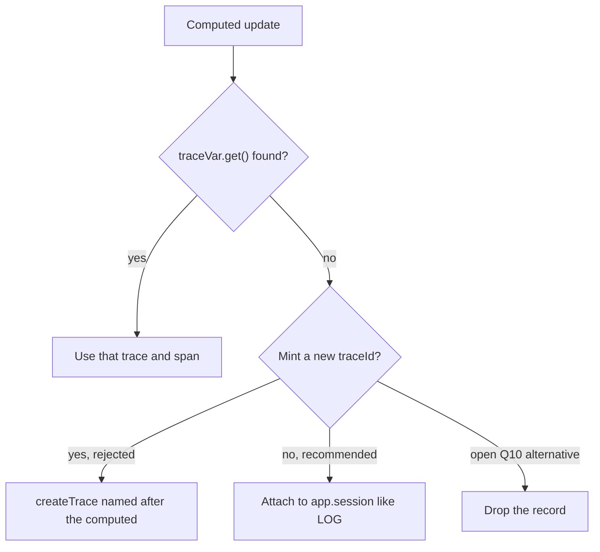

# R4 — Computed with no trace: mint a new `traceId`?

- Task: [R4](../06-research-backlog.md#wave-1-blocks-the-tracer-foundation-and-the-schema) (Т34). Informs [OT-6](../02-opentelemetry-refactor.md#implementation-steps).
- Date: 2026-10-07.
- Method: for-and-against brainstorm against owner lean, OTel/W3C rules, and the three cases named in the backlog (effect outside an action, SSR, admin readability).
- **Recommendation: no. Do not create a `traceId`. Attach the record to the app-session fallback, like `LOG` outside a trace (Т28).** Owner confirm is README open question 10.

This note does **not** answer C1 (whether `traceVar.get()` on a reactive computed actually finds the triggering action). C1 documents observed propagation. R4 is only: **when the variable is not found, mint or not.**

It also does **not** answer variant 3 diamonds (a computed whose *causes already have traces*). That path already has a parent and optional links ([02](../02-opentelemetry-refactor.md#mapping-frames-to-opentelemetry-т7-т10-т22-т27)).

## Question

Should a computed whose frame has no `traceVar` create a new trace id when it is read or recomputed?

Owner lean: **no.** "On a computed the trace is simply not read"; "I'm rather against" minting there (Т34). Spec fallback: **no**; records attach to `app.session`, like `LOG` outside a trace (Т28). Alternative named in open question 10: drop the records.

## When the case actually happens

A computed is lazy derived state.[^1] `computedMiddleware` sets `pubs[0]` to the caller while linking, then `pubs[0] ??= frame.root.frame` after the body.[^2] `Variable.find` on a reactive atom walks `pubs` from `_findReactiveStartIndex` (0 unless overridden).[^3] So "no trace" is not rare theory. It is the leftover after every automatic root has had its chance:

| Situation | Why `traceVar` is empty | Typical record |
| --- | --- | --- |
| First read at module init, `context.start()`, or a test with no action | No action/atom/route/mount root on the stack | `reatom.computed.update` |
| `effect` at module scope (or any effect whose parent frame never set `traceVar`) | `effect` is itself a computed that auto-subscribes;[^4] unscoped module effects are already discouraged for feature work | updates plus any `exception` |
| SSR setup / isomorphic first pass before the request action | Server `setup.ts` and module computeds run before the incoming `traceparent` is `traceVar.set` | same |
| Reactive recompute whose `pubs[0]` is the root frame, if C1 shows `Variable.get()` does not walk the triggering action | Separate from minting; still needs a fallback | same |
| `roots: []` (explicit-only) | Automatic action/atom/route/mount roots off; app-session still exists | same |

What this is **not**:

- An action or atom `.set` without a trace. Those **do** start a trace (Т34). They are user-side writes.
- A computed read *inside* a traced action, route loader, or mount whose variable C1 finds. Then the found context is used (Т34: "If the variable is found, it is used").
- A diamond with two traced causes. Variant 3: short span, primary parent, links. Not a new `traceId`.

## Options

| Id | Policy | New `traceId`? | Record fate |
| --- | --- | --- | --- |
| **A** | Mint a root on every untraced computed read/recompute | yes, per event | own one-span traces |
| **B** | Mint once per computed identity, reuse for later untraced updates | yes, per target | one endless trace per computed |
| **C** | Hold the record until some later frame has a trace | no | delayed, wrong parent |
| **D** | Drop | no | gone |
| **E** | **Fallback.** Do not mint. Attach to `app.session` (closed root span, context kept as leftover bucket) | no | log (or `span: true` child of session) |

A and B are the "for" family. E is the "against" family and the spec default. C and D are named so they can be rejected on the record.

## For: mint a new `traceId`

The honest case for minting is OTel-default plus "more traces, not fewer."

1. **OTel SDK default.** `Tracer` creates a *root* span when the parent `Context` has no span, and **must generate a new `TraceId` for each root span**.[^5][^6] A naive port of `startSpan` onto every computed update would mint.
2. **Query isolation.** Jaeger / Tempo / ClickHouse search by `traceId`. Leftovers dumped into one session trace are a pile. One trace per computed event (A) or per computed life (B) makes "open this derivation" a one-click jump.
3. **Admin Gantt noise, the other way.** A page-long `app.session` waterfall of unrelated `reatom.computed.update` lines looks like an endless trace. The SRE warning was that *endless traces* choke a corporate Jaeger, not gigabytes as such ([README](../README.md) principle 2). Splitting leftovers into many short traces avoids one giant session dump.
4. **Outgoing `traceparent`.** An untraced async computed (`computed(async () => fetch...)`) that hits the network still needs a `traceId` for the header. Minting gives each such fetch its own distributed transaction instead of borrowing the page session.
5. **"More traces, not fewer."** Principle 2 pushes back on "don't start traces automatically." A computed that did real work with no parent looks like an automatic root the same way an action without a trace already is (Т34).
6. **Sampling independence.** Head sampling `by: 'trace'` would sample leftover computed work on its own, instead of tying it to whatever decision was made for `app.session`.

Where the "for" case is strongest: a *named, `span: true`, async computed* that is the real entry of a widget with no route and no wrapping action. That is closer to an action root than to `LOG`.

## Against: do not mint; attach to `app.session`

1. **A trace is a user action, never a system derivation.** [02](../02-opentelemetry-refactor.md#trace-roots-where-a-trace-starts-т1т6-т28-т34): "A trace is a user action with a logical beginning that depends on the user, never on the system." A computed is lazy derived state. It has no user beginning. Actions and atom sets without a trace *do* start one because they are writes. Treating a read as a root collapses that distinction. Т34's "on a computed the trace is simply not read" is the same distinction, not a missing feature.

2. **Updates are logs, not spans.** Variant 2 emits `reatom.computed.update` log records, not spans. OTel logs **may omit `TraceId`**; a missing or invalid id means the record is *not associated with a trace*.[^7][^8] You do not start a span in order to emit a log. The SDK "no parent → new root" rule applies to `StartSpan`, not to `Emit a LogRecord`. Reatom still *attaches* leftovers to `app.session` so backends that follow logs by `traceId` (Tempo ↔ Loki, Datadog connect-logs-and-traces) keep a stable join key, which is *more* than the spec requires and *less* than minting a transaction.[^9][^10]

3. **Minting has no good grain.**
   - **A (per recompute):** one trace ≈ one span. That is exactly the owner's doubt Т10 asked R1 to kill ("I heard one trace gets one span"). It also explodes cardinality: every first paint of a large model, every module `effect` tick, every SSR warm of a derived atom becomes a trace in Jaeger search.
   - **B (per computed life):** the same derived atom then collects *unrelated* later updates (a poll, a storage hydrate, a test poke) into one trace that **never ends** (Т4). That *is* the endless-trace failure mode, just named after the computed instead of the session. Cross-user-action mixing is the admin-readability problem the backlog asked about, and B makes it worse: the computed's "own" trace pretends those updates were one scenario.

4. **Session leftover is the bucket we already paid for.** `app.session` is created with the instance, a short span closed immediately, **one per instance per page load**, and is already the fallback for `LOG` outside a trace. Records are never dropped and never held until the "next trace" (Т28). A computed without a parent is the same kind of fact: it happened, it is not a scenario, put it on the leftover context. One session trace per page is bounded by the watershed we already have (page load). Many computed traces are not.

5. **SSR / Node.** An isomorphic app may run a backend instance and a frontend instance in one process (Vlad, OT-1). Server computeds that evaluate during `setup.ts`, `context.start()`, or before `parseTraceparent` + `traceVar.set` would mint traces **with no HTTP span and no incoming context**. That is poison in a backend Jaeger: orphan roots that look like dropped requests. Attaching them to that instance's session (or, once the request context is set, using it) keeps request traces clean. Who creates the id in an SPA is the frontend; with server-side routing, the server (Run1). A computed is neither.

6. **Effect outside an action.** `effect` is a computed with an auto-subscribe.[^4] A module-level poller that reads `list()` will recompute `list` with no user trace. Minting turns every poll tick (A) or the whole poller lifetime (B) into traces. The product already has roots for the cases we want: route, mount, action, atom set. An unscoped module effect is the documented antipattern; telemetry should not invent a scenario around it. If the effect *should* be a scenario, the app starts it from an action or `traceVar.set(otel.createTrace())` — the one production success story (Vlad).

7. **`traceparent` still works.** `otel.traceparent()` on the session context returns the page (or process) leftover id. Orphaned client fetches then join the session instead of each becoming an unconnected backend trace. Tail sampling that expects browser + backend linkage (SRE) can still see them as one tree.

8. **Search does not need a private `traceId`.** Third-line support already searches typical errors by **computed name** (Vlad, О22). Schema fields `eventName=reatom.computed.update` + `reatom.name` + `reatom.frame.id` / `reatom.cause.ids` rebuild the cause graph without minting ([05](../05-telemetry-schema.md)). Admin under `detail: 'events'` records every non-private update, including those outside actions ([04](../04-admin-rewrite.md)).

9. **`span: true` without a parent.** Flat option `span: true` turns a computed's updates into short spans. Those spans become **children of `app.session`** (same `traceId`, new `spanId`, parent = the closed session span). Route actions already nest under a closed root span; this is the same rule. It does *not* require a new `traceId`.

10. **Dropping is worse than session.** Open question 10 offers "confirm, or drop." Dropping contradicts Т28 ("never dropped"), principle 2, the production debugging loop (bug → prod logs → reproduce), and computed `exception` records. An error in an untraced derived atom would vanish from OTLP.

11. **Hold-until-next-trace is already forbidden.** Т28 forbids delaying `LOG` until the next trace. The next action is often unrelated; the timestamp would lie; unload could lose the batch. Same for computed.

12. **Implementation identity with `LOG`.** OT-6 already must put `LOG` outside a trace onto the session. Computed leftovers share that path: `buildLogRecord` with session span context. No second id generator, no `traceVar.set` from a computed (which would leak a fake scenario into later frames that *do* have a user beginning).

## Scenario verdicts

### Computed read from an effect outside any action

The effect body runs as a reactive computed. If nothing above it is a traced action/route/mount, both the effect and the computeds it reads miss `traceVar`. **E:** each `reatom.computed.update` (and the effect's own record, once R3 classifies `effect`) lands on `app.session`. **A** would mint a trace per tick — a poller becomes a Jaeger flood. **B** would glue every later tick into one fake scenario named after the first computed that happened to run. If the poller *is* the product scenario, wrap it: `traceVar.set(otel.createTrace({ name: 'poll.orders' }))` inside the starting action.

### SSR

Hydration and server render evaluate many computeds before any user click. With a request-scoped `traceVar.set` from the incoming header or a server root, C1 should find it and R4 does not apply. Without it (module init, shared singleton instance, first `context.start()`), **E** keeps those records on the instance session and does **not** invent request-like traces. **A/B** would look like dropped inbound requests next to real server spans. Recipe work stays in OT-15 (SSR `<meta>`, request-scoped `traceVar.run`); R4 must not compensate by minting.

### Admin readability when a computed spans many unrelated updates

This is the backlog's named worry, and it argues **against** B more than against E.

- Under **E**, unrelated leftover updates share `app.session` with leftover `LOG`. Admin already has to present that bucket (Т28). Filter: `eventName=reatom.computed.update` and `reatom.name`. The cause graph still uses `reatom.cause.ids`. The Gantt can hide `reatom.kind=session` children behind a leftover toggle; that is a view problem, not a new trace family.
- Under **B**, the same unrelated updates pretend to be one computed-lifetime scenario. Opening that trace in Tempo mixes a storage hydrate, a later poll, and a test `.set` on a dep. That is the readability failure.
- Under **A**, admin's trace list fills with one-span computed traces. Principle 2 wants rich traces of *user* work, plus a filtering UI — not a list of derivations. R1/R13 already cover diamonds that *do* cross real traces.

## Recommendation

**Ship E.** A computed never starts a trace and never creates a `traceId`. If `traceVar.get()` returns a context, use it. Otherwise emit the log (or the `span: true` short span) with the app-session span context. Never drop. Never delay until the next user trace. Never `traceVar.set` from computed middleware.

This is the owner lean, the documented fallback, and the same leftover path as `LOG` (Т28). It matches OTel's log data model (trace context optional; do not invent a transaction to emit an event).[^7] It keeps SSR backends from growing orphan roots. It leaves variant 3 and C1 their jobs.

### OT-6 implementer rules

1. Roots table stays as in [02](../02-opentelemetry-refactor.md#trace-roots-where-a-trace-starts-т1т6-т28-т34): computed **off**. `roots` has no `'computed'` flag.
2. On computed update: read `traceVar`. Found → that context. Missing → `app.session` context. Do not call `createTrace`.
3. `span: true` on an untraced computed: child span of `app.session`, not a new root.
4. `exception` from an untraced computed: log record on `app.session`, same as `LOG`.
5. Tests (add next to OT-6 / test 10):
   - `computed(() => 1, 'orphan')()` with no action → one `reatom.computed.update` whose `traceId`/`spanId` equal the instance `app.session`; **no** extra span named `orphan`.
   - The same computed later read from a traced action → record uses the *action* span, not session and not a computed-minted id.
   - `LOG('x')` and `orphan()` in the same empty context → **same** `traceId`.
6. Do not wait on this note: fallback is E. Owner confirm of open question 10 can only switch to **drop**, not to mint, unless this file is revised.

### What would change the recommendation

- Owner explicitly wants leftover computed work as first-class traces (overrides Т34).
- C1 proves that *most* "untraced" computeds are actually lost action context, and the fix belongs in core rather than a fallback — still do not mint; fix C1.
- A widget-only embed with `roots: []` and no session story — still prefer a *manual* `createTrace` at the widget entry action over computed-minted ids.

## Sources

1. Reatom REFERENCE, computed as lazy derived state — `skills/reatom/REFERENCE.md` (Core primitives).
2. `computedMiddleware` `pubs[0] ??= frame.root.frame` — `packages/core/src/core/atom.ts`.
3. `Variable.find` reactive walk — `packages/core/src/methods/variable.ts`.
4. `effect` is a computed with auto-subscribe — `packages/core/src/methods/effect.ts`.
5. OpenTelemetry Tracing API: no span in parent Context → root span; new `TraceId` per root — https://opentelemetry.io/docs/specs/otel/trace/api/
6. OpenTelemetry Tracing SDK: valid parent trace id reused, else generate — https://opentelemetry.io/docs/specs/otel/trace/sdk/
7. OTel Logs data model: `TraceId` / `SpanId` optional; `TraceId` is the request id when the log is part of request processing — https://opentelemetry.io/docs/specs/otel/logs/data-model/
8. OTLP logs proto: missing or invalid `trace_id` ⇒ not associated with a trace — https://github.com/open-telemetry/opentelemetry-proto/blob/v1.5.0/opentelemetry/proto/logs/v1/logs.proto
9. Grafana Tempo trace-to-logs (join on `trace_id`) — https://grafana.com/docs/grafana/next/datasources/tempo/configure-tempo-data-source/configure-trace-to-logs/
10. Datadog: correlating OTel traces and logs via `trace_id` / `span_id` — https://docs.datadoghq.com/tracing/other_telemetry/connect_logs_and_traces/opentelemetry/
11. W3C Trace Context, `trace-id` field — https://www.w3.org/TR/trace-context/#trace-id
12. Spec fallback and owner lean — [06 R4](../06-research-backlog.md), [README open question 10](../README.md#open-questions-for-the-owner), Т28 / Т34 in [02](../02-opentelemetry-refactor.md).
