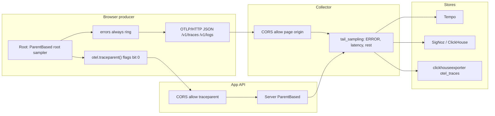

# R5 — Sampling and baggage (Т18, Т41)

- Task: R5. Researcher T-013. Date: 2026-10-07.
- Spec: [02 sampling](../02-opentelemetry-refactor.md#sampling-and-batching-т40-т41-о12), [06 R5](../06-research-backlog.md).
- Informed by: OT-11 (`traceparent`, parent-based sampling, head ratio, error ring).
- Fallback (06 + this note): **ParentBased, ratio 1, `errors: 'always'`, no baggage.**

## Question

How should `@reatom/opentelemetry` head-sample, honor the W3C sampled flag, and talk to Tempo / SigNoz / ClickHouse as a **browser producer**? Is any baggage key (tenant, flag, tier) worth a default, given CORS and privacy cost?

## Recommendation

Keep the 06 fallback. Do not wait for more research.

| Default | Value | Why |
| --- | --- | --- |
| Sampler | `ParentBased` | OTel SDK default. Honors parent `SampledFlag`. |
| Root | AlwaysOn (`ratio: 1`) | Spec principle: more traces, not fewer. Matches `OTEL_TRACES_SAMPLER=parentbased_always_on`. |
| Ratio `< 1` | `ParentBased(root = TraceIdRatioBased(ratio))` only | Bare `TraceIdRatioBased` **MUST NOT** be used. |
| `by` | `'trace'` | One decision per `traceId`. `'session'` is opt-in, still ParentBased. |
| `errors` | `'always'` | Ring-buffer unsampled traces; export on exception. Cheap no-op at ratio 1. |
| Baggage | off | Do not emit, parse, or default tenant/flag/tier into `baggage`. |
| Sampled flag | bitwise AND `0x01` | `01` and `03` are both sampled. Equality on `"01"` is wrong. |
| Outgoing `traceparent` | `…-01` if sampled, `…-00` if not | Server ParentBased follows this bit. |

Never recommend, document, or copy the JS language-docs snippet that constructs a bare `TraceIdRatioBasedSampler` on `WebTracerProvider`. That sampler **MUST ignore** the parent `SampledFlag` by spec, so a remote `00` parent can still be sampled and a remote `01` parent can still be dropped. That splits the distributed trace.

## ParentBased and the W3C sampled flag

W3C `traceparent` is `version-trace-id-parent-id-trace-flags`. `trace-flags` is an 8-bit field. Bit 0 (`0x01`) is sampled. Trace Context Level 2 also defines bit 1 (`0x02`, random-trace-id). Parse with `flags & 0x01`, never `flags === '01'`.

```
00-4bf92f3577b34da6a3ce929d0e0e4736-00f067aa0ba902b7-01  sampled
00-4bf92f3577b34da6a3ce929d0e0e4736-00f067aa0ba902b7-00  not sampled
00-…-03  sampled + random-trace-id (still sampled)
```

OTel SDK sampling is two bits, not one:

| `IsRecording` | `SampledFlag` | Processor | Exporter | Allowed |
| --- | --- | --- | --- | --- |
| true | true | yes | yes | `RECORD_AND_SAMPLE` |
| true | false | yes | no | `RECORD_ONLY` (local sink / admin) |
| false | true | — | — | **forbidden** (gaps in the trace) |
| false | false | no | no | `DROP` |

`ParentBased` is a decorator. Built-in defaults:

| Parent | Remote | Sampled | Delegate (default) |
| --- | --- | --- | --- |
| absent (root) | — | — | `root()` |
| present | yes | yes | AlwaysOn |
| present | yes | no | AlwaysOff |
| present | no | yes | AlwaysOn |
| present | no | no | AlwaysOff |

SDK default sampler is `ParentBased(root=AlwaysOn)`. Reatom's `sampling.ratio: 1` is that sampler. `sampling.ratio: 0.1` must be `ParentBased(root=TraceIdRatioBased(0.1))`, not a standalone ratio sampler.

Spec 02 already maps this onto Reatom:

- Incoming `traceparent` sampled bit is respected (Т41).
- Outgoing `otel.traceparent()` carries `01` when sampled.
- Unsamped traces still reach the local sink / admin (`IsRecording=true`, `Sampled=false`).
- Invalid header starts a new trace and increments `stats.invalidParent`.

`AlwaysRecord` in the SDK converts `DROP` → `RECORD_ONLY` so processors (and admin) still see the span. That is the same shape as spec 02's local sink, not an export path.

## Options (pros / cons)

### A. ParentBased + ratio 1 + errors always (recommended, fallback)

- Pros: matches OTel and Faro guidance for backends; server spans join the browser trace; collector tail sampling still sees the whole trace; admin keeps unsampled local records; error ring is a no-op until ratio drops.
- Cons: volume. Spec already answers this: keep error/slow traces whole at the collector, cut success with tail sampling, nothing high-cardinality in index labels.

### B. Bare `TraceIdRatioBased` (rejected)

- Pros: one object, JS docs show it for browsers.
- Cons: **MUST ignore parent SampledFlag**. Remote `00` can become `01` (backend records a child the browser never exported). Remote `01` can become `00` (browser drops a trace the server recorded). Tempo then shows incomplete traces with wrong parents. Forbidden.

### C. AlwaysOff / omit `traceparent` on unsampled sessions (Faro opt-in)

- Pros: backends start their own traces; frontend volume does not suppress backend volume.
- Cons: no navigation from server span back to a browser session that never exported. Spec wants linked browser+server traces (SRE: tail sampling only works if `traceparent` links them). Keep sending `…-00` when unsampled, do not omit the header by default. An omit option can live next to R23's `patch-fetch`, not as the default.

### D. Session-based head sample (`by: 'session'`) as default

- Pros: Faro default mental model; one decision per visit.
- Cons: a long SPA session is one keep-or-drop; conflicts with "more traces, not fewer" and with route watersheds. Keep `'trace'` as default. If `'session'` is set, still wrap in ParentBased and stamp the sampled bit for the whole session.

### E. Default baggage for tenant / flag / tier (rejected)

- Pros: hops to every downstream hop without touching span attributes.
- Cons: CORS preflight on every cross-origin `fetch`; privacy (PII in a trust-boundary header); no semantic meaning in the spec; feature flags already have an event convention; tenant/tier already have `options.attributes` / `attributesVar`. See Baggage below.

## F-16 — sampling continuity (browser producer → store)

This is the flow OT-11 plus the recommended collector recipe must keep intact. Tail sampling in the collector only sees a whole trace when every hop honored the same sampled bit.



CORS is two allow-lists, not one (spec 02, SRE):

1. Collector OTLP/HTTP must allow the **page origin** (and `Content-Type`). Browser `POST /v1/traces` is cross-origin unless the collector is same-origin / proxied.
2. App API must allow the **`traceparent` request header**. `traceparent`, `tracestate`, and `baggage` are not CORS-safelisted. Adding any of them to a cross-origin `fetch` triggers a preflight.

Do not add `baggage` to that second list until baggage is an opt-in.

## What Tempo, SigNoz, and ClickHouse expect from browser producers

None of the three head-sample in the database. They store what the collector forwards. The producer contract is OTLP plus a consistent sampled bit.

Shared:

- OTLP/HTTP on 4318 (browsers cannot speak gRPC/4317). JSON encoding: hex trace/span ids, not base64.
- `service.name` required. Hex ids 32 / 16 lowercase.
- `Span.flags` bits 0–7 are W3C trace flags; bit 0 = sampled. Bits 8–9 are parent-is-remote. Field is optional (absent in OTLP &lt; 1.1). v1 `buildSpan` currently **omits `flags`**. OT-11 should set it: sampled root `0x01`; sampled child of a remote parent `0x0301` (`HAS_IS_REMOTE | IS_REMOTE | SAMPLED`).
- High-cardinality values stay out of index labels (SRE). Sampling does not fix a bad label.
- Collector CORS is required for a browser origin. SigNoz ships CORS **off** by default and documents `allowed_origins` + `allowed_headers: ['*']`. The package e2e collector already sets `allowed_origins` and `Content-Type` only — enough for OTLP, not for an app API `traceparent`.

**Tempo.** Ingests OTLP; sampling is Grafana Alloy / OTel Collector `tail_sampling`, not Tempo itself. Policies OR: `status_code: ERROR`, `latency`, `probabilistic`. A `trace_flags` policy keeps traces whose sampled bit is set — useless if the producer never writes `flags`. All spans of one `traceId` must hit the same collector instance (stateful processor). Incomplete traces (browser sampled, server not, or the reverse) show wrong parents in the UI. Linked browser+server traces require ParentBased on both sides and a `traceparent` that carries the bit.

**SigNoz.** Browser docs: OTLP/HTTP JSON to the collector, CORS on the receiver, `propagateTraceHeaderCorsUrls` for API `traceparent`. Cost-control docs recommend `OTEL_TRACES_SAMPLER=parentbased_traceidratio` (ParentBased wrapping a ratio), plus collector `tail_sampling` that keeps ERROR, slow, and a small rest. ClickHouse table `distributed_signoz_index_v3` stores `flags UInt32`, `trace_id FixedString(32)`, `has_error`, `is_remote`. Empty flags are legal but then `flags & 1` cannot distinguish sampled. Do not put tenant/flag/tier in baggage; they belong in attributes maps SigNoz already indexes.

**ClickHouse (contrib `clickhouseexporter`).** `otel_traces` is keyed by `Timestamp`, `TraceId`, `SpanId`, `ParentSpanId`, `TraceState`, `StatusCode`. The traces table has **no `TraceFlags` column** (logs *do* have `TraceFlags UInt32`). ClickHouse will not filter on the sampled bit at ingest; the collector must drop first. Expect hex ids, stable `TraceId` across client and server spans, `StatusCode = ERROR` on failed spans (for SQL and for tail `status_code` policies), and links arrays for variant-3 cause links. Browser producers should still set OTLP `flags` so a later schema or SigNoz-style view can read them.

Recommended collector recipe (docs / OT-15), ratio 1 in the browser:

```yaml
processors:
  tail_sampling:
    decision_wait: 10s
    policies:
      - name: keep-errors
        type: status_code
        status_code: { status_codes: [ERROR] }
      - name: keep-slow
        type: latency
        latency: { threshold_ms: 2000 }
      - name: sample-the-rest
        type: probabilistic
        probabilistic: { sampling_percentage: 10 }
```

Head-sample in the browser only when the unload budget or a corporate collector cannot take ratio 1. Then drop `ratio` below 1 **inside ParentBased**, keep `errors: 'always'`, keep sending `traceparent` with the resulting bit.

## `errors: 'always'`

Head sampling cannot see the exception that happens later on the same trace. Collector tail sampling can, but only if the browser **exported** the spans. The error ring is the browser-side complement:

1. If sampled (`RECORD_AND_SAMPLE`): export as today.
2. If not sampled: `RECORD_ONLY` locally (admin / `records`); keep a small ring of spans + logs for that `traceId`.
3. On `exception` in that trace: flip those records to sampled, export them, stamp outgoing `traceparent` `01` for any in-flight client span if still possible.
4. If the exception happens after the ring was dropped, export the exception record on the app-session fallback rather than inventing a half-trace.

At default `ratio: 1` the ring never arms. The option still defaults to `'always'` so dropping the ratio later does not silently lose errors. Analytics keeps its own `analytics.sampling.errors` (R22); this ring is the tracer's.

## Baggage — CORS and privacy; no default

Baggage is a **separate** header from `traceparent` / `tracestate`. Spec 02 already: not emitted, not parsed; `parseTraceparent` ignores it. Keep that.

W3C costs:

- **CORS.** `baggage` is not safelisted. Injecting it on a cross-origin `fetch` forces an OPTIONS preflight. The API must list `baggage` in `Access-Control-Allow-Headers` or the browser **blocks the actual request**. Datadog RUM v7 shipping baggage by default broke servers whose CORS helper only allowed `traceparent`. Supabase keeps `tracePropagation` (and therefore baggage) **off** until the function CORS list includes it.
- **Privacy.** The header "may contain user-identifiable data" with no key semantics. Strip at trust boundaries. A browser default of `tenant` / `user.tier` / flag variant is an identifier on every API call, including third-party origins if `patch-fetch` is ever mis-allowlisted.
- **Size.** Platforms must propagate ≤ 64 members and ≤ 8192 bytes, or drop members. Partial members are forbidden.
- **Not tracing.** Baggage is independent of Trace Context. Backends do not need it to join spans. Tempo / SigNoz / ClickHouse join on `traceId` + `parentSpanId`.

Use cases that look like baggage, and the spec 02 primitive that already covers them:

| Want | Put it in | Not in |
| --- | --- | --- |
| Tenant after login | `otel.options.set({ attributes: { 'tenant.id': … } })` | resource (changes during the page), baggage |
| Per-subtree scenario | `attributesVar.run({ … }, …)` | baggage |
| Experiment exposure | `feature_flag.evaluation` event (schema 05, А13) | baggage |
| Sampling probability | W3C `tracestate` `ot=th:…` (future; not v2 default) | baggage |

An opt-in baggage helper can wait. If it ships, it is explicit (`headers: { baggage: … }` or a lazy module), origin-allowlisted like `patch-fetch`, and documented as a CORS + privacy footgun. No default keys.

## OT-11 implementer contract

- `parseTraceparent`: validate version / ids / flags; sampled = `(parseInt(flags, 16) & 0x01) === 1`; ignore `baggage`; invalid → `undefined` and `stats.invalidParent`.
- Incoming remote context: `traceVar.set` + ParentBased delegates (sampled → record+export, not sampled → record-only / drop export).
- Root with no parent: AlwaysOn when `ratio >= 1`, else `TraceIdRatioBased(ratio)` **as the ParentBased root only**.
- `otel.traceparent()`: current span id, flags `01` / `00` from SampledFlag. Do not omit on unsampled traces.
- OTLP span `flags`: write W3C bits; set parent-is-remote when the parent came from a header.
- Local sink / admin: processor gets `RECORD_ONLY`; exporter does not, unless `errors: 'always'` promotes the trace.
- No `W3CBaggagePropagator`. Tests: remote `00` stays unexported; remote `01` stays exported; `03` counts as sampled; bare-ratio behavior is never the public default.

## Sources

1. OpenTelemetry Tracing SDK — sampling, IsRecording/Sampled table, ParentBased, TraceIdRatioBased MUST ignore parent SampledFlag, default `ParentBased(root=AlwaysOn)` — https://opentelemetry.io/docs/specs/otel/trace/sdk/
2. Same, specification repo — https://github.com/open-telemetry/opentelemetry-specification/blob/main/specification/trace/sdk.md
3. SDK environment default `OTEL_TRACES_SAMPLER=parentbased_always_on` — https://github.com/open-telemetry/opentelemetry-specification/blob/main/specification/configuration/sdk-environment-variables.md
4. W3C Trace Context — `traceparent` sampled flag — https://www.w3.org/TR/trace-context/
5. W3C Trace Context Level 2 — bitwise flags, `01` vs `03`, CORS warning for `traceparent`/`tracestate` — https://www.w3.org/TR/trace-context-2/
6. OTELP Trace proto — `Span.flags` bits 0–7 W3C, bits 8–9 parent remote — https://github.com/open-telemetry/opentelemetry-proto/blob/main/opentelemetry/proto/trace/v1/trace.proto
7. OpenTelemetry JS TracerProvider default `ParentBasedSampler({ root: AlwaysOnSampler })` — https://github.com/open-telemetry/opentelemetry-js/blob/main/packages/sdk-trace/src/TracerProvider.ts
8. OpenTelemetry JS sampling docs (bare `TraceIdRatioBasedSampler` browser example — do not copy) — https://opentelemetry.io/docs/languages/js/sampling/
9. Grafana Tempo / Alloy tail sampling — https://grafana.com/docs/tempo/latest/set-up-for-tracing/instrument-send/set-up-collector/tail-sampling/
10. OTel Collector contrib `tail_sampling` (`status_code`, `latency`, `trace_flags`, same-instance requirement) — https://github.com/open-telemetry/opentelemetry-collector-contrib/blob/main/processor/tailsamplingprocessor/README.md
11. Grafana Faro sampling — parent-based backends, `01`/`00`, omit-header opt-in — https://grafana.com/docs/grafana-cloud/monitor-applications/frontend-observability/configure/sampling/
12. SigNoz browser OTLP + collector CORS — https://signoz.io/docs/frontend-monitoring/sending-traces-with-opentelemetry/
13. SigNoz CORS for OTLP HTTP — https://signoz.io/docs/userguide/otlp-http-enable-cors/
14. SigNoz cost control — `parentbased_traceidratio` + tail ERROR/slow/rest — https://signoz.io/docs/cost-control/optimize-traces/
15. SigNoz ClickHouse `distributed_signoz_index_v3` (`flags UInt32`) — https://signoz.io/docs/userguide/writing-clickhouse-traces-query/
16. ClickHouse OTel integration — `otel_traces` schema (no TraceFlags on traces) — https://clickhouse.com/docs/guides/use-cases/observability/build-your-own/integrating-opentelemetry
17. Collector contrib ClickHouse exporter — https://github.com/open-telemetry/opentelemetry-collector-contrib/blob/main/exporter/clickhouseexporter/README.md
18. W3C Baggage — CORS preflight, privacy, 64 members / 8192 bytes — https://www.w3.org/TR/baggage/
19. WHATWG CORS / `Access-Control-Allow-Headers` — https://developer.mozilla.org/en-US/docs/Web/HTTP/Reference/Headers/Access-Control-Allow-Headers
20. Datadog dd-trace-js CORS: allow `traceparent`, `tracestate`, `baggage` after RUM defaulted baggage — https://github.com/DataDog/dd-trace-js/pull/9779
21. OTEP 0168 — ParentBased honors W3C sampled flag; probability in `tracestate` — https://github.com/open-telemetry/opentelemetry-specification/blob/main/oteps/trace/0168-sampling-propagation.md
