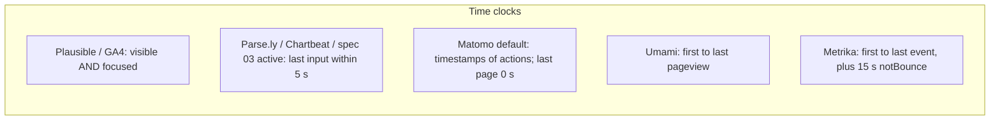
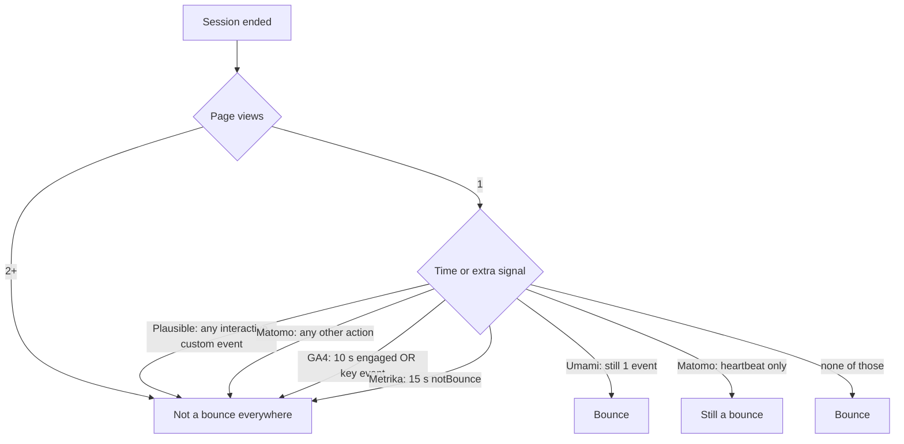

# R9 — Web analytics priorities and engagement (А3, А4, А7)

- Date: 2026-10-07. Researcher T-014, single pass (deep-ish). Not a two-model debate.
- Question: which automatic events the target products ship; how they define visible time, active time, engaged session, and bounce; byte cost per automatic event on Reatom primitives; whether the [03](../03-connect-web-analytics.md#budget-tiers) tier table holds.
- Fallback (unchanged): the tiers in 03 as written. Implementation of WA-6 starts on the engagement paragraph in 03.

Costs below are **estimates**, not `size-limit` numbers. BENCH is still open. Bundle figures are brotli deltas on top of an existing `reatomOpentelemetry` instance that already ships transport, `visibilityAtom`, `onLineAtom`, `urlAtom`, and `onEvent`. Wire figures are uncompressed OTLP/JSON log records inside a batched `resourceLogs` (resource amortized). Gzip/brotli on a batch is roughly 0.3–0.4 of raw.

## 1. What the five products actually collect

Default here means “on after a standard snippet / data-stream create, with no extra plugins.”

| Fact | Plausible | Umami | Matomo | GA4 | Metrika |
| --- | --- | --- | --- | --- | --- |
| Script (order of mag.) | ~1.1–1.2 KB brotli base; ~1.8 KB with outbound+downloads [1][2] | < 2 KB claimed [3] | `matomo.js` tens of KB gzip; uncompressed ~60 KB [4] | `gtag.js` + config, tens of KB | `tag.js`, tens of KB |
| Auto page view | yes | yes (SPA history too) [5] | `trackPageView` in snippet [6] | yes, cannot turn off; history changes via enhanced measurement [7][8] | yes |
| Session timeout | 30 min inactivity [9] | visit hash rotates hourly; not a 30 min idle timer [10] | ~30 min (`visit_standard_length`) | 30 min inactivity, max 7 h 55 min [11] | 30 min inactivity, 30–360 min [12] |
| Visible / focused time | yes: `engagement` event on hide, blur, SPA nav. Clock runs only while `visibilityState === 'visible'` **and** `document.hasFocus()`. First send also if scroll grew; otherwise only if ≥ 3 s since last send [13][9] | no native engagement clock. Duration = last − first **pageview** timestamp; single-page visits are 0 s [10][14] | last page and one-page visits are 0 s unless heartbeat. Heartbeat is **opt-in**. Default 15 s, min 5 s. Ping after focused viewing then leave/blur — not a fixed interval [15][16] | yes: time the page is in focus. `engagement_time_msec` is a **delta** attached to the next event; leftover flushed as `user_engagement` on hide/navigate [17] | duration = first event to last event (pageview, outbound, download, goal, `notBounce`, `params`) [12]. No separate visible-ms field |
| Active time (input idle window) | no | no | no | no (docs say “in focus”; not last-input) [17] | no |
| Engaged session | no named metric. Custom events (unless `interactive: false`) break a bounce [9] | no | no. Heartbeat ping does **not** break a bounce [15][18] | session that **lasts > 10 s** (configurable 10–60 s) **or** has a key event **or** has ≥ 2 page/screen views [19][11] | no named “engaged session”. Closest: not a bounce |
| Bounce | visit with 1 pageview **and** no interactive custom event. Single-page duration counted as 0 s [9] | visit with **exactly 1 event**. Custom events currently excluded from stats SQL (`event_type NOT IN (2, 5)`), so they do not break bounce [10][14][20] | 1 pageview and no other tracked interaction (event, download, goal). Time on page does not matter [18] | complement of engagement rate: session that met **none** of the engaged-session tests [19] | **all three**: ≤ 1 pageview **and** duration < bounce timer (**15 s** default) **and** no `notBounce`. `accurateTrackBounce: true` is the default and fires `notBounce` after 15 000 ms [12][21] |
| Scroll | bundled into `engagement` (`sd` 0–100) [13] | not a first-class metric | content impressions optional | enhanced measurement **on**: one `scroll` at 90 % [7] | scroll map / webvisor, not a cheap default event |
| Outbound / download | **opt-in** script variants [1] | click tracking on by default [5] | `enableLinkTracking` in the default snippet [6] | enhanced measurement **on** (`click` outbound, `file_download`) [7] | `trackLinks: true` default [21] |
| Forms | opt-in `track-form-submissions` [1] | manual | manual | enhanced measurement on (`form_start`, `form_submit`) [7] | goals / forms as goals |
| Web vitals | no | optional `data-performance` [22] | no | no (CrUX / other) | yes in some reports; not the light tag’s job |
| Errors | no | no | no | no | no |
| Ecommerce | opt-in revenue [9] | no | plugin | recommended events, not automatic | `ecommerce: false` default [21] |

What teams on these tools actually look at, in practice: unique visitors / visits, pageviews, bounce or engagement rate, visit duration or time on page, top pages, sources / UTM. Light-Plausible users do **not** look at rage clicks, long tasks, or breadcrumbs. SRE users (А2) do look at errors and web vitals. That split is already the 03 tier 0 vs tier 1 cut.

## 2. Definitions to ship

### Visible time

**Keep 03, with one clarification Plausible and GA4 both make.**

- Count time while `visibilityAtom() === 'visible'` **and** `document.hasFocus()` (the returned `focusAtom`).
- Pause on `hidden`, blur, and (already) page change.
- Do not count background-tab wall clocks.

`visibilityAtom` plus `hiddenAtAtom` / `visibleAtAtom` already exist in core. Focus is a `window` `focus`/`blur` pair via `onEvent` — same listeners Plausible registers [13].

Option A — visibility only, ignore focus: cheaper; over-counts a visible but unfocused window (two monitors, DevTools focused).  
Option B — visible and focused (recommended): matches Plausible [13] and GA4 “page in focus” [17]. A few bytes on listeners already wanted for the flush.

### Active time

**Keep 03.** Visible time that also sits within **5 s of the last input** (pointer, key, scroll, touch). Page load and returning to focus count as the first input, same as Chartbeat [23].

None of the five products do this. The 5 s idle window is Parse.ly `activeTimeout` (default 5, clamp 1–60) [24][25] and Chartbeat’s rolling 5 s engagement window [23]. It is the usual meaning of “active” as opposed to “the tab is merely open.”

Option A — skip active, ship visible only: saves ~150–250 B brotli (no input listeners). Enough for Plausible-like time on page. Idle-open tabs look like readers.  
Option B — both clocks, one flush (recommended): two ints on the same `app.page.engagement` record. No extra wire events. Input listeners are `onEvent` on `window`/`document`; do **not** use `reatomClock` (a 1 Hz tick would burn battery for nothing). Accumulate deltas on visibility/focus/input, like Plausible’s `runningEngagementStart` [13].

Do **not** send Matomo/Parse.ly heartbeats. A 15 s ping on a 5 min page is ~20 extra records. Flush on page change and hide only, as 03 already says. Skip the record when both `visible_ms` and `active_ms` are 0.

Plausible’s ≥ 3 s gate before a repeat engagement send [13] is a good anti-chatter rule for tab switches. First hide/nav still sends (needed so bounced visits have time-on-page, which Plausible does and classic Matomo/Umami do not [9][18][10]).

### Engaged session

**Keep 03, which is GA4 with “active” substituted for “lasts.”**

A session is engaged when any of:

1. `active_ms` summed across pages **> 10 000** (GA4 default 10 s [19]; Metrika’s cousin is 15 s `notBounce` [21])
2. **two or more** `app.page_view` in the session
3. a conversion-marked span (GA4 “key event”; Plausible interactive custom event [9])

Bounce is **not an event**. Backend: `bounce = not engaged`. That is GA4 [19], not UA/Matomo/Umami classic (1 pageview). Docs SQL can also expose classic bounce (`page_views = 1` and no conversion) for people migrating from Plausible/Matomo.

Option A — GA4 10 s on **visible** time: looser; a parked focused tab becomes engaged.  
Option B — GA4 10 s on **active** time (recommended, 03): stricter, closer to “they did something.” SPA landing pages still engage via (2) or (3).  
Option C — Metrika 15 s + emit `notBounce`: extra wire event every session that lasts 15 s. Reject. Fold the timer into the session counters 03 already keeps (page views, events, engaged time).

### Bounce

Do not collect a bounce event. Derive it. The five products disagree:

03’s engaged-session rule is the right default for “teams with no GA/Metrika, or who don’t know how to use them” (03 positioning): it will not report a 4-minute reader of a docs page as a bounce, which Matomo/Umami/classic Plausible duration-0 would.

## 3. Byte-cost estimate per automatic event

### Bundle (brotli, incremental, Reatom primitives)

Reuse, do not reimplement: `visibilityAtom` (and timestamps), `onLineAtom`, `urlAtom` / Navigation API / `popstate`, `onEvent`, the instance logs pipeline and unload flush.

| Automatic fact | Est. brotli | Why that size | Value / byte | Tier |
| --- | --- | --- | --- | --- |
| Page view + navigation source | 400–600 B | branch on `'urlAtom'` / `'navigation-api'` / `'popstate'`; URL reduce; title/referrer/viewport/screen piggybacked. No `history` patch | very high | 0 |
| Session start / rotation + visitor + UTM / click-id / referrer | 500–800 B | storage, 30 min idle, campaign change, cross-tab `storage` events. Attribution lists are data, not code | very high | 0 |
| Consent gating | 200–350 B | read category atoms; pre-consent in-memory ids | required | 0 |
| Engagement clocks + flush on hide/nav | 200–400 B | two timestamps + optional 5 s last-input. Flush is one `effect` on `visibilityAtom` / `urlAtom` | very high | 0 |
| `window.onerror` + `unhandledrejection` + dedup | 250–400 B | two `onEvent`s, signature key, cap 10/min | high (SRE) | 0 |
| Online/offline as its own record | 30–80 B | `onLineAtom` already exists; emit is one `effect` | medium (SRE), rare | 0 |
| Viewport / screen | ~0 extra | fields on `app.page_view` | high | 0 |
| `app.visibility.change` as its own record | 40–80 B code, **every hide/show on the wire** | flush point is free if engagement already listens | low once engagement exists | **do not emit** (see below) |
| `app.focus.change` as its own record | same | `focusAtom` for the clock is enough | low | **do not emit** unless budget leftover |
| Web-vitals adapter | 150–300 B + library **outside** the bundle | 03 already passes `web-vitals` in | very high (SRE) | 1 |
| Peak scroll on the engagement record | 80–150 B | Plausible’s `sd`. If active time already listens to `scroll`, closer to 50 B | high | 0 piggyback **or** 1 if listeners are the reason it is out |
| Scroll threshold events 25/50/75/90 | 150–250 B | GA4 is 90 % only [7] | medium | 1 |
| Outbound + download clicks | 200–400 B | capture-phase click, origin compare, extension list. Plausible pays ~0.5 KB brotli for both [1] | high on content/marketing sites | 1 |
| Form submit | 100–200 B | submit bubbling | medium | 1 |
| Rage clicks | 200–350 B | click clustering | low for target users | 1 |
| Long tasks | 80–150 B | `PerformanceObserver` | SRE, optional | 1 |
| Breadcrumbs | 150–300 B | ring buffer | SRE | 1 |
| Experiment exposure | 80–150 B | first read per session | wanted (А13), budget | 1 |
| Ecommerce schema | 400–800 B | many event names | not automatic | 2 |
| Heartbeat / ping timer | 80–150 B **plus N records/session** | Matomo opt-in [16] | negative vs keepalive | **out** |

Prototype reality check: analytics + web-vitals on the tracer is **4.7 KB** brotli; the 3 KB gate is the base **without** the library [README baseline]. A 3 KB envelope that already contains page view, session, consent, engagement, and errors is tight but plausible if visibility/focus/network are clocks and flush points, not extra catalog events.

### Wire (uncompressed OTLP/JSON, one log in a batch)

OTLP attribute wrapping is the tax. Common fields on every analytics record (`event.name`, `session.id`, `app.visitor.id`, `url.path`, `app.analytics.consent`, plus `timeUnixNano` / ids / `eventName`) are ~500–700 B before event-specific keys. README e2e (14 events + 10 spans ≈ 13 KB) implies ~500 B average mixed; analytics logs with full attribute dictionaries sit higher.

| `eventName` | Extra attributes | Est. raw / record | Typical count / session | Notes |
| --- | --- | --- | --- | --- |
| `app.page_view` | url, title, referrer, viewport, screen, UTM | 1.1–1.5 KB | 1–N | fattest default |
| `app.session.start` | `session.previous_id`, first/last touch | 1.0–1.4 KB | 1 | |
| `app.page.engagement` | `visible_ms`, `active_ms` | 0.7–0.9 KB | 1 per page (hide or nav) | |
| `app.visibility.change` | `app.visibility.state` | ~0.7 KB | 2 per tab switch | **redundant** with engagement flush |
| `app.focus.change` | `app.focus.state` | ~0.7 KB | many | drop |
| `app.network.change` | `network.online` | ~0.65 KB | 0–2 | keep, rare |
| `exception` (type only) | `exception.type` | ~0.7 KB | bursty, capped | |
| `browser.web_vital` | name, value, delta, id, rating | ~0.9 KB | ≤ 5 / page | module |
| Heartbeat ping | time delta | ~0.7 KB × ticks | 4–20 / page | reject |

Unload budget is 60 KiB keepalive. A bounced session (page view + session start + one engagement) is ~3 KB raw. A 10-page SPA with flushes is ~15–20 KB raw. Periodic heartbeats are how a quiet tab blows the budget.

GA4 piggybacks `engagement_time_msec` on the **next** event [17] instead of a dedicated record. We could attach visible/active ms to `app.page_view` of the *next* page and only emit `app.page.engagement` on hide. That saves one record on internal navigations. **Do not do it in v1:** hide-without-next-page is the bounce case we must not lose (Plausible’s reason for `engagement` [9]). Dedicated flush on hide + page change is the right default.

## 4. Ranking vs 03 tiers

Value per byte, given А1 (~3 KB), А2 (SRE, no BI dashboards for 6–12 months), А7 (engagement), А9 (no manual API in analytics):

1. Page view, session, visitor, UTM, referrer — without these there is no analytics.
2. Engagement flush (visible + active) — fixes the single-page / last-page 0 s lie that Umami and default Matomo still ship [10][15].
3. Errors with type-only + dedup — SRE, already mandatory (А29).
4. Consent + pre-consent in-memory clocks — required for А18.
5. Online/offline emit — cheap because the atom exists; useful when the tracer’s online buffer drops.
6. Web vitals — high SRE, library must stay outside (А28) → tier 1.
7. Peak scroll on the engagement record — high, almost free if scroll is already observed for active time. Still listed as tier 1 in 03; **do not promote the 25/50/75/90 event stream**. Optional piggyback `app.engagement.scroll_pct` on the existing flush is a later additive field (R2 / schema).
8. Outbound / download — default **on** in GA4, Matomo, Metrika, Umami; **opt-in** in Plausible. 03 is Plausible-style, so module is correct.
9. Forms, rage clicks, long tasks, breadcrumbs, experiments — module. Experiments are wanted (А13) and stay out of tier 0 only because of bytes.
10. Ecommerce, monkeypatch — tier 2 / opt-in, as written.

**Fallback holds.** Do not move items between tiers. Two implementation cautions so the 3 KB gate survives:

- Treat visibility and focus as **flush points and clocks**, not as `app.visibility.change` / `app.focus.change` records, unless `size-limit` still has room. Schema 05 lists those names; emitting them by default doubles the hide path. WA-6 acceptance is “engagement is flushed on page change and on hide,” which does not require the extra eventNames.
- Do not add a heartbeat.

## 5. Recommendation (WA-6 defaults)

| Knob | Value | Why |
| --- | --- | --- |
| Visible ms | `visibility === 'visible'` and `hasFocus` | Plausible [13], GA4 [17] |
| Active ms | visible ms within 5 s of last pointer / key / scroll / touch; load and refocus count as input | Parse.ly / Chartbeat [24][23]; 03 |
| Flush | `app.page.engagement` on URL change and on hide (and unload via the instance flush) | 03, Plausible [13] |
| Skip | both clocks 0 | avoid empty records |
| Anti-chatter | if a hide/show pair is < 3 s and scroll did not change, fold into the next flush | Plausible 3 s [13] |
| Engaged session | active > 10 s **or** ≥ 2 page views **or** conversion-marked span | GA4 [19] with active instead of wall/visible |
| Bounce | derived, not collected | GA4 [19] |
| Heartbeat | off | wire cost |
| `app.visibility.change` / `app.focus.change` | do not send in tier 0 | flush already covers hide |

Session idle 30 min, campaign rotation, midnight optional: R10, not this note.

## 6. Options rejected

| Option | Why not |
| --- | --- |
| Classic bounce only (1 pageview) | Lies on docs/SPA/landing pages. Umami maintainers know this [14]. Metrika and GA4 already left it. |
| Metrika `notBounce` event at 15 s | Extra automatic event every non-bounce session. The 10 s active counter is enough. |
| Matomo heartbeat default 15 s | Extra records; ping does not even break bounce [18]. |
| GA4 enhanced-measurement set in tier 0 (90 % scroll, outbound, file, form, YouTube) | Breaks the 3 KB budget. Those are exactly 03 tier 1. |
| Piggyback engagement ms only on the next page view | Loses bounced and last-page time, the bug 03 is trying to avoid. |
| `reatomClock` for the 5 s window | Tick cost; event-driven last-input timestamp is enough. |

## Sources

1. Plausible tracker size tables (script v2 PRs), e.g. https://github.com/plausible/analytics/pull/5385 — base `plausible.js` ~1184 B brotli; outbound+file-downloads ~1849 B.
2. Same family: https://github.com/plausible/analytics/pull/5465 — `plausible.js` ~1158 B brotli.
3. Umami tracker size: https://github.com/umami-software/umami/issues/1430
4. Matomo `matomo.js` size discussion: https://github.com/matomo-org/matomo/issues/19541
5. Umami tracker config / SPA / functions: https://docs.umami.is/docs/tracker-configuration — https://docs.umami.is/docs/guides/track-single-page-apps — https://docs.umami.is/docs/tracker-functions
6. Matomo default snippet (`trackPageView`, `enableLinkTracking`): https://developer.matomo.org/guides/tracking-javascript-guide
7. GA4 enhanced measurement events: https://support.google.com/analytics/answer/9216061
8. GA4 automatic page_view: https://developers.google.com/analytics/devguides/collection/ga4/views
9. Plausible metrics definitions (bounce, visit duration, time on page, 30 min session, custom events): https://plausible.io/docs/metrics-definitions
10. Umami metric definitions (bounce = 1 event; duration from first/last timestamp, multi-page only): https://docs.umami.is/docs/metric-definitions
11. GA4 session (30 min; engaged session): https://support.google.com/analytics/answer/12798876 — https://support.google.com/analytics/answer/9191807
12. Yandex Metrica glossary (bounce, session, time on site): https://yandex.com/support/metrica/en/general/glossary — https://yandex.com/support/metrica/ru/general/glossary
13. Plausible tracker `engagement.js` (visible+focus clock, 3 s gate, scroll depth, send on hidden/blur): https://github.com/plausible/analytics/blob/master/tracker/src/engagement.js
14. Umami heartbeat / bounce issue: https://github.com/umami-software/umami/issues/3518 — stats SQL excluding custom events: https://github.com/umami-software/umami/blob/master/src/queries/sql/getWebsiteStats.ts
15. Matomo last-page 0 s and heartbeat FAQ: https://matomo.org/faq/how-to/faq_21824/
16. Matomo JS API `enableHeartBeatTimer(activeTimeInSeconds)` default 15, min 5, ping on leave/blur after focused viewing: https://developer.matomo.org/api-reference/tracking-javascript
17. GA4 user engagement / `engagement_time_msec` / `user_engagement`: https://support.google.com/analytics/answer/11109416
18. Matomo bounce (time does not matter; heartbeat does not break bounce): https://matomo.org/faq/reports/can-i-change-the-bounce-rate-setting-in-matomo/
19. GA4 engagement rate and bounce rate: https://support.google.com/analytics/answer/12195621
20. Umami API `bounces`: https://docs.umami.is/docs/api-reference/get-website-stats
21. Metrika tag init (`accurateTrackBounce` default true = 15 000 ms, `trackLinks` true, `clickmap` true, `webvisor` / `ecommerce` false): https://yandex.com/support/metrica/en/code/counter-initialize
22. Umami web vitals / `data-performance`: https://docs.umami.is/docs/metric-definitions
23. Chartbeat 5 s rolling engagement window: https://help.chartbeat.com/hc/en-us/articles/360045890913-User-Engagement-Tracking-Methodology
24. Parse.ly engaged time / `activeTimeout` default 5 s: https://www.parse.ly/glossary/engaged-time/ — https://docs.parse.ly/installation-resources/parsely-integration/tracking-code-setup/engaged-time/
25. Parse.ly heartbeat docs: https://docs.parse.ly/user-handbook/measuring-reporting-performance/calculations/engaged-minutes/heartbeat/
26. Issue #1272 original analytics list (visibility, focus, online, UTM, optional errors/breadcrumbs/web-vitals): https://github.com/reatom/reatom/issues/1272
27. Schema event catalog: [05](../05-telemetry-schema.md#analytics-events)
28. Spec engagement proposal until R9: [03](../03-connect-web-analytics.md#engagement-а7)
